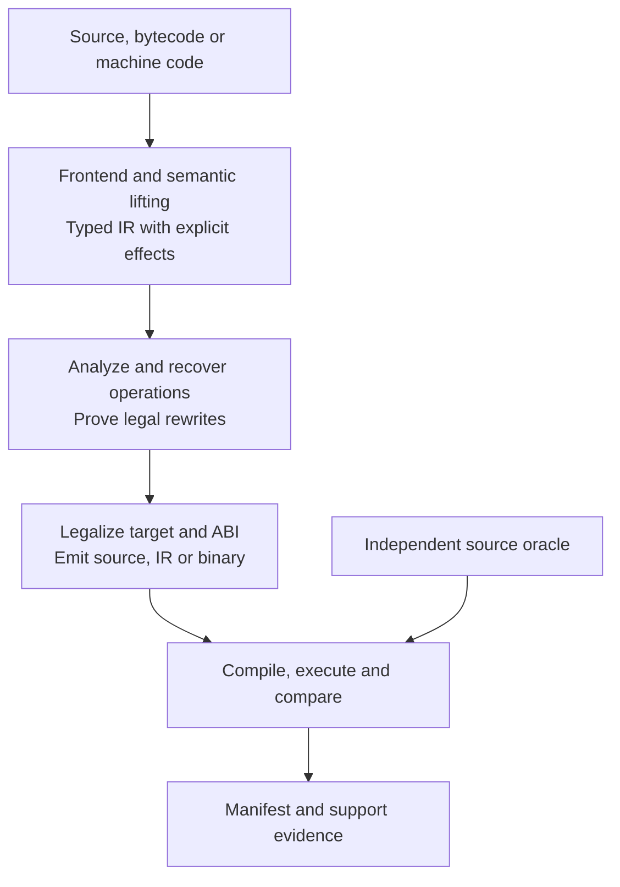

# Polypiler

[](https://github.com/Hawkynt/Polypiler/blob/main/LICENSE)
[](https://github.com/Hawkynt/Polypiler)

[](https://github.com/Hawkynt/Polypiler/actions/workflows/ci.yml)


[](https://github.com/Hawkynt/Polypiler/stargazers)
[](https://github.com/Hawkynt/Polypiler/network/members)
[](https://github.com/Hawkynt/Polypiler/issues)


[](https://github.com/Hawkynt/Polypiler/releases/latest)
[](https://github.com/Hawkynt/Polypiler/releases)
[](https://github.com/Hawkynt/Polypiler/releases)

> **Write or recover an algorithm in one language. Compile it into another. Preserve its semantics. Optimize for the target.** Polypiler is a cross-language optimizing compiler and transpiler that lifts algorithms from source code, bytecode or machine code into one verified intermediate representation and emits readable, tested, target-native implementations — from C#, JavaScript and Rust to PowerBASIC, LLVM IR and MOS 6502.

## 🧭 Vision

**Polypiler** is a planned, cross-language optimizing compiler and algorithm ecosystem. Its goal is to accept algorithm implementations written in supported source languages—or recovered from supported intermediate and machine-code formats—and generate readable, executable, verified implementations for other languages, runtimes, processors and operating environments.

It is designed to do more than translate syntax. Polypiler recognizes the *computation* represented by source code, type patterns, library operations, pointer arithmetic, inline assembly and machine instructions. It can reverse source-specific optimizations, reconstruct higher-level operations, then choose a different implementation suited to the destination.

**Project status: specification and initial implementation planning.** This README describes the intended product, not a finished transpiler. The commands and language combinations below are **planned interfaces and acceptance scenarios**, not claims that they already work. The one exception is a first prototype that translates a small subset of C# and of JSDoc-typed JavaScript to JavaScript or C#; [Quick start](#-quick-start) shows it and says where it ends. The detailed agent implementation contract is in [PRD.md](docs/PRD.md).

A correct algorithm should not need to be manually rewritten for every programming language and processor. Polypiler aims to make algorithm implementations portable through a common, semantically precise intermediate representation (IR) and a verifier-driven compiler pipeline.

The same engine should eventually support:

- **Source → source:** JavaScript Cipher implementation → C#, PowerBASIC → Rust, Kotlin deinterlacer → Perl.
- **Source → executable:** C# numeric algorithm → DOS x86-16 executable, Rust bit manipulation → MOS 6502 machine code.
- **Binary/bytecode → source:** MSIL → PHP, JVM bytecode → Delphi, x86 → C++, ARM → PowerBASIC, MOS 6502 → C#.
- **IR interchange:** LLVM `.ll` / `.bc` → Polypiler → other languages, and Polypiler → LLVM IR for compatible toolchains.
- **Algorithm distribution:** Import a tested algorithm from the catalogue and generate only its relevant implementation, runtime helpers, tests and dependencies.

Every pair is useful only when the supported language subset, source semantics, target runtime, external dependencies and ABI have been independently verified. Polypiler will report unsupported features instead of fabricating superficially plausible code.

## ✨ Features

All of the following is **planned** — nothing is advertised as working before its verification gate passes.

- **Source → source translation** between C#, JavaScript, Rust, C, C++, Kotlin, Perl, Python, PowerBASIC and more — every language planned as both input and output.
- **Binary and bytecode recovery** — MSIL, JVM, WebAssembly, LLVM IR, tokenized BASIC, x86/x64, ARM and 6502 lifted back to readable source.
- **Native executables** for constrained targets such as 8086 DOS and MOS 6502.
- **Semantic recovery and de-optimization** — popcount, min/max, rotations, bit permutations, unrolled and interleaved loops recognized regardless of how they were written.
- **Proof-driven optimization** — every rewrite backed by range/alias facts, exhaustive small-width tests or SMT bitvector proofs.
- **De-dynamicization** — JavaScript, Python and Perl specialized into typed code with guarded fallbacks.
- **Foreign libraries and ABIs preserved** — native bindings, binary-compatible UDTs and marshalling plans.
- **Rich language features lowered** — generics, classes, closures, exceptions, coroutines and async turned into dispatch tables, state machines and cleanup code for targets that lack them.
- **Verification built in** — generated code is compiled, executed and compared against independent oracles before a pair is called supported.

## 🧩 Support matrix

What works **today**, per direction. A frontend reads the language, a backend writes it; the two advance
separately, and supporting one is no evidence for the other. Every cell is backed by tests that run the
generated code — a row changes only in the pull request that makes it true.

`✅` full for the declared subset · `⚠️` partial, explained in the row · `—` not yet (planned).

### Languages

| Language | Dialect / version | Frontend | Backend | Notes |
| --- | --- | :---: | :---: | --- |
| C# | C# 14, .NET 10 | ⚠️ | ⚠️ | Prototype subset. The frontend imports one static class of static methods over every integer type from `sbyte` to `ulong`, `char`, `float`, `double`, `bool` and one-dimensional arrays of the numeric types, with the promotions and conversions of C# and `checked`/`unchecked`; `if`, `while`, `do`, `for`, `foreach` over an array, `switch` with constant labels, `break`, `continue`, `++`/`--` as values; `const` and `static readonly` fields as constants and read-only tables; `Array.Copy`/`Fill`/`Clear`; the exact operations of `Math`, `MathF`, `BitOperations` and `BitConverter`. It refuses `decimal`, strings, classes with state, generics, lambdas, exceptions, `goto`, pattern matching, `ref`/`out` and the transcendental functions. The backend writes every construct the two frontends import as one static class of static methods: every integer type from `sbyte` to `ulong`, `float`, `double`, `bool` and their arrays (a `char` as the `ushort` it is in the IR); wrap-around arithmetic in an `unchecked` block and trapping arithmetic and conversions as `checked(…)` expressions, so that the project's overflow setting changes nothing; a cast to `float` on every binary32 result; `if`, `while`, `do`, `switch` with one block per section, `break`, `continue`, `++`/`--`, and a real `for` where the step is one statement (otherwise a `while` that repeats the step before each `continue`); constants as `private const` and tables as `private static readonly` arrays; the library operations as calls of `Math`, `MathF`, `BitOperations`, `BitConverter` and `Array`; a private helper only where no cast has the IR's result. It reconstructs no `foreach` and no compound assignment, and refuses with `PLY1052` only IR it does not know |
| JavaScript | ES2022 scripts and modules, Node | ⚠️ | ⚠️ | Prototype subset. The frontend imports functions typed in JSDoc (`int32`, `uint32`, `uint8`, `boolean`, `Uint8Array`/`Int32Array`/`Uint32Array`) — declarations and the function-valued properties of one object literal — whose arithmetic is coerced where it stands (`\| 0`, `>>> 0`, a bitwise operand, an index, a typed-array store) or written as `Math.imul`; typed arrays with element access and `length`; `if`, `while`, `for`; no closures, objects, strings, `BigInt`, 64-bit or floating-point values. The backend writes every construct the C# frontend imports as an ES module: integers of up to 32 bits as numbers with explicit wrap-around, `long`/`ulong` as `BigInt` cut with `BigInt.asIntN`/`asUintN`, `float` rounded with `Math.fround` after every operation, arrays and constant tables as typed arrays from `Int8Array` to `BigUint64Array` and `Float64Array`, `switch`, `do`, `break` and `continue`, checked arithmetic and conversions that throw a `RangeError`, and helper functions only for what a module uses |
| PowerBASIC | DOS 3.5 (`pb35`), `pb36` | — | — | |
| C | C11 / C17 / C23 | — | — | |
| C++ | C++17 / 20 / 23 | — | — | |
| Rust | 2024 edition | — | — | |
| Kotlin | JVM | — | — | |
| Perl | Perl 5 | — | — | |
| Python | 3.x | — | — | |
| TypeScript | current | — | — | |
| Java | JDK 17 / 21 | — | — | |
| Go | current | — | — | |
| Delphi / Object Pascal | Free Pascal in Delphi mode | — | — | |
| FreeBASIC | `-lang fb`, `-lang qb` | — | — | |
| PHP | 8.x | — | — | |
| Ruby | 3.x | — | — | |
| Visual Basic .NET | VB 16 on .NET | — | — | |
| Visual Basic 6 | classic VB6 (source, forms excluded) | — | — | No freely available compiler: needs an oracle decision first |
| VBA | Office VBA 7 | — | — | Shares the classic VB core; host object models are external |
| VBScript | VBScript 5.8 (Windows Script Host) | — | — | Variant-only typing: imported through the dynamic-language path |
| Commodore BASIC | V2 (C64); VIC-20 and C128 as profiles | — | — | |

### Bytecode, intermediate and machine-code formats

For these, the frontend *lifts* (decodes and recovers semantics) and the backend *emits* (encodes).

| Format / instruction set | Dialect / variant | Lift | Emit | Notes |
| --- | --- | :---: | :---: | --- |
| .NET MSIL | ECMA-335 assemblies | — | — | |
| JVM bytecode | class files, jars | — | — | |
| WebAssembly | core specification, binary modules | — | — | |
| LLVM IR | `.ll` text, `.bc` bitcode | — | — | |
| GCC GIMPLE / GENERIC | GCC's own intermediate language, per GCC version | — | — | Feasibility study first: reached through a GCC plugin or dump, never through LLVM |
| MOS 6502 | NMOS; 65C02 and 65C816 as variants | — | — | |
| Zilog Z80 / Intel 8080 | | — | — | |
| 8086 / x86-16 | real mode, DOS `MZ` and `COM` | — | — | |
| x86 (32-bit) / x64 | integer core; extensions in the table below | — | — | |
| ARM32 / Thumb, AArch64 | AAPCS, AAPCS64 | — | — | |
| Commodore BASIC tokenized | C64 PRG; VIC-20, C128 | — | — | |
| GW-BASIC tokenized | | — | — | |
| Microsoft BASIC p-code | per dialect, after an inventory | — | — | |

### Instruction-set extensions

A CPU family is not one instruction set. Each extension is lifted and emitted separately, and a target
profile names exactly the ones it may use; an instruction of an extension that is not lifted yet is
preserved as an opaque operation, never dropped.

| Family | Extension | Lift | Emit | Notes |
| --- | --- | :---: | :---: | --- |
| x86 / x64 | x87 FPU | — | — | 80-bit extended precision, stack registers |
| x86 / x64 | MMX | — | — | 64-bit integer vectors |
| x86 / x64 | SSE, SSE2 | — | — | 128-bit float and integer vectors; scalar float arithmetic on x64 |
| x86 / x64 | SSE3, SSSE3, SSE4.1, SSE4.2 | — | — | horizontal operations, byte shuffle, blends, string compares, CRC32 |
| x86 / x64 | AES-NI, PCLMULQDQ, SHA | — | — | cipher rounds, carry-less multiply, hash rounds |
| x86 / x64 | AVX, AVX2, FMA3, F16C | — | — | 256-bit vectors, fused multiply-add, half-float conversion |
| x86 / x64 | AVX-512 (F, BW, DQ, VL, VBMI, VNNI) | — | — | 512-bit vectors, mask registers |
| x86 / x64 | BMI1, BMI2, POPCNT, LZCNT, ADX | — | — | bit manipulation, PEXT/PDEP, multi-precision carry chains |
| ARM32 / AArch64 | NEON (Advanced SIMD), VFP | — | — | 128-bit vectors, floating point |
| AArch64 | Cryptography extensions (AES, SHA, PMULL), CRC32 | — | — | |
| AArch64 | SVE, SVE2 | — | — | scalable vectors |

Every language and format above is planned in **both** directions. LLVM integration broadens access to
LLVM-based source frontends such as Clang; it **does not** automatically expose every GCC language
frontend. GCC GENERIC/GIMPLE requires a separate verified adapter.

## 📦 Installation

Nothing has been released yet. Once the first alpha lands, self-contained `polypiler` binaries for Windows and Linux are published on the [releases page](https://github.com/Hawkynt/Polypiler/releases) — dated releases and automatic nightlies. Until then, build from source (see [🛠️ Building](#️-building)); the only requirement is the .NET 10 SDK.

## 🚀 Quick start

One public command name is planned: `polypiler`. Today it has a single working command, the prototype below. Every other example in this section establishes the product interface and **will not run until the corresponding features have been implemented and verified.**

### Run the prototype: a small C# algorithm to a JavaScript module

```bash
# Works today, from a checkout with the .NET 10 SDK
dotnet run --project Polypiler.Cli -c Release -- translate tests/fixtures/prototype/Adler32.cs \
  --from csharp --to javascript --output ./generated

# The generated module runs as it is; this prints 300286872, the published Adler-32 of "Wikipedia"
node --input-type=module -e "import { Compute } from './generated/Adler32.mjs'; console.log(Compute(new TextEncoder().encode('Wikipedia')))"

# The same subset written back out as C# (prototype subset): ./generated/Adler32.cs, here in a namespace
dotnet run --project Polypiler.Cli -c Release -- translate tests/fixtures/prototype/Adler32.cs \
  --from csharp --to csharp --namespace Demo.Checksums --output ./generated
```

This is a walking skeleton, not the product: one thin path from source to generated code, without optimization, analysis or `--verify`.

- **Input:** one C# file holding one `static class` of `static` methods and constants.
  - **Types:** `sbyte`, `byte`, `short`, `ushort`, `char`, `int`, `uint`, `long`, `ulong`, `float`, `double`, `bool`, and one-dimensional arrays of the numeric ones.
  - **Expressions:** arithmetic, bitwise, shift, comparison and logical operators with the promotions of C# (`uint` with `int` is computed as `long`), `?:`, every cast between numeric types, `checked` and `unchecked`, `++`/`--` as statements and as values, compound assignment to variables and array elements, calls within the class.
  - **Statements:** `if`/`else`, `while`, `do … while`, `for`, `foreach` over an array, `switch` on an integer or `char` with constant labels, `break`, `continue`, `return`, local `const`.
  - **Constants and tables:** `const` fields, and `static readonly` fields whose initializer is a constant or — for an array — a list of constants (`new uint[] { … }`, `{ … }`, `[ … ]`). A table is read-only: it can be indexed, measured, iterated and copied from.
  - **Arrays:** `new T[n]`, `new T[] { … }`, `Length`, `Array.Copy(source, sourceIndex, target, targetIndex, length)`, `Array.Fill(array, value)`, `Array.Clear(array)`.
  - **Base library, where the result is exact:** `Math`/`MathF` `Abs`, `Min`, `Max`, `Sign`, `Sqrt`, `Floor`, `Ceiling`, `Truncate`, `Round` (to even, or `MidpointRounding.AwayFromZero`), `Math.BigMul(uint, uint)`; `BitOperations` `RotateLeft`, `RotateRight`, `PopCount`, `LeadingZeroCount`, `TrailingZeroCount`, `Log2` on `uint` and `ulong`; `BitConverter` `DoubleToInt64Bits`, `Int64BitsToDouble`, `SingleToInt32Bits`, `Int32BitsToSingle`; the constants of the numeric types such as `uint.MaxValue`.
- **Output:** `<class>.mjs`, an ES module that exports every `public` method and states above each function what crosses its boundary.
  - Integers of up to 32 bits and floating-point numbers are JavaScript numbers; `long` and `ulong` are `BigInt`s. Arrays are the typed array of their element type, from `Int8Array` to `BigUint64Array` and `Float64Array`.
  - Integers wrap around at their width as in C#, shift counts are masked, and `float` arithmetic is rounded to binary32 after every operation. Conversions from floating point to an integer saturate as .NET 10 does them.
  - What throws in C# throws a `RangeError`: a division by zero, an index outside its array, `MinValue / -1`, and every overflow in a `checked` context.
- **Output with `--to csharp`:** `<class>.cs`, one `public static class` with a method per function — `public` where the source was — in the file-scoped namespace `--namespace` names, or in none. It holds everything the input list names.
  - Arithmetic that wraps around stands in an `unchecked` block and what was `checked` in a `checked(…)` expression, so the file computes the same with and without `CheckForOverflowUnderflow`. Every `float` result is cast to `float`, so that it is binary32 wherever the file is compiled.
  - A division by zero, an overflow in a checked context, the one quotient that does not fit and an index outside its array throw `DivideByZeroException`, `OverflowException` and `IndexOutOfRangeException`; `Array.Copy` reports a range outside an array as an `ArgumentException`.
  - Constants come back as `private const` fields, tables as `private static readonly` arrays that no method writes to, a `char` as `ushort`, and the library operations as the calls of `System.Math`, `MathF`, `BitOperations`, `BitConverter` and `Array` they were, named in full.
  - A `for` with a `continue` comes back as a `for` when its step is one statement and otherwise as a `while` that runs the step before each `continue`; any other `for` and every `foreach` come back as a `while`, and `x += y` as `x = x + y`.
- **Everything else is refused, not approximated:** `decimal`, `Half`, `Int128`, `nint`, strings and text operations on `char`, spans, multi-dimensional and jagged arrays, `bool[]`, classes with state, generics, lambdas, exceptions, `goto`, pattern matching and `ref`/`out` are reported as `PLY1002` with their position, and nothing is written. So are the transcendental functions (`Math.Sin`, `Math.Pow`, …), whose results are not the same bits on every runtime, and every write to a `static readonly` array. LINQ is not referenced at all, so its use is a compiler error.
- **Exit codes:** 0 success, 2 usage error (`PLY0001`), 3 unsupported construct (`PLY1002` in the source, `PLY1052` for IR the C# backend cannot write), 4 invalid C# (`PLY1000`, or `PLY1003` for a constant expression that overflows, each with the compiler's own message), 70 internal error.

The pair C# → JavaScript is `executed` on the fixtures in `tests/fixtures/prototype` and `tests/fixtures/prototype/wide`: every call of every fixture has the same outcome in `node`, in the IR interpreter and in the fixture as the C# compiler built it. The pair C# → C# is `executed` on the same fixtures: every call has the same outcome in the generated C#, compiled with and without overflow checking, in the interpreter and in the fixture itself. Neither is `verified`.

### Run the prototype: JSDoc-typed JavaScript to C# or JavaScript

```bash
# Works today: two functions of Cipher's OpCodes.js, pinned in this repository, become ./generated/OpCodes.cs
dotnet run --project Polypiler.Cli -c Release -- translate tests/fixtures/prototype/js/OpCodes.js \
  --from javascript --to csharp --export RotL32,RotR32 --namespace Cipher --output ./generated

# A JavaScript module goes through the same IR and comes out as a module again; this prints 300286872
dotnet run --project Polypiler.Cli -c Release -- translate tests/fixtures/prototype/js/adler32.mjs \
  --from javascript --to javascript --output ./generated
node --input-type=module -e "import { compute } from './generated/adler32.mjs'; console.log(compute(new TextEncoder().encode('Wikipedia')))"
```

JavaScript has no static types, so this importer takes them from where the source states them and insists that the source says what it means.

- **Which functions:** `function` declarations, `export function`, and the function-valued properties of an object literal that stands at the top level or directly inside the one immediately invoked function that wraps the file. `--export <name>[,<name>...]` imports the named functions and what they call; without it every function of the file must import. Only the functions are read — what a file does while it loads is not.
- **Types come from JSDoc:** `@param {type} name` and `@returns {type}` with `int32`, `uint32`, `uint8`, `boolean`, `uint8[]`/`Uint8Array`, `int32[]`/`Int32Array`, `uint32[]`/`Uint32Array`; without `@returns` a function returns nothing. A type is a contract: JavaScript does not check an argument, and neither does the imported code.
- **Expressions are typed by JavaScript's own rules:** `| & ^ ~ << >>` yield an `int32`, `>>>` a `uint32`, `Math.imul` multiplies in 32 bits. The result of `+` and `-` is a number and is accepted only where it is coerced at once — `(a + b) | 0`, `>>> 0`, as a bitwise operand, as an index, or stored into a typed array. `a * b` is refused wherever it stands, because above 2^53 it loses digits that a 32-bit multiplication keeps; division is `(a / b) | 0` or `(a / b) >>> 0`. A local has the type of its initializer.
- **Everything else is refused, not approximated:** an uncoerced number is `PLY1103`, a missing or unsupported JSDoc type (`number`, `string`, `BigInt`, `uint16`, the 64-bit types) is `PLY1101`, and closures, objects, classes, `this`, strings, regular arrays, exceptions, `==`, `switch`, `break`, `continue`, `do` and a `var` used outside its block are `PLY1102` — each with its position, one diagnostic per refused function, and nothing is written. An integer of one type used as another must be coerced too: nothing is inferred from how a value is used.
- **Known differences are announced:** where the imported code cannot behave like the original, the command says so in a note. `js-oob-read`: outside its typed array JavaScript reads `undefined` and ignores a write; the imported code traps. `js-div-zero`: JavaScript divides by zero to `Infinity` or `NaN`; the imported code traps. `js-step-wrap`: `i++` counts on beyond 32 bits in JavaScript; the imported code wraps around, as `(i + 1) | 0` does.
- **Exit codes:** as above, with 3 for `PLY1101` to `PLY1104` (`PLY1104`: `--export` names a function the file does not have) and 4 for a syntax error (`PLY1100`, with the parser's own message).

Of the 155 functions that stand directly in the `OpCodes` object, 37 import today; `tests/fixtures/prototype/js/OpCodes.import.txt` lists every one with the reason it is refused. The pairs JavaScript → JavaScript and JavaScript → C# are `executed` on the fixtures in `tests/fixtures/prototype/js` — `node` running the original is the oracle — not `verified`.

### Translate an existing algorithm

```bash
# A JavaScript checksum from Cipher to a compiled C# library
polypiler translate path/to/Cipher/algorithms/checksum/example.js \
  --from javascript --to csharp --runtime net9.0 \
  --verify --output ./generated/checksum-csharp

# A PowerBASIC numeric kernel to Rust
polypiler translate path/to/example.bas \
  --from powerbasic --dialect pb35 --to rust \
  --verify --output ./generated/example-rust

# A Kotlin CPU deinterlacer to Perl
polypiler translate path/to/Deinterlacer.kt \
  --from kotlin --to perl --profile perl5 \
  --verify --output ./generated/deinterlace-perl
```

### Translate a lower-level representation

```bash
# LLVM bitcode, preserving supported ABI/effect contracts
polypiler translate kernel.bc --from llvm --to csharp \
  --verify --output ./generated/kernel-csharp

# A supported C# algorithm as an 8086 DOS executable
polypiler translate Checksum.cs --from csharp --to x86-16 \
  --os dos --cpu 8086 --verify --output ./generated/checksum-dos

# A 6502 binary routine to C# (machine profile/entry point required)
polypiler recover checksum.bin --from mos6502 --to csharp \
  --cpu mos6502 --entry 0x8000 --verify --output ./generated/checksum-csharp
```

### Inspect and verify optimizations

```bash
polypiler inspect path/to/algorithm.cs --from csharp \
  --show types,ranges,effects,patterns,ir,proofs

polypiler capabilities --from kotlin --to perl --profile perl5

polypiler verify ./generated/checksum-csharp \
  --against ./tests/fixtures/checksum-vectors.json
```

### Generate an existing catalogue algorithm

```bash
polypiler search "Floyd-Steinberg"
polypiler generate color.dithering.floyd-steinberg \
  --to rust --verify --output ./generated/floyd-steinberg
```

The catalogue and publishing workflows are later deliverables. A generated package is not automatically published to NuGet, crates.io, npm, CPAN, PyPI or any other registry.

## 📚 Documentation

Before starting work, follow the [issue-writing standard](ISSUES.md) and its
[Ready and Blocked examples](docs/examples/ISSUE-READINESS.md).

Start with the [documentation index](docs/README.md), then follow the [end-to-end compilation flow](docs/architecture/PIPELINE.md), [IR and analysis contracts](docs/architecture/IR.md), [semantic recovery](docs/architecture/SEMANTIC-RECOVERY.md), [foreign interoperability](docs/architecture/INTEROP.md), and [verification gates](docs/quality/VERIFICATION.md). The [full PRD](docs/PRD.md) remains the normative implementation plan; these pages describe the proposed design, not shipped features.

## 🔬 What makes it different

### Recover semantics before optimizing

An algorithm may already contain hand-written bit tricks, custom unrolling, interleaved computations, compiler-generated state machines, or inline assembly. Polypiler aims to recognize operations such as `PopCount`, `Min`, `Max`, multiplication, bit permutation, memory copy, matrix multiplication, loop maps/reductions and deterministic disposal regardless of the particular implementation pattern.

Recognition and instruction selection are separate. For example, the same recovered bit permutation might become PEXT/PDEP on a compatible CPU, masks and shifts on another, or an 8-bit assembly routine on a 6502. A recognized sequence is rewritten only when its equivalence preconditions and effects are proven.

### One optimization middle-end, many frontends and backends

The intended architecture is:



The IR must preserve source-language arithmetic, conversions, ownership, error handling, runtime identity and observable effects. Native operations and external code are neither discarded nor treated as permanently opaque if their semantics can be recovered.

### Specialize dynamic code into typed code

When an algorithm's actual values and call contracts permit it, Polypiler should recover concrete types from JavaScript, Python and Perl and replace dynamic objects, conversions and boxed collections with typed values, arrays, records, spans or buffers. Speculative fast paths require guards and valid fallbacks; only proven cases can be lowered without runtime checks.

### Support old and new machines

The target profile may describe .NET 9, .NET Framework 2.0-compatible helper code, modern x86/x64, ARM, GPU/NPU runtimes or 8086/6502-class systems. Bounds checks, integer widths, pointers, banked memory, CPU flags, stack behavior and memory-mapped I/O are part of the compilation problem—not implementation details the translator can ignore.

### Preserve foreign libraries and ABIs

Polypiler should generate native target-language bindings for recognized external calls: for example, C declarations using a DLL can become PowerBASIC `DECLARE ... LIB ... ALIAS` declarations for the same compatible Windows DLL.

It must also synthesize binary-compatible target UDTs, byte-backed records, `pack`/`unpack` marshaling, unaligned accessors and ABI bridge code when native target representations have different padding, alignment or calling conventions. A byte-compatible structure is not necessarily callable **by value** under another ABI. Unknown external calls or memory effects are preserved or explicitly diagnosed, never erased.

### Lower rich language features to constrained targets

Generics, classes, abstract classes, interfaces, multiple/diamond inheritance, anonymous types, structural records, enums, closures, overloads, operator overloads, variadic functions, type-switch and pattern-matching expressions, exceptions, `On Error Resume Next`, `using`, RAII, generators, coroutines, async/await and iterators should be represented semantically.

When the target lacks a feature, Polypiler can specialize it away or generate explicit UDTs, dispatch tables, state machines, cleanup control flow and minimal runtime helpers. Observable behavior must be preserved. A real-time DOS or 6502 target may reject capabilities its environment cannot implement within its resource constraints.

## 💡 Prior art and reference corpora

Polypiler is designed to build on, and later gradually replace duplicated compiler functionality in, existing projects. Those projects remain independently usable until verified migration gates pass.

| Project | Candidate contribution |
|---|---|
| [PB-Compiler](https://github.com/Hawkynt/PB-Compiler) | Typed SSA, range/known-bits passes, PowerBASIC semantics, LLVM emission, x86-16 backend and emulation oracles |
| [Cipher](https://github.com/Hawkynt/Hawkynt.github.io/tree/main/Cipher) | JavaScript type-aware frontend, AST/IL pipeline, language emitters, cryptographic algorithms and test vectors |
| [BitPerm](https://github.com/Hawkynt/Hawkynt.github.io/tree/main/BitPerm) | Bit-routing model, heuristic/Dijkstra synthesis, CPU cost profiles and building-block tests |
| [BitBench](https://github.com/Hawkynt/Hawkynt.github.io/tree/main/BitBench) | Bit-width, encoding, numeric and format catalogue |
| [C--FrameworkExtensions](https://github.com/Hawkynt/C--FrameworkExtensions) | Legacy and unusual numeric types, fixed point, Float80/MBF, BCD, Posit, image/color algorithms |
| [Randomizer](https://github.com/Hawkynt/Randomizer) | Deterministic RNG algorithms and independent test vectors |
| [CompressionWorkbench](https://github.com/Hawkynt/CompressionWorkbench) | Bitstream algorithms, compression codecs, tests and corpora |
| [PNGCrushCS](https://github.com/Hawkynt/PNGCrushCS) | Image format implementations and binary processing tests |
| [MediaDroyd](https://github.com/Hawkynt/MediaDroyd) | Kotlin CPU deinterlacing/motion algorithms, shaders and optional native NN integration |

The first Kotlin→Perl showcase targets the actual [MediaDroyd `Deinterlacer.kt`](https://github.com/Hawkynt/MediaDroyd/blob/main/core/player/src/main/kotlin/com/hawkynt/mediadroyd/player/Deinterlacer.kt), not a synthetic substitute. Derivative implementations must respect the file's documented FFmpeg/GStreamer licensing and attribution. NCNN-backed interpolation is initially a provider-backed **Rust adapter**; a pure Rust neural implementation additionally requires model/operator/weight conversion and appropriate licenses.

## 🗺️ Roadmap

The complete product contract, implementation phases, architecture and acceptance tests are in **[PRD.md](docs/PRD.md)**. That document is authoritative for agent work; this README is an overview and planned user experience.

The initial milestone is deliberately narrow: set up a reproducible repository and build an actual CLI that translates a pinned **Cipher JavaScript algorithm → C#** and a **PowerBASIC algorithm → C#**, compiling and executing generated code against independent known-answer vectors. Only expand the advertised language matrix when those gates pass.

At project bootstrap, the agent should:

1. Read `docs/PRD.md` and upstream `AGENTS.md` files, pin sources/toolchains, and inventory licenses and existing tests.
2. Create `Polypiler.slnx`, `.editorconfig`, `AGENTS.md`, versioned specifications, NUnit tests and CI on a feature branch.
3. Implement typed/effect-aware IR, verification, real JavaScript and PowerBASIC imports and C# emission; add runnable acceptance tests and negative diagnostics.
4. Merge only via reviewed, green PRs with linear history. Never push directly to `main`, `master` or `trunk`.

For regular compiler projects, target .NET 10 and current stable C# features; keep framework compatibility backports separate, with .NET Framework 2.0 as their compatibility baseline where applicable. The repository's C# style and testing conventions are specified in the PRD and `AGENTS.md`.

## 📈 Optimizations

Recognizing what code computes and choosing a better form for the target is the middle of the product.
Every optimization, recognition rule and lowering rewrite has an identifier (`O####`), a page with an
example before and after, the conditions under which it applies, the cases in which it must **not**
fire, and a switch to turn it off.

**[The optimization checklist](docs/optimizations/README.md)** lists all of them with their state:
0 of 290 are implemented today. The families from "Loop transformations" on are borrowed from
[PB-Compiler](https://github.com/Hawkynt/PB-Compiler); the
[catalog](docs/optimizations/pb-compiler-catalog.md) maps each of its 424 optimization documents to the
page here that covers it.

| Family | Planned |
| --- | ---: |
| [General passes](docs/optimizations/README.md#general-passes) — folding, propagation, dead code, loops, vectors | 30 |
| [De-dynamicization](docs/optimizations/README.md#de-dynamicization) — typing JavaScript, Python and Perl | 7 |
| [Legalization](docs/optimizations/README.md#legalization) — expressing what a target lacks | 10 |
| [Recognition and recovery](docs/optimizations/README.md#recognition-and-recovery) — rotates, popcounts, CRCs, de-unrolling | 57 |
| [Bit permutations](docs/optimizations/README.md#bit-permutations) | 10 |
| [Language-construct lowering and recovery](docs/optimizations/README.md#language-construct-lowering-and-recovery) — generics, classes, exceptions, coroutines | 30 |
| [Interop and layouts](docs/optimizations/README.md#interop-and-layouts) | 2 |
| [Loop transformations](docs/optimizations/README.md#loop-transformations) — induction variables, fusion, interchange, versioning | 29 |
| [Memory and data layout](docs/optimizations/README.md#memory-and-data-layout) — store and load motion, structure layout, lookup tables | 23 |
| [Redundancy](docs/optimizations/README.md#redundancy) — reassociation, reciprocal reuse | 5 |
| [Value propagation and arithmetic rewrites](docs/optimizations/README.md#value-propagation-and-arithmetic-rewrites) — path facts, speculation with side exits | 17 |
| [Interprocedural](docs/optimizations/README.md#interprocedural) — constants across calls, cloning, dead functions and globals | 17 |
| [Vectorization refinements](docs/optimizations/README.md#vectorization-refinements) — alignment, tails, alias versioning | 11 |
| [Control-flow shaping and block layout](docs/optimizations/README.md#control-flow-shaping-and-block-layout) — dispatch tables, jump threading, block placement | 20 |
| [Profile-guided](docs/optimizations/README.md#profile-guided) | 9 |
| [Strings](docs/optimizations/README.md#strings) | 13 |

## 🏗️ Architecture

The planned monorepo contains these **internal components**, all under the Polypiler product name:

| Component | Responsibility |
|---|---|
| `Polypiler.Core` | IR, frontends/backends, type/range analysis, semantic recovery, optimization, legalization |
| `Polypiler.Base` | Portable semantic types, numbers, vectors, buffers, ownership, sequences and tensor operations |
| `Polypiler.Permutation` | BitPerm-derived bit mapping recovery, composition, synthesis and cost selection |
| `Polypiler.Interop` | Native bindings, foreign ABIs, layouts, UDT synthesis and marshalling plans |
| `Polypiler.Catalog` | Algorithm identities, reference vectors, verified target packages, provenance |
| `Polypiler.Adapters` | Optional NCNN and other native compute/runtime integrations |
| `Polypiler.Cli` | Translation, inspection, verification, capability reporting and catalogue commands |

The implementation is initially C# on **.NET 10**, with NUnit-based testing and a language-neutral, versioned IR specification. Older .NET and non-.NET output targets receive generated compatible code rather than depending on the compiler's own runtime.

### Semantic correctness is a release gate

Support states are reported at the granularity of source language/version, source construct, target language/version, target ABI/architecture/runtime and optimization configuration:

| State | Meaning |
|---|---|
| `planned` | Specified, not implemented |
| `experimental` | Prototype exists; full execution/equivalence gate not met |
| `compiled` | Destination compiler accepts the generated output; behavior not yet verified |
| `executed` | Output runs with test inputs; complete conformance not yet established |
| `verified` | Independent source/target oracles and required semantic/effect tests pass |
| `unsupported` / `blocked` | Not implemented or cannot be verified in the configured environment |

For optimizations, a successful pattern match is not a correctness proof. Polypiler will use proof preconditions, range and alias analysis, exhaustive small-width tests, differential testing and SMT bitvector reasoning where applicable. An unknown or timed-out proof must not silently authorize a rewrite.

## ⚠️ Limitations

- Translating an algorithm is not equivalent to translating an entire language runtime, OS, object model or native library.
- Foreign calls, inline assembly, volatile/memory-mapped I/O, arbitrary memory writes, exception semantics, reflection and runtime effects must be preserved or explicitly rejected.
- An ABI-compatible layout needs more than matching field names; padding, alignment, byte order, by-value classification, calling convention and lifetime are part of the contract.
- Some sources, especially neural implementations and model weights, have additional license restrictions. Their presence in an upstream repository does not authorize copying or redistributing them.
- Legacy hardware has concrete resource limits and potentially timing-sensitive behavior. Performance improvements are measured, never assumed.
- Untrusted source code and generated native artifacts must be tested in isolated environments with pinned toolchains and resource limits.
- Imported code, generated derivative works, model weights and native dependencies keep their own licences and require per-source provenance checks; the licences of PB-Compiler, Cipher, BitPerm, MediaDroyd and third-party libraries are not assumed to be interchangeable.

## 🛠️ Building

```bash
dotnet build Polypiler.slnx -c Release
dotnet test Polypiler.slnx -c Release                                 # everything
dotnet test Polypiler.slnx -c Release --filter "TestCategory!=Slow"   # the fast tier
```

Requires the .NET 10 SDK. [CONTRIBUTING.md](CONTRIBUTING.md) covers the test tiers, CI and releases.

## 🤝 Contributing

Contributions should start with an IR/semantic contract and a positive and negative test case, not just an emitter that produces plausible source. A supported translation requires a real target compiler/runtime, a separately executed reference oracle and documented limitations. The agent-specific workflow, branch rules, coverage targets and PR checklist are in [PRD.md](docs/PRD.md).

## ❤️ Support

If this project saves you time or money, consider supporting its development:

[](https://github.com/sponsors/Hawkynt)
[](https://www.paypal.me/hawkynt)

## 📜 License

Licensed under LGPL-3.0-or-later — see [LICENSE](LICENSE).
