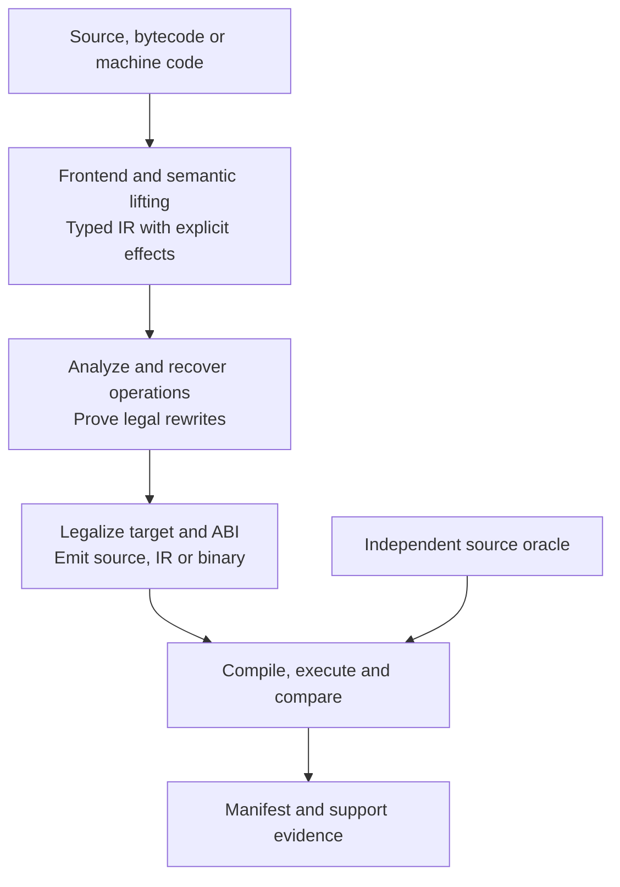

# Polypiler

[](https://github.com/Hawkynt/Polypiler/blob/main/LICENSE)
[](https://github.com/Hawkynt/Polypiler)

[](https://github.com/Hawkynt/Polypiler/actions/workflows/ci.yml)


[](https://github.com/Hawkynt/Polypiler/stargazers)
[](https://github.com/Hawkynt/Polypiler/network/members)
[](https://github.com/Hawkynt/Polypiler/issues)


[](https://github.com/Hawkynt/Polypiler/releases/latest)
[](https://github.com/Hawkynt/Polypiler/releases)
[](https://github.com/Hawkynt/Polypiler/releases)

> **Write or recover an algorithm in one language. Compile it into another. Preserve its semantics. Optimize for the target.** Polypiler is a cross-language optimizing compiler and transpiler that lifts algorithms from source code, bytecode or machine code into one verified intermediate representation and emits readable, tested, target-native implementations — from C#, JavaScript and Rust to PowerBASIC, LLVM IR and MOS 6502.

## 🧭 Vision

**Polypiler** is a planned, cross-language optimizing compiler and algorithm ecosystem. Its goal is to accept algorithm implementations written in supported source languages—or recovered from supported intermediate and machine-code formats—and generate readable, executable, verified implementations for other languages, runtimes, processors and operating environments.

It is designed to do more than translate syntax. Polypiler recognizes the *computation* represented by source code, type patterns, library operations, pointer arithmetic, inline assembly and machine instructions. It can reverse source-specific optimizations, reconstruct higher-level operations, then choose a different implementation suited to the destination.

**Project status: specification and initial implementation planning.** This README describes the intended product, not a finished transpiler. The commands and language combinations below are **planned interfaces and acceptance scenarios**, not claims that they already work. The one exception is a first prototype that translates a small subset of C# and of JavaScript, with or without type annotations, to JavaScript or C#; [Quick start](#-quick-start) shows it and says where it ends. The detailed agent implementation contract is in [PRD.md](docs/PRD.md).

A correct algorithm should not need to be manually rewritten for every programming language and processor. Polypiler aims to make algorithm implementations portable through a common, semantically precise intermediate representation (IR) and a verifier-driven compiler pipeline.

The same engine should eventually support:

- **Source → source:** JavaScript Cipher implementation → C#, PowerBASIC → Rust, Kotlin deinterlacer → Perl.
- **Source → executable:** C# numeric algorithm → DOS x86-16 executable, Rust bit manipulation → MOS 6502 machine code.
- **Binary/bytecode → source:** MSIL → PHP, JVM bytecode → Delphi, x86 → C++, ARM → PowerBASIC, MOS 6502 → C#.
- **IR interchange:** LLVM `.ll` / `.bc` → Polypiler → other languages, and Polypiler → LLVM IR for compatible toolchains.
- **Algorithm distribution:** Import a tested algorithm from the catalogue and generate only its relevant implementation, runtime helpers, tests and dependencies.

Every pair is useful only when the supported language subset, source semantics, target runtime, external dependencies and ABI have been independently verified. Polypiler will report unsupported features instead of fabricating superficially plausible code.

## ✨ Features

All of the following is **planned** — nothing is advertised as working before its verification gate passes.

- **Source → source translation** between C#, JavaScript, Rust, C, C++, Kotlin, Perl, Python, PowerBASIC and more — every language planned as both input and output.
- **Binary and bytecode recovery** — MSIL, JVM, WebAssembly, LLVM IR, tokenized BASIC, x86/x64, ARM and 6502 lifted back to readable source.
- **Native executables** for constrained targets such as 8086 DOS and MOS 6502.
- **Semantic recovery and de-optimization** — popcount, min/max, rotations, bit permutations, unrolled and interleaved loops recognized regardless of how they were written.
- **Proof-driven optimization** — every rewrite backed by range/alias facts, exhaustive small-width tests or SMT bitvector proofs.
- **De-dynamicization** — JavaScript, Python and Perl specialized into typed code with guarded fallbacks.
- **Foreign libraries and ABIs preserved** — native bindings, binary-compatible UDTs and marshalling plans.
- **Rich language features lowered** — generics, classes, closures, exceptions, coroutines and async turned into dispatch tables, state machines and cleanup code for targets that lack them.
- **Verification built in** — generated code is compiled, executed and compared against independent oracles before a pair is called supported.

## 🧩 Support matrix

What works **today**, per direction. A frontend reads the language, a backend writes it; the two advance
separately, and supporting one is no evidence for the other. Every cell is backed by tests that run the
generated code — a row changes only in the pull request that makes it true.

`✅` full for the declared subset · `⚠️` partial, explained in the row · `—` not yet (planned).

### Languages

| Language | Dialect / version | Frontend | Backend | Notes |
| --- | --- | :---: | :---: | --- |
| C# | Frontend: C# 14, .NET 10. Backend, by `--profile`: `net2.0` (C# 2), `net3.5` (C# 3), `net4.6` (C# 6), `net4.8` and `netstandard2.0` (C# 7.3), `netstandard2.1` and `netcoreapp3.1` (C# 8), `net8.0` (C# 12), `net10.0` (C# 14, the default) | ⚠️ | ⚠️ | Prototype subset. The frontend imports one static class of static methods over every integer type from `sbyte` to `ulong`, `char`, `float`, `double`, `bool`, one-dimensional arrays of the numeric types and [value records](docs/reference/records.md) - `struct`, `readonly struct`, `record struct` and `readonly record struct` beside or inside the class, with fields, constructors that assign them, `new T()`, `default`, object initializers, field access through variables, array elements and nested fields, arrays of structs and the `==`/`!=`/`Equals(T)` of a record struct - with the promotions and conversions of C# and `checked`/`unchecked`; `if`, `while`, `do`, `for`, `foreach` over an array, `switch` with constant labels, `break`, `continue`, `++`/`--` as values; `const` and `static readonly` fields as constants and read-only tables; `private`/`internal` `static` fields, and `static readonly` ones whose value is computed or whose array elements are written, as [module state](docs/reference/module-state.md) that every method shares from call to call, initialised once in source order (an initializer reads only constants and earlier fields and calls only methods that touch no static field); `Array.Copy`/`Fill`/`Clear`; the exact operations of `Math`, `MathF`, `BitOperations` and `BitConverter`, and the [integer members](docs/reference/integer-operations.md#c-frontend) of `BitOperations`, `Math`, `BinaryPrimitives`, `BitConverter` and the integer types — rotates, counts, `IsPow2`, `RoundUpToPowerOf2`, `ReverseEndianness`, `BigMul`, `DivRem` with its out argument or deconstructed, `Clamp`, `Min`/`Max`/`Abs`/`Sign`, `CreateSaturating`/`Truncating`/`Checked`, endian `Read…`/`Write…` on an array or any span of bytes and `BitConverter.To…` on an array or its `AsSpan`, of the integers and of `float` and `double` as their IEEE 754 encoding (`BitConverter.ToSingle`/`ToDouble` on an array and an index). Every floating-point member of `Math`, `MathF`, `double` and `float` that the table `CSharpFloatApi` lists ([floating-point operations](docs/reference/floating-point-operations.md)) - the trigonometric, hyperbolic, exponential and logarithmic functions and their inverses, `Pow`, `Cbrt`, `Hypot`, `RootN`, `FusedMultiplyAdd`, `IEEERemainder`, `Round` with every `MidpointRounding` given as a constant and to digits, `CopySign`, the magnitude and number forms of `Min` and `Max`, `Clamp`, `ScaleB`, `ILogB`, `BitIncrement`/`BitDecrement`, the classification, the angle conversion, `Lerp` and the two parts of `SinCos` - is the operation it means or the sequence .NET 10 computes it by (`double.Exp2` is `Math.Pow(2, x)`). [Views](docs/reference/views.md): `Span<T>` and `ReadOnlySpan<T>` of the number types as locals, parameters and results - `AsSpan`, `new Span<T>(…)`, the conversion of an array, `Slice`, ranges and indices from the end, `Length`, `IsEmpty`, the indexer, `foreach`, `stackalloc`, `CopyTo`, `TryCopyTo`, `Fill`, `Clear`, `SequenceEqual`, `ToArray`, `MemoryMarshal.Cast`/`AsBytes` into a read-only span and `MemoryMarshal.Read`/`Write`; `Memory<T>` and `ReadOnlyMemory<T>` as locals, parameters, results and fields of a class that is no record - `AsMemory`, `new Memory<T>(…)`, the conversion of an array, `Slice`, `Span`, `Length`, `IsEmpty`, `ToArray` (not `GetReference`, `CreateSpan` and `ref` locals). [Pointers](docs/reference/pointers.md): unsafe code as bounded pointers - `unsafe` classes, methods and blocks, pointers to the number types and `void*`, `fixed` over an array, an element or a span, `&` of a local, `*p`, `p[i]`, `p + n`, `p - q`, `++`, `--`, `+=`, `-=`, the comparisons, casts between pointer types, `sizeof` and `stackalloc` into a pointer; the backend keeps them unsafe code in every profile, whose file asks for `AllowUnsafeBlocks` (not a cast between a pointer and an integer, `delegate*`, `char*`, pointers to structs and a pointer kept after its `fixed`). [Strings](docs/reference/string-operations.md) of UTF-16 code units: `string` locals, parameters, results, constants and arrays, literals, `+` and interpolation of strings and chars, `==`, `switch` on a string, `foreach` over one and the ordinal members `CSharpStringApi` lists (`Substring`, `IndexOf(char)`, `Contains`, `Replace`, `Split(char)`, `Join`, `Trim`, `PadLeft`, `CompareOrdinal` against 0 …); a member that compares by culture is refused with the advice to pass `StringComparison.Ordinal`, and so is case mapping. [Numbers to text and back](docs/reference/number-text.md) by .NET's rules with the invariant culture: `ToString`, `+` and interpolation of numbers and `bool`, `F<n>`, `D<n>`, `x<n>`, `Convert.ToString(v, 2 | 8 | 10 | 16)` and `Parse` of every number type, a conversion without a provider imported with the invariant culture and the caveat `cs-invariant-culture`; another culture, another format, `NumberStyles` and `TryParse` are refused by name. [Enums](docs/reference/enums.md) over every integer type, with `[Flags]`, beside or inside the class: casts, `&`, `|`, `^`, `~`, `e + n`, comparisons, `switch`, `ToString`, `+` and interpolation by .NET's naming and flag rules, `Enum.IsDefined`, `Enum.Parse` (cast to the enum), `HasFlag`, `GetNames` and `GetValues` in their typed and generic forms; a format, `TryParse`, `GetName` and the text of an enum whose values repeat are refused. [Classes](docs/reference/classes.md): `sealed` classes, classes nothing in the file derives from and `record` classes beside the static class, with instance, static and `readonly` fields and their initializers, constructors with overloads and `this(…)`, instance and static methods with overloads, auto-properties (`get`/`set`/`init`, initializers) and computed properties, `this`, `null`, `==`/`!=`/`is null`/`ReferenceEquals` as identity and a record's `==`/`Equals(T)` as field-wise equality, object initializers in a declaration, an assignment or a `return`; a member reached through `null` traps. [Hierarchies](docs/reference/classes.md#inheritance-interfaces-and-dispatch): single inheritance within the file, `abstract` classes and members, `virtual`/`override`/`sealed override`, interfaces with methods and properties (implicit and explicit implementation, interface inheritance), `protected`, `base.M(…)`, `: base(…)`, `is T`, `is not T`, `if (x is T t)`, `as T` and `(T)x` on classes and interfaces (an invalid cast traps); a virtual or interface call on `this` reachable from a constructor, member hiding, default interface methods, static abstract members, generic interfaces and overriding `object` members are refused by name. [Optional values](docs/reference/optional-values.md): `T?` of the scalar types, `null`, `HasValue`, `Value` (which traps), `GetValueOrDefault`, `??`, `??=`, `?.`/`?[]` on arrays and objects, `== null`/`is null` on nullable values and arrays, and the lifted operators written out as C# defines them (none for arithmetic, `false` for `<`, two nones equal); reference annotations and the null-forgiving `!` change nothing. [Exceptions](docs/reference/exceptions.md): `try`, `catch`, `catch (T e)` with `when` filters, `finally`, `throw`, `throw;`, throw expressions, classes derived from `Exception` and the library exception classes of the table with their three constructors, `Message` and `InnerException`, every trap caught by the clause of its class; any other library exception class is refused by name. [Generics](docs/reference/generics.md): generic static methods and generic classes beside the static class, monomorphized - one function or class per instantiation the module reaches, `IndexOf<f64>`, `Ring<i64>`, and those `--instantiate "Method[type,…]"` names for a public generic the class does not use - with the constraints `struct`, `class`, `unmanaged`, `notnull`, `new()`, `IEquatable<T>`, `IComparable<T>` and interfaces of the file, `default(T)`, `new T()`, and `Equals`/`CompareTo`/`EqualityComparer<T>.Default`/`Comparer<T>.Default` with .NET's meaning on NaN and `-0.0`; generic math, `typeof(T)`, `is T`, variance and polymorphic recursion are refused by name. [Resource scopes](docs/reference/exceptions.md#resource-scopes): `using` statements - with a declaration, several declarators, an expression, stacked - and using declarations over classes of the file that implement `System.IDisposable`, publicly or explicitly; `await using`, a resource of a struct type and a `ref struct` with a pattern-based `Dispose` are refused by name. [Collections](docs/reference/collections.md): `List<T>` (initializers, collection expressions, `Add`, `Insert`, `RemoveAt`, `Clear`, `Count`, the indexer, `Contains`, `IndexOf`, `ToArray`), `Dictionary<TKey, TValue>` (initializers, the indexer, `Add`, `TryAdd`, `if (d.TryGetValue(k, out var v))`, `ContainsKey`, `Remove`, `Clear`, `Count`, `Keys`, `Values`, entries with `Key`/`Value` or deconstructed) and `HashSet<T>` in .NET's order of slots, `foreach` checking for changes as .NET's enumerator does; other collections, capacities and comparers are refused by name. [Functions and closures](docs/reference/functions-and-closures.md): lambdas (expression and block bodies), anonymous methods, `static` lambdas, local functions (also recursive and `static`), method groups of static and instance methods, `Func`/`Action` of every arity and the non-generic delegate types of the file as function types by signature, `f(x)`, `f.Invoke(x)`, `null` and `== null`, and closures that share the variables they capture - a `for` one variable for every pass, a `foreach` one per pass; multicast delegates, delegate equality other than with `null`, `ref`/`out`/`params` delegates and `async` lambdas are refused by name. [Lazy sequences](docs/reference/sequences.md): iterator methods (also of classes and generic ones) returning `IEnumerable<T>` with `yield return` and `yield break` as restartable sequences that run nothing before the first value is asked for, `foreach` over them - closed on every way out, so that pending `finally` blocks run - and over arrays converted to `IEnumerable<T>`, `foreach (var v in s) yield return v;` as a delegation; an enumerator used by hand (`GetEnumerator`, `MoveNext`, `Current`), iterator local functions and lambdas and the non-generic `IEnumerable` are refused by name. [LINQ to Objects](docs/reference/sequence-operations.md): `Select`, `Where`, `SelectMany`, `Take`, `Skip`, `Zip`, `OrderBy`/`ThenBy` (ascending and descending, stable), `Range` and the terminals `ToArray`, `ToList`, `Count`, `Any`, `All`, `First`, `FirstOrDefault`, `Sum` (checked for integers, `f32` accumulated in `f64`), `Min`, `Max`, `Aggregate` and `Contains` on arrays, lists and sequences, query syntax with `from`, `where`, `orderby`, `select`, `let` and a second `from`, and the array searches `Array.IndexOf`/`Find`/`FindIndex`/`Exists`/`TrueForAll` - deferred as LINQ is, each chain one loop that calls the lambdas in the order LINQ does; a string key without `StringComparer.Ordinal`, `GroupBy`, `Join`, `Distinct`, PLINQ and `IQueryable` are refused by name. It refuses `decimal`, events, indexers, operators, finalizers, public mutable static fields of the static class, static constructors and properties, `[ThreadStatic]`, `volatile`, `Interlocked` and `lock`, generic methods of classes, `goto`, pattern matching, `ref`/`out` (but the out argument of `Math.DivRem` and `Math.BigMul` in a statement), methods, properties and `with` on structs, and the estimates `ReciprocalEstimate` and `ReciprocalSqrtEstimate`. A list is `List<T>` in every profile, a map `Dictionary` and a set `HashSet` (net3.5 on) where they enumerate as the IR says, and the nested class `KeyedSlots` with the slots of either language's order where they do not - net2.0 sets, JavaScript's order with removals, a loop that changes what it walks on .NET Framework - with `FloatKeys` as the comparer of floating-point keys below netstandard2.1 ([collections](docs/reference/collections.md#c-backend)). The backend writes exceptions natively, a filter below C# 6 as one catch that tests the clauses (or `PLY1053` where it must run before a `finally` block) and a throw expression below C# 7 through a `Throw<T>` helper. A resource scope is a `using` statement over `global::System.IDisposable` in every profile, a using declaration from C# 8 where the source wrote one and a statement around the rest of the block before. The backend writes every construct the two frontends import as one static class of static methods, with the structs and the classes in front of it - a class as a `sealed class` where nothing derives from it (a positional `sealed record` from C# 9, a class with `IEquatable<T>` and null-safe `==` before), with its base class, interfaces, `abstract`/`virtual`/`override` members, `base.M(…)`, `: base(…)`, `is`/`as`/casts and `if (x is T t)` from C# 7, an auto-property from C# 3 (`{ get; }` from C# 6, `init` from C# 9 where only constructors write it; a property over a private field in C# 2), a computed getter as `=> …` from C# 6, chained constructors as `: this(…)`, the members of the static class it reaches made `internal`; the instantiations of a generic method that are its template instantiated as one generic definition with its constraints (`unmanaged` from C# 7.3, `notnull` from C# 8, each instantiation as `Name_Type` below), any other instantiation and every instantiation of a generic class as `IndexOf_Double`/`Ring_Int64`, the copies of a JavaScript function as overloads of its name - a `readonly struct` from C# 7.2, a `record struct` from C# 10 where the struct has equality and its equality members written out (`IEquatable<T>`, `EqualityComparer<T>.Default`, `HashCode.Combine` from .NET Standard 2.1) before: every integer type from `sbyte` to `ulong`, `float`, `double`, `bool` and their arrays (a `char` as the `ushort` it is in the IR); wrap-around arithmetic in an `unchecked` block and trapping arithmetic and conversions as `checked(…)` expressions, so that the project's overflow setting changes nothing; a cast to `float` on every binary32 result; `if`, `while`, `do`, `switch` with one block per section, `break`, `continue`, `++`/`--`, and a real `for` where the step is one statement (otherwise a `while` that repeats the step before each `continue`); constants as `private const` and tables as `private static readonly` arrays; module state as `private static` fields initialised in their declaration, `readonly` for an array, without a static constructor; the library operations as calls of `Math`, `MathF`, `BitOperations`, `BitConverter` and `Array` where the profile's framework has them, and otherwise as the older call that has the same bits or as a private helper the class gets only when it uses it — rotate, population count, leading and trailing zeros and `Log2` as bit code, `Array.Fill` as a loop, the float bit casts through `BitConverter.GetBytes`, `Min`/`Max` of floating-point numbers that order the zeros, and a conversion from floating point that saturates before .NET 9. Every [integer and bit operation](docs/reference/integer-operations.md) of the IR is written on every width from `sbyte` to `ulong` in every profile — rotates, counts, byte swap and bit reversal, powers of two, the high half of a product, floor and Euclidean division, clamp, saturating, carry and overflow-testing arithmetic, bit fields, masks, sign and zero extension, little- and big-endian loads and stores — as `BitOperations`, `BinaryPrimitives.ReverseEndianness`/`Read…`, `Math.BigMul` or the type's own `RotateLeft` from the profile that has them, and otherwise as a C# 2 helper. A view is a `Span<T>` or `ReadOnlySpan<T>` from `netstandard2.1` on, a memory a `Memory<T>` or `ReadOnlyMemory<T>`, with `stackalloc` for a constant length below 1024 bytes outside every loop, and both an `ArraySegment<T>` with C# 2 helpers that check and throw what a span does before it, where a reinterpretation is a copy. A `float` or `double` in a byte array is read by `BinaryPrimitives.ReadSingle…`/`ReadDouble…` from `net8.0`, as the bit cast of the integer load of its width before, and stored as the integer of its bits in every profile; nothing reads the byte order of the host. Every string operation is written with its ordinal member, the member of `char` (`Contains`, `StartsWith`, `Split`) from .NET Standard 2.1, `Trim()` from .NET Framework 4 and a C# 2 helper where no framework has the operation - ECMA-262's white space, split, padding and `codePointAt`, the first-occurrence replacement. A [conversion between numbers and text](docs/reference/number-text.md) is .NET's own from `netcoreapp3.1` on and a C# 2 helper before - Ryu's shortest digits, the exact fixed notation and a correctly rounded parse - and ECMA-262's rules are helpers in every profile. Optional values are `Nullable<T>` in every profile, with `?.` from C# 6 and `??=` from C# 8 and a conditional and an `if` before. The language follows the profile too: a block namespace before C# 10, statement bodies before C# 6, explicit types before C# 3, casts instead of `>>>` before C# 11, a helper instead of the discard before C# 7. An exclusive or of two shifts that .NET's JIT would compile to a rotation also at count 0 is written with a count it does not rotate ([known runtime defects](docs/reference/known-runtime-defects.md)). A floating-point function with a tolerance is .NET's own (`Math.Sin`, a `float` one through the `double` one cast back) only with `--float accurate`, the default, and only where [ADR 0005](docs/adr/0005-floating-point-tolerance.md) admits .NET's measured error - the header lists each with its bound; with `--float strict`, and wherever a function is not admitted or the framework lacks the call, the class gets the correctly rounded portable implementation as private methods, so every profile returns the same bits. It reconstructs no `foreach` and no compound assignment, and refuses with `PLY1052` only IR it does not know (`PLY1053` is kept for an operation a profile can neither call nor replace; no operation of today is one). An [enum](docs/reference/enums.md) is a C# enum beside the class, its text, parse and listing the members of `System.Enum` the profile has (the generic ones from `netstandard2.1` and `net8.0` on), `HasFlag` written as `(x & f) == f`. Function values are anonymous methods and delegate types the class declares (`Int32ToInt32`) for `net2.0`, `Func`/`Action` and lambdas from `net3.5` (up to sixteen parameters from `net4.6`), local functions from C# 7, `static` local functions from C# 8 and `static` lambdas from C# 9; a JavaScript `for (let …)` copies its variable into the body of every pass ([functions and closures](docs/reference/functions-and-closures.md#c-backend)). An iterator function is an iterator method returning `IEnumerable<T>` in every profile, a loop over a sequence a `foreach`, and a JavaScript generator object - which runs once - the helper `SinglePass` over the one enumerator of its call ([sequences](docs/reference/sequences.md#c-backend)). The helpers of both backends come from [one IR library](docs/architecture/BACKENDS.md#helpers-one-library-in-the-ir) that legalization binds into the module, and the passes over the legalized module - [O0006](docs/optimizations/O0006-inlining.md) inlining, [O0003](docs/optimizations/O0003-sccp.md) propagation, [O0001](docs/optimizations/O0001-constant-folding.md) folding, [O0005](docs/optimizations/O0005-dead-code-elimination.md) dead code, [O0023](docs/optimizations/O0023-loop-unrolling.md) unrolling - specialise them to their calls; by the effect summaries of the functions [O0002](docs/optimizations/O0002-partial-evaluation.md) evaluates pure calls with constant arguments and [O0464](docs/optimizations/O0464-call-merging.md) merges identical pure and read-only calls. The backend builds a syntax tree of C#, runs the target passes [O0500](docs/optimizations/O0500-target-helper-inlining.md) (a single-expression helper inlined where its call is not cheaper) and [O0501](docs/optimizations/O0501-target-unused-declaration-removal.md) (a helper or private constant nothing names any more removed) over it and prints it last ([backends](docs/architecture/BACKENDS.md)); with `--opt none` it writes what it wrote before the tree. [Async methods](docs/reference/async.md): `async Task`, `Task<T>`, `ValueTask<T>` methods of the class that await every task where they make it - a call of such a method, `Task.CompletedTask`, `Task.FromResult` and `Task.WhenAll` of isolated calls, `ConfigureAwait` dropped - are imported, and written natively from `net4.6` on (`ValueTask<T>` from `netstandard2.1`, `Task<T>` and a header line below); `net2.0` and `net3.5` refuse them with `PLY1053`. A stored task, `TaskCompletionSource`, blocking, `Task.Run`/`Delay`/`Yield`, `ContinueWith`, `async void` and `await foreach` are refused by name, because .NET and JavaScript order their effects differently. [Native calls](docs/reference/foreign-calls.md): `static extern` methods with `[DllImport]` and `static partial` methods with `[LibraryImport]` - numbers, `bool`, strings in, arrays, `out`/`ref`/`in`, structs with `[StructLayout]` and `[FieldOffset]`, `nint`/`nuint` handles - and calls of them are kept as P/Invoke in every profile, a `LibraryImport` below net8.0 as the equivalent `DllImport`. The arbitrary-precision integer is `System.Numerics.BigInteger` from `net4.6` on (its conversion to `double` the helper `BigToDouble`, which rounds where .NET's cast cuts); `net2.0` and `net3.5` refuse it with `PLY1053`. |
| JavaScript | Frontend: ES2022 scripts and modules. Backend: ES5, ES2015, ES2017, ES2020, ES2022 as ES module, CommonJS module or script; Node | ⚠️ | ⚠️ | Prototype subset. The frontend imports plain JavaScript without annotations: every number is a double computed as ECMA-262 computes it, and a variable, a parameter of a function nothing outside calls or a result is an `int32` or `uint32` where the program proves it — where every value that reaches it comes from a bitwise operator, `>>> 0`, `Math.imul`, `Math.clz32`, a typed array, a `length`, an integer literal or `+`/`-` directly under a coercion (a product is never narrowed). JSDoc (`int8` to `uint64`, `number`, `float32`, `boolean`, every typed array, and the spellings of Cipher's framework: `byte`, `int`, `bool`, `string`, a class of the file, `T|null` and arrays of arrays or of objects) states the contract of a parameter, and a literal default (`f(a = 1)`) is what a call that leaves it out passes; without it an exported parameter is a double, or the integer its function coerces it to, which the import announces. `BigInt` under `BigInt.asUintN(64, …)`/`asIntN(64, …)` is a 64-bit integer. [Module graphs](docs/reference/module-graphs.md): a UMD factory, a wrapper that assigns `module.exports` or a CommonJS file is imported with the files it requires (`require` relative to it), of which only what it reaches; what only probes the environment is folded away, and what a module with state does at its top level runs once when it is loaded ([module state](docs/reference/module-state.md)). What the Cipher framework writes ([#1365](docs/corpus/cipher.md)): a function a required file declares is a helper whose parameters take what the graph passes; a string that may be `null` and an optional number as a field; a getter or setter a derived class declares again overrides the base class's, and `this.key = …` calls the inherited setter; a derived class without a constructor takes the parameters of the nearest one; a frozen object of object literals of one shape (`Object.freeze({ HASH: { name: '…', … } })`) is a class of read-only fields whose members are read as new objects; `typeof` of a value of a known kind is its constant; `Object.keys(o)` of an object of a known shape, and a loop over it, are its keys, written out once per key; JSDoc's `T[]` of numbers is an `Array`, a list or a typed array as the calls of the file pass it, an `Array` where the function tests `Array.isArray`; a parameter JSDoc states as an integer and the function only coerces takes any 32-bit integer; `a % b` of two integers that are never negative is an unsigned integer; `||` and `&&` of a left operand with an effect evaluate it once; `slice`, `fill` and `concat` of an Array whose length never changes. Functions: declarations, helpers of the wrapping IIFE, properties of object literals, also nested; numeric and table constants of the enclosing scope; `let`, `var` and written `const` arrays at the top level of a module as [module state](docs/reference/module-state.md) that its functions share, typed like locals from every value that reaches them (an exported variable, a statement at the top level of a module with state and an initializer that reads a later variable or calls a function with state are refused); typed arrays, array literals, `new Array(n)`; `if`, `while`, `do`, `for`, `switch` without fall-through, `break`, `continue`; exact `Math` functions, `Math.abs`/`min`/`max`/`sign` of proven integers as integer operations, every function and constant of `Math` but `random` (`Math.pow` and `**` as ECMA-262's exponentiation, which keeps `pow(1, NaN)` and `pow(±1, ±∞)` a NaN), `Number.isNaN`/`isFinite`/`isInteger`/`isSafeInteger`, the global `isNaN`/`isFinite` of a number and the constants of `Number` ([floating-point operations](docs/reference/floating-point-operations.md)), `BigInt.asUintN`/`asIntN` of any literal width from 1 to 64, and the `get…`/`set…` methods of a `const` [`DataView`](docs/reference/integer-operations.md#javascript-frontend) made of a `Uint8Array` of the function, `getFloat32`/`getFloat64`/`setFloat32`/`setFloat64` among them (not `getFloat16`/`setFloat16`). [Views](docs/reference/views.md): `subarray` of a typed array is a view, with the clamping and negative positions of ECMA-262 written out so that nothing traps where JavaScript does not; `slice` copies, `set` and `fill` copy and fill through views, and a `DataView` takes a view with its offset and length; `for…of` goes over a typed array or a view, and a view stored into a field of a class is a `Memory` (not a typed array over `buffer`, which reads in the host's byte order). The backend writes a [pointer](docs/reference/pointers.md) of a C# source as a region and a byte offset - two variables, `[region, offset]` where it is passed - whose every load and store is checked, a reinterpreting read through a little-endian `DataView` or, in plain arrays, through the bytes of the elements. `--explain-types` prints each type with the expression that decided it. [Value records](docs/reference/records.md): an object literal of names whose values are numbers, Booleans or such literals - also in shorthand, destructured with `const { x, y } = p`, passed, returned and in array literals - is a struct, one per shape, as long as it is never written, extended, compared by identity or handed to anything but a function of the file; each of those is refused by name. [Strings](docs/reference/string-operations.md) by code unit: literals, templates with string holes, `+`, `+=`, the comparisons, `length`, `charCodeAt`, `charAt`, `substring`, `slice`, `indexOf`, `includes`, `startsWith`, `split`, `join`, `replace`/`replaceAll` with a constant replacement, `trim`, `padStart`, `repeat`, `String.fromCharCode`, `codePointAt`, `switch` on a string and `for…of` by code point, as `JavaScriptStringApi` lists them; `localeCompare`, case mapping and regular expressions are refused by name. [Numbers to text and back](docs/reference/number-text.md) by ECMA-262's rules: `+`, `concat` and template holes of numbers, `BigInt`s and Booleans, `String`, `toString` (also with a literal radix, of a proven integer), `toFixed`, `Number`, unary `+`, `parseFloat` and `parseInt`; `toPrecision`, `toExponential` and `toLocaleString` are refused. [Enum objects](docs/reference/enums.md): a `const` of `Object.freeze({ A: 0, … })` of distinct 32-bit integers is an enum over `i32` whose members are read as `X.A`; a value only members reach is of the enum, any other use of a member is its number; an object that is not frozen, a string member, a repeated value, `X[k]` and the object as a value are refused. [Classes](docs/reference/classes.md): ECMAScript 2015 classes (constructor, methods, `get`/`set`, `static` methods), ECMAScript 2022 fields with values, `#private` fields and methods and `static` fields, and constructor functions of ECMAScript 5 with methods on the prototype and `Object.defineProperty` accessors; `new`, `this`, `null` and `===`/`!==` between objects; the type of a field is joined from every value stored into it (a double unless the program proves an integer, a field of two kinds is `PLY1105`), a field may hold a string, an object or an `Array` of them, which is a list, and an object or an array counts as true unless it is `null`. [Hierarchies](docs/reference/classes.md#inheritance-interfaces-and-dispatch): `class B extends A` with `super(…)`, `super.m(…)` and `super` accessors, ES5 chains of `Object.create(A.prototype)` with `A.call(this, …)` and `A.prototype.m.call(this, …)`, `instanceof` with a class of the file; a method a subclass overrides is virtual, its overrides share one inferred signature, and a variable reached by several classes has their nearest common base. A function the file does not export that its calls pass arrays or values of two kinds is copied per kind ([generics](docs/reference/generics.md#javascript-frontend)); an exported one keeps one type per parameter (`PLY1105`). A property added outside the constructor, `delete`, a computed member name, prototype mutation, `Object.setPrototypeOf`, `extends` of anything but a class of the file, a call of an overridden method on `this` during construction, a method taken from its object, `call`/`apply`/`bind` and `this` outside a method are refused by name. [Exceptions](docs/reference/exceptions.md): `try`, `catch (e)`, `catch`, `finally`, `throw`, classes that extend `Error` with `super(m)` and `super(m, { cause })`, `new Error(…)`, `e.message`, `e.cause` and `instanceof` a class of the file, `Error`, `RangeError` or `TypeError`; a thrown value that is no `Error` only where nothing observes it (`PLY1107`), and a string thrown out to the caller as an `Error` of that message (caveat `js-throw-string`), `return`, `break` and `continue` in `finally` refused; a disposing `try … finally` stays one, a `using` declaration is a syntax error at every level (`PLY1100`) and a `[Symbol.dispose]` method is refused (`PLY1102`). [Optional values](docs/reference/optional-values.md): `null`, `undefined`, `void 0`, `return;`, the end of a function and a missing argument, `== null`, `=== null`/`=== undefined`, `??`, `a?.b` and `??=`; a number that may be absent is an optional value, and an operator that computes with it applies ToNumber written out (`null` is 0, `undefined` a NaN); a place both absent values reach that the program tells apart is `PLY1105`. [Collections](docs/reference/collections.md): an `Array` that changes its length (`push`, `pop`, `splice(i, 1)`, `splice(i, 0, x)`, `a.length = 0`, `a[a.length] = x`) or is searched with `indexOf`/`includes` is a list, one array one list wherever it is held; `Map` (`get` as an optional value, `set`, `has`, `delete`, `clear`, `size`) and `Set` in the order of insertion; `for…of` over them, `entries()`, `keys()`, `values()` and `[k, v]` walks them live. [Functions and closures](docs/reference/functions-and-closures.md): arrow functions, function expressions and function declarations inside a function (hoisted to their block), closures that share the variables they capture, a top-level function as a value and calls of function values, typed from the calls through them - a `for (let …)` gives every pass a variable of its own, a `for (var …)` shares one; `arguments`, `this` in a function expression, `new` of a function value and `call`/`apply`/`bind` are refused by name. [Generators](docs/reference/sequences.md): `function*` declarations and generator methods of classes as single-pass sequences, `yield v` as a statement, `yield*` of a generator object or an array, `return;`, and `for…of` over a generator object, closed on every way out; a yield that receives a value, a generator that returns a value, nested and async generators and `next()` outside a `for…of` are refused by name. [Array callbacks](docs/reference/sequence-operations.md#javascript-frontend): `map`, `filter`, `forEach`, `reduce`, `reduceRight`, `some`, `every`, `find`, `findIndex`, `flatMap` and a stable `sort(comparator)` with arrows, function expressions or functions of the file, eager as JavaScript is - the length read once, `(element, index, array)` as far as the callback's parameters reach, a `TypeError` for `reduce` of nothing; `sort()` without a comparator, a comparator with effects, `findLast` and a library function as the callback are refused by name. No mutable object literals; no `Map` keyed by object literals, no callbacks of arrays. The backend writes every construct the C# frontend imports as an ES module: integers of up to 32 bits as numbers with explicit wrap-around, `long`/`ulong` as `BigInt` cut with `BigInt.asIntN`/`asUintN`, `float` rounded with `Math.fround` after every operation, arrays and constant tables as typed arrays from `Int8Array` to `BigUint64Array` and `Float64Array`, `switch`, `do`, `break` and `continue`, checked arithmetic and conversions that throw the generated error class of their trap (`OverflowError`, `DivideByZeroError`, … with `RangeError` in their chain), structs as object literals that are copied exactly where the place they are read from can still be used, with `$copy_T`, `$equals_T` (a NaN equals a NaN) and `$newArray_T` helpers, and helper functions only for what a module uses; module state as `let` (`var` before ES2015, `const` for an array) after the constants and before the functions, private to the module in every format, a 64-bit one as a `BigInt` or the pair of its halves; a class as an ES2015 `class` (a constructor function with prototype methods and `Object.defineProperty` accessors in ES5), its fields as ES2022 class fields and `#private` names (assignments in the constructor and `_`-prefixed properties before, which the header states), static fields as `static` fields (assignments after the class before), several constructors chosen by the number of arguments, a record's equality as a null-safe `$equals_T` helper, a derived class with `extends` and `super` (an `Object.create` chain and `A.call(this, …)`/`A.prototype.m.call(this, …)` in ES5), interfaces as non-enumerable `$is_I` markers on the prototypes, `instanceof`, a `$cast_T` helper that throws an `InvalidCastError` (a `TypeError`), `protected` members as `_`-prefixed properties, exported as the module format says; the instantiations and copies of one generic whose text is the same as one function or class under the source name and the others as `IndexOf$f64`, `Ring$i64` ([generics](docs/reference/generics.md#javascript-backend)), the equality of a generic definition on floating point as SameValueZero (`$sameValueZero`), never `===` alone or `indexOf`. That is the default profile, `--profile es2022 --module esm`; `--profile` also takes `es5`, `es2015`, `es2017` and `es2020`, `--module` also `cjs` and `iife` (a script that declares the global object `--global` names; ES5 has `cjs` and `iife` only). Every construct is chosen from one capability table, and a level that lacks one gets its replacement: `var` for `let`/`const`, helpers for `Math.imul`, `Math.clz32`, `Math.fround`, `Math.trunc` and `Math.sign`, `long`/`ulong` below ES2020 as objects `{ hi, lo }` of two unsigned 32-bit halves whose arithmetic is the library's limb helpers ([O0075](docs/optimizations/O0075-wide-integer-legalization.md)), specialised by the passes, plain arrays with explicit wrap-around where there are no typed arrays (ES5 has them with `--typed-arrays`). Every [integer and bit operation](docs/reference/integer-operations.md) of the IR is written on every width in every profile: up to 32 bits on numbers, with `Math.clz32`, `Math.abs` and `Math.min`/`Math.max` where they say it and a helper told the width otherwise, 64 bits on `BigInt`s from ES2020 and on the pair of halves below. A view or a memory is the `subarray` of a typed array behind a helper that checks the range first, or an object `{ a, o, n }` over a plain array where the profile has none; a copy moves like memmove, equality takes a NaN as equal to a NaN as .NET does, and an endian access or a reinterpretation goes through a `DataView` with the byte order given. A `float` or `double` in a byte array goes through a `DataView` of the array where the profile has typed arrays and through the bit casts of plain arrays below, the same bytes in every profile (a NaN compared by class, ADR 0005). An optional value is `null` or its value, an exported result the source spelled `undefined` stays `undefined`; `??` and `?.` are written from ES2020 and `??=` from ES2021, a conditional on `!= null` below (never `||`), and `.Value` of none throws through `$unwrap`. A list is an `Array` whose index checks are helpers, a map a `Map` and a set a `Set` from ES2015, and the helper `$Keyed` - slots in either language's order - at ES5, for keys of 64 bits as halves and for .NET's order with removals, floating-point keys or a checked loop that changes it; a checked loop over a list that may change counts its changes ([collections](docs/reference/collections.md#javascript-backend)). Every profile computes the same results and throws the same error classes. A conversion between numbers and text by ECMA-262's rules is JavaScript's own, by .NET's rules a helper (`$fmtNet`, `$fmtNet32`, `$fixedNet`, `$parseNet`) at every level. Exceptions are one `catch (e)` testing the clauses with `instanceof` in order, a filter joined to its test or refused where it must run before a `finally` block (`PLY1152`), a catch without a binding from ES2019 and the `cause` of ES2022. A resource scope is the `try … finally` it means, `const r = e; try { … } finally { if (r != null) r.Dispose(); }` (`var` in ES5), nested per resource. A floating-point function with a tolerance is a function of `Math` only with `--float accurate` and where ADR 0005 admits V8's measured error; otherwise it is the correctly rounded portable implementation, which gives the same bits at every level. An [enum](docs/reference/enums.md) is a frozen object of its members (of 64 bits from ES2020 on; below that a public one is `PLY1152`), its text, parse and definedness helpers with .NET's rules over a private table of the members. Function values are arrow functions from ES2015 and function expressions in ES5, a local function `const f = …`, a bound method a closure over its receiver; a C# `for` keeps its `let` in front of the loop, a `for (let …)` of every pass is one again, and in ES5 the variables of a pass a closure captures live in an environment object made every pass ([functions and closures](docs/reference/functions-and-closures.md#javascript-backend)). An iterator function is a `function*` from ES2015 - a restartable C# sequence an object whose `[Symbol.iterator]` calls the generator anew - a loop over it a `for…of`; in ES5 a state machine on the helper `$generator`, a restartable sequence `{ $iterator }` and a loop over it a loop over `next()` that closes it, so ES5 output has no generator syntax ([sequences](docs/reference/sequences.md#javascript-backend)). The helpers of both backends come from [one IR library](docs/architecture/BACKENDS.md#helpers-one-library-in-the-ir) that legalization binds into the module, and the passes over the legalized module - [O0006](docs/optimizations/O0006-inlining.md) inlining, [O0003](docs/optimizations/O0003-sccp.md) propagation, [O0001](docs/optimizations/O0001-constant-folding.md) folding, [O0005](docs/optimizations/O0005-dead-code-elimination.md) dead code, [O0023](docs/optimizations/O0023-loop-unrolling.md) unrolling - specialise them to their calls; by the effect summaries of the functions [O0002](docs/optimizations/O0002-partial-evaluation.md) evaluates pure calls with constant arguments and [O0464](docs/optimizations/O0464-call-merging.md) merges identical pure and read-only calls. The backend builds a syntax tree of JavaScript, runs the target passes [O0500](docs/optimizations/O0500-target-helper-inlining.md) (a single-expression helper inlined where its call is not cheaper) and [O0501](docs/optimizations/O0501-target-unused-declaration-removal.md) (a helper or private constant nothing names any more removed) over it and prints it last ([backends](docs/architecture/BACKENDS.md)); with `--opt none` it writes what it wrote before the tree. [Async functions](docs/reference/async.md): an `async function` of the module that awaits every promise where it makes it - a call of such a function, `Promise.resolve`, a value and `Promise.all` of isolated calls of which at most one can fault - is imported, and written as `async function` from ES2017, as a generator driven by `$async` at ES2015 and refused with `PLY1152` at ES5; `Task.WhenAll` becomes `$whenAll`, which rejects with the first fault in argument order. A stored promise, `new Promise`, `.then`, timers, async arrows and `for await` are refused by name. [Native calls](docs/reference/foreign-calls.md) go through the binding module or global `--bind <library>=<module or global>` names, with a documented value contract ([ADR 0007](docs/adr/0007-javascript-native-calls.md)); without a binding they are refused with PLY1152. The arbitrary-precision integer is a `BigInt` from ES2020 on; below, a level has no such type and refuses it with `PLY1152`. |
| PowerBASIC | DOS 3.5 (`pb35`), `pb36` | — | — | |
| C | C11 / C17 / C23 | — | — | |
| C++ | C++17 / 20 / 23 | — | — | |
| Rust | Frontend: 2024 edition; the overflow mode of `--overflow-checks panic` (debug) or `wrap` (release), else the `overflow-checks` of the Cargo profile (`--cargo-profile`, default `dev`) in the `Cargo.toml` above the source, else panic. Backend, by `--profile`: `rust2018` (Rust 1.31), `rust2021` (Rust 1.56), `rust2024` (Rust 1.85, the default); `--rust-version` raises the MSRV; `--trap-policy panic` (default) or `result`; `--allow-unsafe` admits the one unsafe lowering | ⚠️ | ⚠️ | Frontend: free functions over `i8`…`i64`, `u8`…`u64`, `isize`/`usize` (64-bit), `f32`, `f64`, `bool`, with literals of every base and suffix, the operators, `as` casts (float to integer saturating), `MIN`/`MAX`/`BITS`, the `wrapping_*`, `checked_*` (consumed by `unwrap`, `expect`, `unwrap_or`, `is_some`, `is_none`), `overflowing_*` (`.0`, `.1`, tuple `let`) and `saturating_*` methods, `abs`, `signum`, `pow`, `abs_diff`, `min`, `max`, `clamp`, `div_euclid`, `rem_euclid`, rotations, byte and bit reversal, bit counts, float `abs`, `sqrt`, `to_bits`, `from_bits`, `is_nan`; `let`, shadowing, `const`, blocks, `if`, `match` (literal, range, or, tuple, binding and guard patterns, exhaustiveness checked), `while`, `loop` with `break` value, `for` over integer ranges with `rev()`/`step_by()` in either order, labelled `break`/`continue` and blocks, calls and recursion, `pub` as the exported surface; fixed arrays, `&[T]`/`&mut [T]` slices and `Vec<T>` of numbers, `bool`, tuples and structs (indexing, ranges, `len`, `iter`, `iter_mut`, `chunks_exact`, `split_at`, `copy_from_slice`, `fill`, `swap`, `push`, `pop`, `vec!`), shared and `&mut` references (aliased places, `&mut` parameters copied in and out), tuples, structs and tuple structs with inherent methods and associated constants, field-less enums with discriminants, `Option` and `Result` with `?`, `if let`, `while let` and destructuring patterns, `match` on constants as a switch; closures (inlined, `move` included) and iterator chains (`map`, `filter`, `enumerate`, `zip`, `rev`, `step_by`, `copied` into `sum`, `product`, `count`, `fold`, `any`, `all`, `for_each`, `collect` into `Vec`, maps and sets), function pointers; modules inline and in files, `use` trees, re-exports, `#[test]` functions and `#[cfg(test)]` modules. `String`, `&str` and `char` with Rust's UTF-8 byte lengths, offsets and slicing panics computed over the IR's UTF-16 strings, `chars`, `bytes`, `split`, `trim`, `find`, `parse` of integers, `to_string` and `format!` of integers, `bool`, `char` and text; traits of the crate's types with provided methods, supertraits and static dispatch, trait objects (`&dyn T`, `Box<dyn T>`, `Rc<dyn T>`) dispatched through the IR's interfaces, generic functions, structs, impls, methods and traits monomorphised per type arguments with standard and crate bounds and `T::Output` results (a public generic function exported as the instances the crate makes), the operator traits and `PartialEq` on the crate's types; `HashMap`, `BTreeMap`, `HashSet`, `BTreeSet` with `insert`, `get`, `remove`, `contains`, indexing and `entry().or_insert()`, never iterated. Parsed and typed by the frontend itself, use after move checked (E0382); refusals PLY1500–PLY1546 name the construct (`&mut dyn T`, generic enums, enums with data, smart pointers, iterating a map). See [the Rust frontend](docs/architecture/RUST-FRONTEND.md). Backend: a Cargo package - `Cargo.toml` without dependencies, `src/lib.rs` with `#![forbid(unsafe_code)]` (`#![deny(unsafe_code)]` where `--allow-unsafe` let in the one unsafe spelling function) and the lints the code needs allowed, `src/<module>.rs` - every integer type, `src/lib.rs` with `#![forbid(unsafe_code)]` and the lints the code needs allowed, `src/<module>.rs`, a file per module of a Rust source crate (`src/util/bits.rs`, `use crate::…`, its tests as `#[test]`) - every integer type, `f32`, `f64` and `bool`; the arbitrary-precision integer (a Python `int` no fixed width holds) as `PlyBigInt`, a struct of the crate converted from num-bigint, with every operation and conversion of the IR; the arithmetic with its contract in every build mode (`wrapping_add`, `checked_add(…).expect("IntegerOverflow")`, `saturating_add`, masked `wrapping_shl`), the division and its traps, every conversion, the intrinsics Rust has a method for (the IR helper library and the portable floating-point implementations for the others, chosen by the MSRV); functions, calls, recursion; arrays by ownership - `&[T]`/`&mut [T]` parameters, `Vec<T>` for arrays the code makes, `static` tables, borrowed results with their lifetime, element loops `for &x in data`, parallel loops `for (&s, d) in src.iter().zip(dst.iter_mut())`, a vector moved where the source never names it again, copies (`copy_from_slice`, `copy_within` inside one array), `split_at_mut`, fills and endian access checked before they touch a byte, pointers as positions in a region known statically (a pinned array or view, a `stackalloc`, the address of a local, a pointer parameter with its slice) with no raw pointer, overlay views read as safe copies through `from_le_bytes`/`to_le_bytes`, a written one only under `--allow-unsafe` as one audited `unsafe` block that passes Miri, one array passed twice to a writing callee through a copy of the callee with the parameters merged; structs of numbers with their derives and the IR's equality; strings as UTF-16 code units (`Vec<u16>`/`&[u16]`) with their searches, splits, trims and joins; enums as newtypes with their text and parse; numbers as text both ways; classes as `Rc` of a struct with a `Cell`/`RefCell` per field (array fields included), `Option<Rc<T>>` where a nullness analysis finds null possible; interfaces and class hierarchies as traits with `Rc<dyn Trait>` values, virtual calls, `is`/`as`/casts; generic methods as Rust generics with the bounds their bodies need (`fn max<T: Ord + Copy>`, `where` clauses), an instantiation a bound would give another meaning - a float under `Ord`/`Eq` - and generic classes per instantiation; static fields as atomics; spans as slices; `if`/`else if`, `while`, `loop` with `break value`, `for i in a..b` and `a..=b` (to the type's maximum, `0..=255u8`), reductions as iterator folds (`.fold(0u32, |acc, x| acc.wrapping_add(x))`), `match` with or-patterns and ranges, labelled blocks from Rust 1.65; traps as panics named after the IR trap, or with `--trap-policy result` as errors - every function a trap can leave returning a `Result` with the crate's `Error` enum in `src/error.rs` or the module's exceptions, every trap an explicit check, a catch clause seeing a trap, what would still panic refused with `PLY1552` (ADR 0008); optional `#[test]` functions; lambdas as `Rc<dyn Fn>` closures (a captured variable that is assigned shared in an `Rc<Cell<T>>`, a local function a nested `fn`); optional values as `Option<T>`, arrays the module tests for null as `Option<&[T]>`/`Option<Vec<T>>`; module state with no atomic form (arrays, strings, floats) behind a `Mutex` (Rust 1.63, `LazyLock` 1.80); lists as `Vec<T>`, `Dictionary`/`HashSet` as vectors of slots in .NET's enumeration order, the LINQ loops legalization writes; a local naming a field's array as the borrow of its cell; exceptions of the module's classes as `Rc<PlyError>` propagated through `Result` and `?`; lazy sequences (`yield`, generators, the LINQ chains legalization keeps lazy) as `Iterator` state machines - a struct of the state and the variables kept across a `yield`, `try`/`finally` around a `yield` run on `Drop`, sequence parameters as generics or `impl Iterator`, arrays and strings an iterator takes borrowed, iterator methods of a class - other lazy forms refused with `PLY1558` naming them. Pointers, exceptions of the module's classes as `Rc<PlyError>` propagated through `Result` and `?`. Pointers compared across two arrays, lazy sequences (`yield`), JavaScript's insertion-ordered maps and other forms are refused with `PLY1550` naming them, a written overlay view without `--allow-unsafe` with `PLY1567`, aliasing that safe Rust cannot borrow with `PLY1566`, catching a trap under the panic policy, a filter behind a `finally` and other exception regions with `PLY1560` naming why. [The Rust backend](docs/architecture/RUST-BACKEND.md). |
| Kotlin | JVM | — | — | |
| Perl | Perl 5 | — | — | |
| Python | Frontend: Python 3, parsed by the `ast` module of the installed CPython (pinned 3.14). Backend, by `--profile`: `py3.8` to `py3.14` (the default) | ⚠️ | ⚠️ | Prototype subset. The frontend imports a module and the modules of the import it imports (`import m`, `from m import f`, relative imports, packages): functions with positional, keyword, positional-only and keyword-only parameters and defaults evaluated once, recursion, nested functions and closures with `nonlocal`, lambdas as `key=` and of `map`/`filter`, generators with `yield` and `yield from`, `:=`; module constants, tables and `global` variables, run once in source order; `int`, `float` and `bool` with `+ - * / // % ** << >> & \| ^ ~`, comparisons (chained, an `int` with a `float` exactly), `and`/`or` giving an operand; `list`, `tuple`, `str` (code points), `bytes` and `bytearray` with indexing from the end, slices, `+`, `*`, `in`, `==`, `len`, `append`, `pop()`, `extend`, `copy`, comprehensions and generator expressions (as sequence operations), `for` over sequences with `enumerate`, `zip` and `reversed`, `sorted`, `sum`, `min`, `max`, `any`, `all`; `dict` as an insertion-ordered map and `set` (keys of `int`, `bool`, `str` and plain objects) with displays, comprehensions, `d[k]` (`KeyError`), `del`, `in`, `len`, `==`, `get`, `pop`, `add`, `remove`, `discard`, `clear`, `copy`, iteration of a dict and its `keys`/`values`/`items` (`RuntimeError` when its size changes), and a set only where its order cannot count (`sorted`, `sum`, `min`, `max`, `any`, `all`); `int.from_bytes`, `int.to_bytes`, `str.encode`, `struct` with explicit byte order; classes without bases, `@dataclass`, `NamedTuple`, `Enum` and `IntEnum`, `@staticmethod`, `@property`, `__eq__`, `__len__`, `__getitem__`, `__setitem__`; `None` and `Optional`; `raise`, `try`/`except`/`else`/`finally` and exception classes derived from the built-in ones; `math.sqrt`, `isqrt`, `floor`, `ceil`, `trunc`, `fabs`, `copysign`, `gcd`, `isnan`, `isinf`, `isfinite` and its constants; `if`, `while`, `match` on literals and enum members, `assert`, with definite assignment required. A parameter has the type of its hint, its default or the import's calls, a local and a result the type of their values; hints are recorded as contracts. An `int` is the IR's arbitrary-precision integer, exact at every magnitude (literals of any size, floor `//` and `%`, `/` correctly rounded, `int`/`float` conversions with CPython's `OverflowError`), and [O0062](docs/optimizations/O0062-python-int-specialization.md) narrows it to `i32`, `u32`, `i64` or `u64` where masks and ranges prove that exact: masked hashes such as FNV-1a, SplitMix64 and xorshift compute natively. An `int` kept in an attribute, a tuple, an optional, a module table, a dict key or a set element is 64 bits wide there and raises `OverflowError` beyond (`py-int-held-64`). Refused with a code per family (`PLY1820`–`PLY1823`, `PLY1830`–`PLY1834`, `PLY1840`–`PLY1844`): other list and string methods, f-strings, iterating a set, `float` and tuple keys, set algebra and the other `dict` and `set` methods, slice assignment, native `struct` formats, inheritance between classes, `with`, `*args`. See [the Python frontend](docs/architecture/PYTHON-FRONTEND.md). The backend writes one typed module per IR module (PEP 484 hints, `__all__` of the public functions in snake_case, everything else private behind an underscore), standard library only. The arbitrary-precision integer as `int`, with helpers for its truncating division and remainder, shifts by a count of any sign and the conversion to `float` that gives an infinity. Integers of every width with masks and sign-wraps, truncating division, checked arithmetic and the conversions that saturate or trap through small helpers; `f64` IEEE 754 (division and remainder by zero included), `f32` rounded to binary32 after every operation; bit casts through `struct`; the integer operations of the library as its helpers, `int.bit_count` from 3.10; the floating-point functions as their portable implementations. Branches, `while` and post-test loops, counted loops as `for … in range(…)` where the counter cannot wrap past the bound (otherwise a `while`), switches as `match` from 3.10 and as an `if`/`elif` chain before; arrays as lists, module constants and globals; strings as `str` of UTF-16 code units; classes with inheritance, virtual and interface dispatch, properties and statics as Python classes, structs as dataclasses (frozen where nothing writes a field, copied where the IR copies), records with the IR's equality, enums as `enum.IntEnum`, optional values as `T \| None` tested with `is None`; lists, maps and sets as `list` and `dict` (.NET's slot order and checked enumeration where the module needs them); closures as lambdas and nested functions, a variable of every pass as a cell; iterators as generators, restartable where the IR's are, LINQ as the fused loops; spans and memory as `_PlyView`, pointers as a region and an offset, endian accesses as `int.from_bytes`/`int.to_bytes`/`struct`; the number-text conversions of .NET and ECMA-262; traps as built-in exceptions (or classes derived from them) with `try`/`except`/`finally` and `using` as `try`/`finally`; async functions as `async def` with `await` and `asyncio.gather`. Refused with `PLY1850`/`PLY1851`/`PLY1858`/`PLY1874` naming the construct: a native call, an exception filter that must run before the `finally` blocks inside its try, two constructors of one arity, two exports of one Python name. See [the Python backend](docs/architecture/PYTHON-BACKEND.md). |
| TypeScript | current | — | — | |
| Java | JDK 17 / 21 | — | — | |
| Go | current | — | — | |
| Delphi / Object Pascal | Free Pascal in Delphi mode | — | — | |
| FreeBASIC | `-lang fb`, `-lang qb` | — | — | |
| PHP | 8.x | — | — | |
| Ruby | 3.x | — | — | |
| Visual Basic .NET | VB 16 on .NET | — | — | |
| Visual Basic 6 | classic VB6 (source, forms excluded) | — | — | No freely available compiler: needs an oracle decision first |
| VBA | Office VBA 7 | — | — | Shares the classic VB core; host object models are external |
| VBScript | VBScript 5.8 (Windows Script Host) | — | — | Variant-only typing: imported through the dynamic-language path |
| Commodore BASIC | V2 (C64); VIC-20 and C128 as profiles | — | — | |

### Bytecode, intermediate and machine-code formats

For these, the frontend *lifts* (decodes and recovers semantics) and the backend *emits* (encodes).

| Format / instruction set | Dialect / variant | Lift | Emit | Notes |
| --- | --- | :---: | :---: | --- |
| .NET MSIL | ECMA-335 assemblies | — | — | |
| JVM bytecode | class files, jars | — | — | |
| WebAssembly | core specification, binary modules | — | — | |
| LLVM IR | `.ll` text, `.bc` bitcode | — | — | |
| GCC GIMPLE / GENERIC | GCC's own intermediate language, per GCC version | — | — | Feasibility study first: reached through a GCC plugin or dump, never through LLVM |
| MOS 6502 | NMOS; 65C02 and 65C816 as variants | — | — | |
| Zilog Z80 / Intel 8080 | | — | — | |
| 8086 / x86-16 | real mode, DOS `MZ` and `COM` | — | — | |
| x86 (32-bit) / x64 | integer core; extensions in the table below | — | — | |
| ARM32 / Thumb, AArch64 | AAPCS, AAPCS64 | — | — | |
| Commodore BASIC tokenized | C64 PRG; VIC-20, C128 | — | — | |
| GW-BASIC tokenized | | — | — | |
| Microsoft BASIC p-code | per dialect, after an inventory | — | — | |

### Instruction-set extensions

A CPU family is not one instruction set. Each extension is lifted and emitted separately, and a target
profile names exactly the ones it may use; an instruction of an extension that is not lifted yet is
preserved as an opaque operation, never dropped.

| Family | Extension | Lift | Emit | Notes |
| --- | --- | :---: | :---: | --- |
| x86 / x64 | x87 FPU | — | — | 80-bit extended precision, stack registers |
| x86 / x64 | MMX | — | — | 64-bit integer vectors |
| x86 / x64 | SSE, SSE2 | — | — | 128-bit float and integer vectors; scalar float arithmetic on x64 |
| x86 / x64 | SSE3, SSSE3, SSE4.1, SSE4.2 | — | — | horizontal operations, byte shuffle, blends, string compares, CRC32 |
| x86 / x64 | AES-NI, PCLMULQDQ, SHA | — | — | cipher rounds, carry-less multiply, hash rounds |
| x86 / x64 | AVX, AVX2, FMA3, F16C | — | — | 256-bit vectors, fused multiply-add, half-float conversion |
| x86 / x64 | AVX-512 (F, BW, DQ, VL, VBMI, VNNI) | — | — | 512-bit vectors, mask registers |
| x86 / x64 | BMI1, BMI2, POPCNT, LZCNT, ADX | — | — | bit manipulation, PEXT/PDEP, multi-precision carry chains |
| ARM32 / AArch64 | NEON (Advanced SIMD), VFP | — | — | 128-bit vectors, floating point |
| AArch64 | Cryptography extensions (AES, SHA, PMULL), CRC32 | — | — | |
| AArch64 | SVE, SVE2 | — | — | scalable vectors |

Every language and format above is planned in **both** directions. LLVM integration broadens access to
LLVM-based source frontends such as Clang; it **does not** automatically expose every GCC language
frontend. GCC GENERIC/GIMPLE requires a separate verified adapter.

## 📦 Installation

Nothing has been released yet. Once the first alpha lands, self-contained `polypiler` binaries for Windows and Linux are published on the [releases page](https://github.com/Hawkynt/Polypiler/releases) — dated releases and automatic nightlies. Until then, build from source (see [🛠️ Building](#️-building)); the only requirement is the .NET 10 SDK.

## 🚀 Quick start

One public command name is planned: `polypiler`. Today it has a single working command, the prototype below. Every other example in this section establishes the product interface and **will not run until the corresponding features have been implemented and verified.**

### Run the prototype: a small C# algorithm to a JavaScript module

```bash
# Works today, from a checkout with the .NET 10 SDK
dotnet run --project Polypiler.Cli -c Release -- translate tests/fixtures/prototype/Adler32.cs \
  --from csharp --to javascript --output ./generated

# The generated module runs as it is; this prints 300286872, the published Adler-32 of "Wikipedia"
node --input-type=module -e "import { Compute } from './generated/Adler32.mjs'; console.log(Compute(new TextEncoder().encode('Wikipedia')))"

# The same algorithm for an old engine: ./generated/Adler32.js, an ES5 script that declares the global Checksums
dotnet run --project Polypiler.Cli -c Release -- translate tests/fixtures/prototype/Adler32.cs \
  --from csharp --to javascript --profile es5 --module iife --global Checksums --output ./generated

# The same subset written back out as C# (prototype subset): ./generated/Adler32.cs, here in a namespace
dotnet run --project Polypiler.Cli -c Release -- translate tests/fixtures/prototype/Adler32.cs \
  --from csharp --to csharp --namespace Demo.Checksums --output ./generated

# The same again for an old framework: C# 7.3 that compiles for .NET Framework 4.8
dotnet run --project Polypiler.Cli -c Release -- translate tests/fixtures/prototype/wide/Library.cs \
  --from csharp --to csharp --profile net4.8 --output ./generated
```

This is a walking skeleton, not the product: one thin path from source to generated code, with the first recognition rules as its only optimization and without analysis or `--verify`.

- **Input:** one C# file holding one `static class` of `static` methods and constants, and the structs and record structs it uses ([value records](docs/reference/records.md)).
  - **Types:** `sbyte`, `byte`, `short`, `ushort`, `char`, `int`, `uint`, `long`, `ulong`, `float`, `double`, `bool`, and one-dimensional arrays of the numeric ones.
  - **Expressions:** arithmetic, bitwise, shift, comparison and logical operators with the promotions of C# (`uint` with `int` is computed as `long`), `?:`, every cast between numeric types, `checked` and `unchecked`, `++`/`--` as statements and as values, compound assignment to variables and array elements, calls within the class.
  - **Statements:** `if`/`else`, `while`, `do … while`, `for`, `foreach` over an array, `switch` on an integer or `char` with constant labels, `break`, `continue`, `return`, local `const`.
  - **Constants and tables:** `const` fields, and `static readonly` fields whose initializer is a constant or — for an array — a list of constants (`new uint[] { … }`, `{ … }`, `[ … ]`). A table is read-only: it can be indexed, measured, iterated and copied from.
  - **Arrays:** `new T[n]`, `new T[] { … }`, `Length`, `Array.Copy(source, sourceIndex, target, targetIndex, length)`, `Array.Fill(array, value)`, `Array.Clear(array)`.
  - **Base library, where the result is exact:** `Math`/`MathF` `Abs`, `Min`, `Max`, `Sign`, `Sqrt`, `Floor`, `Ceiling`, `Truncate`, `Round` (to even, or `MidpointRounding.AwayFromZero`); `BitConverter` `DoubleToInt64Bits`, `Int64BitsToDouble`, `SingleToInt32Bits`, `Int32BitsToSingle`; the constants of the numeric types such as `uint.MaxValue`.
  - **Integer and bit operations:** the members of [`CSharpIntegerApi`](docs/reference/integer-operations.md#c-frontend) — every member of `BitOperations` the IR has an operation for (not `Crc32C`); `RotateLeft`, `RotateRight`, `PopCount`, `LeadingZeroCount`, `TrailingZeroCount`, `Log2`, `IsPow2`, `Clamp`, `Min`, `Max`, `Abs`, `Sign`, `DivRem`, `CreateSaturating`, `CreateTruncating`, `CreateChecked` of the integer types; `Math.BigMul`, `Math.Clamp` and `Math.DivRem` (the out argument of a 64-bit `BigMul` and of `DivRem` a local, in a statement); `BinaryPrimitives.ReverseEndianness` and `Read…`/`Write…LittleEndian`/`BigEndian` on a `byte[]`, its `AsSpan(index)` or its `AsSpan(index, size)`; `BitConverter.ToInt16` to `ToUInt64` (little-endian, as on every supported host). `Log2` of a negative signed value and crossed `Clamp` bounds trap with another kind than the exception .NET throws.
- **Output:** `<class>.mjs`, an ES module that exports every `public` method and states above each function what crosses its boundary.
  - Integers of up to 32 bits and floating-point numbers are JavaScript numbers; `long` and `ulong` are `BigInt`s. Arrays are the typed array of their element type, from `Int8Array` to `BigUint64Array` and `Float64Array`.
  - Integers wrap around at their width as in C#, shift counts are masked, and `float` arithmetic is rounded to binary32 after every operation. Conversions from floating point to an integer saturate as .NET 10 does them.
  - What throws in C# throws a `RangeError`: a division by zero, an index outside its array, `MinValue / -1`, and every overflow in a `checked` context.
- **Output for another JavaScript:** `--profile <es5|es2015|es2017|es2020|es2022>` names the language level and `--module <esm|cjs|iife>` the packaging; the file is `<class>.mjs`, `<class>.cjs` or `<class>.js` and states its profile in its second line.
  - **Module formats:** `esm` exports every `public` method, `cjs` assigns them to `exports`, `iife` is a script that declares one global object holding them, named by `--global <name>`. Without `--module` the level decides: `esm` from ES2015 on, `cjs` at ES5, which has no modules — `--profile es5 --module esm` is a usage error.
  - **Below ES2020 there is no `BigInt`:** a `long` or `ulong` is an object `{ hi, lo }` of its upper and lower 32 bits, each an unsigned number, also as a parameter and as a result — the comment above the function says so — and arrays of them are plain arrays. Addition, subtraction, multiplication, division, remainder, shifts, comparisons and conversions are computed on the halves by helpers that never leave the integers a number holds exactly.
  - **At ES5 there is no `let`, `Math.imul`, `Math.clz32`, `Math.fround`, `Math.trunc` or `Math.sign`:** variables are `var`s, renamed where two of one name would otherwise become one variable, and the functions are helpers; `float` arithmetic is rounded to binary32 by arithmetic. Arrays are plain arrays whose stores wrap around as a typed array would; `--typed-arrays` says the engine has typed arrays and `DataView`, and they are used.
  - **One known difference:** without a `DataView` a NaN has no bits a program can read, so `BitConverter.SingleToInt32Bits` and `DoubleToInt64Bits` give every NaN the bits of the quiet NaN `0x7FC00000` and `0x7FF8000000000000`, whatever payload it had.
  - **Native calls** ([foreign calls](docs/reference/foreign-calls.md), [ADR 0007](docs/adr/0007-javascript-native-calls.md)): a `[DllImport]` or `[LibraryImport]` function of the source calls the function of its symbol in the binding that `--bind <library>=<module or global>` names - imported by `esm`, required by `cjs`, read from a global by `iife` - with the value contract of the reference page; the manifest records each as an unverified external. Without a binding the translation is refused with `PLY1152`.
- **Output with `--to csharp`:** `<class>.cs`, one `public static class` with a method per function — `public` where the source was — in the namespace `--namespace` names, or in none. It holds everything the input list names.
  - `--profile` names what the file is written for; the header of the file repeats it. A profile is a target framework and the C# version of that framework's time: `net2.0` (C# 2), `net3.5` (C# 3), `net4.6` (C# 6), `net4.8` and `netstandard2.0` (C# 7.3), `netstandard2.1` and `netcoreapp3.1` (C# 8), `net8.0` (C# 12) and `net10.0` (C# 14), which is the default. `--langversion` raises the language version (`--profile net4.8 --langversion 10`); it cannot lower it.
  - The file uses what its profile has and nothing else. An API the framework lacks is replaced — `MathF.Sqrt(x)` by `(float)Math.Sqrt(x)`, which has the same bits, a rotate or a population count by a private helper that the class gets only when it calls it — and the language is written in the forms of its version: a file-scoped namespace from C# 10 on and a block before, `=>` bodies from C# 6, `var` from C# 3, `>>>` from C# 11, the discard from C# 7. The generated code depends on no package in any profile, and a public method has the same name in every profile.
  - Variables keep their names. A local named like a parameter or like a local of an enclosing or enclosed block, which JavaScript and the IR allow and C# does not (CS0136), becomes `<name>_<k>` with the smallest free `k`; of two such locals the later one is renamed.
  - Every call returns the same in every profile. That includes what an older framework's own library would do differently: `Math.Min` and `Math.Max` did not order `-0.0` and `+0.0` before .NET Core 3.0, and a cast from floating point to an integer saturates only from .NET 9 on, so a file for an older profile calls a helper for both.
  - Arithmetic that wraps around stands in an `unchecked` block and what was `checked` in a `checked(…)` expression, so the file computes the same with and without `CheckForOverflowUnderflow`. Every `float` result is cast to `float`, so that it is binary32 wherever the file is compiled.
  - A division by zero, an overflow in a checked context, the one quotient that does not fit and an index outside its array throw `DivideByZeroException`, `OverflowException` and `IndexOutOfRangeException`; `Array.Copy` reports a range outside an array as an `ArgumentException`.
  - Constants come back as `private const` fields, tables as `private static readonly` arrays that no method writes to, a `char` as `ushort`, and the library operations as the calls of `System.Math`, `MathF`, `BitOperations`, `BitConverter` and `Array` they were, named in full.
  - A `for` with a `continue` comes back as a `for` when its step is one statement and otherwise as a `while` that runs the step before each `continue`; any other `for` and every `foreach` come back as a `while`, and `x += y` as `x = x + y`.
- **Everything else is refused, not approximated:** `decimal`, `Half`, `Int128`, `nint`, multi-dimensional and jagged arrays, `bool[]`, generic math and `typeof(T)`, events, `goto`, pattern matching beyond type tests and `is null`, and `ref`/`out` are reported as `PLY1002` with their position, and nothing is written. So is every library member outside the mapping tables, by its name, and every write to a `static readonly` array. LINQ is not referenced at all, so its use is a compiler error.
- **Optimization:** between the frontend and the backend the pass pipeline runs 17 recognition rules over the IR until nothing changes: rotates (O0100), population counts from loops and from the SWAR sequence (O0101, O0102), zero counts from bit-scanning loops (O0103), bit reversal (O0105), byte swaps (O0106), single-bit test, set, clear and toggle (O0108), sign extension (O0109), parity (O0110), minimum and maximum (O0120), the absolute value that wraps (O0121), sign (O0122), clamp (O0123), multiplication by a constant (O0125), the remainder from the quotient (O0127, where the target's table prefers it) and endian loads and stores (O0140, O0141). A spelled-out rotate becomes `BitOperations.RotateLeft`, four byte loads `BinaryPrimitives.ReadUInt32LittleEndian`. A rule applies only where its result is exact, traps included; each [page](docs/optimizations/README.md#recognition-and-recovery) says what it matches and what it leaves alone. `--opt none|default` (default `default`) switches the pipeline off or on, `--disable-opt O####[,O####…]` (repeatable) switches single rules off, and `--explain-opt` lists every rule application with its number, function and statement on standard error. An unknown or malformed number is `PLY0003`.
- **`--float strict|accurate`** (default `accurate`, [ADR 0005](docs/adr/0005-floating-point-tolerance.md)): `strict` writes the portable, correctly rounded implementation of every floating-point function with a tolerance, so every target and profile returns the same bits; `accurate` calls the target's own function where its measured error is admitted and names each one with its comparison bound in the header of the file.
- **Manifest ([PRD §10.2](docs/prd/04-roadmap-and-delivery.md#s10-2)):** beside the files, `translate` writes `polypiler.manifest.json`, which [`spec/schemas/manifest.schema.json`](spec/schemas/manifest.schema.json) describes: the compiler and IR version, the command line with its paths relative to the output directory, the SHA-256 of the input and of every file written, the source language, the target profile and runtime, the exported functions with their IR signatures, the intrinsics, the floating-point mode with every native function and bound the header of the file names, every helper the backend emitted with its origin, licence, call sites, size and dependencies, the licence of the output — the input's `SPDX-License-Identifier` header together with the helpers' MIT ([LICENSE-OUTPUT.md](LICENSE-OUTPUT.md)), `NOASSERTION` without a header — the optimizations applied, the caveats of a JavaScript import and the warnings. Its state is `generated`: a manifest reaches `built`, `executed` or `verified` only with the build, run and oracle results recorded in it, and `ManifestValidator` refuses one that claims more (`PLY0054`) or breaks the schema (`PLY0053`). The text is canonical — the same output gives the same bytes, with no timestamp, host name or absolute path.
- **Gate states ([PRD §23.6](docs/prd/06-recovery-acceptance-and-gates.md#s23-6)):** the acceptance tests that run the generated code record how far each fixture got in `artifacts/gates/<from>--<to>--<source-profile>--<target-profile>.json` ([`spec/schemas/gate-record.schema.json`](spec/schemas/gate-record.schema.json)), with the files that show it: C# to JavaScript per JavaScript profile (`node-es2022-esm` …), JavaScript to C# per C# profile. `parsed` needs a translation without an error, `lifted` and `legalized` the frontend's IR as the verifier and the target's check accept it, `emitted` the manifest of the translation, `compiled`, `executed` and `verified` a manifest that records the build, the run and the comparison with the compiled original or `node` on the original; recognition and proof are not recorded, since the rewrites are reported unproven. A pair is the lowest state of its fixtures. `GateStore` re-hashes every file and rejects a record that claims more than its evidence (`PLY0058`); a C# profile whose code an earlier profile runs reaches `compiled` only.
- **Command line ([ADR 0004](docs/adr/0004-cli-design.md)):** `polypiler [--diagnostics text|json] [--quiet] <command> [arguments] [options]`; `polypiler help <command>` and `<command> --help` print a command's operands and options. Diagnostics go to standard error, as text or, with `--diagnostics json`, one JSON object per line; `--quiet` leaves infos and warnings off. A command line the grammar refuses is one diagnostic and nothing else: `PLY0002` for an unknown command, `PLY0003` for an unknown option, a missing value or operand, a repeated option or an empty list item, `PLY0011` for two options that exclude each other.
- **Exit codes:** 0 success, 1 a file that cannot be read or written (`PLY0004` for the source, `PLY0005` for the output directory), 2 usage error (`PLY0002`, `PLY0003`, `PLY0011`), 3 unsupported construct (`PLY1002` in the source, `PLY1052` for IR the C# backend cannot write, `PLY1053` for IR that has no form in the chosen C# profile, `PLY1152` for IR that has no form in the chosen JavaScript profile — nothing today), 4 invalid C# (`PLY1000`, or `PLY1003` for a constant expression that overflows, each with the compiler's own message), 70 internal error (`PLY0101` when the float implementations the executable carries precomputed are missing or damaged, `PLY0001` for any exception nothing anticipated, which a stack trace follows on standard error only with `POLYPILER_DEBUG=1`), 130 a run cancelled by the user. The exit code is the one of the first error reported, 70 once `PLY0001` was; in text format a command that ran and reported something ends standard error with `polypiler: <e> error(s), <w> warning(s)`. `polypiler help exit-codes` prints the whole table of [PRD §10.1](docs/cli/exit-codes.md), with the codes no command raises yet.

The pair C# → JavaScript is `executed` on the fixtures in `tests/fixtures/prototype`, `tests/fixtures/prototype/wide`, `tests/fixtures/prototype/bits` and `tests/fixtures/prototype/records`: every call of every fixture has the same outcome in `node`, in the IR interpreter and in the fixture as the C# compiler built it — in every profile and module format, where each generated file is also parsed at the language level it claims. The pair C# → C# is `executed` on the same fixtures, in each of the nine profiles: the generated file compiles in the profile's language version against the reference assemblies of the profile's framework with warnings as errors, and every call has the same outcome in the generated C#, compiled for the running runtime with and without overflow checking, in the interpreter and in the fixture itself. The files are run on .NET 10 only — what the runtime of an older framework does with them is not measured. Neither pair is `verified`.

### Run the prototype: JavaScript to C# or JavaScript

```bash
# Works today: two functions of Cipher's OpCodes.js, pinned in this repository, become ./generated/OpCodes.cs
dotnet run --project Polypiler.Cli -c Release -- translate tests/fixtures/prototype/js/OpCodes.js \
  --from javascript --to csharp --export RotL32,RotR32 --namespace Cipher --output ./generated

# JavaScript without a single annotation goes through the same IR and comes out as a module again; this prints 300286872
dotnet run --project Polypiler.Cli -c Release -- translate tests/fixtures/prototype/js/untyped/adler32.mjs \
  --from javascript --to javascript --output ./generated --explain-types
node --input-type=module -e "import { compute } from './generated/adler32.mjs'; console.log(compute(new TextEncoder().encode('Wikipedia')))"
```

`--explain-types` prints why every parameter, local and result has its type — the first expression that decided it, with line and column. For `compute`:

```text
tests/fixtures/prototype/js/untyped/adler32.mjs: type compute: parameter data: u8[] from 'new Uint8Array([87, 105, 107, 105, 112, 101, 100, 105, 97])' at (17,18)
tests/fixtures/prototype/js/untyped/adler32.mjs: type compute: local a: u32 from '((a + data[i]) % 65521) >>> 0' at (9,9)
tests/fixtures/prototype/js/untyped/adler32.mjs: type compute: local b: u32 from '((b + a) % 65521) >>> 0' at (10,9)
tests/fixtures/prototype/js/untyped/adler32.mjs: type compute: local i: f64 from 'i++' at (8,36)
tests/fixtures/prototype/js/untyped/adler32.mjs: type compute: result: u32 from '((b << 16) | a) >>> 0' at (12,10)
```

JavaScript has no static types. This importer models what JavaScript itself does — a number is a double — and makes an integer of a value only where the program proves it is one. It never guesses from a name, from a literal alone or from typical usage.

- **Which functions:** `function` declarations, `export function`, the declarations directly inside the one immediately invoked function that wraps the file (helpers nothing outside can call), and the function-valued properties of an object literal that stands in either place, also of a literal inside it (`O.Bits.low(x)`). `--export <name>[,<name>...]` imports the named functions and what they call; without it every function of the file must import. Only the functions are read — what a file does while it loads is not — and the constants around them: a `const` of a number, or of a list of numbers or a typed array of listed numbers that the file only ever reads an element or the length of.
- **A number is a double:** `+ - * / %` are double arithmetic with NaN, both zeros and the infinities; `| & ^ ~ << >>` work on `ToInt32` of their operands and `>>>` on `ToUint32`, exact also beyond 2^53; a number as a condition is false for a zero and a NaN; `Math.imul`, `clz32`, `fround`, `trunc`, `floor`, `ceil`, `round` (half up), `abs`, `sign`, `min`, `max` and `sqrt` mean what they mean in JavaScript. `==` and `!=` are accepted between two values of one kind, where they are `===` and `!==`.
- **Integers where the program proves them:** a local, a parameter of a function nothing outside can call, or a result is an `int32` or `uint32` when every value that reaches it comes from a bitwise operator, `>>> 0`, `Math.imul`, `Math.clz32`, an element of a typed array, a `length`, an integer literal in range, a variable already so typed, or `+`/`-` of such values directly under a coercion — `(a + b) | 0` is the wrapping addition, because the exact sum of 32-bit integers is a double. `(a * b) | 0` stays a double multiplication followed by the conversion: its exact value can exceed 2^53. A mask (`& 0xFF`, `& 0xFFFF`) or a small typed array proves an 8- or 16-bit integer. A place that integers and other numbers reach is a double; `i++` is `i + 1` in doubles, so a loop counter is one.
- **Parameters:** JSDoc states a contract — `@param {type} name` with `int8`, `uint8`, `int16`, `uint16`, `int32`, `uint32`, `int64`, `uint64`, `number`/`float64`, `float32`, `boolean`, `type[]` or the name of a typed array — and a call inside the file that passes something else is refused. Without JSDoc a parameter of an exported function is a double, unless the function reads it under `ToInt32`/`ToUint32` only or re-assigns it coerced before anything else (`x = x | 0`): then it is that integer. A parameter used as an array needs JSDoc, or a call in the same file that shows which array it is. `@returns` is taken where it holds every value the function returns.
- **64-bit integers:** a `BigInt` is accepted where the program bounds it — a literal, `BigInt.asUintN(64, …)` and `BigInt.asIntN(64, …)` with `+ - * & | ^ ~`, `<<`, `>>`, `/` and `%` directly inside, `BigInt(x)` of a proven integer, `BigUint64Array`/`BigInt64Array`, JSDoc `uint64`/`int64`.
- **Statements and arrays:** `if`, `while`, `do … while`, `for`, `switch` on an integer whose sections end in `break`, `return` or `continue`, `break`, `continue`, compound assignment and `++`/`--` on variables and array elements, `let x;` when an assignment precedes every read. Every typed array, array literals of numbers and `new Array(n)` of a proven integer `n` filled by indexed stores, typed by what is stored in them.
- **Everything else is refused, not approximated,** each with its position, one diagnostic per refused function, and nothing is written: strings, objects, classes, `this`, closures, generators, exceptions, growable arrays (`push`, `pop`), a `switch` section that falls through, a `var` used outside its block and a JSDoc contract a call does not keep are `PLY1102`; a JSDoc type the importer does not know and an array parameter nothing gives a type are `PLY1101`; a `BigInt` that nothing bounds is `PLY1103`; a variable that holds values of two kinds (a number and an array, say) is `PLY1105`; a variable that may be read before it is assigned is `PLY1106`.
- **Known differences are announced:** where the imported code cannot behave like the original, the command says so in a note. `js-oob-read`: at an index that is not the integer of an element JavaScript reads `undefined` and ignores a write or lets an `Array` grow; the imported code traps, and takes an index that is a double without its fraction. `js-div-zero`: an integer division under a coercion — `(a / b) | 0` on two integers of one type — traps where JavaScript yields 0; a division of doubles has no such difference. `js-param-integer-inferred` and `js-param-array-inferred` name the parameters that got an integer or an array type without JSDoc: JavaScript coerces or takes whatever is passed, the imported function takes that type.
- **Exit codes:** as above, with 3 for `PLY1101` to `PLY1106` (`PLY1104`: `--export` names a function the file does not have) and 4 for a syntax error (`PLY1100`, with the parser's own message).

Of the 155 functions that stand directly in the `OpCodes` object, 103 import today — all 37 that imported while every type had to be stated in JSDoc among them; `tests/fixtures/prototype/js/OpCodes.import.txt` lists every one with the reason it is refused. The pairs JavaScript → JavaScript and JavaScript → C# are `executed` on the fixtures in `tests/fixtures/prototype/js` — `node` running the original is the oracle, a double compared by its bits — not `verified`.

### Translate an existing algorithm

```bash
# A JavaScript checksum from Cipher to a compiled C# library
polypiler translate path/to/Cipher/algorithms/checksum/example.js \
  --from javascript --to csharp --runtime net9.0 \
  --verify --output ./generated/checksum-csharp

# A PowerBASIC numeric kernel to Rust
polypiler translate path/to/example.bas \
  --from powerbasic --dialect pb35 --to rust \
  --verify --output ./generated/example-rust

# A Kotlin CPU deinterlacer to Perl
polypiler translate path/to/Deinterlacer.kt \
  --from kotlin --to perl --profile perl5 \
  --verify --output ./generated/deinterlace-perl
```

### Translate a lower-level representation

```bash
# LLVM bitcode, preserving supported ABI/effect contracts
polypiler translate kernel.bc --from llvm --to csharp \
  --verify --output ./generated/kernel-csharp

# A supported C# algorithm as an 8086 DOS executable
polypiler translate Checksum.cs --from csharp --to x86-16 \
  --os dos --cpu 8086 --verify --output ./generated/checksum-dos

# A 6502 binary routine to C# (machine profile/entry point required)
polypiler recover checksum.bin --from mos6502 --to csharp \
  --cpu mos6502 --entry 0x8000 --verify --output ./generated/checksum-csharp
```

### Inspect and verify optimizations

```bash
polypiler inspect path/to/algorithm.cs --from csharp \
  --show types,ranges,effects,patterns,ir,proofs

polypiler capabilities --from kotlin --to perl --profile perl5

polypiler verify ./generated/checksum-csharp \
  --against ./tests/fixtures/checksum-vectors.json
```

### Generate an existing catalogue algorithm

```bash
polypiler search "Floyd-Steinberg"
polypiler generate color.dithering.floyd-steinberg \
  --to rust --verify --output ./generated/floyd-steinberg
```

The catalogue and publishing workflows are later deliverables. A generated package is not automatically published to NuGet, crates.io, npm, CPAN, PyPI or any other registry.

## 📚 Documentation

Before starting work, follow the [issue-writing standard](ISSUES.md) and its
[Ready and Blocked examples](docs/examples/ISSUE-READINESS.md).

Start with the [documentation index](docs/README.md), then follow the [end-to-end compilation flow](docs/architecture/PIPELINE.md), [IR and analysis contracts](docs/architecture/IR.md), [semantic recovery](docs/architecture/SEMANTIC-RECOVERY.md), [foreign interoperability](docs/architecture/INTEROP.md), and [verification gates](docs/quality/VERIFICATION.md). The [full PRD](docs/PRD.md) remains the normative implementation plan; these pages describe the proposed design, not shipped features.

Every diagnostic code Polypiler reports, from `PLY0001` on, has a page in the [error catalogue](docs/errors/README.md): its severity, its exit code and what to do about it. The catalogue is generated from [`spec/diagnostics.yaml`](spec/diagnostics.yaml) by `polypiler-tooling report errors`, and CI refuses a copy that is out of date.

## 🔬 What makes it different

### Recover semantics before optimizing

An algorithm may already contain hand-written bit tricks, custom unrolling, interleaved computations, compiler-generated state machines, or inline assembly. Polypiler aims to recognize operations such as `PopCount`, `Min`, `Max`, multiplication, bit permutation, memory copy, matrix multiplication, loop maps/reductions and deterministic disposal regardless of the particular implementation pattern.

Recognition and instruction selection are separate. For example, the same recovered bit permutation might become PEXT/PDEP on a compatible CPU, masks and shifts on another, or an 8-bit assembly routine on a 6502. A recognized sequence is rewritten only when its equivalence preconditions and effects are proven.

### One optimization middle-end, many frontends and backends

The intended architecture is:



The IR must preserve source-language arithmetic, conversions, ownership, error handling, runtime identity and observable effects. Native operations and external code are neither discarded nor treated as permanently opaque if their semantics can be recovered.

### Specialize dynamic code into typed code

When an algorithm's actual values and call contracts permit it, Polypiler should recover concrete types from JavaScript, Python and Perl and replace dynamic objects, conversions and boxed collections with typed values, arrays, records, spans or buffers. Speculative fast paths require guards and valid fallbacks; only proven cases can be lowered without runtime checks.

### Support old and new machines

The target profile may describe .NET 9, .NET Framework 2.0-compatible helper code, modern x86/x64, ARM, GPU/NPU runtimes or 8086/6502-class systems. Bounds checks, integer widths, pointers, banked memory, CPU flags, stack behavior and memory-mapped I/O are part of the compilation problem—not implementation details the translator can ignore.

### Preserve foreign libraries and ABIs

Polypiler should generate native target-language bindings for recognized external calls: for example, C declarations using a DLL can become PowerBASIC `DECLARE ... LIB ... ALIAS` declarations for the same compatible Windows DLL.

It must also synthesize binary-compatible target UDTs, byte-backed records, `pack`/`unpack` marshaling, unaligned accessors and ABI bridge code when native target representations have different padding, alignment or calling conventions. A byte-compatible structure is not necessarily callable **by value** under another ABI. Unknown external calls or memory effects are preserved or explicitly diagnosed, never erased.

### Lower rich language features to constrained targets

Generics, classes, abstract classes, interfaces, multiple/diamond inheritance, anonymous types, structural records, enums, closures, overloads, operator overloads, variadic functions, type-switch and pattern-matching expressions, exceptions, `On Error Resume Next`, `using`, RAII, generators, coroutines, async/await and iterators should be represented semantically.

When the target lacks a feature, Polypiler can specialize it away or generate explicit UDTs, dispatch tables, state machines, cleanup control flow and minimal runtime helpers. Observable behavior must be preserved. A real-time DOS or 6502 target may reject capabilities its environment cannot implement within its resource constraints.

## 💡 Prior art and reference corpora

Polypiler is designed to build on, and later gradually replace duplicated compiler functionality in, existing projects. Those projects remain independently usable until verified migration gates pass.

| Project | Candidate contribution |
|---|---|
| [PB-Compiler](https://github.com/Hawkynt/PB-Compiler) | Typed SSA, range/known-bits passes, PowerBASIC semantics, LLVM emission, x86-16 backend and emulation oracles |
| [Cipher](https://github.com/Hawkynt/Hawkynt.github.io/tree/main/Cipher) | JavaScript type-aware frontend, AST/IL pipeline, language emitters, cryptographic algorithms and test vectors |
| [BitPerm](https://github.com/Hawkynt/Hawkynt.github.io/tree/main/BitPerm) | Bit-routing model, heuristic/Dijkstra synthesis, CPU cost profiles and building-block tests |
| [BitBench](https://github.com/Hawkynt/Hawkynt.github.io/tree/main/BitBench) | Bit-width, encoding, numeric and format catalogue |
| [C--FrameworkExtensions](https://github.com/Hawkynt/C--FrameworkExtensions) | Legacy and unusual numeric types, fixed point, Float80/MBF, BCD, Posit, image/color algorithms |
| [Randomizer](https://github.com/Hawkynt/Randomizer) | Deterministic RNG algorithms and independent test vectors |
| [CompressionWorkbench](https://github.com/Hawkynt/CompressionWorkbench) | Bitstream algorithms, compression codecs, tests and corpora |
| [PNGCrushCS](https://github.com/Hawkynt/PNGCrushCS) | Image format implementations and binary processing tests |
| [MediaDroyd](https://github.com/Hawkynt/MediaDroyd) | Kotlin CPU deinterlacing/motion algorithms, shaders and optional native NN integration |

The first Kotlin→Perl showcase targets the actual [MediaDroyd `Deinterlacer.kt`](https://github.com/Hawkynt/MediaDroyd/blob/main/core/player/src/main/kotlin/com/hawkynt/mediadroyd/player/Deinterlacer.kt), not a synthetic substitute. Derivative implementations must respect the file's documented FFmpeg/GStreamer licensing and attribution. NCNN-backed interpolation is initially a provider-backed **Rust adapter**; a pure Rust neural implementation additionally requires model/operator/weight conversion and appropriate licenses.

## 🗺️ Roadmap

The complete product contract, implementation phases, architecture and acceptance tests are in **[PRD.md](docs/PRD.md)**. That document is authoritative for agent work; this README is an overview and planned user experience.

The initial milestone is deliberately narrow: set up a reproducible repository and build an actual CLI that translates a pinned **Cipher JavaScript algorithm → C#** and a **PowerBASIC algorithm → C#**, compiling and executing generated code against independent known-answer vectors. Only expand the advertised language matrix when those gates pass.

At project bootstrap, the agent should:

1. Read `docs/PRD.md` and upstream `AGENTS.md` files, pin sources/toolchains, and inventory licenses and existing tests.
2. Create `Polypiler.slnx`, `.editorconfig`, `AGENTS.md`, versioned specifications, NUnit tests and CI on a feature branch.
3. Implement typed/effect-aware IR, verification, real JavaScript and PowerBASIC imports and C# emission; add runnable acceptance tests and negative diagnostics.
4. Merge only via reviewed, green PRs with linear history. Never push directly to `main`, `master` or `trunk`.

For regular compiler projects, target .NET 10 and current stable C# features; keep framework compatibility backports separate, with .NET Framework 2.0 as their compatibility baseline where applicable. The repository's C# style and testing conventions are specified in the PRD and `AGENTS.md`.

## 📈 Optimizations

Recognizing what code computes and choosing a better form for the target is the middle of the product.
Every optimization, recognition rule and lowering rewrite has an identifier (`O####`), a page with an
example before and after, the conditions under which it applies, the cases in which it must **not**
fire, and a switch to turn it off.

**[The optimization checklist](docs/optimizations/README.md)** lists all of them with their state:
29 of 294 are implemented today, as prototypes in the pipeline of `translate`. The families from "Loop transformations" on are borrowed from
[PB-Compiler](https://github.com/Hawkynt/PB-Compiler); the
[catalog](docs/optimizations/pb-compiler-catalog.md) maps each of its 424 optimization documents to the
page here that covers it.

| Family | Planned |
| --- | ---: |
| [General passes](docs/optimizations/README.md#general-passes) — folding, propagation, dead code, loops, vectors | 30 |
| [De-dynamicization](docs/optimizations/README.md#de-dynamicization) — typing JavaScript, Python and Perl | 7 |
| [Legalization](docs/optimizations/README.md#legalization) — expressing what a target lacks | 10 |
| [Recognition and recovery](docs/optimizations/README.md#recognition-and-recovery) — rotates, popcounts, CRCs, de-unrolling | 57 |
| [Bit permutations](docs/optimizations/README.md#bit-permutations) | 10 |
| [Language-construct lowering and recovery](docs/optimizations/README.md#language-construct-lowering-and-recovery) — generics, classes, exceptions, coroutines | 30 |
| [Interop and layouts](docs/optimizations/README.md#interop-and-layouts) | 2 |
| [Loop transformations](docs/optimizations/README.md#loop-transformations) — induction variables, fusion, interchange, versioning | 29 |
| [Memory and data layout](docs/optimizations/README.md#memory-and-data-layout) — store and load motion, structure layout, lookup tables | 23 |
| [Redundancy](docs/optimizations/README.md#redundancy) — reassociation, reciprocal reuse | 5 |
| [Value propagation and arithmetic rewrites](docs/optimizations/README.md#value-propagation-and-arithmetic-rewrites) — path facts, speculation with side exits | 17 |
| [Interprocedural](docs/optimizations/README.md#interprocedural) — constants across calls, cloning, lambda specialisation, call merging, dead functions and globals | 19 |
| [Vectorization refinements](docs/optimizations/README.md#vectorization-refinements) — alignment, tails, alias versioning | 11 |
| [Control-flow shaping and block layout](docs/optimizations/README.md#control-flow-shaping-and-block-layout) — dispatch tables, jump threading, block placement | 20 |
| [Profile-guided](docs/optimizations/README.md#profile-guided) | 9 |
| [Strings](docs/optimizations/README.md#strings) | 13 |
| [Target emission](docs/optimizations/README.md#target-emission) — passes over the backends' syntax trees: helper inlining, unused declarations | 2 |

## 🏗️ Architecture

The planned monorepo contains these **internal components**, all under the Polypiler product name:

| Component | Responsibility |
|---|---|
| `Polypiler.Core` | IR, frontends/backends, type/range analysis, semantic recovery, optimization, legalization |
| `Polypiler.Base` | Portable semantic types, numbers, vectors, buffers, ownership, sequences and tensor operations |
| `Polypiler.Permutation` | BitPerm-derived bit mapping recovery, composition, synthesis and cost selection |
| `Polypiler.Interop` | Native bindings, foreign ABIs, layouts, UDT synthesis and marshalling plans |
| `Polypiler.Catalog` | Algorithm identities, reference vectors, verified target packages, provenance |
| `Polypiler.Adapters` | Optional NCNN and other native compute/runtime integrations |
| `Polypiler.Cli` | Translation, inspection, verification, capability reporting and catalogue commands |

The implementation is initially C# on **.NET 10**, with NUnit-based testing and a language-neutral, versioned IR specification. Older .NET and non-.NET output targets receive generated compatible code rather than depending on the compiler's own runtime.

### Semantic correctness is a release gate

Support states are reported at the granularity of source language/version, source construct, target language/version, target ABI/architecture/runtime and optimization configuration:

| State | Meaning |
|---|---|
| `planned` | Specified, not implemented |
| `experimental` | Prototype exists; full execution/equivalence gate not met |
| `compiled` | Destination compiler accepts the generated output; behavior not yet verified |
| `executed` | Output runs with test inputs; complete conformance not yet established |
| `verified` | Independent source/target oracles and required semantic/effect tests pass |
| `unsupported` / `blocked` | Not implemented or cannot be verified in the configured environment |

For optimizations, a successful pattern match is not a correctness proof. Polypiler will use proof preconditions, range and alias analysis, exhaustive small-width tests, differential testing and SMT bitvector reasoning where applicable. An unknown or timed-out proof must not silently authorize a rewrite.

## ⚠️ Limitations

- Translating an algorithm is not equivalent to translating an entire language runtime, OS, object model or native library.
- Foreign calls, inline assembly, volatile/memory-mapped I/O, arbitrary memory writes, exception semantics, reflection and runtime effects must be preserved or explicitly rejected.
- An ABI-compatible layout needs more than matching field names; padding, alignment, byte order, by-value classification, calling convention and lifetime are part of the contract.
- Some sources, especially neural implementations and model weights, have additional license restrictions. Their presence in an upstream repository does not authorize copying or redistributing them.
- Legacy hardware has concrete resource limits and potentially timing-sensitive behavior. Performance improvements are measured, never assumed.
- Untrusted source code and generated native artifacts must be tested in isolated environments with pinned toolchains and resource limits.
- Imported code, generated derivative works, model weights and native dependencies keep their own licences and require per-source provenance checks; the licences of PB-Compiler, Cipher, BitPerm, MediaDroyd and third-party libraries are not assumed to be interchangeable.
- The helper and runtime code Polypiler emits into generated outputs is MIT ([LICENSE-OUTPUT.md](LICENSE-OUTPUT.md)), while the compiler stays LGPL-3.0-or-later: a translated program keeps the licence of its source. Helpers converted from third-party code keep their own permissive licence; the header of a generated file names the licence of its helpers, and the manifest lists each one with its origin.

## 🛠️ Building

```bash
dotnet build Polypiler.slnx -c Release
dotnet test Polypiler.slnx -c Release   # everything
dotnet test Polypiler.slnx -c Release --filter "TestCategory!=Slow&TestCategory!=EndToEnd&TestCategory!=OsIntegration&TestCategory!=ExternalInterop&TestCategory!=PolyglotInterop&TestCategory!=Performance"   # the fast tier
```

Requires the .NET 10 SDK. [CONTRIBUTING.md](CONTRIBUTING.md) covers the test tiers, CI and releases.

## 🤝 Contributing

Contributions should start with an IR/semantic contract and a positive and negative test case, not just an emitter that produces plausible source. A supported translation requires a real target compiler/runtime, a separately executed reference oracle and documented limitations. The agent-specific workflow, branch rules, coverage targets and PR checklist are in [PRD.md](docs/PRD.md).

## ❤️ Support

If this project saves you time or money, consider supporting its development:

[](https://github.com/sponsors/Hawkynt)
[](https://www.paypal.me/hawkynt)

## 📜 License

Licensed under LGPL-3.0-or-later — see [LICENSE](LICENSE).
