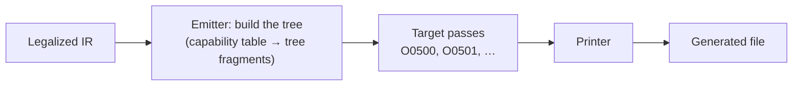

# Backends: tree, passes, printer

**Status:** implemented for the C# and the JavaScript backend of the prototype ([#1336](https://github.com/Hawkynt/Polypiler/issues/1336)); stage 8 of the [pipeline](PIPELINE.md).

A backend does not write text. It builds a syntax tree of its target language from the IR, runs the
target passes over that tree and hands the result to its printer, the only place where generated code
becomes text:

| | C# | JavaScript |
| --- | --- | --- |
| Tree | `Polypiler.Core.Backends.CSharp/Syntax/CSharpSyntax.cs`: compilation unit, namespaces, types, members, statements, expressions | `Polypiler.Core.Backends.JavaScript/Syntax/JavaScriptSyntax.cs`: ESTree-shaped program, statements, expressions |
| Printer | `CSharpPrinter.Print(CsCompilationUnit, CSharpProfile)` | `JavaScriptPrinter.Print(JsProgram, JavaScriptProfile)` |
| Reader | `CSharpSyntaxReader` (Roslyn) | `JavaScriptSyntaxReader` (Acornima) |
| Passes | `CSharpTargetPasses.Pipeline` | `JavaScriptTargetPasses.Pipeline` |
| Tree after the passes | `CSharpEmitter.Build(…)` | `JavaScriptEmitter.Build(…)` |

## The tree

The nodes are immutable records, one per construct the emitter writes. Every expression carries the
IR type it was written for (`Type`; unknown in a helper's source), so a pass can reason about types.
Parentheses are nodes of their own: the emitter puts them where it always has, which keeps the output
of the old string-building emitters byte for byte. A few properties only say how a node is laid out -
a blank line or comment in front of a statement, a block on one line, a line break before an operator,
a tabulated table, the spelling of a literal in a helper's source. They change no meaning, a rewrite
keeps them only on the nodes it does not replace, and a comparison of two trees ignores them.

`CSharpSyntaxRewriter` and `JavaScriptSyntaxRewriter` walk a tree (`DescendantsAndSelf`) and rewrite it
bottom-up (`Rewrite`); a rewrite that changes nothing returns the same tree.

## Helpers and capability rows

A helper stays readable source - C# 2 in `Helpers/` of the C# backend, ECMAScript in `Helpers/` of the
JavaScript backend with the placeholders a level decides (`@let`, `@imul(`, …). The reader parses each
source once, when a module first needs it, and the parsed tree is shared; Roslyn and Acornima already
ship with the frontends, and parsing keeps the helpers editable as source rather than turning them into
code that builds trees. The printer writes every helper back as exactly its source
(`CSharpHelperSyntaxTests`, `JavaScriptHelperSyntaxTests`).

A row of `CSharpCapabilities` still says its form in C# source - a method, a cast, further arguments or
a template with `{0}`, `{1}` and `{h}` - and `CSharpForm.Build` makes it a tree fragment: the template
is parsed once with its places as names, which are then replaced by the argument nodes. Adding a row
is adding its form; nothing else changes. The JavaScript table names what each level has; the emitter
makes the fragment for it.

## Target passes

A pass implements `ITargetPass<TTree, TProfile>` (`Polypiler.Core.Optimize.Target`): an optimization
number `Id`, a `Name` and `Run(tree, profile, applied)`, which returns the rewritten tree and reports
every change. `TargetPipeline` runs the passes in table order, skips those `--disable-opt` names and
runs none at `--opt none`; `--explain-opt` writes every change as a note, as it does for the IR rules,
with which the passes share one namespace of numbers. A pass never prints and never re-parses.

| Number | Pass | What it does |
| --- | --- | --- |
| [O0500](../optimizations/O0500-target-helper-inlining.md) | helper inlining | a call of a single-expression helper becomes its body where the cost rule says so |
| [O0501](../optimizations/O0501-target-unused-declaration-removal.md) | unused declaration removal | a helper or private constant nothing names any more is removed |

The emitter declares only the helpers the code calls (and those they call); O0501 removes what later
passes made unused.

### Adding a pass

1. Take a number of the "Target emission" family of the [catalog](../optimizations/README.md), write
   its page and tick it.
2. Implement `ITargetPass` for each backend it applies to and add it to the backend's pipeline in the
   order it must run.
3. Test it test-first on hand-built trees and on fixtures, both with it on and off; with `--opt none`
   the golden outputs (`tests/fixtures/backend/golden`) must not change.

## Checks

- **Golden outputs:** every source of `tests/fixtures/prototype` in every profile, module format,
  namespace form and floating-point mode, as the emitters wrote them before the trees, recorded by
  `dotnet test Polypiler.Tests -c Release --filter "FullyQualifiedName~GoldenOutputRecorder"`; with
  `--opt none` the backends must reproduce every byte (`GoldenOutputTests`).
- **Parse-back:** every generated file is parsed by Roslyn at the profile's language version and by
  Acornima at the profile's ECMAScript version, read into the tree and compared with the tree it was
  printed from, parentheses and layout aside (`ParseBackTests`).
