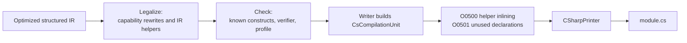

# The C# backend

**Status:** implemented for the prototype's typed IR and the nine target profiles below.
Related: [C# frontend](CSHARP-FRONTEND.md) · [JavaScript backend](JAVASCRIPT-BACKEND.md) ·
[backends: tree, passes, printer](BACKENDS.md) · [pipeline](PIPELINE.md).

`Polypiler.Core.Backends.CSharp` emits one `<module>.cs` file: a static host class containing the
module's functions, constants, state and required helpers, together with its supported types.
For a JavaScript source named `example.js`:

```sh
polypiler translate example.js --from javascript --to csharp --profile net10.0 --output generated
```

The file is `generated/example.cs`. `--namespace Example.Generated` places the output in a
namespace. The CLI writes a separate `polypiler.manifest.json`; the emitter API returns generated
files and helper metadata, not a built assembly or a project file.

## Pipeline and project



| Source | Responsibility |
| --- | --- |
| [CSharpEmitter.cs](../../Polypiler.Core.Backends.CSharp/CSharpEmitter.cs) | `Check`, `Legalize`, `Build`, `Emit`, names and core lowering |
| [Profiles/](../../Polypiler.Core.Backends.CSharp/Profiles/) | `CSharpProfile`, capability rows and family-specific API forms |
| [Syntax/](../../Polypiler.Core.Backends.CSharp/Syntax/), [Printing/](../../Polypiler.Core.Backends.CSharp/Printing/) | Typed target syntax, reader/rewriter and final formatting |
| [Passes/](../../Polypiler.Core.Backends.CSharp/Passes/) | Target passes after IR lowering |
| [IR helpers](../../Polypiler.Core.IR/Helpers/) | Shared implementations bound into ordinary IR functions during legalization |

The overload of `Emit` taking `TargetPassOptions` runs the target passes as `translate` does.
Simpler overloads print without those passes. `Build` exposes the target tree after the requested
passes. Library callers must supply appropriately legalized IR; `Check` reports why a module
cannot be written for the chosen profile.

## Profiles

The target framework decides API availability. The language version decides syntax. Raising
`--langversion` does not make a newer framework API available.

| `--profile` | Default C# version |
| --- | --- |
| `net2.0` | 2 |
| `net3.5` | 3 |
| `net4.6` | 6 |
| `net4.8` | 7.3 |
| `netstandard2.0` | 7.3 |
| `netstandard2.1` | 8 |
| `netcoreapp3.1` | 8 |
| `net8.0` | 12 |
| `net10.0` (default) | 14 |

`CSharpProfile.TryParse` allows a supported language version at or above the profile's minimum;
a lower or unknown version is refused. `CSharpCapabilities.Default` is the decision table for
language features, APIs, operation forms, replacements and known runtime defects. Older profiles
use supported syntax or helpers; they do not receive calls to APIs their frameworks lack.

## Values and lowering

| IR family | C# representation |
| --- | --- |
| `i8` through `u64`, `bool`, `f32`, `f64` | `sbyte` through `ulong`, `bool`, `float`, `double` |
| Numeric arrays, constants and tables | Typed arrays, constants and read-only tables |
| `str` and enums | `string` with UTF-16 units; enum declarations and underlying integer operations |
| Structs and classes | Value types versus reference types, constructors, fields, properties, inheritance and supported dispatch |
| Optional values | Nullable value types or null references, with explicit null tests |
| Function values | Delegates and closures in the form the language version supports |
| Collections and sequences | BCL containers or helpers preserving the IR contract; iterators or lowered sequence operations |
| Views and pointers | Profile-specific native forms or bounded emulation |
| Arbitrary-precision integers | `System.Numerics.BigInteger` where the profile admits it |

The detailed per-family forms are in [records](../reference/records.md),
[classes](../reference/classes.md), [optional values](../reference/optional-values.md),
[functions and closures](../reference/functions-and-closures.md),
[collections](../reference/collections.md), [sequences](../reference/sequences.md),
[views](../reference/views.md) and [pointers](../reference/pointers.md).

Generic origin metadata lets matching method instantiations share one generic definition when
the profile supports its constraints and the called instantiations also generalize. Other methods
remain concrete; generic classes remain one class per instantiation. Copies without origin
metadata can become overloads. See [generics](../reference/generics.md).

Integer operators preserve width and signedness. Wrapping arithmetic is explicitly `unchecked`,
checked operations use trapping forms, and casts preserve the IR conversion contract. Logical
right shift of a signed value is written through its unsigned representation where the language
has no direct syntax. The consumer's checked compilation setting must not change the result.
[Integer operations](../reference/integer-operations.md) lists the native and helper forms.

Every binary32 result is rounded to `float`. Floating-point legalization selects capability rows
or the shared portable implementation under `--float accurate` (default) or `--float strict`.
Strict mode is the bitwise contract; accurate mode uses only the native error bounds admitted by
the floating-point policy. Availability alone does not establish a valid numerical contract.
See [floating-point operations](../reference/floating-point-operations.md) and
[known runtime defects](../reference/known-runtime-defects.md).

Structured branches, loops and switches remain structured C# rather than a generic dispatch loop.
The writer preserves evaluation order when operands act or trap. Exceptions use the classes of
the [exception reference](../reference/exceptions.md); resource scopes preserve disposal, and
the [async reference](../reference/async.md) specifies the supported task forms.

Foreign functions preserve the imported library identity and marshalling contract. The profile
chooses the declaration form; emitting a declaration does not verify that the user's native
library is installed or ABI-compatible. See [foreign calls](../reference/foreign-calls.md).

## Syntax, names and helpers

The writer builds `CsCompilationUnit`; `CSharpPrinter` is where it becomes text. The syntax reader
uses Roslyn to read printed output back. Names escape C# keywords, and BCL references use qualified
names so a declaration of the translated module cannot hide the intended API.

The shared [helper library](BACKENDS.md#helpers-one-library-in-the-ir) supplies operations missing
from a profile. Required functions and dependencies enter the IR before target writing. Target
passes can inline eligible helpers and remove unused declarations; their switches are ordinary
optimization IDs. Emitted helper origins and licences travel in the header and manifest. Output
licensing is described in [licence of emitted code](../../LICENSE-OUTPUT.md).

## Refusals

| Code | Meaning |
| --- | --- |
| `PLY1052` | An IR construct, type or operation this backend does not know how to write |
| `PLY1053` | A known construct has no permitted native or replacement form in the chosen profile |

Both are unsupported-construct errors (exit 3). Invalid IR also receives verifier diagnostics.
Invalid profile names and invalid `--langversion` combinations are CLI usage errors (`PLY0003`),
not a request to emit modern syntax and hope an older compiler accepts it. See the
[error catalogue](../errors/README.md).

## Verification

[Backend unit tests](../../Polypiler.Tests/Backends/CSharp/) cover capability rows, profiles,
conversions, helper syntax, scope and emitted text. Target-tree tests exercise parsing and target
passes. [CSharpProfilesTests](../../Polypiler.Tests.Acceptance/Prototype/CSharpProfilesTests.cs)
and the other [prototype acceptance tests](../../Polypiler.Tests.Acceptance/Prototype/) compile
and run translations against the original C# or JavaScript and the IR interpreter.

An older syntax profile compiled by a modern Roslyn/runtime is evidence for its syntax and tested
contracts, not evidence that that older runtime itself executed the program. Gate records and the
[capability report](../capabilities.md) distinguish emitted, compiled, executed and verified states.
