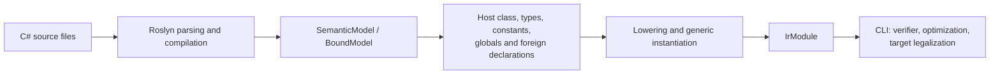

# The C# frontend

**Status:** implemented for the prototype subset, with the value, object and control-flow
families described below. This is an implementation guide, not a claim that arbitrary C# projects
can be imported. Related: [C# backend](CSHARP-BACKEND.md) ·
[JavaScript frontend](JAVASCRIPT-FRONTEND.md) · [pipeline](PIPELINE.md).

`Polypiler.Core.Frontends.CSharp` uses Roslyn to bind C# source and lowers the supported constructs
into the typed, structured IR. For example, save this as `Example.cs`:

```csharp
public static class Example {
  public static uint Twice(uint x) => unchecked(x * 2u);
}
```

```sh
polypiler translate Example.cs --from csharp --to javascript --output generated
```

The default JavaScript target writes `generated/Example.mjs`; `Twice(21)` returns `42`.
The output also includes `polypiler.manifest.json`. A successful translation records generation;
it does not by itself prove that a runtime compiled or executed the output.

## Pipeline and project



| Source | Responsibility |
| --- | --- |
| [CSharpFrontend.cs](../../Polypiler.Core.Frontends.CSharp/CSharpFrontend.cs) | `Import`, Roslyn references, compiler diagnostics and the source list |
| [Lowering.cs](../../Polypiler.Core.Frontends.CSharp/Lowering.cs) | The host class, declarations, method bodies, expressions and type mapping |
| [Integer/](../../Polypiler.Core.Frontends.CSharp/Integer/) | Symbol-based mapping of integer and bit APIs |
| [Records/](../../Polypiler.Core.Frontends.CSharp/Records/), [Objects/](../../Polypiler.Core.Frontends.CSharp/Objects/) | Value records, classes and their declarations and bodies |
| [Functions/](../../Polypiler.Core.Frontends.CSharp/Functions/), [Generics/](../../Polypiler.Core.Frontends.CSharp/Generics/) | Function values, captures and generic specialization |
| [Globals/](../../Polypiler.Core.Frontends.CSharp/Globals/), [Interop/](../../Polypiler.Core.Frontends.CSharp/Interop/) | Module initialization and foreign function declarations |
| [Sequences/](../../Polypiler.Core.Frontends.CSharp/Sequences/), [String/](../../Polypiler.Core.Frontends.CSharp/String/) | Iterators, LINQ, strings and number/text conversion |
| [Views/](../../Polypiler.Core.Frontends.CSharp/Views/), [Pointers/](../../Polypiler.Core.Frontends.CSharp/Pointers/) | Bounded views and unsafe source operations |

## Parsing, binding and the import boundary

`CSharpFrontend.Import(path, source)` imports one file. The overload taking an ordered list of
`CSharpSource` imports parts of the same host class; it refuses files declaring different host
classes. Supporting types can be beside or inside that class. Namespaces and `using` directives
are resolved by Roslyn; the module is named after the host class.

Parsing uses `LanguageVersion.Latest` of the Roslyn package shipped with the frontend. The
documented source dialect is C# 14 on .NET 10; the target's `--profile` does not select the source
language version. The compilation uses the running process's core-library metadata, collections
and, when needed, LINQ references. It is not a project build: it does not restore a `.csproj`, load
arbitrary project references or run source generators. The missing generated implementation of a
supported `[LibraryImport]` declaration is handled explicitly by the importer.

Roslyn resolves symbols and rejects invalid source before subset lowering. API maps use the bound
method or type, rather than accepting a user-defined method because its name resembles a BCL API.
`ImportLibrary` is a separate entry point for Polypiler's own helpers: its named intrinsic stubs
become IR operations instead of imported functions.

## Values and constructs

| Source family | Representation and detailed contract |
| --- | --- |
| `sbyte` through `ulong`, `char`, `bool` | Fixed-width IR integers, `u16` for `char`, and `bool`; [integer operations](../reference/integer-operations.md) |
| `float`, `double` | `f32` and `f64`, with explicit conversions and binary32 rounding; [floating-point operations](../reference/floating-point-operations.md) |
| Numeric arrays and supported array operations | Typed arrays with explicit indexing, copy and fill behavior |
| `struct`, `readonly struct`, record structs | IR value records and value copies; [records](../reference/records.md) |
| Supported classes, record classes and interfaces | IR object identity, constructors, members and dispatch; [classes](../reference/classes.md) |
| Nullable values and null-aware operators | Explicit optional operations; [optional values](../reference/optional-values.md) |
| Enums | Named integer types and their operations; [enums](../reference/enums.md) |
| Delegates, lambdas and local functions | Function references and closures; [functions and closures](../reference/functions-and-closures.md) |
| Generic methods and supported generic types | Closed instantiations, not open generic IR; [generics](../reference/generics.md) |
| `List`, `Dictionary`, `HashSet` operations | Typed collections with their equality and enumeration contracts; [collections](../reference/collections.md) |
| Iterators and supported LINQ chains | Lazy sequences and explicit sequence operations; [sequences](../reference/sequences.md), [sequence operations](../reference/sequence-operations.md) |
| Restricted `async`/`await` | The order-insensitive subset, not arbitrary task scheduling; [async functions](../reference/async.md) |
| Strings and number/text APIs | UTF-16 units and mapped ordinal/formatting operations; [strings](../reference/string-operations.md), [number text](../reference/number-text.md) |
| Static fields | Constants, read-only tables or module state with checked initialization; [module state](../reference/module-state.md) |
| `Span`, memory, unsafe pointers | Bounded regions and views, not unrestricted native addresses; [views](../reference/views.md), [pointers](../reference/pointers.md) |
| P/Invoke declarations | Explicit foreign functions and marshalling contracts; [foreign calls](../reference/foreign-calls.md) |

The body is structured IR: blocks, conditions, loops, switches, returns, exceptions and resource
scopes. It is not a typed SSA graph with phis. Each family above has restrictions; its reference
page describes the accepted forms and counterexamples.

## Semantic rules

Roslyn's bound types determine promotion, signedness, overload selection for mapped APIs and
conversions. Ordinary runtime integer arithmetic wraps by default. `checked` and `unchecked`
override that context, and the library API's `checkedByDefault` argument supplies a compilation
default. Checked runtime operations become trapping IR operations; an overflowing constant
expression is a source diagnostic. A backend preserves those operations independently of its
consumer's overflow settings.

The importer keeps evaluation order and models traps, `try`/`catch`/`finally` and disposal in the
IR. The [exception reference](../reference/exceptions.md) gives their cross-language mapping.
Unsafe source is parsed with `allowUnsafe`, but only the bounded pointer forms described in the
pointer reference lower successfully.

Number/text conversions without a provider use invariant culture in the imported module, rather
than the caller's thread culture. The caveat `cs-invariant-culture` records this difference. A
translation must not be advertised as preserving culture-dependent formatting without that
qualification.

## Refusals and diagnostics

| Code | Meaning |
| --- | --- |
| `PLY1000` | A Roslyn compiler error, including the original compiler code and source location; exit 4 |
| `PLY1002` | Valid C# outside the supported subset; exit 3 |
| `PLY1003` | An overflowing constant expression (`CS0220` or `CS0221`); exit 4 |

The host class is not a general overload set: same-named host methods are refused. Parameter
modifiers such as `ref`, `out`, `in` and `params`, and default parameter values, are also refused
by this import path. A static constructor, unsupported static property, unknown BCL call or
unsupported type is not silently omitted. Family-specific diagnostics are listed in the
[error catalogue](../errors/README.md).

For example, a host method taking `ref int x` is valid C# but receives `PLY1002`; a source that fails
Roslyn binding receives `PLY1000` instead. Neither result produces a usable imported module.

## Verification

[Frontend unit tests](../../Polypiler.Tests/Frontends/CSharp/) exercise the importer, partial-class
input, API mappings and refusals. Shared construct tests cover the reference-page families.
[Prototype acceptance tests](../../Polypiler.Tests.Acceptance/Prototype/) compile the C# original,
interpret the imported module and execute emitted output, using the fixtures in
[`tests/fixtures/prototype`](../../tests/fixtures/prototype/). Profile tests also check older
target syntax and runtime capabilities; see the [C# backend](CSHARP-BACKEND.md#verification).
