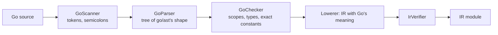

# Go frontend

**Status:** implemented for the subset below ([#687](https://github.com/Hawkynt/Polypiler/issues/687): [#697](https://github.com/Hawkynt/Polypiler/issues/697), [#694](https://github.com/Hawkynt/Polypiler/issues/694), [#695](https://github.com/Hawkynt/Polypiler/issues/695)); stage 1 of the [pipeline](PIPELINE.md). Related: [Go backend](GO-BACKEND.md) · [import differences](../reference/import-differences.md).

`Polypiler.Core.Frontends.Go` imports one Go package file into the IR.



```text
polypiler translate checksums.go --from go --to csharp --output out
```

No Go has to be installed: the frontend parses and type-checks Go itself and starts no process.

## Parsing: the frontend's own scanner and parser

`Syntax/GoScanner.cs` is the lexical grammar of the specification, converted from `go/scanner`:
identifiers (Unicode letters and digits), keywords, every operator, integer literals in every base
with `_` separators (`0x`, `0o`, a leading `0`, `0b`), decimal and hexadecimal floats, imaginary
literals, rune literals, interpreted strings with every escape and raw strings without their
carriage returns, comments, and the automatic semicolon after a line's last token where that token
can end a statement. A `//go:build` line before the package clause sets the language version of the
file to the one it implies, go1.21 at the least, as go/types does.

`Syntax/GoParser.cs` is a recursive descent over the whole grammar, converted from `go/parser` with
its look-ahead decisions - a composite literal in a control clause, a type parameter list against an
array length (`type T[P *C] …` is an array, as in go/parser), a type switch guard - and its messages.
It builds `Ast/GoNode` trees with the node types and field names of `go/ast`. The first error decides
the verdict, as go/parser's first error does; a nesting deeper than 1000 levels is refused.

## Type checking: the frontend's own checker

`Checking/GoChecker*.cs` type-checks one package file by the rules of the specification and of
go/types:

- **Names**: the universe, the package, the file's imports, function and block scopes; package-level
  declarations are checked lazily in dependency order, with cycles of constants, types
  (`invalid recursive type`) and initialization (`initialization cycle`) detected.
- **Constants** (`Checking/GoConstant.cs`, go/constant's representation): integers of any size,
  fractions while numerator and denominator stay below 4096 bits, 512-bit binary floats beyond; an
  untyped integer may have 512 bits, a typed constant must be representable in its type after every
  operation (`constant 200 overflows int8`), float32 and float64 constants are rounded once to nearest
  even; `iota` and implicit repetition; untyped bool, int, rune, float and string with their default
  types; a shift of an untyped constant by a variable count takes the type its context gives.
- **Expressions**: assignability and convertibility, the operators with their operand rules, division
  by a constant zero, shifts, comparisons, selectors with method sets and automatic dereference,
  indexes and slices with constant bounds, composite literals with elided element types, function
  literals, calls with variadic and multi-value arguments, conversions, and the built-ins `append`,
  `cap`, `clear`, `copy`, `delete`, `len` (constant of arrays and constant strings), `make`, `max`,
  `min`, `new` (of an expression from go1.26), `panic`, `print`, `println`, `recover`.
- **Statements**: every simple statement, `:=` with its redeclaration rules, `if`, `switch` with
  duplicate constant cases and `fallthrough`, every `for` and `range` (over strings, arrays, pointers
  to arrays, slices, maps and, from go1.22, integers), `go`, `defer`, `return` with named results,
  labels with `break`, `continue` and `goto` (no jump into a block or over a declaration), terminating
  statements (`missing return`), unused variables and imports.
- **Packages**: `math` and `math/bits`, read from their declarations (`Checking/GoLibrary.cs`, the
  constants copied from the Go distribution).

What the checker does not model - generics, channels and `select`, type switches and assertions,
embedded fields and interfaces, complex numbers, other imports - is refused by name with PLY2101 or
PLY2102, so that a verdict the frontend gives is always Go's. The algorithms of go/scanner,
go/parser, go/constant and go/build/constraint are converted under their BSD-3-Clause licence
(`THIRD-PARTY-NOTICE.Go.txt`).

## Subset

| Go | IR |
| --- | --- |
| `int8` … `uint64`, `int`/`uint` (64 bits), `float32`, `float64`, `bool`, `string`, `[]T`, struct types, defined types | the IR's types; a defined type is its underlying type |
| constant expression | the exact value the checker computes, one constant of the type it takes |
| `+ - * & \| ^ &^` | the IR's operator at the width of the type, wrapping, without promotion |
| `/ %` | truncating; a signed one by a divisor that may be -1 through a helper that wraps `MinInt / -1` and gives 0 for `MinInt % -1` |
| `<< >>` | a constant count below the width as the IR's shift; any other through a helper: a count of the width or more gives 0 (or the sign), a negative one traps |
| conversions | wrapping between integers; float to integer saturates (caveat `go-float-to-int`) |
| float `+`/`-` of a product | not fused (caveat `go-fma-unfused`) |
| `if`, `for` (all forms), `range` over an integer or a slice, `switch`, `break`, `continue` | the IR's statements; a loop variable is a new variable in every pass from 1.22 |
| `len`, `make`, `min`, `max`, `panic(string)` | `ArrayLength`, `NewArray`, `Min`, `Max`, a throw |
| `math` (exact and transcendental functions, bit casts), `math/bits` (rotates, counts, reversals, `Len`) | the IR's intrinsics |

An index wider than 32 bits is clamped into the IR's `i32`, so that a value outside it is out of
range rather than wrapped into it. A local whose name an inner scope reuses gets a name of its own.

## Diagnostics

`PLY2100` for every error of Go: `Go syntax error: …` for what the scanner and parser refuse,
`Go type error: …` for what the checker refuses (an unused variable or import, a mismatched type, a
constant that overflows, a missing return); `PLY2101` for a type outside the subset (pointers, maps,
channels, functions, interfaces, complex numbers); `PLY2102` for a construct outside it: methods,
generics, several or named results, variadic parameters, goroutines, `defer`, `select`, closures,
slice expressions, `append`, `goto`, `fallthrough`, a `break` or `continue` of an outer statement,
imports other than `math` and `math/bits`, a function without a body, a global of a struct type.

## Checks

`Polypiler.Tests/Frontends/Go` imports the fixtures of `tests/fixtures/go/frontend` - checksums with
their published vectors and Go's arithmetic, the forms of the subset, one source per refused
construct - and runs the cases of `tests/fixtures/go/checker/*.txtar`: one file per syntax and type
error the frontend reports, valid files over every construct the checker models with the exact
constants go/types gives them, and the constructs it refuses. Go itself is only the oracle of the Go
layer (`GoOracleTests`): `Polypiler.Tests.Acceptance/Go/Oracle/oracle.go`, built with the pinned
`go`, has go/parser and go/types decide the same cases and fixtures, every `.go` file of the
distribution's `src/` and `test/` for the parser, and the type checker's own test data and `test/`
for the checker; the frontend's verdicts and constants must be Go's wherever it gives one. The Go
layer also writes the imported checksums back through the Go backend and runs them under `go`.
