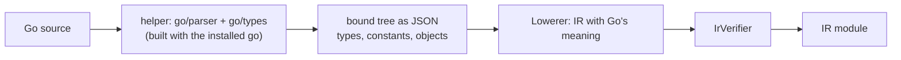

# Go frontend

**Status:** implemented for the subset below ([#687](https://github.com/Hawkynt/Polypiler/issues/687): [#697](https://github.com/Hawkynt/Polypiler/issues/697), [#694](https://github.com/Hawkynt/Polypiler/issues/694), [#695](https://github.com/Hawkynt/Polypiler/issues/695)); stage 1 of the [pipeline](PIPELINE.md). Related: [Go backend](GO-BACKEND.md) · [import differences](../reference/import-differences.md).

`Polypiler.Core.Frontends.Go` imports one Go package file into the IR.



```text
polypiler translate checksums.go --from go --to csharp --output out
```

## Parsing: the type checker of Go

Go's own `go/parser` and `go/types` parse and type-check the source, as the Python frontend lets
CPython's `ast` parse. `AstDump/main.go` is a helper program that reads the source on standard input,
parses it, type-checks it - standard-library imports resolved from the source of the installed
GOROOT - and prints the bound tree as JSON: every node with its type, its mode and, for a constant
expression, the exact value `go/types` computed; every identifier with the object it names. It never
builds, links or runs the source. The frontend builds the helper once with the installed `go` into a
cache keyed by the helper's text and the Go version (`POLYPILER_GO` names the `go` command,
`POLYPILER_GO_CACHE` the cache), always with `GOTOOLCHAIN=local`, `GOPROXY=off`, `CGO_ENABLED=0`.

**Choice.** `translate --from go` depends on an installed Go, as `--from python` depends on CPython.
A recursive-descent parser in C# would need none, but it would re-derive what only the type checker
knows exactly - the type every untyped constant takes in its context, the exact value of a constant
expression of any magnitude, the resolution of every name, and the compile errors Go defines (an
unused variable or import, a constant that overflows) - and every difference would be a silent
mistranslation. The helper gives the compiler's answer; its JSON can also be recorded, which is how
the unit tests run without Go (`GoImportOptions.Dump`).

## Subset

| Go | IR |
| --- | --- |
| `int8` … `uint64`, `int`/`uint` (64 bits), `float32`, `float64`, `bool`, `string`, `[]T`, struct types, defined types | the IR's types; a defined type is its underlying type |
| constant expression | the exact value of `go/types`, one constant of the type it takes |
| `+ - * & \| ^ &^` | the IR's operator at the width of the type, wrapping, without promotion |
| `/ %` | truncating; a signed one by a divisor that may be -1 through a helper that wraps `MinInt / -1` and gives 0 for `MinInt % -1` |
| `<< >>` | a constant count below the width as the IR's shift; any other through a helper: a count of the width or more gives 0 (or the sign), a negative one traps |
| conversions | wrapping between integers; float to integer saturates (caveat `go-float-to-int`) |
| float `+`/`-` of a product | not fused (caveat `go-fma-unfused`) |
| `if`, `for` (all forms), `range` over an integer or a slice, `switch`, `break`, `continue` | the IR's statements; a loop variable is a new variable in every pass from 1.22 |
| `len`, `make`, `min`, `max`, `panic(string)` | `ArrayLength`, `NewArray`, `Min`, `Max`, a throw |
| `math` (exact and transcendental functions, bit casts), `math/bits` (rotates, counts, reversals, `Len`) | the IR's intrinsics |

An index wider than 32 bits is clamped into the IR's `i32`, so that a value outside it is out of
range rather than wrapped into it. A local whose name an inner scope reuses gets a name of its own.

## Diagnostics

`PLY2100` for anything the parser or type checker reports, and for a helper that cannot run;
`PLY2101` for a type outside the subset (pointers, maps, channels, functions, interfaces, complex
numbers); `PLY2102` for a construct outside it: methods, generic functions, several or named results,
variadic parameters, goroutines, `defer`, `select`, closures, slice expressions, `append`, `goto`,
`fallthrough`, a `break` or `continue` of an outer statement, imports other than `math` and
`math/bits`.

## Checks

`Polypiler.Tests/Frontends/Go` runs the frontend on the recorded trees of
`tests/fixtures/go/frontend` - checksums with their published vectors and Go's arithmetic, and one
source per refused construct - and, where Go is installed, checks that the helper still prints them.
The Go layer writes the imported checksums back through the Go backend and runs them under `go`.
