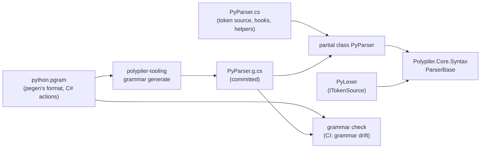

# Grammars and generated parsers

A frontend's parser is a grammar, a token source and a hand-written half of a partial class
([ADR 1000](../adr/1000-grammar-described-frontends.md)). `polypiler-tooling grammar generate` turns
the grammar into the other half, which runs on `Polypiler.Core.Syntax`; the generated file is
committed beside its grammar, and the CI job `grammar drift` fails when it is not the grammar's
output. Related: [pipeline](PIPELINE.md) · [Python frontend](PYTHON-FRONTEND.md).



## The format

The format is pegen's ([PEP 617](https://peps.python.org/pep-0617/), `Tools/peg_generator/pegen/metagrammar.gram`),
so CPython's `Grammar/python.gram` reads as it is: `polypiler-tooling grammar read python.gram --tokens Tokens`
reads and checks it and finds the left-recursive rules pegen finds.

| Written | Means |
| --- | --- |
| `rule[Type]: a b \| c` | a rule with the C# type of its result; alternatives may also start on the following, indented lines with `\|` |
| `rule (memo): …` | the result is memoized per position and hook state |
| `n=item`, `n[Type]=item` | a named item, as the action reads it; the type casts it |
| `{ expression }` | the action, a C# expression taken as written; `{ throw … }` raises |
| `( … )`, `[ … ]`, `e?`, `e*`, `e+`, `s.e+` | group, optional, repetitions, gather (the separators dropped) |
| `&e`, `!e` | lookahead that consumes nothing |
| `~` | cut: once passed, the rule's later alternatives are not tried |
| `&&'x'`, `&&( … )` | forced: the absence is the error `expected 'x'` at once |
| `'if'`, `"match"`, `'+'` | keyword, soft keyword, operator; `NAME` in upper case is a token kind |
| `$` | the end of the input (`ENDMARKER`) |

The semantics are pegen's, including the corners: an alternative is tried at the position the rule
started at; a rule whose matching alternative yields `null` fails; an alternative without action
yields its one item, or `Dummy` where it has several; left recursion is found as pegen finds it
(the nullable rules, the first-name graph, its strongly connected components, one leader per
component) and grown by seed growing at the leader; every rule call, artificial ones included, is
one level of nesting. Rules named `invalid_*`, as the one item of an alternative, are tried only in
the second pass, and a rule whose name ends in `without_invalid` turns them off inside it.

### What ADR 1000 adds

| Written | Means |
| --- | --- |
| `@hooks "a b"`, `a(e)` | `EnterA()` before and `LeaveA()` after `e`, methods of the hand-written half |
| `?name` | a predicate: `bool name()` of the hand-written half, consuming nothing (space before the `?`, a name right after) |
| `@state "a"` | the hook's state is part of the memo key: the hand-written half sets `MemoState` |
| `@axis version`, `@axis dialect` | the axes of the profile the grammar's guards may test |
| `\| @version >= 3.10 items` | an alternative tried only where the profile satisfies the guard |
| `\| @version >= 3.10 @message "…" items` | the alternative matches, then the message is raised where the guard fails (pegen's `CHECK_VERSION`) |
| `@guards runtime` (default), `@guards generate` | guards checked against `Profile` at run time, or evaluated at generation: one parser per `@profile_output "Class axis=value…"` |
| `@extends "base.pgram"` | an overlay: the base's rules and metas, then `@replace rule: …`, `@add rule: …` (alternatives appended, or a new rule), `@remove rule`, `@remove rule: alt` |

The version axis compares dotted numbers (`3.9 < 3.10`), every other axis compares text.

### The metas of a generated grammar

`@class`, `@namespace`, `@token_type` and `@token_kind` name the generated class, its namespace, the
token class (an `IToken<TKind>`) and the kind enum; `@start "a b"` names the start rules, each
generated as a public `ParseA()` (default: the rule `start`). `@tokens` lists the token names, one
per line, as `NAME Kind`, or `NAME - Method Type` where a method of the hand-written half reads the
token. `@literals` maps a literal's spelling to a kind (Go), `@soft_keyword "Method Type"` names the
method that reads a soft keyword (Python), `@dummy "Expression Type"` is the value of an alternative
of several items without action (pegen's dummy name; `Dummy` by default), `@unexplained "…{token}…"`
is the message of an error no rule explains, `@using` adds namespaces and `@output` names another
output file. A name an alternative gives twice reads as `name_1` the second time, as pegen dedupes
it: the action sees the first.

Only a grammar that declares `@class` generates; the output goes beside it as `<class>.g.cs`.

## The runtime

`ParserBase<TToken, TKind>` in `Polypiler.Core.Syntax` keeps the position in a token buffer filled
as far as the rules read; memo tables per rule made on first use; the nesting limit (`MaxNesting`,
default 1000) with `NestingExceeded`; the farthest failure outside lookaheads; and `Run`, the two
passes: the first without the invalid rules, the second, after a failed first only, with them. What
neither explains is `UnexplainedError`, `invalid syntax` at the farthest failure unless the grammar
or the hand-written half says otherwise. The `RaiseSyntaxError…` helpers are pegen's macros.

## Regenerating and checking

```bash
dotnet run --project Polypiler.Tooling -c Release -- grammar generate <grammar.pgram>
dotnet run --project Polypiler.Tooling -c Release -- grammar check        # what the CI job runs
```

The generated file starts with `// <auto-generated>`, the grammar's name and its SHA-256; it is
never edited by hand. `grammar check` regenerates every grammar with `@class` in memory and reports
each committed file that differs (compared with LF line endings), is missing, or has no grammar;
`ci audit` fails where a grammar generates and the workflow has no `grammar-drift` job running it.
