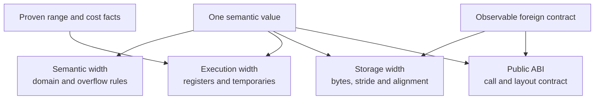

# Canonical IR and analysis contracts

**Status:** proposed semantics, not a claim that these types or passes exist. See [PRD §4](../prd/02-core-architecture.md#s4), [§17](../prd/05-semantics-and-recovery.md#s17) and [§§29–30](../prd/08-interop-and-language-semantics.md).

The IR is language-independent **without erasing source-language behavior**. Some source rules must remain as explicit operations or policies until they are legally lowered. The IR verifier should run at every representation boundary.

## Core data model

- **Values/SSA:** typed constants, instructions, block arguments/phi, control-flow graph, explicit source locations.
- **Semantic types:** sized integers, arbitrary precision when required, floats with format and rounding, fixed point, encoded values, structures, variants, functions, ownership and dynamic shapes.
- **Memory:** allocations, address spaces, provenance, alias classes, byte/bit offsets, alignment, lifetime and storage identity.
- **Effects:** writes/reads, potential faults, exceptions, synchronization, device I/O, external calls, stack/register/flag state and dynamic control flow.
- **Iteration:** induction variables, access functions, strides, reductions, dependences, mutation and evaluation order.
- **Object/runtime:** classes, interface dispatch, generic instantiations, type identity, cleanup, continuations and error-handler regions.
- **Machine:** explicit registers/flags and instruction effects for binary lifting/inline ASM; uninterpreted operations only with conservative effect summaries.
- **Provenance:** source instruction range, import module, optimization provenance and licensing identity.

## Do not conflate widths

Each value can have four independently tracked representations:

| Width | Meaning |
|---|---|
| Semantic | Value-domain requirements and signedness/overflow behavior |
| Execution | Chosen physical register or temporary width |
| Storage | Serialized/in-memory field width, stride and alignment |
| Public ABI | Externally observable width and calling convention |

A semantic 96-bit value whose range is proven to fit eight bits might execute using an 8-bit register, but an exposed foreign 96-bit record still requires its original bytes and alignment at the boundary. Narrowest execution is not automatically fastest; speed, code size, conversions and register pressure all influence selection.

## Abstract interpretation

Analyses should expose facts **at a program point**, not just an unqualified global range:

- intervals, signed and unsigned bounds, known zero/one bits, demanded bits;
- congruences, alignment, affine/index relations and induction bounds;
- float classes, possible NaNs, signed zeros, precision and rounding constraints;
- reference shape, class identity, nullness, escape, ownership and aliases;
- memory effects and summaries across procedures, external calls and ASM.

A pure function does not invalidate unrelated memory facts. A write invalidates facts about possibly overlapping memory; unresolved external code invalidates the appropriate conservative region(s). A stack address is not assumed to be a normal local variable without provenance.

Use fixpoints with widening/narrowing and deterministic budgets where required. After any pass changes the CFG, effects or representation, invalidate or recompute affected facts.

## Numeric, encoded and collection operations

IR semantics should distinguish:

- integer add/sub/mul with **checked**, wrapping and saturating variants;
- signed division modes, carry/borrow, high/wide multiply, bit-count and bit-field operations;
- floating-point format, exceptional values, fused versus non-fused operations, rounding and domain;
- reversible **Encode/Decode** versus numerical **Convert/Quantize** versus bitwise **Reinterpret**;
- arrays/views/iterators/tensors, including laziness, mutation, exceptions and iteration order;
- bit routing/permutations and Boolean transforms (not every routing is invertible).

Canonical intrinsic names permit recognition and late target-specific decomposition. They are not permission to ignore runtime semantics.

## Representative memory/effect nodes

| Conceptual node | Semantics |
|---|---|
| Load/Store | Typed access to an allocation and offset; may trap or be volatile |
| Region/AddressSpace | RAM, device, executable, stack, foreign, near/far, banked |
| ExternalCall | Symbol + ABI + unknown or declared effects |
| MachineInstruction | Decoded register/flag/memory effects |
| OpaqueInstruction | Preserved bytes/text plus worst-case effects and target requirement |
| AbiMaterialize | Create exact external layout at a boundary |
| ResourceScope | Deterministic cleanup across all relevant exits |
| Suspend/Resume | Coroutine or async continuation state |

An example IR fragment is illustrative, **not** a proposed parser grammar:

    %a = Load8(program_ram, base + 0)
    %b = Load8(program_ram, base + 1)
    %sum = AddWithCarry8(%a, %b, incoming_carry)
    Store8(program_ram, base + 2, %sum.value)
    ObserveFlags(%sum.flags)  // retained only if flags are live

## Pass contract and invariants

Every transformation needs:

1. **Pattern:** the precise source/IR form being recognized.
2. **Preconditions:** type, range, order, alias, effect, arithmetic and target restrictions.
3. **Replacement:** a canonical operation or target-representable graph.
4. **Proof:** established rewrite theorem, solver result or independently verified equivalence obligation.
5. **Diagnostics:** why the pass succeeded, declined or used guarded specialization.
6. **Tests:** positive, negative and boundary cases; a failed proof must not enable a rewrite.

Unknown is **not false** and not **proven safe**. A timeout never counts as a proof.

Related: [pipeline](PIPELINE.md) · [semantic recovery](SEMANTIC-RECOVERY.md) · [foreign interop](INTEROP.md).
