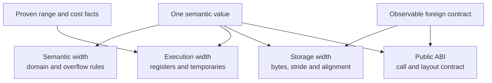

# Canonical IR and analysis contracts

**Status:** proposed semantics, not a claim that these types or passes exist. See [PRD §4](../prd/02-core-architecture.md#s4), [§17](../prd/05-semantics-and-recovery.md#s17) and [§§29–30](../prd/08-interop-and-language-semantics.md).

The IR is language-independent **without erasing source-language behavior**. Some source rules must remain as explicit operations or policies until they are legally lowered. The IR is the structured typed tree of `Polypiler.Core.IR` ([ADR 0009](../adr/0009-structured-tree-ir.md), superseding the SSA parts of [ADR 0001](../adr/0001-ir-stage-invariants.md)); the verifier runs on every module before it is interpreted or emitted, and target legality is checked per profile by legalization and the backend's capability table.

## Core data model

- **Values and control:** typed expressions over named locals in structured statements (blocks, `if`, loops, `switch`, `break`/`continue`, `return`), explicit source locations. No SSA storage form; an analysis may derive an SSA view and map its results back to tree nodes.
- **Semantic types:** sized integers, arbitrary precision when required, floats with format and rounding, fixed point, encoded values, structures, variants, functions, ownership and dynamic shapes.
- **Memory:** allocations, address spaces, provenance, alias classes, byte/bit offsets, alignment, lifetime and storage identity.
- **Effects:** per-function summaries (`IrEffects`) of writes/reads, potential faults, exceptions, synchronization, device I/O, external calls, stack/register/flag state and dynamic control flow.
- **Iteration:** induction variables, access functions, strides, reductions, dependences, mutation and evaluation order.
- **Object/runtime:** classes, interface dispatch, generic instantiations, type identity, [cleanup, continuations and error-handler regions](LANGUAGE-LOWERING.md).
- **Machine:** explicit registers/flags and instruction effects for binary lifting/inline ASM; uninterpreted operations only with conservative effect summaries. These live on a level of their own, [MachineIR](MACHINE-IR.md), which is raised to and lowered from this IR.
- **Provenance:** source instruction range, import module, optimization provenance and licensing identity.

## Do not conflate widths

Each value can have four independently tracked representations:

| Width | Meaning |
|---|---|
| Semantic | Value-domain requirements and signedness/overflow behavior |
| Execution | Chosen physical register or temporary width |
| Storage | Serialized/in-memory field width, stride and alignment |
| Public ABI | Externally observable width and calling convention |

A semantic 96-bit value whose range is proven to fit eight bits might execute using an 8-bit register, but an exposed foreign 96-bit record still requires its original bytes and alignment at the boundary. Narrowest execution is not automatically fastest; speed, code size, conversions and register pressure all influence selection.

## Abstract interpretation

Analyses should expose facts **at a program point**, not just an unqualified global range:

- intervals, signed and unsigned bounds, known zero/one bits, demanded bits;
- congruences, alignment, affine/index relations and induction bounds;
- float classes, possible NaNs, signed zeros, precision and rounding constraints;
- reference shape, class identity, nullness, escape, ownership and aliases;
- memory effects and summaries across procedures, external calls and ASM.

A pure function does not invalidate unrelated memory facts. A write invalidates facts about possibly overlapping memory; unresolved external code invalidates the appropriate conservative region(s). A stack address is not assumed to be a normal local variable without provenance.

Use fixpoints with widening/narrowing and deterministic budgets where required. After any pass changes the CFG, effects or representation, invalidate or recompute affected facts.

### The fact facade (what exists)

`Polypiler.Core.Analysis` holds the one place a pass asks for facts (#88). The IR is a structured tree,
so a **program point** is `ProgramPoint(block, index)`: the point before statement `index` of a block
node, or its end when the index is the number of statements; the edge into a branch of an `IrIf` is the
entry of that branch. Points compare by the identity of the block node, not by record equality.

- `ValueFacts` answers `Get<TFact>(value, point)` for any registered domain. A domain without a provider,
  a provider that gives up (`FactUnavailableException`) and a provider out of its budget (PLY0301, once
  per domain) all answer the domain's `Unknown`; only `Require` insists (PLY0300). `Decide` asks every
  provider that decides comparisons and reports two that contradict each other (PLY0302). `Describe`
  lists one line per domain in the order of the domain names. A value may only be asked about where every
  variable it reads is defined; elsewhere the query is an `ArgumentException`.
- A fact type names its domain (`IFact<TSelf>.Domain`); a domain (`IFactDomain<TFact>`) is a lattice with
  `Unknown` on top, `Unreachable` at the bottom, join, meet, widening and `Contains` for an observed value.
- `TreeDataflow<TFact>` walks the tree forward: joins after branches, iterates loops to a fixpoint and
  widens after three passes, records the state at every point. A variable a lambda captures or whose
  address is taken is always `Unknown`; a write inside an expression forgets the variable; catch and
  finally blocks start from the state before the `try` with what it may write forgotten.
- `ConstantAnalysis` is the first provider: integer and truth constants, folded by the interpreter
  itself, refined on the edges of `==`, `!=`, truth variables, `!`, `&&` and `||`.
- `RangeAnalysis` is a minimal interval provider (`ValueRange`, mathematical integers, so a `u64` fits):
  exact constants, sums, differences and products while they stay within the type, masks with a
  non-negative operand, remainders and divisions by a positive divisor, and the edges of `<`, `<=`, `>`,
  `>=` and `==`. The full range analysis (#94) is to replace it.
- `ProvenanceAnalysis` (#93) gives every bounded pointer its allocation sites - a `stackalloc`, a pin, the
  address of a local; at most four, more is `Unknown` - its byte offset as a `ValueRange` and whether it may
  be null. Pointer arithmetic adds the range of its count times the element size, read from the range
  analysis at the same point; an offset that may leave 64 bits is `Unknown`, the sites stay. `IsInBounds`
  answers `True` only for a never-null pointer whose every site has a known size that holds the access,
  `False` when every possible pointer leaves its region. A pointer bumped in a loop keeps its site but
  loses its offset to widening: narrowing by the loop's trip count is not done yet. The IR stores no
  pointer to memory and has no integer-to-pointer conversion, so those sources of the issue do not arise.
- `ScalarEvolution` (`Polypiler.Core.Analysis.Scev`, #350) describes the loops of a function: an
  induction variable is one a loop writes exactly once, by `v = v ± s` or `v++` with an invariant `s`,
  directly in its body before any `continue`, or in an `IrFor`'s step. Read where a pass starts, it is an
  `Evolution.AddRec(start, step)`; sums, differences, negations, products with an invariant and constant
  left shifts of such values, single definitions in the body (`At` reads them at a point after the steps
  that ran) and truncations stay recurrences, an extension only with its no-wrap flag. `TripCountOf`
  gives `Exact`, `Symbolic(value, offset)`, `Max` or `Unknown` for a `while` or `for` test comparing a
  recurrence with an invariant, or a conjunction of such tests, from the constant and range facts at the
  point before the loop: a count only where no value the test reads can wrap first, an `!=` test only when
  the step divides the distance, a bound when the body can also `break`, `return` or `throw`. The no-wrap
  flags come from such a count or from a checked step - never from the source language. A `do`-`while`
  has recurrences but no count. `ValueFacts.EvolutionOf` and `TripCountOf` ask through the facade. The
  tests hold the analysis against the iteration traces of 2 000 seeded loops (seed 315) in the
  interpreter, and the PB-Compiler cases it is converted from.
- `DynamicFacts` (`Polypiler.Core.Analysis.Dynamic`, #1581) is the domain of what a dynamic place may
  hold ([ADR 0300](../adr/0300-static-types-first.md) decision 2): a `DynamicType` - `Nothing`, `Exact`
  (one IR type, with the language's kind where two kinds share one, such as Visual Basic's `Currency` on
  an `i64`), `Nominal`, `Shape`, `Optional` (the language's missing values `Null`, `Undefined`, `Empty`),
  `Union` (2 to 4 members) or `Variant` - with a `Certainty` from `Dynamic` to `Proven`. Elements are
  canonical: an optional is outermost, so a union's members are exact, nominal or shapes. Joins go up:
  two exact types join where the language's `IJoinPolicy` cannot tell them apart, two shapes of the same
  field names field by field, everything else to a union, a fifth member to `Variant`; a join takes the
  weaker certainty. The widening turns shapes nested deeper than four into `Variant`. `DynamicState`
  carries the facts of the places at a point and joins them place by place. The tests check the lattice
  laws - commutative, associative, idempotent joins, bounds, monotone widening - over every pair and
  triple of 40 generated elements under two policies.
- `FactChecker` holds every answered query against runs of the interpreter, which reports each point it
  reaches to an `IIrObserver`; a value a run observes outside its fact is PLY0302. The tests check the
  constant domain on 10 000 seeded random functions (`RandomIr`, seed 300) and on loops, switches and
  exception handlers of real C#.

## Numeric, encoded and collection operations

IR semantics should distinguish:

- integer add/sub/mul with **checked**, wrapping and saturating variants;
- signed division modes, carry/borrow, high/wide multiply, bit-count and bit-field operations;
- floating-point format, exceptional values, fused versus non-fused operations, rounding and domain;
- reversible **Encode/Decode** versus numerical **Convert/Quantize** versus bitwise **Reinterpret**;
- arrays/views/iterators/tensors, including laziness, mutation, exceptions and iteration order;
- bit routing/permutations and Boolean transforms (not every routing is invertible).

Canonical intrinsic names permit recognition and late target-specific decomposition. They are not permission to ignore runtime semantics.

## Representative memory/effect nodes

| Conceptual node | Semantics |
|---|---|
| Load/Store | Typed access to an allocation and offset; may trap or be volatile |
| Region/AddressSpace | RAM, device, executable, stack, foreign, near/far, banked |
| ExternalCall | Symbol + ABI + unknown or declared effects |
| `IrWriteLine` | Ordered standard output of one typed string |
| MachineInstruction | Decoded register/flag/memory effects |
| OpaqueInstruction | Preserved bytes/text plus worst-case effects and target requirement |
| AbiMaterialize | Create exact external layout at a boundary |
| ResourceScope | Deterministic cleanup across all relevant exits |
| Suspend/Resume | Coroutine or async continuation state |

Bind an interpreter output sink with `IrInterpreter.Instantiate(module, sink)`. The sink receives
one text record per write, with an empty record for a null string. The target runtime determines the
line ending and encoding. Initializers and nested calls use the same instance sink. Earlier records
remain available if a later operation traps. The C# backend emits the string overload of
`System.Console.WriteLine` in every profile, so the host console controls line endings and encoding.

An example IR fragment is illustrative, **not** a proposed parser grammar:

    %a = Load8(program_ram, base + 0)
    %b = Load8(program_ram, base + 1)
    %sum = AddWithCarry8(%a, %b, incoming_carry)
    Store8(program_ram, base + 2, %sum.value)
    ObserveFlags(%sum.flags)  // retained only if flags are live

## Source locations and provenance

What exists today, on the prototype's tree IR (`Polypiler.Core.IR`), where an instruction is a
statement (`IrStmt`) other than a block:

- **Sources.** `IrModule.Sources` lists the `SourceArtifact`s a module was made from: repository,
  commit, path relative to the repository, SHA-256 of the file and dialect ID (`pb/3.5`). Never an
  absolute local path, never the text.
- **Origins.** `IrStmt.Origins` and `IrExpr.Origins` hold, in order, any number of `SourceSpan`
  (source index, 1-based start and end line and column, end exclusive, columns in UTF-16 code units;
  `SourceSpan.FromOffsets` computes one from text offsets), `AddressSpan` (source index, byte offset,
  length, for binary inputs) and `Synthetic` (the ID of the pass that made the node). Origins take no
  part in equality, hashing or `ToString`: two nodes that differ only in origins are equal and
  interchangeable for every pass.
- **Rewrites.** A `with` expression copies origins, and `IrTree.With` keeps them also for the
  expressions it rebuilds with `new`. `IrOrigins.Replace(replacement, replaced...)` gives a
  replacement the origins of everything it replaces, in their order (one for a replacement, N for a
  merge); `IrOrigins.MarkSynthetic(node, passId)` marks a node a pass inserted; `IrOrigins.Split`
  leaves both halves of a split block the block's origins. A missing origin is never borrowed from a
  neighbour.
- **Verification.** `IrVerifier.Verify` runs `OriginRule`: a malformed origin or source is PLY0116,
  an origin naming a source index at or past `Sources.Count` is PLY0117, and in a module that declares
  sources every instruction without an origin is PLY0115. A module that declares no sources is exempt
  from PLY0115: no frontend records locations yet, and the optimizer's passes do not yet carry them,
  so the rule binds exactly the modules made by something that tracks them. The IR has no stages, so
  the rule is the same wherever it runs.
- **Text form.** There is no textual IR; the suffixes `!loc(0:12:5-12:18)`, `!addr(0:0x1F40+3)` and
  `!synthetic("O0100")` are printed by `Origin.Format` and read by `Origin.TryParse`, and the
  `sources { 0: "repo@commit:path" sha256:<hex> dialect:"pb/3.5" }` header by
  `SourceArtifact.FormatTable` and `SourceArtifact.TryParseTable`.
- **Bytes.** `IrModuleFormat` keeps sources and origins exactly. A node with origins is preceded by a
  marker byte and its origins, and a module with sources ends with their table; a module without
  either writes the bytes it always wrote, so the layout version stays 11.
- **Export.** `SourceMapWriter.Write(module, function)` writes a function's `*.map.json` per
  [`spec/ir/sourcemap.schema.json`](../../spec/ir/sourcemap.schema.json): the ECMA-426 field names
  where the concepts coincide (`version`, `sources`), the hashes (`sourcesSha256`) where ECMA-426
  embeds content, and one mapping per instruction with its number, kind and origins.

## Pass contract and invariants

Every transformation needs:

1. **Pattern:** the precise source/IR form being recognized.
2. **Preconditions:** type, range, order, alias, effect, arithmetic and target restrictions.
3. **Replacement:** a canonical operation or target-representable graph.
4. **Proof:** established rewrite theorem, solver result or independently verified equivalence obligation.
5. **Diagnostics:** why the pass succeeded, declined or used guarded specialization.
6. **Tests:** positive, negative and boundary cases; a failed proof must not enable a rewrite.

Unknown is **not false** and not **proven safe**. A timeout never counts as a proof.

Related: [PRD and architecture index](../PRD.md#architecture-guides) · [pipeline](PIPELINE.md) · [semantic recovery](SEMANTIC-RECOVERY.md) · [foreign interop](INTEROP.md).
