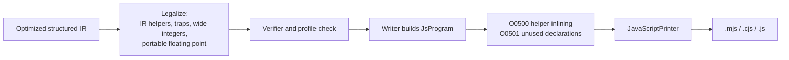

# The JavaScript backend

**Status:** implemented for the prototype's typed IR at ECMAScript 5, 2015, 2017, 2020 and 2022.
Related: [JavaScript frontend](JAVASCRIPT-FRONTEND.md) · [C# backend](CSHARP-BACKEND.md) ·
[backends: tree, passes, printer](BACKENDS.md) · [pipeline](PIPELINE.md).

`Polypiler.Core.Backends.JavaScript` writes one module or script, exporting the IR's public
functions. For the `Example.cs` in the [C# frontend guide](CSHARP-FRONTEND.md):

```sh
polypiler translate Example.cs --from csharp --to javascript --profile es2022 --output generated
```

The default format is an ES module, `generated/Example.mjs`. It can be loaded with
`import { Twice } from './generated/Example.mjs'`; `Twice(21)` returns `42`.
The CLI also writes `polypiler.manifest.json`, recording generation and the selected profile;
it does not turn generation into execution evidence.

## Pipeline and project



| Source | Responsibility |
| --- | --- |
| [JavaScriptEmitter.cs](../../Polypiler.Core.Backends.JavaScript/JavaScriptEmitter.cs) | `Check`, `Build`, `Emit`, core expression writing and generated-file metadata |
| [Profiles/](../../Polypiler.Core.Backends.JavaScript/Profiles/) | Language level, packaging, keywords and capability replacements |
| [Library/](../../Polypiler.Core.Backends.JavaScript/Library/) | Which IR helper or portable implementation legalization binds |
| [Syntax/](../../Polypiler.Core.Backends.JavaScript/Syntax/), [Printing/](../../Polypiler.Core.Backends.JavaScript/Printing/) | Target tree, reader/rewriter and final printing |
| [Passes/](../../Polypiler.Core.Backends.JavaScript/Passes/) | Helper inlining and removal in module or IIFE scope |
| [IR helpers](../../Polypiler.Core.IR/Helpers/) | Shared arithmetic, trap and wide-integer implementations |

`Build` exposes the tree after the requested target passes. The `Emit` overload taking
`TargetPassOptions` uses them, as the CLI does; simpler overloads do not. Library callers must
legalize the module for the profile and float mode before emitting it. The syntax reader uses
Acornima to parse generated code back into the target tree.

## Profiles and packaging

| `--profile` | Default format | Important representation boundary |
| --- | --- | --- |
| `es5` | `cjs` | `var`/functions, helper-based classes and collections, plain arrays unless `--typed-arrays` is supplied |
| `es2015` | `esm` | Block bindings, classes, typed arrays, `Math.imul` and `Math.fround` |
| `es2017` | `esm` | Native async syntax where the IR contract permits it |
| `es2020` | `esm` | Fixed-width 64-bit values use native `BigInt`; null-aware syntax becomes available |
| `es2022` (default) | `esm` | Newer class-field/private-field and error forms where applicable |

`JavaScriptCapabilities.Standard` records each construct's first level and its fallback.
Selecting an older level selects the fallback, not a polyfill dependency that the user must
discover separately.

| `--module` | File | Export surface |
| --- | --- | --- |
| `esm` | `<module>.mjs` | ES exports; unavailable with `es5` |
| `cjs` | `<module>.cjs` | CommonJS exports |
| `iife` | `<module>.js` | A script exposing the object named by required `--global <name>` |

For example:

```sh
polypiler translate Example.cs --from csharp --to javascript --profile es5 --module iife --global ExampleApi --output legacy
```

This writes `legacy/Example.js`; after loading the script, its public function is
`ExampleApi.Twice`. `--global` belongs only to `iife` and must be a valid identifier.
`--typed-arrays` declares that an ES5 host has typed arrays and `DataView`; later profiles already
include that capability. Neither profile selection nor Node-based tests prove every old browser
implements an optional ES5 host facility.

## Numbers and arrays

| IR value or operation | JavaScript form |
| --- | --- |
| `i8`/`u8`/`i16`/`u16` | Numbers with explicit masking or sign extension |
| `i32`, `u32` | Numbers coerced with `\| 0` or `>>> 0`; multiplication uses `Math.imul` or its fallback |
| `i64`, `u64` from ES2020 | `BigInt` values cut to width with `BigInt.asIntN` or `BigInt.asUintN` |
| `i64`, `u64` before ES2020 | `{ hi, lo }`, two unsigned 32-bit limbs; arithmetic and conversions use legalized IR helpers |
| `f64` | A JavaScript number |
| `f32` | A number rounded after operations with `Math.fround` or its replacement |
| Numeric arrays | Typed arrays where the profile provides them, plain arrays where it does not; 64-bit element representation follows the profile |
| Checked arithmetic, integer division and conversions | Explicit trap checks and arithmetic preserving the IR contract |

A number cannot hold every 64-bit integer exactly. The older-profile fallback therefore uses
limbs instead of silently converting a 64-bit value to a number. The limbs are the external
representation too: callers of an older-profile function taking a 64-bit parameter must supply
the pair. This fallback is for fixed-width values; it does not supply an arbitrary-precision
`BigInt` implementation to an old engine.

The backend emits the meaning of the IR, not the permissive behavior of arbitrary JavaScript.
An array access that must trap receives its check; integer division does not become a floating
division that happens to be coerced later. See [integer operations](../reference/integer-operations.md).

`--float accurate` (default) and `--float strict` select the floating-point policy. Legalization
uses native functions only under the accepted contract and otherwise binds the portable
implementation. Strict output carries the bitwise contract; a missing older `Math` API is not
approximated by a similarly named expression. See
[floating-point operations](../reference/floating-point-operations.md).

A value of the dynamic type `variant` ([variants](../reference/variants.md)) is a pair
`[tag, payload]` - `[0]` for `Empty`, `[1]` for `Null` - since a JavaScript number cannot tell an
`i16` from an `f64`: the tag is `v[0]`, a payload the frontend tested `v[1]`, one it did not
`$variant(v, tag)`, which throws the `InvalidCastError`; a date is `[7, days]`, an array of the type
an `Array` of pairs whose new elements are `[0]`. A payload of 64 bits, a currency too, is refused.
`FormatVisualBasic`, Visual Basic's text of a number, is the helper `$fmtVb` over the exact digits of
`$exact`.

## Objects, control flow and runtime contracts

Struct values, classes and interfaces have different representations: value records are copied
where the IR requires value semantics; classes retain identity. Modern profiles use classes and
their available field syntax; ES5 uses constructor functions, prototype chains and accessors.
The [records](../reference/records.md) and [classes](../reference/classes.md) pages give the rules.

Generic instantiations and specialized copies can share one declaration when their emitted text
matches after renaming. Otherwise each keeps a type-qualified name. The decision includes what
the declarations call; see [generics](../reference/generics.md).

Optional values use explicit null-aware operations, with conditional fallbacks on older levels;
their meaning is not JavaScript truthiness. Strings use UTF-16 code units. Collections preserve
the IR's selected equality, insertion/slot order and mutation-during-enumeration contract, using
helpers where native `Map` or `Set` behavior differs. See
[optional values](../reference/optional-values.md), [strings](../reference/string-operations.md)
and [collections](../reference/collections.md).

Branches, loops, switches, exceptions and resource cleanup remain structured target constructs.
Closures retain shared captures and per-iteration bindings, including environment-object
fallbacks below ES2015. Generators and async functions use their profile's native syntax or
lowered helpers/state machines for the supported IR. The contracts and restrictions are in
[functions and closures](../reference/functions-and-closures.md),
[sequences](../reference/sequences.md), [async](../reference/async.md) and
[exceptions](../reference/exceptions.md).

Views and pointers keep bounded region semantics, not raw JavaScript addresses; see
[views](../reference/views.md) and [pointers](../reference/pointers.md). Foreign calls require a
`--bind <library>=<module-or-global>` binding for each native library. ES modules import it,
CommonJS requires it, and an IIFE uses the specified global object. JavaScript does not acquire
a native ABI bridge merely by emitting that call; the binding must meet the
[foreign-call contract](../reference/foreign-calls.md).

## Helpers, refusals and verification

Shared arithmetic and portable floating-point helpers enter the IR before emission. Operations
specific to JavaScript's runtime representation use the backend's own helpers. Only required
helpers and their dependencies are carried; eligible ones may be inlined or removed by O0500 and
O0501. Their licences and origins are recorded with the output; see
[backend helpers](BACKENDS.md#helpers-one-library-in-the-ir) and
[licence of emitted code](../../LICENSE-OUTPUT.md).

`PLY1152` (exit 3) reports a construct with no valid form in the chosen profile, including missing
required bindings. Invalid IR receives verifier diagnostics. Invalid profile/module combinations,
such as `--profile es5 --module esm`, receive the CLI usage diagnostic `PLY0003` (exit 2).
The backend refuses instead of emitting a construct that the chosen language level cannot parse.

[Backend unit tests](../../Polypiler.Tests/Backends/JavaScript/) cover profiles, capabilities,
scope, numeric forms, syntax and helper selection.
[JavaScriptProfileTests](../../Polypiler.Tests.Acceptance/Prototype/JavaScriptProfileTests.cs)
and the other [prototype acceptance tests](../../Polypiler.Tests.Acceptance/Prototype/) load
the output in Node for each packaging/level combination and compare against the interpreter
and compiled source. Parsing as the requested level checks the syntax independently of a modern
Node engine accepting newer syntax. These checks establish the tested contracts; they do not
claim that an actual ES5-era engine ran the output.
