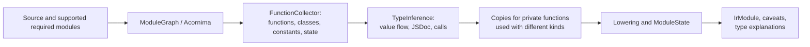

# The JavaScript frontend

**Status:** implemented for the typed prototype subset, including the value and object families
linked below. It imports supported JavaScript algorithms, not a browser or Node.js application.
Related: [JavaScript backend](JAVASCRIPT-BACKEND.md) · [C# frontend](CSHARP-FRONTEND.md) ·
[pipeline](PIPELINE.md).

`Polypiler.Core.Frontends.JavaScript` parses source with Acornima and infers a static IR type from
the values that reach each parameter, local and result. JSDoc can state a boundary contract; it is
not required on every function. Save this as `example.js`:

```javascript
/** @param {uint32} x @returns {uint32} */
export function twice(x) {
  return Math.imul(x, 2) >>> 0;
}
```

```sh
polypiler translate example.js --from javascript --to csharp --output generated --explain-types
```

The default C# target writes `generated/example.cs`; `twice(21)` returns `42`.
`--explain-types` prints why the frontend chose each type. The output manifest records exports,
source hashes and semantic caveats; generation alone is not runtime verification.

## Pipeline and project



| Source | Responsibility |
| --- | --- |
| [JavaScriptFrontend.cs](../../Polypiler.Core.Frontends.JavaScript/JavaScriptFrontend.cs) | Import orchestration, diagnostics, caveats and type explanations |
| [JsDoc.cs](../../Polypiler.Core.Frontends.JavaScript/JsDoc.cs) | Supported type contracts at the source boundary |
| [Inference/](../../Polypiler.Core.Frontends.JavaScript/Inference/) | Value-flow typing and specialization of private functions |
| [Modules/](../../Polypiler.Core.Frontends.JavaScript/Modules/) | Supported module wrappers, linking and reachability |
| [Lowering.cs](../../Polypiler.Core.Frontends.JavaScript/Lowering.cs), [Lowering.Expressions.cs](../../Polypiler.Core.Frontends.JavaScript/Lowering.Expressions.cs) | Statements and expressions into typed IR |
| [Records/](../../Polypiler.Core.Frontends.JavaScript/Records/), [Objects/](../../Polypiler.Core.Frontends.JavaScript/Objects/) | Fixed shapes, constructors, classes and member typing |
| [Integer/](../../Polypiler.Core.Frontends.JavaScript/Integer/), [String/](../../Polypiler.Core.Frontends.JavaScript/String/), [Sequences/](../../Polypiler.Core.Frontends.JavaScript/Sequences/) | API mappings and the semantic lowering of these families |

## Parsing and module selection

`JavaScriptFrontend.Import(path, source, exports, read)` accepts a script or module. Without an
export selection it imports all collected functions. `--export` selects the public functions and
their reachable callees; an unknown name is an error. This is a translation boundary, not execution
of the file's exports machinery.

The optional `read` callback supplies required files. The CLI supplies file access for supported
CommonJS, UMD and wrapper shapes; the graph links the collected definitions and maps diagnostics
back to their original files. This is not a general Node package resolver. The accepted wrappers,
dependency order and reachability rules are described in [module graphs](../reference/module-graphs.md).

Functions, classes, constants and relevant module initialization are collected before lowering.
Module state follows the supported initialization contract in
[module state](../reference/module-state.md); arbitrary effects at load time are not evaluated by
running the user's JavaScript.

## Types and semantic operations

| Source evidence | IR interpretation |
| --- | --- |
| General JavaScript numeric arithmetic | `f64`, not an integer guessed from a name or a sample value |
| Bitwise operators, `Math.imul`, coercions such as `>>> 0` | Explicit `ToInt32`/`ToUint32` semantics and fixed-width integer results |
| Typed arrays | Their element type; reads and stores remain typed operations |
| JSDoc numeric contracts | `int8`, `uint8`/`byte`, `int16`, `uint16`, `int32`/`int`, `uint32`, `int64`, `uint64`, `float32`, `number`/`float64` |
| `boolean`/`bool`, `string` contracts | `bool` and UTF-16 `str` |
| Calls and assignments | Constraints propagated through parameters, locals and results |
| Private functions called with different supported kinds | Specialized copies where the inference can separate the calls |
| Bounded `BigInt` expressions | A fixed-width integer where the bounds prove it fits; unbounded values are refused |

The distinction between a number and its integer coercion matters. A double addition is not
silently changed to wrapping `i32` arithmetic. An inferred integer parameter also narrows the
caller contract: JavaScript could coerce a fractional or non-finite number at its use, while the
translated function may require the integer itself. This is recorded as a caveat.

The supported construct families lower to the same IR as the other frontends:

| Family | Contract |
| --- | --- |
| Fixed-shape object literals | Value records, not arbitrary dictionaries; [records](../reference/records.md) |
| Classes and constructor functions | Identity, members and supported dispatch; [classes](../reference/classes.md) |
| `null`, `undefined`, null-aware operators | Explicit optional values and coercions; [optional values](../reference/optional-values.md) |
| Nested functions, lambdas and captures | Function values and shared captures; [functions and closures](../reference/functions-and-closures.md) |
| Arrays, `Map`, `Set` | Typed containers and ECMA enumeration/equality rules; [collections](../reference/collections.md) |
| Generators and array callbacks | Lazy sequences or eager callback operations as specified; [sequences](../reference/sequences.md), [sequence operations](../reference/sequence-operations.md) |
| Restricted async functions | The portable, order-insensitive subset; [async](../reference/async.md) |
| Strings, number conversion and frozen enum objects | [String operations](../reference/string-operations.md), [number text](../reference/number-text.md), [enums](../reference/enums.md) |
| Errors, catches and `finally` | Explicit exception operations; [exceptions](../reference/exceptions.md) |
| Typed-array subranges | Aliasing views; [views](../reference/views.md) |

Each reference page specifies the subset; the presence of a family here does not admit dynamic
property mutation, arbitrary prototype behavior or every method of a JavaScript built-in.

## Caveats are part of the result

`ImportResult` includes the module, diagnostics, caveats and `TypeExplanation` records. The CLI
puts caveats in `polypiler.manifest.json`. They are known changes at the import boundary, not a
claim that every JavaScript input has the same behavior after translation.

| Caveat | Boundary |
| --- | --- |
| `js-oob-read` | Invalid/fractional indexes, out-of-range writes and uninitialized array elements: the imported typed array model traps, truncates an index or reads its initialized zero instead of all JavaScript behaviors |
| `js-div-zero` | Integer division/remainder under coercion can trap where JavaScript produces a non-finite number or a wrapped result |
| `js-param-integer-inferred` | An unannotated parameter inferred from integer-only uses requires the inferred integer contract |
| `js-param-array-inferred` | An unannotated array parameter takes the element/type contract of the arrays its calls supply |
| `js-sort-order` | An inconsistent double comparator, including NaN cases, is given the translation's stable-sort order |
| `js-throw-string` | Text thrown out of a function becomes an `Error` carrying that message |

## Refusals and diagnostics

| Code | Meaning |
| --- | --- |
| `PLY1100` | JavaScript syntax error; exit 4 |
| `PLY1101` | A required type cannot be established or its stated contract is unsupported; exit 3 |
| `PLY1102` | A construct outside the subset; exit 3 |
| `PLY1103` | A `BigInt` value is not proven bounded for the IR; exit 3 |
| `PLY1104` | A requested export does not name a function; exit 3 |
| `PLY1105` | Incompatible value kinds reach one typed value; exit 3 |
| `PLY1106` | A read may precede definite assignment; exit 3 |
| `PLY1107` | An observed thrown value is not a supported error value; exit 3 |

For example, selecting `--export missing` from the example above receives `PLY1104`. The importer
does not invent a function or silently translate an unrelated export. The
[error catalogue](../errors/README.md) includes the remaining construct-specific refusals.

## Verification

[Frontend unit tests](../../Polypiler.Tests/Frontends/JavaScript/) cover inference, JSDoc,
definite assignment, selection, module graphs and refusals. The
[prototype acceptance tests](../../Polypiler.Tests.Acceptance/Prototype/) compare the original
under Node with the IR interpreter and emitted code over
[`tests/fixtures/prototype`](../../tests/fixtures/prototype/). They distinguish import caveats
from backend correctness instead of comparing outside the declared source contract.
The larger [Cipher corpus](../corpus/cipher.md) records what translates and what is refused;
it is evidence about those files, not general support for all JavaScript programs.
