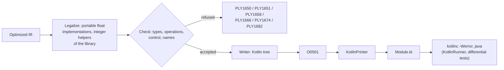

# The Kotlin backend

**Status:** implemented for scalars, control flow, arrays, strings and read-only structs
([#419](https://github.com/Hawkynt/Polypiler/issues/419), [#416](https://github.com/Hawkynt/Polypiler/issues/416),
[#418](https://github.com/Hawkynt/Polypiler/issues/418), part of [#417](https://github.com/Hawkynt/Polypiler/issues/417)
and [#420](https://github.com/Hawkynt/Polypiler/issues/420)), checked by the pinned `kotlinc` and JDK through the
[Kotlin runner](#verification) ([#426](https://github.com/Hawkynt/Polypiler/issues/426)). It follows the shape of every
backend ([backends](BACKENDS.md)): the IR becomes a Kotlin syntax tree, the target passes rewrite the tree, and the
printer is the only place where Kotlin becomes text.
Related: [pipeline](PIPELINE.md) · [exceptions](../reference/exceptions.md#kotlin) · [Kotlin frontend](KOTLIN-FRONTEND.md).

`polypiler translate <file> --from <language> --to kotlin --output <directory> [--profile kotlin2.0 … kotlin2.4[-jvm11|-jvm17|-jvm21]]`
writes one file, `<Module>.kt`, in the package of the module's name in lower case, and the manifest beside it.

## Project

| Folder | What it holds |
| --- | --- |
| `Syntax/` | `KotlinSyntax.cs`, the tree after the grammar of the Kotlin specification; `KotlinSyntaxWalker` (children, every node below one); `KotlinSyntaxReader`, which reads the printed subset back - newlines significant only outside parentheses and brackets, the precedence of the grammar; `Kt`, the short constructors |
| `Printing/` | `KotlinPrinter`: four spaces, LF, a final newline, the opening brace on the line that opens the block; parentheses exactly where the precedence needs them and around an operand of an infix function that is an operator of another kind - every infix function binds alike and from the left, so `(x + y) shl 2` is written as it computes; a call of more than eight arguments eight to a line |
| `Profiles/` | `KotlinProfile` (`kotlin2.0` … `kotlin2.4`, the versions the pinned `kotlinc` 2.4.21 takes as `-language-version`, each on the JVM targets 1.8, 11, 17 and 21) and `KotlinCapabilities`, the table of what each profile has |
| `Writing/` | the writer: module, names, functions, constants and globals; types; statements and control flow; expressions, literals and conversions; intrinsics |
| `Passes/` | `KotlinTargetPasses`: O0501, which removes a helper nothing names |
| `KotlinHelpers.cs` | the semantics of the IR Kotlin's operators state otherwise, each a private function built as a tree ([backends](BACKENDS.md#helpers-that-stay-with-a-backend)) |
| `KotlinLibrary.cs` | which integer operations legalization binds from the IR's helper library |

## Profiles

| Profile | `kotlinc` options |
| --- | --- |
| `kotlin2.0`, `kotlin2.1` | `-language-version 2.x -api-version 2.x -Xsuppress-version-warnings` (both versions are deprecated by the pinned compiler; the warning is suppressed so that `-Werror` builds) |
| `kotlin2.2`, `kotlin2.3`, `kotlin2.4` (default) | `-language-version 2.x -api-version 2.x` |
| `-jvm11`, `-jvm17`, `-jvm21` suffix | `-jvm-target 11`, `17`, `21`; without one `-jvm-target 1.8`, Kotlin's own default |

Kotlin 1.9 and older are no profile: the pinned compiler refuses them ("language version 1.9 is no
longer supported"). The language versions 2.0 to 2.4 differ in nothing the backend writes; the rows of
the capability table are methods of `java.lang` a later JVM brought:

| Row | Since | Without it |
| --- | --- | --- |
| `Math.fma` (fused multiply-add, rounded once) | JVM 9 | the portable implementation `FusedMultiplyAdd` of the IR library |
| `Math.multiplyHigh` (high 64 bits of the signed product) | JVM 9 | the helper `MulHighSigned64` of the IR library |
| `Math.unsignedMultiplyHigh` | JVM 18 | the helper `MulHighUnsigned64` of the IR library |
| `Integer.compress`, `Integer.expand` and the `Long` pair (parallel bit extract and deposit) | JVM 19 | the helpers `ParallelBitExtract`/`ParallelBitDeposit` of the IR library |

## Values

| IR | Kotlin |
| --- | --- |
| `i8` `i16` `i32` `i64` | `Byte` `Short` `Int` `Long` |
| `u8` `u16` `u32` `u64` | `UByte` `UShort` `UInt` `ULong` |
| `bool`, `f32`, `f64` | `Boolean`, `Float`, `Double` |
| `str` | `String`, UTF-16 as the IR's |
| array of a number | the primitive array of the signed type of the width (`IntArray`, `ByteArray`, …); an unsigned element is converted where it is read (`a[i].toUInt()`) and stored (`a[i] = v.toInt()`), since Kotlin's unsigned arrays need an opt-in |
| array of strings, of structs | `Array<String>`, `Array<Point>` (`Array(n) { Point() }`) |
| struct nothing writes a field of | `data class Point(val x: Int = 0, val y: Double = 0.0)`, the defaults making `Point()` the IR's default value |
| enum | its underlying integer |
| constant | `private const val NAME: Int = 5`; a table `private val TABLE: IntArray = intArrayOf(…)` |
| global | `private var name: T = value`, initialised when the file's class is loaded |

## Lowering

Kotlin's own operators compute what the IR computes on 32 and 64 bits and on floating point, the only
widths the IR's operators take (narrow values are converted before they reach one):

| IR | Kotlin |
| --- | --- |
| `Add` `Subtract` `Multiply` | `a + b`, `a - b`, `a * b`, which wrap |
| `AddChecked` … of `i32`/`i64` | `Math.addExact(a, b)`, `subtractExact`, `multiplyExact`, `negateExact` |
| `AddChecked` … of `u32`/`u64`, a checked 8- or 16-bit step | `plyAddCheckedUInt(a, b)` and its siblings |
| `Divide` `Remainder` of a signed type | `a / 7` by a constant other than 0 and -1; otherwise `plyDivideInt(a, b)`: the smallest value divided by -1 throws `ArithmeticException("integer overflow")`, where Kotlin wraps, a zero divisor throws Kotlin's own `ArithmeticException` |
| `Divide` `Remainder` of an unsigned type | `a / b`; a constant zero divisor `a / UInt.MIN_VALUE`, which `kotlinc` does not warn about |
| `And` `Or` `Xor`, `BitNot` | `a and b`, `a or b`, `a xor b`, `a.inv()` |
| `ShiftLeft` `ShiftRight` `ShiftRightLogical` | `shl`, `shr` (logical of an unsigned type), `ushr`; Kotlin masks the count to five or six bits as the IR does; a constant count is masked when it is written |
| comparisons, `LogicalAnd` `LogicalOr` `LogicalNot`, `Conditional` | `<` … `==`, `&&`, `||`, `!`, `if (c) a else b`; floating point compares by IEEE 754 on the statically typed primitives |
| conversion between integers | `a.toByte()` … `a.toULong()`, which wrap as the IR's `Wrap` does; `Trap` through `plyToIntCheckedFromLong(a)` and its siblings |
| conversion of a floating-point number to an integer | `a.toInt()`, `toLong()`, `toUInt()`, `toULong()`, which truncate and saturate with a NaN as 0 as `Saturate` does; 8 and 16 bits `a.toInt().coerceIn(-128, 127).toByte()`; `Trap` through `plyToIntCheckedFromDouble(a)` |
| conversion to floating point | `toFloat()`, `toDouble()`; `u64` to `f32` through `plyULongToFloat`, since Kotlin rounds that one twice |
| `IrStep` | `x++`, `a[i]--` (wrapping); a checked step `x = Math.addExact(x, 1)`, whose value `x.also { x = Math.addExact(x, 1) }` |
| `IrBind` | `value.also { x = it }` |
| intrinsics Kotlin or `java.lang` has | `countOneBits`, `countLeadingZeroBits`, `countTrailingZeroBits`, `rotateLeft`, `rotateRight`, `Integer.reverseBytes`, `java.lang.Long.reverse`, `minOf`, `maxOf`, `Math.sqrt`, `floor`, `ceil`, `rint`, `kotlin.math.truncate`, `Math.abs`, `toRawBits`, `Double.fromBits`, and the rows of the capability table |
| `Sign` and `RoundAway` of floating point | `plySignDouble` (a NaN throws `ArithmeticException`), `plyRoundAwayDouble` |
| every other integer intrinsic | the helper of the IR library, copied into the module |
| every other floating-point operation | its portable implementation, in both modes, so that its bits are the interpreter's |
| `ArrayCopy`, `ArrayFill`, `ArrayClear`, `ArrayOf` | `plyCopyInt(…)` (checked as a whole, then `copyInto`), `a.fill(v)`, `a.fill(0)`, `intArrayOf(…)` |
| strings | `s.length`, `s[i].code.toUShort()`, `a + b`, `a == b`, `Integer.signum(a.compareTo(b))`, `startsWith`, `endsWith`, `contains`, `Char(c.toInt()).toString()` |
| `if`, `while`, `do`-`while` | the same; an `else` that is one `if` an `else if` |
| `for` | `while (c) { body; step }`, the step written before every `continue` of the loop |
| `switch` | `when (v) { 1, 2 -> { … } else -> { … } }` without the `break` that ends a section; a `break` inside a section leaves `switch@ do { when … } while (false)` |
| `break`, `continue` | labelled (`loop@ while`) where the target is not the innermost loop of Kotlin |
| `return`, `WriteLine` | `return`, `println(s)` |
| a library exception | `ArithmeticException`, `IndexOutOfBoundsException`, `NullPointerException`, `ClassCastException`, `IllegalStateException`, `IllegalArgumentException`, `NoSuchElementException`, `Exception`; `DivideByZeroException`, `OverflowException`, `ArgumentOutOfRangeException`, `FormatException` and `AssertionException` are classes the file declares, deriving from the JVM class of the nearest meaning; without a message the text .NET gives; an inner exception `initCause` |

A local is a `val` where nothing assigns it after its first value, otherwise a `var`, always with its
type (an integer literal alone would make an `Int` of a `Long`); a parameter the body assigns is rebound,
`var a = a`, the file suppressing `NAME_SHADOWING`. Every local of a function has a name of its own, so
that no nested block shadows another and the IR's blocks can be flattened - Kotlin has no block statement.
A function whose body is one `return` has an expression body.

## Refusals

| Code | What |
| --- | --- |
| [PLY1650](../errors/PLY1650.md) | a type without a Kotlin representation: `bigint`, views, pointers, optional values, collections, function values, sequences, async results |
| [PLY1651](../errors/PLY1651.md) | an operation without a Kotlin form yet: lambdas, method calls, objects, the string operations beyond the ones above, number text |
| [PLY1658](../errors/PLY1658.md) | a statement without a Kotlin form yet: `try`, `throw` again, `using`, `foreach`, a store into a field; a module initializer |
| [PLY1666](../errors/PLY1666.md) | a struct with a `[StructLayout]` |
| [PLY1674](../errors/PLY1674.md) | two exports with one Kotlin name, or an export with no name left |
| [PLY1682](../errors/PLY1682.md) | a class, an interface, a struct whose fields are written |

## Verification

- **Emission and parse-back** (no toolchain): every row of the lowering table (`KotlinEmissionTests`),
  every prototype source in the oldest and the newest profile read back by `KotlinSyntaxReader` into a
  tree that prints the same text (`KotlinParseBackTests`).
- **Differential** (`Layer.jvm`): the prototype fixtures, the bit fixtures, the integer operation cases on
  `kotlin2.0`, `kotlin2.4` and `kotlin2.4-jvm21`, and the float algorithms compile in one run of `kotlinc`
  with warnings as errors and agree, call for call, with the C# compiler's build and the interpreter
  (`KotlinDifferentialTests`). A trap is read back by its JVM class and, for the `ArithmeticException` the
  JVM throws itself, its message; a JVM that throws a preallocated exception from compiled code leaves the
  message out, which is a division by zero.
- **The runner** (`KotlinRunner`, #426) builds a unit with a generated driver into one runnable jar and
  calls an export on input images (`tests/features/infra/infra-runner-kotlin.feature`, `KotlinRunnerTests`).

## Not yet

Classes and interfaces, mutable structs (copies at every read of a place), closures, collections,
optional values, `try`/`catch` (a catch of `DivideByZeroException` must also take the JVM's own
`ArithmeticException("/ by zero")`), counted `for` loops written as `for (i in a until b)`, the
`kotlin.test` harness and the package layout `src/main/kotlin` of #417, and the JUnit console runner of
#426 are follow-ups.
