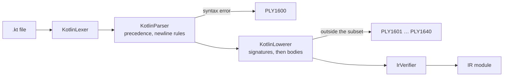

# The Kotlin frontend

**Status:** implemented for the first verified subset ([#424](https://github.com/Hawkynt/Polypiler/issues/424),
[#421](https://github.com/Hawkynt/Polypiler/issues/421), [#423](https://github.com/Hawkynt/Polypiler/issues/423),
part of [#422](https://github.com/Hawkynt/Polypiler/issues/422)); classes, nullable types, lambdas and exceptions
([#425](https://github.com/Hawkynt/Polypiler/issues/425)) are refused. Related: [Kotlin backend](KOTLIN-BACKEND.md) ·
[IR](IR.md) · [exceptions](../reference/exceptions.md#kotlin).

`polypiler translate <file>.kt --from kotlin --to <language> --output <directory>` imports one Kotlin file for the
JVM into one module named after the file (`deinterlacer.kt` is `Deinterlacer`).

## Parsing

The parser is the repository's own recursive descent after the grammar of the Kotlin language
specification (kotlinlang.org/spec, "Syntax and grammar"): `KotlinLexer` (identifiers, backticked names,
integer literals in decimal, hexadecimal and binary with underscores and the suffixes `u`, `U`, `L`,
floating-point literals with an exponent and `f`, characters, strings with templates and escapes, raw
strings, nested block comments) and `KotlinParser` (the precedence from postfix down to disjunction and
the newline rules: a line break ends a statement unless it cannot end there, means nothing inside
parentheses and brackets, and may stand before `.`, `?.`, `?:`, `&&`, `||` and `else`). The official
grammar (ANTLR, Apache-2.0) was not taken: it needs a parser runtime and generated code in the product,
and a parser of the subset keeps the import free of a JVM, as the Rust frontend is. The pinned `kotlinc`
is the oracle the tests compare with.

## Lowering

`KotlinLowerer` lowers in two passes - the signatures of the file's functions first, so that a function
may call one declared after it, then the properties and the bodies - with Kotlin's meaning:

| Kotlin | IR |
| --- | --- |
| `Byte` … `Long`, `UByte` … `ULong`, `Float`, `Double`, `Boolean`, `String` | `i8` … `i64`, `u8` … `u64`, `f32`, `f64`, `bool`, `str` |
| `Char` | the `u16` of its code unit; `c.code`, `Char(n)`, `n.toChar()`, `c + n` (a `Char`), `c - d` (an `Int`), comparisons on the widened codes |
| `IntArray`, `ByteArray`, `ShortArray`, `LongArray`, `FloatArray`, `DoubleArray`, `CharArray` | arrays of the element type; `BooleanArray` and the unsigned arrays are refused |
| an integer literal | typed by its suffix, else by the expected integer type it fits, else `Int`, else `Long` - Kotlin's rule; a negative literal is folded |
| `+ - * / %` | on the type Kotlin's operator gives (`Byte + Byte` is an `Int`, `Int + Long` a `Long`, `Int + Double` a `Double`); `/` and `%` of a signed type by anything but a constant other than 0 and -1 call `kotlin_divide_i32` / `kotlin_remainder_i32` of the module, which give the smallest value divided by -1 (and 0 as its remainder) where the IR's division traps; a zero divisor traps in both |
| `shl` `shr` `ushr`, `and` `or` `xor`, `inv()` | `Int`, `Long`, `UInt`, `ULong` directly (the IR masks the count as Kotlin does); `UByte`/`UShort` bit functions on 32 bits and narrowed; `and`, `or`, `xor` of Booleans evaluate both operands |
| `toInt()` and its siblings | `Wrap` between integers; from floating point `Saturate` to 32 and 64 bits, to `Byte`/`Short` through `Int`, which wraps after it saturated |
| `countOneBits`, `countLeadingZeroBits`, `countTrailingZeroBits`, `rotateLeft`, `rotateRight`, `minOf`, `maxOf`, `coerceIn`, `coerceAtLeast`, `coerceAtMost`, `abs`, `absoluteValue`, `sqrt`, `floor`, `ceil`, `round`, `truncate`, `isNaN`, `isInfinite`, `isFinite`, `toRawBits`, `fromBits`, `MIN_VALUE`, `MAX_VALUE`, `SIZE_BITS`, `SIZE_BYTES`, `NaN`, the infinities | the IR operations; `abs` of `Int.MIN_VALUE` is `AbsWrap`, the value itself |
| `if`, `when` | statements and values; a value of branches with statements is assigned in each branch; `when` with a subject of constant integer conditions and no jump an IR switch, otherwise a chain of `if`s; `in a..b` and `!in` as range tests |
| `while`, `do`-`while` | the same; a condition that needs statements is tested at the top of an endless loop |
| `for (x in a..b)`, `until`, `..<`, `downTo`, `step`, `indices`, arrays, strings | an IR `for` over a counter that never steps past the last element, so that a range ending at `Int.MAX_VALUE` ends; the bounds and the step evaluated once; a step that is not positive throws `IllegalArgumentException` |
| `break@label`, `continue@label` | a flag of the target loop and a `break`; after every inner loop the flags are tested |
| `repeat(n) { … }`, `require`, `check`, `error`, `throw` of the standard exceptions | a counted loop, a test that throws `IllegalArgumentException` or `IllegalStateException` (the IR's `ArgumentException`, `InvalidOperationException`), the throw |
| top-level `fun` | a function, public unless `private`; an expression body the return of its value; defaults filled at the calls; overloads named by their parameter types |
| `const val`, `val` of constants or of an array of constants nothing writes or passes on | a constant of the module, a table |
| any other top-level `val`, `var` | a global |
| `IntArray(n) { i -> … }` | a new array and a loop before the statement |
| string templates, `+` with a string, `println` | concatenation of the text of each value: integers in decimal, truth values `true`/`false`, characters their code unit; a floating-point number's text is the JVM's, which the IR has no operation of, and is refused |

## Refusals

| Code | Family |
| --- | --- |
| [PLY1600](../errors/PLY1600.md) | a syntax error, and syntax outside the subset: generic and extension functions, `vararg`, named and spread arguments, destructuring, `object` expressions, `super`, `try`, a `when` subject that declares a variable, a type test in `when`, function types |
| [PLY1601](../errors/PLY1601.md) | an operator or conversion Kotlin does not have (signed with unsigned, a narrowing compound assignment), `as`, `is`, `!!` |
| [PLY1610](../errors/PLY1610.md) | control flow outside the subset: a missing `else` of a value, a function that can reach its end without a return, a jump without its loop, a loop over anything but a range, an array or a string |
| [PLY1620](../errors/PLY1620.md) | arrays and strings: unsigned and Boolean arrays, the members not listed above, the text of a floating-point number |
| [PLY1630](../errors/PLY1630.md) | functions and names: undeclared names and functions, local functions, lambdas outside `IntArray(n) { … }` and `repeat`, a `val` reassigned |
| [PLY1640](../errors/PLY1640.md) | declared types: classes, data classes, enums, objects, interfaces, type aliases, nullable types, `null`, safe calls and the elvis operator |

## Verification

The fixtures of `tests/fixtures/kotlin` (scalars, control flow, arrays, functions and kernels - CRC-32,
FNV-1a, Adler-32, xorshift, an integer square root, a deinterlacing kernel) are compiled by the pinned
`kotlinc` and run on every call of `KotlinFixture.Cases`; the outcomes are recorded in
`*.recorded.txt` (`POLYPILER_RECORD=1`). The unit tests hold the interpreter against the recording
(`KotlinFrontendTests`), the acceptance tests of the Kotlin/Java layer hold `kotlinc`, the Kotlin the
backend writes from the imported IR and the C# the C# backend writes from it against it
(`KotlinFrontendDifferentialTests`).
