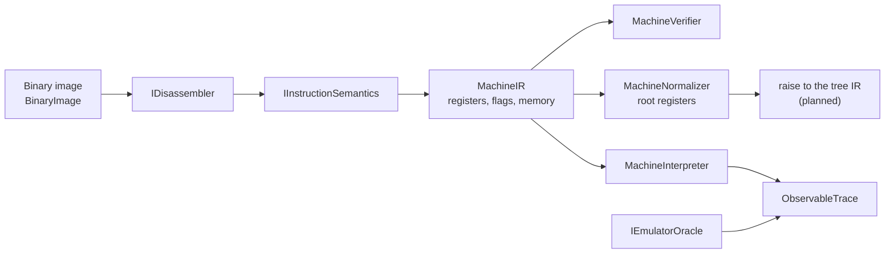

# MachineIR: the machine level

**Status:** implemented in `Polypiler.Core.MachineSemantics` and `Polypiler.Core.BinaryFormats`; no CPU
decoder, lifter or emitter uses it yet. See [IR](IR.md), [semantic recovery](SEMANTIC-RECOVERY.md) and
PRD §17.2, §18.2, §21.4, §23.1.

The structured, typed tree IR of `Polypiler.Core.IR` is the IR of source-level code. Machine code is
the one exception: lifters produce **MachineIR**, a separate level whose vocabulary is registers,
sub-registers, flags and machine memory. It is lowered to and raised from the tree IR; it is never a set
of extra opcodes in the tree IR. In the terms of [ADR 0009](../adr/0009-structured-tree-ir.md), MachineIR is the working form of
a lifter, an assembler and a machine oracle: what a lifter delivers to the pipeline is the tree, and no
pass between import and emission sees MachineIR.



## Machine profiles

`spec/machine/<isa>.yaml` (family `machine`, schema `spec/schemas/isa-profile.schema.json`) declares the
address width, byte order, interrupt vectors, registers and flags of one ISA. A register is a root or a
sub-register naming bits `offset .. offset+bits-1` of its parent with a write policy: `preserve` (the
other bits of the root keep their value: x86 `AL`, `AX`) or `zero-extend` (the write replaces the root:
`EAX` in 64-bit mode). A flag stands alone or names a bit of a status register. The profiles today are
`test-m32`, `test-m64` and `mos6502`; the x86 sub-register fixtures live in
`tests/fixtures/native/mach-ir/profiles`. A broken profile is `PLY4003`. `IsaProfile` is the one
implementation of the port `IMachineStateModel`: a CPU declares its registers by shipping a profile.

## Instructions

A module names its profile (`machine test-m32`); functions are control-flow graphs of blocks.

```text
machine test-m32

@addc {
entry:
  %a = RegRead.u32 @r0
  %b = RegRead.u32 @r1
  %r = Add.u32 %a, %b
  RegWrite.u32 @r0, %r !at(0x00401000, "01 C8")
  %c = ULt.u32 %r, %a
  FlagWrite @c, %c
  Ret
}
```

- **Values** (`%x`) are typed `bool` or `u1`..`u64`, assigned once and local to their block. A register
  keeps the machine width and no signedness; each operation chooses how it reads the bits.
- **Storage** (`@r0`, `@c`) is read and written in program order by the machine operations `RegRead`,
  `RegWrite`, `FlagRead`, `FlagWrite`, `FlagUndef`, `Load`, `Store` (in the profile's byte order),
  `IndirectJump` and `MachineTrap`. Storage carries state from block to block.
- **Pure operations:** `Const`, `Add`, `Sub`, `Mul`, `UDiv`, `URem`, `SDiv`, `SRem` (a zero divisor raises
  `divide-error`), `And`, `Or`, `Xor`, `Shl`, `LShr`, `AShr`, `Not`, `Neg`, the comparisons `Eq` … `SLe`,
  `ZeroExtend`, `SignExtend`, `Truncate`, `ExtractBits`, `InsertBits`, `Select`.
- **Terminators:** `Jump`, `Branch`, `IndirectJump %a -> L1, L2` or `-> unresolved`, `Ret`, and a
  `MachineTrap` that does not resume.
- **Origins:** `!at(0x00401000, "0F C8")` keeps the address and bytes an instruction came from, also in a
  module without a profile (`isa wasm`); every rewrite keeps it.

`MachineSyntax` prints and parses the text with an exact round trip (`PLY4006` for bad text).

### No SSA, by decision

Registers and flags stay storage; MachineIR builds no SSA form and has no phis. The raise to the tree IR
maps every root register and flag to a mutable local, which the tree IR has, so phis would only be
undone again. `MachineInterface.Of` states what a routine exchanges with its caller: the root registers
and flags it may read before writing them (inputs) and those it writes (outputs). A flag is an explicit
tri-state value: set, cleared, or undefined after `FlagUndef`; nothing undefined is ever given a value.

### Verifier

`MachineVerifier.Verify` reports: storage the profile lacks (`PLY4000`), an access of the wrong width
(`PLY4001`), a flag read that only a `FlagUndef` reaches on every path (`PLY4002`), machine operations
without a profile (`PLY4003`), a sub-register in a function normalized to root registers (`PLY4004`), and
malformed structure — terminators, labels, undefined or redefined values, operand types (`PLY4005`).

### Normalization to root registers

`MachineNormalizer.ToRootRegisters` rewrites every sub-register access into one of its root: a read
becomes `RegRead` of the root, `ExtractBits` and `Truncate`; a preserving write `RegRead`, `ZeroExtend`,
`InsertBits` and `RegWrite`; a write that replaces the root `ZeroExtend` and `RegWrite`. The function gets
the attribute `root-registers`. The interpreter gives the same final state before and after.

## Effects and traps

`MachineEffects.Of` gives each instruction its channels — `Machine.Registers:<isa>/<root>`,
`Machine.Flags:<isa>/<flag>`, `Memory.Unknown` or a region channel, `Trap` — and `Interferes` decides
whether two instructions must keep their order. `MachineTrap[kind=…, vector=…, resumes=…, id=…]` covers
the nine kinds `software-interrupt`, `system-call`, `undefined-instruction`, `privileged-instruction`,
`breakpoint`, `halt`, `divide-error`, `overflow-trap` and `access-fault`. A service contract
(`service("dos.write-char") reads(ah, dl) writes(al)`) narrows a resuming trap to its registers;
without one the trap reads and writes everything (`PLY4026`). A vector outside the profile is `PLY4025`.
A trap that does not resume ends its block and observes every earlier effect. Conditional faults are
trapping divisions, linked to the canonical traps through `TrapLabels` (`divide-error` →
`DivideByZero`). The effect document is `spec/effects/machine-trap.yaml`.

## Memory regions

`RegionClassifier` gives every `Load` and `Store` a `MemoryClass` from evidence only. An address that is
constant, or that has a proven range, is checked against the `IAddressMap` byte by byte across every range
it touches: an `Mmio` range makes it a device access (`Device:mmio.<range>`), a write to an executable
range `ExecutableMemory`, an unmapped byte `UnknownMemory` (with `PLY4010` for a constant), every other
range `ProvenShared` (`Memory:<range>`); an access spanning several ranges takes all their channels and the
strongest class. Otherwise the provenance of the address (`IProvenanceFacts`) decides: a private
allocation is `ProvenLocal`, a global one `ProvenShared`, a caller buffer `ExternalMemory`, runtime-owned
storage `RuntimeState`, anything else `UnknownMemory`. `AddressMap` refuses overlapping ranges
(`PLY4009`) and ranges outside the address space (`PLY4011`).

## Interpreter and traces

`MachineInterpreter.Run` executes MachineIR on a `MachineState` (root registers, tri-state flags, sparse
memory, optional address map and trap model) and returns an `ObservableTrace`: the final registers, flags
and memory, the ordered events (`MemoryWrite`, `DeviceAccess`, `ExternalCall`, `Trap`, `Return`) and the
outcome `Returned`, `Trapped`, `Aborted` or `BudgetExceeded`. Reading an uninitialized register, an
undefined flag or unwritten memory aborts (`PLY4035`); an access the map does not cover traps
(`access-fault`); an indirect jump outside its targets aborts (`PLY4038`); a resuming trap without a model
aborts (`PLY4034`); the step budget is `PLY4039`. Diagnostics are returned, never thrown. The fixtures of
`tests/fixtures/native/mach-interp` are checked against a C reference compiled by gcc.

A fixture declares what counts in a `TraceProjection`. `TraceComparer.Compare` checks outcome, registers,
flags, observed bytes, events and cycles in that order and reports the first difference; in `Semantic`
mode memory writes count only through the final bytes, in `Raw` mode they are part of the event sequence.
Machine vector files (`*.mvec.json`, `spec/schemas/machine-vector.schema.json`) hold vectors and expected
traces; `MachineVectorFile` loads them against a profile (`PLY4030`, `PLY4032`) and saves the canonical
form; `MachineVectorCodec` turns them into the bytes of the general `TestVector`. Every emulator oracle
implements `IEmulatorOracle`.

## Binary input

A binary enters as a `BinaryImage` (sections with permissions, symbols, relocations, imports, entries,
ISA, mode, byte order) that implements `IMachineCodeSource`. An `IBinaryCodec` reads it, chosen by
`BinaryCodecRegistry` from the manifest's `container` or the file's magic; known but unsupported magics
(ELF, PE, Mach-O) are named in `PLY4059`, and a blob is raw only when the manifest says so. The manifest
(`spec/schemas/binary-manifest.schema.json`) states the hash, machine, mode, load address, entries with
their ABI and buffer parameters, code and data ranges, relocations, imports, stack, memory map and
projection. `ImageBuilder.Load` checks the SHA-256 (`PLY4056`), merges container and manifest and refuses
contradictions (`PLY4057`) and entries outside executable code (`PLY4058`). Relocations are recorded,
never applied. The `--manifest` option of `recover` follows with the `recover` command.

## Ports

`Polypiler.Core.MachineSemantics.Ports` declares, once for every CPU: `IMachineCodeSource`,
`IDisassembler` (→ `DisassembledInstruction`), `IInstructionSemantics` (→ `MachineFragment`),
`IMachineStateModel`, `IAssemblerEmitter` (→ `GeneratedFile`) and `IBinaryWriter` (→ `BinaryArtifact`).
Stack machines (MSIL, JVM, WebAssembly) are deliberately outside MachineIR: their frontends deliver the
tree IR directly and use only `MachineOrigin`.
