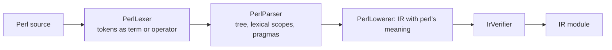

# Perl frontend

**Status:** implemented for the subset below ([#428](https://github.com/Hawkynt/Polypiler/issues/428): [#435](https://github.com/Hawkynt/Polypiler/issues/435) – [#439](https://github.com/Hawkynt/Polypiler/issues/439); own parser [#1561](https://github.com/Hawkynt/Polypiler/issues/1561)); stage 1 of the [pipeline](PIPELINE.md). Related: [import differences](../reference/import-differences.md).

`Polypiler.Core.Frontends.Perl` imports one Perl 5 file - a module, a script of subs or a
`Test::More` test - into the IR.



```text
polypiler translate Checksum.pm --from perl --to csharp --perl-contract "Checksum::adler32.data: str" --output out
```

No perl has to be installed: the frontend lexes and parses Perl itself and starts no process.

## Lexing: what follows decides what a character is

`Syntax/PerlLexer.cs` reads one token at a time, either where the parser expects a term or where it
expects an operator, which decides what perl's ambiguous characters are: `/` starts a match where a
term belongs and divides where an operator does; `<` reads a line (`<FH>`, `<$fh>`, `<>`, `<<>>`), a
glob (`<*.c>`) or starts a heredoc in term position and compares in operator position; `%`, `&` and
`*` are sigils or operators; `-e` is a file test or a minus; `x` repeats or names a sub; `~~` is two
complements or the smartmatch.

- **Numbers**: decimal with `_`, exponents, `0x`, `0b`, `0o` and legacy octal, hexadecimal (and octal,
  binary) floats with `p` exponents, version strings (`v5.36.0`, `5.36.0`); integers beyond 64 bits
  become binary64, as in perl.
- **Quotes**: `'…'`, `"…"`, `` `…` `` and `q qq qw qx m qr s tr y` with any delimiter: brackets nest,
  `#` needs no space before it, an alphanumeric one does; `s` and `tr` take a second part with a
  delimiter of its own after a bracketed first one; `=>` after the keyword makes it a word.
- **Heredocs**: `<<"X"`, `<<'X'`, `<<X`, `<<\X`, `` <<`X` ``, `<< "X"` and the indented `<<~`, several
  on one line, bodies cut out of the lines after the marker's line; an indented body must start with
  the terminator's indentation.
- **Variables**: `$x`, `${x}`, `${^NAME}`, `$::x`, `$Pkg::x`, `$main'x` (while the apostrophe is a
  package separator, which `use v5.41` and later end), `$1`, `$^W`, the punctuation variables, `$#a`,
  `$#{…}`, `$#$r`, `$#-`, whitespace (and comments) between a sigil and its name.
- **POD** wherever a line starts with `=word`, up to `=cut`; `__END__` and `__DATA__` end the code;
  identifiers take Unicode letters under `use utf8`.

## Parsing: perlop and perlsyn

`Syntax/PerlParser*.cs` is a recursive descent written from perlsyn, perlop, perldata, perlfunc and
perlsub (perl's own parser, `toke.c` and `perly.y`, and PPI are licensed Artistic/GPL, so no code is
taken; perl is the oracle). It builds the tree of `Ast/PerlNode.cs`.

- **Precedence**: the table of perlop from `**` (right, binding tighter than a unary minus on its left)
  down to `or`/`xor`, with the ternary and the assignments right-associative and `..` non-associative.
- **Builtins** by their prototypes as `prototype("CORE::…")` of perl 5.42.3 gives them, copied into
  `Syntax/PerlBuiltins.cs`: an empty prototype is a term (`time / 2` divides), one argument slot a named
  unary operator whose operand binds tighter than a comparison (`ref $x eq 'HASH'`), more a list
  operator that takes everything up to a low-precedence operator; a builtin with syntax of its own
  (`print`, `sort`, `map`, `grep`, `split`, `defined`, `exists`, `require`, `do`, `eval`, `return`,
  `last`, `goto`, …) is parsed by name. `shift // 0` is a defined-or, `length / 2 /` a match.
- **Blocks or hashes**: a `{` where a statement starts or after `map`/`grep` is a hash when it starts
  with a word or string followed by `=>`, or by a comma unless the word is lower case, and a block
  otherwise; `{}` is a block at a statement and a hash after `map`.
- **Strings**: interpolation of `$x`, `${x}`, `${\ expr}`, `@x`, `@{[ … ]}`, element and slice
  subscripts with `->` chains (a `[` or `{` in a pattern only where it cannot be a character class or
  a quantifier), every escape (`\x{…}`, `\N{U+…}`, `\o{…}`, octal, `\c`), the case escapes
  `\L \U \Q \F \l \u` up to `\E`; source characters beyond ASCII are their UTF-8 bytes without
  `use utf8`, as perl reads them.
- **Lexicals** are resolved while parsing, as perl resolves them: a `my`, `our` or `state` variable
  is visible after its statement, after the condition of the compound statement that declares it,
  in the body of its `foreach`; an inner sub sees the lexicals of the scopes around it.
- **Pragmas** that change the grammar: `use feature` and the feature bundles of `use VERSION`
  (copied from feature.pm: `say`, `state`, `try`, `defer`, `isa`, `signatures`, `fc`, `__SUB__`,
  `bitwise`, the apostrophe as package separator, …), `use experimental`, `use utf8`, `use integer`,
  `use constant`, `use subs`, `use builtin` and the builtin bundle of `use v5.40`.
- **Subs**: declarations and definitions with prototypes, signatures (with the `signatures` feature),
  attributes and `:prototype(…)`; a sub known before a call parses the call by its prototype (`()` a
  term, `($)` a named unary operator, `(&@)` a block first); `AUTOLOAD {…}`, `DESTROY {…}` and the
  phase blocks.
- **Calls a module may define**: the subs `use` imports are known where the parser knows the module's
  exports (Test::More, Carp, Moose, Data::Dumper, …, and explicit import lists) and their prototypes
  where they change the parse (List::Util's `first`, Scalar::Util's `blessed`, …); the subs of perl's
  test harness (`t/test.pl`) where a BEGIN block requires it; the functions perl defines itself
  (`utf8::`, `Internals::`, `re::`, `mro::`, `builtin::`). A bareword whose parse depends on whether
  something the parser cannot see defines it - `foo $x -1` after a `use` of a module whose exports
  are not known - is refused by name.

## Outside the parser

What cannot be decided without running the file is refused with PLY1701 and no verdict: source
filters and keyword plugins (`use Filter::…`, `Syntax::Keyword::…`, `Switch`, …), `format`, the
`class` feature, the `switch` feature, lexical subs, declared references, regex code blocks
(`(?{…})`), `s///ee`, `\N{name}` with a character name, switches of the `#!` line that change the
program (`-n`, `-p`, `-a`, …), and the bareword calls above.

## Lowering

`Lowering/PerlLowerer*.cs` reads the tree and makes perl's compile-time decisions itself: it folds
constant expressions (arithmetic, string, comparison and bitwise operators, the constants of
`use constant` and of constant subs, `chr`, `ord`, `length`, …) as perl does, with IVs, UVs and NVs
and `use integer`; it gives each statement its context (void, scalar, list, or the caller's for the
last statement of a sub) - a postfix increment in void context is a prefix one, an `if` modifier in
void context a branch; and it reads packages, exports (`our @EXPORT`/`@EXPORT_OK`), `@ISA`,
`use parent`/`use base` and Moose's `has`/`extends`/`with`/`requires` from the tree.

## Subset

| Perl | IR |
| --- | --- |
| numeric scalars with contracts (`--perl-contract`), `use integer` regions | the IR's integer and float types; 64-bit shift and overflow rules |
| `if`/`elsif`/`else`/`unless`, statement modifiers, `while`/`until`, C-style `for`, range and array `foreach`, `last`/`next` with lexical labels | the IR's statements |
| arrays, lists, negative indices, `push`/`pop`/`shift`/`unshift`, `join`, byte strings, `substr`, `ord`, `chr`, `vec`, endian-explicit `pack`/`unpack` | lists, arrays and the string intrinsics |
| subs with `@_`, `shift`, `$_[N]`, signatures; closures over lexicals; packages and exports | functions, lambdas |
| constant-key hashes as records, computed-key hashes as maps, `exists`, `delete`, `scalar(keys %h)` | classes and maps |
| `die`, `eval`, `try`/`catch`/`finally` | exceptions |
| blessed-hash, inside-out and Moose classes and roles | classes and interfaces |

## Diagnostics

`PLY1700` for source that is no valid Perl (`Perl syntax error: …`) and for a malformed contract,
`PLY1701` for a construct outside the parser, `PLY1702`–`PLY1743` for constructs outside the subset.

## Checks

`Polypiler.Tests/Frontends/Perl` imports the subset and its refusals and tests the lexer and parser
directly - the term/operator decisions, every quote and heredoc form, interpolation, precedence and
the outline of what a file declares. perl itself is only the oracle of the Perl layer
(`PerlOracleTests`): `Polypiler.Tests.Acceptance/Perl/Oracle/B/PolypilerOutline.pm`, a compiler
backend of the pinned perl, gives perl's verdict on a file and the outline the frontend gives too -
the subs it defines and the lexicals of every pad in order of declaration - on the fixtures of
`tests/fixtures/perl`, on every `t/**/*.t` and `lib/**/*.pm` of the pinned distribution (downloaded
with its SHA-256 and used as input only) and on copies of them cut in the middle or given an extra
closing brace; `Oracle/shape.pl` gives the shape of perl's op tree for a corpus of expressions over
every precedence level. The frontend's verdict, outline and shapes must be perl's wherever it gives
one.
