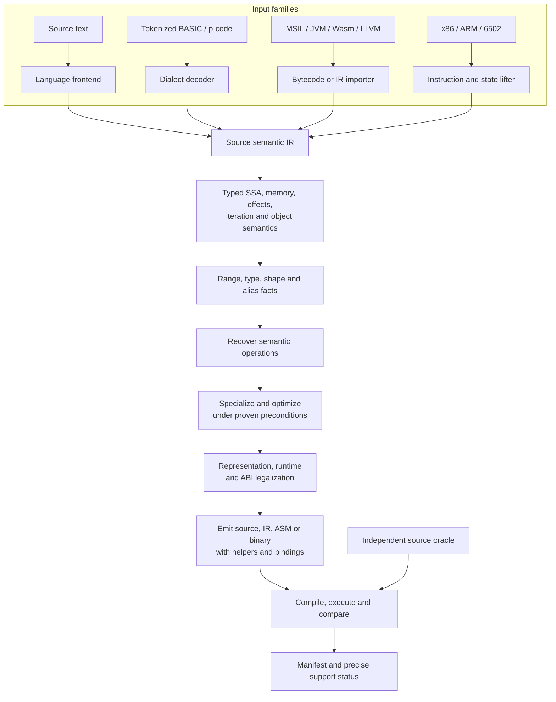

# End-to-end compilation flow

**Status:** design contract, not an implemented pipeline. See [PRD §4](../prd/02-core-architecture.md#s4), [§8](../prd/04-roadmap-and-delivery.md#s8), [§17](../prd/05-semantics-and-recovery.md#s17) and [§24](../prd/06-recovery-acceptance-and-gates.md#s24).

Polypiler translates *observable program behavior*, not syntax trees. Source language, input representation, output language, runtime and CPU are separate axes. "Translatable" means the selected subset is representable in the destination and the generated artifact passes the required verification gate.

## One pipeline, several entry points

These are **conceptual stages**, not necessarily separate serialized IR formats. Facts may flow back into earlier passes; iterative passes must converge or stop at a deterministic budget with conservative fallback.

## Detailed phases

| Phase | Receives | Produces | Must preserve |
|---|---|---|---|
| 0. Input discovery | Files, requested entry symbols, target profile, dependency manifest | Pinned compilation units and import graph | Input identity, version, provenance |
| 1. Parse/lift | Language syntax, bytecode, instructions, metadata | Structured source semantics and CFG | Dialect quirks, overflow, exception and order rules |
| 2. Bind/normalize | Modules, names, types, calls, external symbols | Typed references and explicit semantic operations | Dynamic dispatch, overload choices, API identities |
| 3. Construct IR | Bound code and memory model | SSA values, blocks, regions, effects, provenance | All observable state, control flow, traps |
| 4. Analyze | SSA, interprocedural summaries, target facts | Ranges, known bits, shape, ownership, alias and effects | Soundness at each program point |
| 5. Recognize | Expressions, loops, library calls, mixed ASM | Canonical operations and proof obligations | Exact bit, floating-point and memory semantics |
| 6. Optimize | Semantic operations and proven facts | Optimized IR, proof/decision log | Behavioral equivalence under selected contract |
| 7. Legalize | Optimized IR and target capabilities | Target IR, type layouts, runtime closure, ABI adapters | Target instruction, runtime and FFI legality |
| 8. Emit/package | Target IR and dependencies | Source/binary plus build and dependency manifest | Reproducibility and debug/provenance mapping |
| 9. Verify | Source oracle, generated artifact, target toolchain | Passed/failed evidence and support tier | No false "verified" claims |

## Semantic recognition is not mandatory rewriting

A pattern such as shifts/adds implementing multiplication may be recognized as a multiplication *candidate*. The optimizer may retain the original shift/add form when it is faster on 6502 or when the proof does not hold for the source's overflow and width behavior. Recognizing a permutation or a memcpy-like loop similarly does not authorize changing ordering or hardware effects.

## Two important flows

### JavaScript Cipher to C#

1. Import a pinned algorithm, its type annotations and the relevant known-answer vectors.
2. Reconstruct JavaScript bitwise coercions and typed-array semantics. Do not assume a JavaScript number is an arbitrary C# integer.
3. Infer fixed widths and values when sound; recognize bit manipulation and loop operations.
4. Emit the smallest necessary C# types and helpers.
5. Build the emitted C# under the requested runtime and compare results to the independently run JavaScript oracle.

### C# to DOS x86-16

1. Bind a supported C# algorithm and explicitly close its reachable runtime dependencies.
2. Monomorphize suitable generics, lower object features and cleanup, select compatible arithmetic and pointer representations.
3. Legalize to segmented near/far memory and DOS-compatible runtime operations.
4. Emit through the x86-16 backend **only** when all surviving operations are supported.
5. Execute in a DOS emulator and compare results, memory effects, errors and any promised timing constraints.

The x86-16 route is independent of the LLVM emitter: LLVM support does not imply an LLVM 16-bit DOS backend.

## Compilation result

Every invocation should produce a machine-readable manifest containing at least:

- Source identity, format, dialect, versions, hashes and chosen entry points.
- Target language, runtime, OS, architecture, ABI and toolchain versions.
- Resolved and unresolved dependencies, generated helpers, foreign libraries and licenses.
- Transformations with legality/proof status and conservative fallbacks.
- Build/run/oracle evidence, diagnostics and precise support tier.

See [verification](../quality/VERIFICATION.md) and the [normative CLI/manifest contract](../prd/04-roadmap-and-delivery.md#s10).
