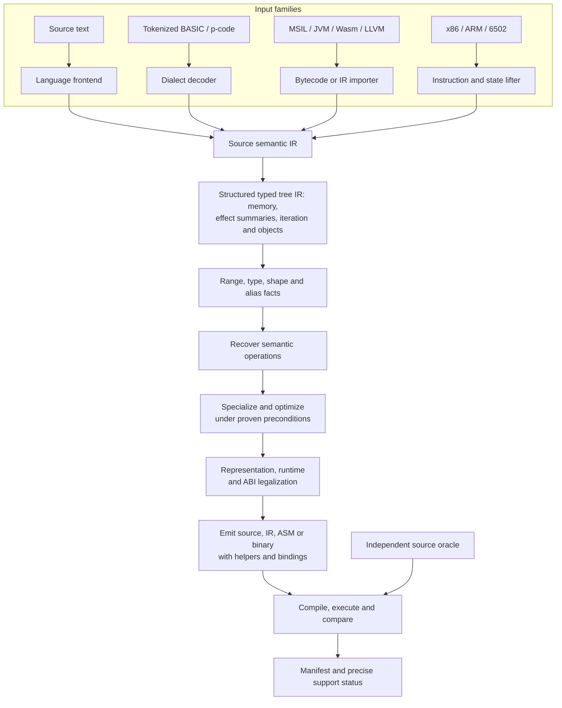

# End-to-end compilation flow

**Status:** design contract, not an implemented pipeline. See [PRD §4](../prd/02-core-architecture.md#s4), [§8](../prd/04-roadmap-and-delivery.md#s8), [§17](../prd/05-semantics-and-recovery.md#s17) and [§24](../prd/06-recovery-acceptance-and-gates.md#s24).

Polypiler translates *observable program behavior*, not syntax trees. Source language, input representation, output language, runtime and CPU are separate axes. "Translatable" means the selected subset is representable in the destination and the generated artifact passes the required verification gate.

## One pipeline, several entry points

These are **conceptual stages**, not necessarily separate serialized IR formats. Facts may flow back into earlier passes; iterative passes must converge or stop at a deterministic budget with conservative fallback. The [IR contracts](IR.md) define the representation boundaries and [ADR 0009](../adr/0009-structured-tree-ir.md) the tree IR and its legality checks; [semantic recovery](SEMANTIC-RECOVERY.md) explains recognition and proof obligations.

Two passes run on every translation before the optional ones, at every optimization level: the
specialization of Python's arbitrary-precision integer (O0062) and the de-dynamicization of
[ADR 0300](../adr/0300-static-types-first.md), which types the variants of a module that names its
language's semantics table (`IrModule.DynamicSemantics`) - within each function, on the tag tests of
its branches and across the module by clones per call-site signature - and leaves every other module
as it is. `translate --type-report <path|->` writes what the translation made of every place, by the
lattice level and certainty of its type, with the static ratio (`spec/schemas/type-report.schema.json`).

## Detailed phases

| Phase | Receives | Produces | Must preserve |
|---|---|---|---|
| 0. Input discovery | Files, requested entry symbols, target profile, dependency manifest | Pinned compilation units and import graph | Input identity, version, provenance |
| 1. Parse/lift | Language syntax, bytecode, instructions, metadata | Structured source semantics and CFG | Dialect quirks, overflow, exception and order rules |
| 2. Bind/normalize | Modules, names, types, calls, external symbols | Typed references and explicit semantic operations | Dynamic dispatch, overload choices, API identities |
| 3. Construct IR | Bound code and memory model | Typed tree of structured statements and expressions, effect summaries, provenance | All observable state, control flow, traps |
| 4. Analyze | The tree (an SSA view derived where an analysis needs one), interprocedural summaries, target facts | Ranges, known bits, shape, ownership, alias and effects | Soundness at each program point |
| 5. Recognize | Expressions, loops, library calls, mixed ASM | Canonical operations and proof obligations | Exact bit, floating-point and memory semantics |
| 6. Optimize | Semantic operations and proven facts | Optimized IR, proof/decision log | Behavioral equivalence under selected contract |
| 7. Legalize | Optimized IR and target capabilities | Target IR, type layouts, runtime closure, ABI adapters | Target instruction, runtime and FFI legality |
| 8. Emit/package | Target IR and dependencies | A syntax tree of the target language, rewritten by the target passes and printed last ([backends](BACKENDS.md)); source/binary plus build and dependency manifest | Reproducibility and debug/provenance mapping |
| 9. Verify | Source oracle, generated artifact, target toolchain | Passed/failed evidence and support tier | No false "verified" claims |

Phase 1 of a source frontend is a parser generated from a grammar where one exists ([ADR 1000](../adr/1000-grammar-described-frontends.md)): `polypiler-tooling grammar generate` turns a grammar in pegen's format into the C# half of a partial parser class, and the hand-written half supplies the token source, the hooks and the helpers the actions call. Both halves run on `Polypiler.Core.Syntax`, the runtime every generated parser shares: a token buffer filled only as far as the rules read, memo tables per rule made on first use and keyed by position and hook state, the nesting limit, the farthest failure, and the two passes in which the `invalid_*` rules give the reference compiler's messages. The grammars and their format are described in [grammars](GRAMMARS.md).

Stage 7 is built for the helpers of the prototype ([#1353](https://github.com/Hawkynt/Polypiler/issues/1353)): legalization replaces every operation the profile has no native form of by the call of its helper from the one IR library and copies the helper into the module ([backends](BACKENDS.md#helpers-one-library-in-the-ir)). Between legalization and emission the passes over the legalized module run over the helpers and every function a helper was inlined into, round after round until nothing changes: [O0463](../optimizations/O0463-lambda-specialisation.md) specialisation of functions for the lambdas passed to them ([#1360](https://github.com/Hawkynt/Polypiler/issues/1360)) - a function value that stays in the function it is made in is lifted into a function of the module, and its callee copied with it bound -, [O0006](../optimizations/O0006-inlining.md) inlining under a size budget of the helpers, the lifted functions and the copies, [O0003](../optimizations/O0003-sccp.md) constant propagation, [O0001](../optimizations/O0001-constant-folding.md) constant folding, [O0002](../optimizations/O0002-partial-evaluation.md) compile-time evaluation of pure calls with constant arguments, [O0464](../optimizations/O0464-call-merging.md) merging of identical pure and read-only calls, [O0005](../optimizations/O0005-dead-code-elimination.md) dead-code removal and [O0023](../optimizations/O0023-loop-unrolling.md) full unrolling of short counted loops and [O0381](../optimizations/O0381-dead-function-elimination.md) module-wide removal of unreachable functions together with [O0383](../optimizations/O0383-global-dead-code-elimination.md) removal of unreferenced globals. The atomic sweep follows code and data references from exports, frontend test entry points, initialization, retained type declarations and host/profile global roots; disabling O0381 keeps every function as a data root, and disabling O0383 keeps every global initializer as a function root. Initializers whose effects, modeled traps or termination are uncertain remain roots. Evaluation, merging and the removal of unused calls ask the effect summary of each function ([#1361](https://github.com/Hawkynt/Polypiler/issues/1361), `IrEffects`): what it reads and writes outside its own variables, whether it allocates, may trap and may run forever, computed bottom-up over the calls, recursion and loops without a proven bound counting as possibly endless and calls through function values as the worst case; evaluation and merging look at every function, as specialisation and inlining do.

Stage 8 is built for the C# and the JavaScript backend of the prototype: each builds a typed syntax tree of its language from the IR, the capability table contributing tree fragments, runs the target passes (`O0500` helper inlining, `O0501` unused declaration removal) between building and printing, and only its printer makes text. `--opt`, `--disable-opt` and `--explain-opt` govern the passes over the legalized module and the target passes as they govern the IR rules. See [backends](BACKENDS.md).

## Semantic recognition is not mandatory rewriting

O0105 bit reversal and O0106 byte swap use exact weighted-bit provenance as a
structural check; O0108 checks single-bit test, set, clear and toggle with a
shifted one; O0110 parity evaluates folds and nibble lookups as exclusive ors
of atom bits; O0120 minimum and maximum checks compare-select, mask-select and
subtract-sign forms; O0121 wrapping magnitude checks sign masks and signed
compare-select forms, including promoted narrow arithmetic; O0122 signum
evaluates comparison differences and selections for the three sign classes and
checks the shift-or form. These rules ask the host's `IRecognitionProver` to
prove the actual tree expression and replacement equivalent. `translate`
supplies `SmtRecognitionProver`, which encodes stable definitions, conversions,
signed shifts, rotations, comparisons (including equality), selections,
truth-valued results, `Min`/`Max`, the single-bit operations and the unrolled
values of pure counted loops for Z3. A single-bit operation is encoded only
when its position is provably within the width (a constant inside it or a count
masked to it), which is also when `IrShape` counts it as trap-free. Only a
proved verdict permits replacement; timeout, unknown and unavailable proofs
leave the candidate unchanged. A rule whose only open condition is a range —
O0120's subtract-sign form, where `a - b` must not overflow — has the proof
establish it from the actual conversions and reports a refutation as that
condition (`subtraction may overflow`). `--explain-opt` includes proof classes and
refusals. Library hosts enable these proof-dependent rules with
`OptimizerOptions.Prover = new SmtRecognitionProver()`; recognition itself has no
dependency on the verification module. `CreateObligation` exports the same
obligation for independent exhaustive checks and evidence.

O0126 reciprocal division asks no solver: a 32-bit division by a constant does
not finish within the budget and a 64-bit high product would need 128 bits.
It derives the divisor from the multiplier and the shift and checks an exact
certificate in `BigInteger` arithmetic, which is the proof (`validated-rule`);
its tests validate the rule exhaustively and with Z3 at 16 bits. It reports
through `RuleContext.Certify`, which, like a proof, publishes the application
only after the optimizer commits it.

O0103 proves loops that end early the same way: it unrolls the bit-scanning
loop symbolically into the chain of its passes' exit values (`c0 ? (c1 ? … : v1)
: v0`) and asks the prover to equate the final counter and shifted variable with
`TrailingZeroCount` or `LeadingZeroCount`, whose definitions test every bit
position. A loop that does not end for zero is proved only under the non-zero
fact a dominating `if (x == 0) return` or an enclosing `if (x != 0)` supplies.

O0104 de Bruijn bit scans read a constant table, which the frontends make of an
array nothing writes. A load from such a table is total when its index cannot
pass the table's end (a logical shift, a non-negative mask, or a conversion that
keeps the bound), and `IrShape.IsTrapFree` says so; the prover encodes the load
as the choice among the table's entries by the index. The one obligation covers
the multiply, the shift, the table and the zero case, which the replacement
keeps with a selection on `x == 0`; the rule's table check only names the first
wrong entry.

O0102 SWAR population count is recognition by proof: a structural gate (a final
fold at the root and the `0x55…`, `0x33…`, `0x0F…` mask families) selects the
candidate, and the proof against an independent bit-by-bit `PopCount` decides.
A refuted proof is reported as `not equivalent to PopCount`.

O0125 reads a wrapping shift-add or shift-subtract chain as a linear form `c · x`
modulo `2^w` and proves it against `Mul(x, c)`. The adapter encodes a
multiplication by a constant as the sum of the other operand shifted to the
constant's set bits (or the negation of that sum for `-c`), derived from the
constant alone: a bit-blasted 64-bit multiplier would take the solver seconds.

Each solver query releases its native wrappers before closing the context. The
pinned Z3 binding's array parser retains temporary AST wrappers until collection,
so the integration loads assertions directly into the solver. The resource
regression runs repeated satisfiable and unsatisfiable queries in an isolated
process without managed collection, then forces finalization to check cleanup.

A pattern such as shifts/adds implementing multiplication may be recognized as a multiplication *candidate*. The optimizer may retain the original shift/add form when it is faster on 6502 or when the proof does not hold for the source's overflow and width behavior. Recognizing a permutation or a memcpy-like loop similarly does not authorize changing ordering or hardware effects.

## Two important flows

### JavaScript Cipher to C#

1. Import a pinned algorithm, its type annotations and the relevant known-answer vectors.
2. Reconstruct JavaScript bitwise coercions and typed-array semantics. Do not assume a JavaScript number is an arbitrary C# integer.
3. Infer fixed widths and values when sound; recognize bit manipulation and loop operations.
4. Emit the smallest necessary C# types and helpers.
5. Build the emitted C# under the requested runtime and compare results to the independently run JavaScript oracle.

### C# to DOS x86-16

1. Bind a supported C# algorithm and explicitly close its reachable runtime dependencies.
2. Monomorphize suitable generics, lower object features and cleanup, select compatible arithmetic and pointer representations.
3. Legalize to segmented near/far memory and DOS-compatible runtime operations.
4. Emit through the x86-16 backend **only** when all surviving operations are supported.
5. Execute in a DOS emulator and compare results, memory effects, errors and any promised timing constraints.

The x86-16 route is independent of the LLVM emitter: LLVM support does not imply an LLVM 16-bit DOS backend.

## Compilation result

Every invocation should produce a machine-readable manifest containing at least:

- Source identity, format, dialect, versions, hashes and chosen entry points.
- Target language, runtime, OS, architecture, ABI and toolchain versions.
- Resolved and unresolved dependencies, generated helpers, foreign libraries and licenses.
- Transformations with legality/proof status and conservative fallbacks.
- Build/run/oracle evidence, diagnostics and precise support tier.

See [verification](../quality/VERIFICATION.md) and the [normative CLI/manifest contract](../prd/04-roadmap-and-delivery.md#s10).

Related: [PRD and architecture index](../PRD.md#architecture-guides) · [IR](IR.md) · [semantic recovery](SEMANTIC-RECOVERY.md) · [targets](TARGETS.md).
