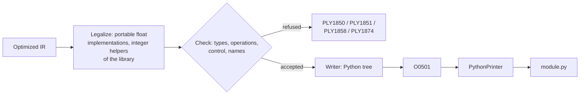

# The Python backend

**Status:** implemented for integers, floating point, control flow and functions
([#447](https://github.com/Hawkynt/Polypiler/issues/447), [#444](https://github.com/Hawkynt/Polypiler/issues/444),
[#445](https://github.com/Hawkynt/Polypiler/issues/445)), checked by CPython through the runner of the
Python/Perl layer ([#454](https://github.com/Hawkynt/Polypiler/issues/454)). It follows the shape of every
backend ([backends](BACKENDS.md)): the IR becomes a Python syntax tree, the target passes rewrite the
tree, and the printer is the only place where Python becomes text.

`polypiler translate <file> --from <csharp|javascript|python> --to python --output <directory> [--profile py3.8 … py3.14]`
writes one module, `<module in snake_case>.py`, and the manifest beside it.

## Project

| Folder | What it holds |
| --- | --- |
| `Syntax/` | `PythonSyntax.cs`, the tree after CPython's `ast`; `PythonSyntaxRewriter` (walk, bottom-up rewrite, the shape two trees are compared by); `PythonSyntaxReader`, which reads the printed subset back - INDENT/DEDENT, implicit joining inside brackets, the precedence of the language reference §6.17 |
| `Printing/` | `PythonPrinter`: four spaces, double quotes, LF, a final newline; parentheses exactly where precedence needs them, and around a mixed operand of a bitwise operator, so `((x + y) & 0xFF) ^ 0x80` reads as it computes; a signature over 88 columns one parameter per line; a table eight elements to a line |
| `Profiles/` | `PythonProfile` (`py3.8` … `py3.14`, the newest by default, the version `tooling/toolchains.lock` pins) and `PythonCapabilities`, the table of what each version has |
| `Library/` | `PythonLibrary`: which integer operations legalization binds from the IR's helper library |
| `Helpers/` | `PythonHelpers`: the operations Python has no expression for (listed in [backends](BACKENDS.md#helpers-that-stay-with-a-backend)) |
| `Writing/` | the writer: module, functions and names; expressions; statements; switches and counted loops |
| `Passes/` | `PythonTargetPasses`: O0501, which removes a helper and an `import` nothing names |

## Pipeline

1. **Legalization** (`PythonEmitter.Legalize`): every floating-point operation that has a portable
   implementation becomes the call of it, in both modes - no function of Python's `math` module has a
   measured error ADR 0005 admits, and `math.fma` (3.13) raises on an overflow or an invalid operation
   where IEEE 754 gives an infinity or a NaN. Every integer operation Python lacks - rotates, counts,
   reorderings, saturating and overflow-testing arithmetic, bit fields, endian accesses - becomes the
   call of its helper of the library (`IntegerLibrary`); `min`/`max` of integers stay, and the count of
   one bits is `int.bit_count()` from 3.10. The library's functions arrive as ordinary private
   functions of the module.
2. **Check** (`PythonEmitter.Check`): the verifier, then everything the writer cannot carry.
3. **Build** (`PythonEmitter.Build`), the target passes, **print**.

## Values

| IR | Python |
| --- | --- |
| `i8` … `i64` | `int` holding the signed value |
| `u8` … `u64` | `int` holding the non-negative value |
| `bool` | `bool` |
| `f64` | `float` |
| `f32` | `float` that is always exactly a binary32 number |
| array of numbers | `list` (`List` from `typing` before 3.9) |

## Lowering

| IR | Python |
| --- | --- |
| `Add`, `Subtract`, `Multiply`, `ShiftLeft` of a signed type | the exact result sign-wrapped: `(((x + y) & 0xFFFFFFFF) ^ 0x80000000) - 0x80000000` |
| the same of an unsigned type | the exact result masked: `(x * y) & 0xFFFFFFFF` |
| the checked forms, `NegateChecked`, a conversion that traps | `_ply_checked(exact, low, high)`: `OverflowError` outside the type |
| `Divide`, `Remainder` of a signed type | `_ply_sdiv` / `_ply_srem`: truncating, `OverflowError` for the smallest value by -1; `//` and `%` where the dividend cannot be negative and the divisor is a positive constant |
| `Divide`, `Remainder` of an unsigned type | `x // y`, `x % y` |
| shifts | the count masked to 5 (6) bits; `>>` is arithmetic on Python's ints; a logical shift of a signed value reads its bits first: `(x & 0xFFFFFFFF) >> n`, sign-wrapped unless the count is a constant of at least one |
| `f64` arithmetic | Python's operators; `_ply_fdiv` and `_ply_fmod` where Python raises for a zero divisor or an infinite dividend |
| `f32` arithmetic | the same, rounded: `_ply_f32(x + y)` (exact, because a double holds the result of two binary32 operands precisely enough to round once) |
| integer to `f32` | `float(x)` up to 24 bits, `_ply_f32_of_int(x)` beyond, which rounds once rather than through a double |
| float to integer | `_ply_f2i_sat` (NaN to 0, saturating) or `_ply_f2i_trap` (`OverflowError`) |
| `FloatBits`, `BitsFloat` | `struct.unpack("<q", struct.pack("<d", x))[0]` and the reverse |
| square root, floor, ceiling, truncation, the roundings, sign, IEEE minimum and maximum | helpers that keep -0 and NaN as IEEE 754 does; `abs` |
| a constant | decimal; masks in hexadecimal, `_` every four digits beyond 32 bits; `math.inf`, `math.nan`, a NaN with payload by its bits |
| a step as a value | `(x := new)`, or `(x, (x := new))[0]` for the old value; of an array element a tuple of assignment expressions ending in `__setitem__` |
| an array element | `a[i]`, `a[_ply_index(i)]` where the index could be negative (Python counts it from the end); a new array `[0] * n`, `_ply_length(n)` where `n` could be negative |
| a store whose value can trap or act, into a place that is no variable | the array and the index computed first, as the IR evaluates them |
| `if`/`else` | `if`/`elif`/`else`; an empty branch disappears |
| `while`, `do … while` | `while`; `while True:` with `if not c: break` last, a `continue` testing first |
| a counted `for` (or a `while` that ends with its step and has no `continue`) | `for i in range(…)`: the counter declared just before, a bound that does not change in the loop, a constant step, no write of the counter in the body, no read of it after the loop, and the step after the last pass inside the counter's type for every value the bound can have (a constant, or a widening conversion of a narrower integer); otherwise a `while` with the IR's own step |
| any other `for` | `while` with the step at the end of every pass and before every `continue` |
| `switch` | `match` (3.10): `case 1 \| 2:`, `case _ if 3 <= x <= 9:` for a run of three or more, `case _:`; before 3.10 an `if`/`elif` chain; the `break`s of a section are taken out (a `break` in a branch moves what follows into the other branch), and where that would copy more than three statements the `match` stands in a loop of one pass |
| a function | `def name(p: int) -> int:`; public ones in snake_case and in `__all__`, private ones behind `_` |
| constants, globals | `_NAME: int = 5`, a table as a tuple; globals assigned after every function, `global` in a function that assigns one |
| a `throw` of a library exception | `raise` of the built-in exception of the [trap table](../reference/exceptions.md#python) |

## Refusals

| Code | When |
| --- | --- |
| `PLY1850` | a type Python cannot carry in this backend: strings, structs, classes, enums, views, pointers, collections, functions |
| `PLY1851` | a construct the backend does not write, named: an intrinsic, a `try`, a call of a constructor, a closure |
| `PLY1858` | a `continue` inside a switch that stands in a loop of one pass |
| `PLY1874` | two public functions whose snake_case names are the same, or a name nothing of is left |

## Where the issues and the repository differ

The issues were written before the prototype existed; where they and the repository disagree, the
repository's architecture is followed:

- **Structured IR.** The IR has `if`, `while`, `do`, `for`, `switch`, `break` and `continue` of the
  innermost loop or switch, not a control-flow graph with `RegionTree`, phis and labelled exits (#444):
  there is no phi to destroy and no outer exit to flag, and the dispatch loop is not needed.
- **Range facts.** The IR carries no interval facts (#447): a mask is omitted only where a constant or a
  counted loop proves it. Every other fixed-width operation is masked.
- **Package layout and tests.** The IR has no export names, test-role functions, documentation or
  contract asserts (#445): the backend writes one module of the shape `translate` writes for every
  target, and no `src/` package, `tests/test_<module>.py`, docstrings or entry guards yet.
- **Codes.** Refusals use the codes of the Python block (`PLY1850`, `PLY1851`, `PLY1858`, `PLY1874`),
  as the C# and JavaScript backends use their own.
- **Counted loops at the limit.** A counted loop with an inclusive test against a bound that may be the
  largest value of the counter's type (the smallest, counting down) runs on in the IR, where the counter
  wraps, and a `range` would end. Such a loop is written as `range` only where the bound's values are
  known to keep the step after the last pass inside the type: a constant, or a widening conversion of a
  narrower integer. Every other one (`i <= n` with `n` of the counter's type, `i <= len(a)` with an
  `i32` counter) stays a `while` with the IR's step.

## Verification

- `Polypiler.Tests/Backends/Python`: the syntax, the printer, the reader, profiles and naming, every
  lowering as text, the CLI, and every prototype source read back (`PythonParseBackTests`).
- `Polypiler.Tests.Acceptance/Python` (layer `pyperl`, `python` from `tooling/toolchains.lock`): every
  prototype fixture, the bit-operation fixtures, every integer operation on every width (py3.8 and
  py3.14), the floating-point algorithms and the module-state fixtures run under CPython in the sandbox
  and agree call for call with the C# compiler's build (or the bit-by-bit reference, or for floating
  point the interpreter, which runs the same portable implementations) and with the IR interpreter.
  The driver maps the built-in exceptions back to the traps. Where the interpreter on the host is not
  the pinned one, the tests are inconclusive; with `POLYPILER_REQUIRE_TOOLCHAINS=1`, as in CI, they fail.
