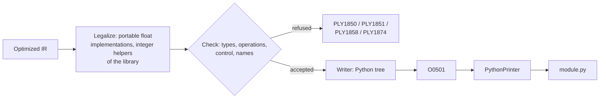

# The Python backend

**Status:** implemented for integers, floating point, control flow and functions
([#447](https://github.com/Hawkynt/Polypiler/issues/447), [#444](https://github.com/Hawkynt/Polypiler/issues/444),
[#445](https://github.com/Hawkynt/Polypiler/issues/445)), for arrays, strings, collections, views, pointers
and endian accesses ([#446](https://github.com/Hawkynt/Polypiler/issues/446)) and for classes, structs,
records, enums, optional values, exceptions, closures and iterators
([#448](https://github.com/Hawkynt/Polypiler/issues/448)), checked by CPython through the runner of the
Python/Perl layer ([#454](https://github.com/Hawkynt/Polypiler/issues/454)). It follows the shape of every
backend ([backends](BACKENDS.md)): the IR becomes a Python syntax tree, the target passes rewrite the
tree, and the printer is the only place where Python becomes text.

`polypiler translate <file> --from <csharp|javascript|python> --to python --output <directory> [--profile py3.8 … py3.14]`
writes one module, `<module in snake_case>.py`, and the manifest beside it.

## Project

| Folder | What it holds |
| --- | --- |
| `Syntax/` | `PythonSyntax.cs`, the tree after CPython's `ast`; `PythonSyntaxRewriter` (walk, bottom-up rewrite, the shape two trees are compared by); `PythonSyntaxReader`, which reads the printed subset back - INDENT/DEDENT, implicit joining inside brackets, the precedence of the language reference §6.17 |
| `Printing/` | `PythonPrinter`: four spaces, double quotes, LF, a final newline; parentheses exactly where precedence needs them, and around a mixed operand of a bitwise operator, so `((x + y) & 0xFF) ^ 0x80` reads as it computes; a signature over 88 columns one parameter per line; a table eight elements to a line |
| `Profiles/` | `PythonProfile` (`py3.8` … `py3.14`, the newest by default, the version `tooling/toolchains.lock` pins) and `PythonCapabilities`, the table of what each version has |
| `Library/` | `PythonLibrary`: which integer operations legalization binds from the IR's helper library |
| `Helpers/` | `PythonHelpers` and its parts by area (objects, strings, collections, views, pointers, number text): the operations Python has no expression for and the classes that represent what Python has no type for (listed in [backends](BACKENDS.md#helpers-that-stay-with-a-backend)) |
| `Writing/` | the writer: module, functions and names; expressions; statements; switches and counted loops; objects (classes, structs, interfaces); exceptions; functions and closures; values (strings, enums, optional values, collections); sequences; views and pointers; number text |
| `Passes/` | `PythonTargetPasses`: O0501, which removes a helper and an `import` nothing names |

## Pipeline

1. **Legalization** (`PythonEmitter.Legalize`): every floating-point operation that has a portable
   implementation becomes the call of it, in both modes - no function of Python's `math` module has a
   measured error ADR 0005 admits, and `math.fma` (3.13) raises on an overflow or an invalid operation
   where IEEE 754 gives an infinity or a NaN. Every integer operation Python lacks - rotates, counts,
   reorderings, saturating and overflow-testing arithmetic, bit fields, endian accesses - becomes the
   call of its helper of the library (`IntegerLibrary`); `min`/`max` of integers stay, and the count of
   one bits is `int.bit_count()` from 3.10; the limbs `HighWord` and `JoinWords` the library's helpers are built from are written in place. The library's functions arrive as ordinary private
   functions of the module.
2. **Check** (`PythonEmitter.Check`): the verifier, then everything the writer cannot carry.
3. **Build** (`PythonEmitter.Build`), the target passes, **print**.

## Values

| IR | Python |
| --- | --- |
| `i8` … `i64` | `int` holding the signed value |
| `u8` … `u64` | `int` holding the non-negative value |
| `bool` | `bool` |
| `f64` | `float` |
| `f32` | `float` that is always exactly a binary32 number |
| array | `list` (`List` from `typing` before 3.9); a constant table a `tuple` |
| `str` | `str` whose every character is one UTF-16 code unit - a character beyond the BMP is its two surrogates - so that lengths, indexes and the ordinal comparison are the IR's |
| class | a class: `__init__` for its constructor, the fields its attributes with their defaults, methods, properties for accessors, static fields as class attributes; a base class and the interfaces the base does not implement as bases |
| interface | a class whose methods raise `NotImplementedError`, which an implementing class derives from, so that a type test is `isinstance` |
| struct | a `@dataclass`, `frozen=True` where nothing writes one of its fields; a mutable one is copied with `copy.copy` wherever a value is read from a place that can still be used |
| record class, equatable struct | `__eq__` and `__hash__` field by field as `IrStructEquals` says (a float by `Equals`: NaN equal to NaN) |
| enum | `enum.IntEnum`, members in UPPER_SNAKE_CASE; a value is an `int`, the member where the IR names one |
| optional value | `T \| None` |
| list, map, set | `list`, `dict`, `dict` of keys to `None`; a map or set in .NET's slot order whose keys are removed `_PlySlots` |
| function value | a nested function or a `lambda`, a bound method, a function of the module |
| lazy sequence | a generator; a restartable one an object of `_PlySequence` that calls the generator anew on every enumeration |
| span, memory | `_PlyView` |
| pointer | `_PlyPointer`, the null pointer `None` |

## Lowering

| IR | Python |
| --- | --- |
| `Add`, `Subtract`, `Multiply`, `ShiftLeft` of a signed type | the exact result sign-wrapped: `(((x + y) & 0xFFFFFFFF) ^ 0x80000000) - 0x80000000` |
| the same of an unsigned type | the exact result masked: `(x * y) & 0xFFFFFFFF` |
| the checked forms, `NegateChecked`, a conversion that traps | `_ply_checked(exact, low, high)`: `OverflowError` outside the type |
| `Divide`, `Remainder` of a signed type | `_ply_sdiv` / `_ply_srem`: truncating, `OverflowError` for the smallest value by -1; `//` and `%` where the dividend cannot be negative and the divisor is a positive constant |
| `Divide`, `Remainder` of an unsigned type | `x // y`, `x % y` |
| shifts | the count masked to 5 (6) bits; `>>` is arithmetic on Python's ints; a logical shift of a signed value reads its bits first: `(x & 0xFFFFFFFF) >> n`, sign-wrapped unless the count is a constant of at least one |
| `f64` arithmetic | Python's operators; `_ply_fdiv` and `_ply_fmod` where Python raises for a zero divisor or an infinite dividend |
| `f32` arithmetic | the same, rounded: `_ply_f32(x + y)` (exact, because a double holds the result of two binary32 operands precisely enough to round once) |
| integer to `f32` | `float(x)` up to 24 bits, `_ply_f32_of_int(x)` beyond, which rounds once rather than through a double |
| float to integer | `_ply_f2i_sat` (NaN to 0, saturating) or `_ply_f2i_trap` (`OverflowError`) |
| `FloatBits`, `BitsFloat` | `struct.unpack("<q", struct.pack("<d", x))[0]` and the reverse |
| `variant`, the dynamic type ([variants](../reference/variants.md)) | a tuple `(tag, payload)`, `(0,)` and `(1,)` for `Empty` and `Null`, `(6, ten thousandths)` and `(7, days)`, lists of them, new elements `(0,)`; the tag `v[0]`, a tested payload `v[1]`, an untested one `_ply_variant(v, tag)`, which raises the `InvalidCastError` |
| `bigint`, the arbitrary-precision integer | Python's `int`: its operators, `//` and `%` of a dividend that is not negative by a positive constant, `<<` and `>>` by a constant; `_ply_big_div` and `_ply_big_rem` (truncating), `_ply_big_shl` and `_ply_big_shr` (a count of any sign), `_ply_big_float` (an infinity where `float()` raises), `_ply_float_big` (`OverflowError` for a NaN and an infinity); to a fixed width the mask and sign-wrap or `_ply_checked` |
| `HighWord`, `JoinWords` (the limbs of O0075) | `(x >> 32) & 0xFFFFFFFF`; `(high << 32) \| low` sign-wrapped to `i64` |
| square root, floor, ceiling, truncation, the roundings, sign, IEEE minimum and maximum | helpers that keep -0 and NaN as IEEE 754 does; `abs` |
| a constant | decimal; masks in hexadecimal, `_` every four digits beyond 32 bits; `math.inf`, `math.nan`, a NaN with payload by its bits |
| a step as a value | `(x := new)`, or `(x, (x := new))[0]` for the old value; of an array element a tuple of assignment expressions ending in `__setitem__` |
| an array element | `a[i]`, `a[_ply_index(i)]` where the index could be negative (Python counts it from the end); a new array `[0] * n`, `_ply_length(n)` where `n` could be negative |
| a store whose value can trap or act, into a place that is no variable | the array and the index computed first, as the IR evaluates them |
| `if`/`else` | `if`/`elif`/`else`; an empty branch disappears |
| `while`, `do … while` | `while`; `while True:` with `if not c: break` last, a `continue` testing first |
| a counted `for` (or a `while` that ends with its step and has no `continue`) | `for i in range(…)`: the counter declared just before, a bound that does not change in the loop, a constant step, no write of the counter in the body, no read of it after the loop, and the step after the last pass inside the counter's type for every value the bound can have (a constant, or a widening conversion of a narrower integer); otherwise a `while` with the IR's own step |
| any other `for` | `while` with the step at the end of every pass and before every `continue` |
| `switch` | `match` (3.10): `case 1 \| 2:`, `case _ if 3 <= x <= 9:` for a run of three or more, `case _:`; before 3.10 an `if`/`elif` chain; the `break`s of a section are taken out (a `break` in a branch moves what follows into the other branch), and where that would copy more than three statements the `match` stands in a loop of one pass |
| a function | `def name(p: int) -> int:`; public ones in snake_case and in `__all__`, private ones behind `_` |
| constants, globals | `_NAME: int = 5`, a table as a tuple; globals assigned after every function, `global` in a function that assigns one |
| a `throw` | `raise` of the Python class of the [trap table](../reference/exceptions.md#python) or of the module; `throw;` a bare `raise` |
| `try`/`catch`/`finally` | `try`/`except`/`finally`, or one `except Exception as e:` testing the clauses in order where a clause has a filter (see the [exceptions](../reference/exceptions.md#python)) |
| `using` | the resource, then `try:` the body `finally:` its `dispose()` unless it is `None` |
| `new` of a class | `Class(args)`; several constructors are `__init<k>` methods `__init__` chooses by the number of arguments |
| a field, a method call | `o.field`, `o.method(args)`; a static method `Class.method(args)`; a base call `super().method(args)`, or `Base.method(self, args)` inside a closure; a direct call of an overridden method `Class.method(o, args)` |
| `ReferenceEquals`, `is`, a cast, `as` | `a is b`, `isinstance(o, C)`, `_ply_cast(o, C)` (`InvalidCastError`), `o if isinstance(o, C) else None` |
| an optional value | `x is None`, never by truth; `x if x is not None else y`; `_ply_unwrap(x)` (`RuntimeError`) |
| a lambda | `lambda a: e` where it returns one expression and writes nothing it captures; otherwise a nested `def` in front of the statement, with `nonlocal` for what it assigns |
| a variable a closure captures that every pass of a loop has anew | a cell `[v]` made anew where the IR makes the variable, which the nested function binds as the default of a parameter when it is made |
| a local whose address is taken | a cell, the region of its pointers |
| an async function (#1330) | `async def name(p: int) -> int:` typed with its result; `await f(…)` of a call, the value of `FromResult(v)`, nothing for `Completed`, `await asyncio.gather(…)` for `WhenAll`; see [async functions](../reference/async.md) |
| an iterator function | a generator function (`yield`, `yield from`, `return`); a restartable one returns `_PlySequence(_make, args)` |
| a pipeline of sequence operations | the loops of `SequenceFusion` (#1329), with `StableSort` and `RangeCount` from the library |
| a string operation | `len`, `ord(s[i])`, `+`, `find`, `rfind`, `in`, `startswith`, `replace`, `join`; helpers where the IR traps and Python would count from the end or clamp, and for .NET's and ECMA-262's trims, splits and pads |
| a list operation | `append`, `len`, `clear`, `in`; helpers for the operations that check an index (`ArgumentOutOfRangeError`), a `_PlyList` that counts its changes where a checked loop over a list has a body that may change one |
| a map operation | `m[k]` (`KeyError`), `m[k] = v`, `k in m`, `m.get(k)`; helpers that trap or say whether they changed the map; a float key with every NaN made one NaN |
| a loop over a collection | `for x in xs:`, `for k, v in m.items():`; a walk that traps after a new key, as .NET's, or that visits added keys, as ECMA-262's, where the body may change the collection |
| `ArrayCopy`, `ArrayFill`, `ArrayClear` | a slice assignment from a slice, which copies first; the value stored in every element |
| a view | `_ply_view_of(a, start, length)` (`ArgumentOutOfRangeError` outside); `len(v)`; `v[i]` checks its own bounds; `Reinterpret` reads the bytes with `struct` |
| `LoadLittle`, `LoadBig`, `StoreLittle`, `StoreBig` | `int.from_bytes(_ply_bytes(b, o, 4), "little")`, `signed=True` for a signed type, `struct.unpack("<d", …)` for a float; `v.to_bytes(4, "big")` put in after the range check |
| a pointer | `_ply_pin(a, "B")`, `_PlyPointer(cell, 0, 1, "i", 0)` for `&x`; `_ply_pointer_add`, `_ply_pointer_load`/`_ply_pointer_store` with the `struct` format of the type, the distance and the comparisons within one region |
| a conversion between a number and text | `str(i)` of an integer; helpers for the layouts of .NET and ECMA-262, `toFixed` and `F<n>`, and the grammars of `Parse`, `Number`, `parseFloat` and `parseInt` |

## Refusals

| Code | When |
| --- | --- |
| `PLY1850` | a type Python cannot carry in this backend |
| `PLY1851` | a construct the backend does not write, named: an intrinsic left after legalization, a native call and the last error of one ([foreign calls](../reference/foreign-calls.md#python)), two constructors of one arity, an exception filter that must run before the `finally` blocks inside its try, a call of a class's own only constructor |
| `PLY1858` | a `continue` inside a switch that stands in a loop of one pass |
| `PLY1874` | two public functions whose snake_case names are the same, or a name nothing of is left |

## Where the issues and the repository differ

The issues were written before the prototype existed; where they and the repository disagree, the
repository's architecture is followed:

- **Structured IR.** The IR has `if`, `while`, `do`, `for`, `switch`, `break` and `continue` of the
  innermost loop or switch, not a control-flow graph with `RegionTree`, phis and labelled exits (#444):
  there is no phi to destroy and no outer exit to flag, and the dispatch loop is not needed.
- **Range facts.** The IR carries no interval facts (#447): a mask is omitted only where a constant or a
  counted loop proves it. Every other fixed-width operation is masked.
- **Package layout and tests.** The IR has no export names, test-role functions, documentation or
  contract asserts (#445): the backend writes one module of the shape `translate` writes for every
  target, and no `src/` package, `tests/test_<module>.py`, docstrings or entry guards yet.
- **Codes.** Refusals use the codes of the Python block (`PLY1850`, `PLY1851`, `PLY1858`, `PLY1874`),
  as the C# and JavaScript backends use their own; the codes #446 and #448 name (`PLY1866`, `PLY1867`,
  `PLY1882`, `PLY1883`) have nothing left to refuse: the IR's pointers always know their region, its
  reinterpretation is a view of the bytes, inheritance, interfaces, generics (monomorphized) and
  tagged unions reach the backend as classes, and every trap has its class.
- **Object model.** #448 asks for records as dataclasses and refuses inheritance and dispatch; the
  IR on `main` has classes with inheritance, virtual and interface dispatch, properties and static
  fields, which the backend writes as Python classes, and structs, which it writes as dataclasses.
- **Arrays.** #446 writes byte arrays as `bytearray`; the IR's arrays cross the boundary as lists in the
  drivers and the other backends' conventions, so every array is a `list`, and the endian accesses
  take their bytes from it with `bytes(…)`.
- **Counted loops at the limit.** A counted loop with an inclusive test against a bound that may be the
  largest value of the counter's type (the smallest, counting down) runs on in the IR, where the counter
  wraps, and a `range` would end. Such a loop is written as `range` only where the bound's values are
  known to keep the step after the last pass inside the type: a constant, or a widening conversion of a
  narrower integer. Every other one (`i <= n` with `n` of the counter's type, `i <= len(a)` with an
  `i32` counter) stays a `while` with the IR's step.

## Verification

- `Polypiler.Tests/Backends/Python`: the syntax, the printer, the reader, profiles and naming, every
  lowering as text, the CLI, and every prototype source read back (`PythonParseBackTests`).
- `Polypiler.Tests.Acceptance/Python` (layer `pyperl`, `python` from `tooling/toolchains.lock`):
  `PythonFixtureTests` translates every C# and JavaScript source of the prototype fixtures and calls
  every public function whose values cross the boundary with arguments from fixed sets, against .NET's
  build of the C# fixture or node's run of the JavaScript original (the interpreter for unsafe C#),
  leaving out the calls where the source and the IR's import already differ; every
  prototype fixture, the bit-operation fixtures, every integer operation on every width (py3.8 and
  py3.14), the floating-point algorithms and the module-state fixtures run under CPython in the sandbox
  and agree call for call with the C# compiler's build (or the bit-by-bit reference, or for floating
  point the interpreter, which runs the same portable implementations) and with the IR interpreter.
  The driver maps the built-in exceptions back to the traps. Where the interpreter on the host is not
  the pinned one, the tests are inconclusive; with `POLYPILER_REQUIRE_TOOLCHAINS=1`, as in CI, they fail.
