# Python frontend

**Status:** implemented for the subsets of [#452](https://github.com/Hawkynt/Polypiler/issues/452),
[#449](https://github.com/Hawkynt/Polypiler/issues/449), [#450](https://github.com/Hawkynt/Polypiler/issues/450),
[#451](https://github.com/Hawkynt/Polypiler/issues/451) and [#453](https://github.com/Hawkynt/Polypiler/issues/453),
stage 2 of the [pipeline](PIPELINE.md); the epic is [#442](https://github.com/Hawkynt/Polypiler/issues/442).
Related: [exceptions](../reference/exceptions.md) · [frontends, backends and targets](TARGETS.md).

`polypiler translate f.py --from python --to csharp|javascript|python` imports a Python 3 module, and
the modules of the import it imports, into the typed IR. The frontend lives in
`Polypiler.Core.Frontends.Python`.

```mermaid
flowchart LR
  Source["f.py and the modules it imports"] --> Helper["polypiler_ast_dump.py<br/>(CPython's ast, parse only)"]
  Helper -- "JSON, wire format 1" --> Reader["AstReader"]
  Reader --> Collect["Collector, ClassCollector<br/>ScopeResolver"]
  Collect --> Check["SubsetCheck"]
  Check --> Evaluate["ModuleEvaluation<br/>(the module's statements, once)"]
  Evaluate --> Assigned["DefiniteAssignment"]
  Assigned --> Types["TypeInference"]
  Types --> Declare["ClassDeclarations"]
  Declare --> Lowering["FunctionLowering<br/>PythonHelpers"]
  Lowering --> IR["IrModule"]
```

The issues describe an import into `dyn` values that a later specialization types (#494, #780). The
repository's IR is typed and has no `dyn`, so this frontend types every value itself, from hints and
from the values that reach it; where it cannot, it refuses with a diagnostic that names the
construct. The behaviour and test contracts of the issues hold; their IR form is the typed one.

## Parsing

The source is parsed by the standard `ast` module of the installed CPython through
`AstDump/polypiler_ast_dump.py`, which the assembly carries. The interpreter is the one
`PythonImportOptions.Interpreter` or `POLYPILER_PYTHON` names, else `python3`, else `python`; it runs
with `-I -B` and reads the source from standard input. The helper only parses: the source is never
compiled, imported or executed. It prints one JSON object - `format` (1), `python` (the version), and
either `module`, the tree, or `error`, CPython's syntax error. A node carries its class under `_`, its
range as `line`, `col`, `endLine` and `endCol` (columns counted in characters from 1) and every field
under its own name; a constant carries `kind` and `value` as text: an `int` in decimal digits of any
size, a `float` as `float.hex()`, which reads back exactly, `bytes` in hexadecimal.

`PythonFrontend.Dump` returns that JSON and `PythonFrontend.ImportDump` imports from it, so that a
recorded tree imports without an interpreter. The unit tests do exactly that from
`tests/fixtures/prototype/python/ast/`; the tests of the Python layer hold every recorded tree to what
the helper prints with the pinned CPython.

A syntax error, an interpreter that cannot be started and a dump of another wire format are `PLY1800`
(exit code 4).

## The module graph

`Collector` reads the statements of the module: imports, `def`s, `class`es and module-level
assignments; a docstring, `from __future__ import` and the block under `if __name__ == "__main__":`
are left out, anything else is `PLY1810`. An import names a module of the standard library the call
map knows (`math`, `struct`, `dataclasses`, `enum`, `typing`, `collections.abc`), or a module of the
import: `import m`, `import m as n`, `from m import f, C, X`, relative imports and packages with
`__init__.py`. `PythonImportOptions.Modules` locates a module by its name; without it the module is a
file beside the source (`a/b.py` for `a.b`, `a/b/__init__.py` for a package), parsed the same way.
Modules that import each other, star imports and anything else are `PLY1833`. All the modules become
one IR module; the functions of another module are named after it (`helper_twice`), and only the
public functions of the module the import started from are its exports, or those its `__all__` names.

`ModuleEvaluation` runs the module's own statements the way an import runs them: once, in source
order, before any function is called. Each module-level name takes the value of each assignment in
turn - the functions see the last one - and a parameter's default is the value its expression has
where the `def` stands. The value of an expression is worked out by lowering it as a function would and
running the IR in the interpreter; the source is never run. What the statements may hold is constant:
numbers, strings, bytes, tuples, and lists of ints, floats or enum members built by displays or
comprehensions, which become global arrays nothing writes. A module-level call of a function or a
class of the module, an object, and a statement that raises at import are `PLY1810`; a name
functions assign through `global` is a global variable of the IR of a number type.

## Types

The IR is typed, so the frontend gives every value a static type:

| Python | IR |
| --- | --- |
| `bool`, `int`, `float` | `bool`, `i64`, `f64` |
| `str` | `str`, read by code point (a pair of surrogates is one) |
| `bytes`, `bytearray` | `u8[]`; a `bytes` is never written |
| `list[T]` | `list<T>`, a reference with an identity |
| `tuple[A, B]` of numbers, bytes, enum members and tuples | a read-only struct |
| a class of the module | a sealed class; `T \| None` of it a reference that may be `null` |
| an `Enum` or `IntEnum` | an enum of `i64` |
| `T \| None`, `Optional[T]` of a number or tuple | `T?` |
| a generator | a single-pass `seq<T>` (#1327) |
| a module-level list of numbers | a global `T[]` nothing writes |

- A **parameter** has the type of its hint - `int`, `float`, `bool`, `str`, `bytes`, `bytearray`,
  `list[T]`, `tuple[...]`, `Optional[T]`, `T | None`, `Iterator[T]`, a class or an enum, also as a
  string forward reference. A parameter without a hint has the type of its default and of the
  arguments the import's calls pass it; where nothing calls the function, `PLY1801` asks for a hint.
- A **local**, an **attribute** of a plain class and a **result** have the type of the values that
  reach them - a hint on them is recorded, not trusted, except that it completes a value that tells
  nothing itself: `x: list[int] = []`, `x: Optional[int] = None`. An empty list takes its element
  type from what is appended or stored. The rules run to a fixed point.
- Two number types **join** to the wider one (`py-number-widened`); a type and `None` join to an
  optional of it; a list of `int` and a list of `float` join to nothing (`PLY1803`).
- Every hint is recorded as a **source contract** in `PythonImportResult.Contracts`.

### `int` is exact

Python's `int` is unbounded, and so is the IR's `bigint` (#494), which every `int` is imported as:
literals of any size, `+ - *`, unary `-`, `& | ^ ~` on the infinite two's complement and the
comparisons exact; `//` and `%` floor division from truncating division; `<<` and `>>` by any count;
`/`, `int()`, `round()`, `math.isqrt`, `math.gcd`, `sum`, `range` and `enumerate` and the conversion
to `float` with CPython's results and exceptions. Nothing wraps around and nothing overflows.

The IR keeps a `bigint` in a variable, an argument, a result, a list, a value of a map and a sequence,
but not in a field, a struct, an optional, an array, a key of a map or an element of a set. An `int`
kept in an attribute, a tuple, an `int | None`, a module table, a module variable, a key of a dict or
an element of a set - and one used as an index, a count or an argument of the byte and
`struct` operations - is therefore an `i64` there (`PyTypes.Held`): reading it back gives the exact
`int` again, and storing one outside -2**63 .. 2**63 - 1 raises `OverflowError` (`py-int-held-64`).

Which `int` fits a fixed width is no guess of the import: [O0062](../optimizations/O0062-python-int-specialization.md)
narrows a variable, an expression or a result to `i32`, `u32`, `i64` or `u64` where its masks and
ranges prove that exact, so a masked hash such as `(h * 0x100000001B3) & 0xFFFFFFFFFFFFFFFF` computes
natively. #452 imports every value as `dyn`; the repository imports a typed value and leaves only the
width of an `int` to that specialization.

## Operations

| Python | IR |
| --- | --- |
| `+ - *` on `int` | `Add`, `Subtract`, `Multiply` of `bigint`, exact |
| `+ - *` with a `float` | the operation on `f64`, the `int` or `bool` converted |
| `/` | always a `float`: of two `int` the correctly rounded quotient (`PyTrueDivideInt`: the quotient brought to 55 bits by shifting, a sticky bit, the subnormals rounded at 2^-1074, `OverflowError` beyond the largest float), of floats `PyTrueDivideFloat`; `ZeroDivisionError` |
| `//`, `%` on `int` | by a positive power of two `>>` and `&` (floor semantics for every sign); otherwise `PyFloorDivideInt`, `PyModuloInt` from the truncating `Divide` and `Remainder`; `ZeroDivisionError` |
| `//`, `%` on `float` | `PyFloorDivideFloat`, `PyModuloFloat`: the exact `fmod` moved by the divisor where the signs differ, the quotient brought to the nearest integer; `ZeroDivisionError` |
| `**`, `pow(a, b)` | `PyPowerInt` for an `int` exponent that is a non-negative constant or of unknown sign (`py-int-power-sign`), `PyPowerFloat` for a negative constant one and for floats: `ZeroDivisionError` for `0.0` to a negative power, `OverflowError`, and `ArithmeticError` where CPython gives a complex (`py-complex-power`) |
| `<<`, `>>` | a constant count the IR's `ShiftLeft`, `ShiftRight`; otherwise `PyShiftLeft`, `PyShiftRight`: `ValueError` for a negative count, `OverflowError` for a left shift beyond 2^31 - 1 bits |
| `&`, `\|`, `^`, `~` | `And`, `Or`, `Xor`, `BitNot` on the infinite two's complement; of two `bool`s a `bool` |
| `< <= > >= == !=` | of numbers the comparison, an `int` with a `float` exactly; of strs and bytes their contents; of lists and tuples element by element; of dicts the same keys with `==` values, of sets the same elements, in any order; of objects the class's `__eq__`, else identity; of two optional objects of one class `None` equal only to `None`; an optional against another type refused (`PLY1802`) |
| `is`, `is not` | `None` against an optional, identity of objects and bytes, members of an enum by value; lists, numbers and strs refused (`PLY1820`, `PLY1802`) |
| `in`, `not in` | a substring of a str; an element of a list, tuple, table or bytes by Python's `==` from the start (`py-float-identity`); a key of a dict, an element of a set (`MapContainsKey`, `SetContains`) |
| `and`, `or`, `not`, `x if c else y` | the short-circuit operators, a choice that gives an operand, the truth of the value (zero, empty and `None` are false) |
| `x := e` | `IrBind`: the value assigned to the variable of the function and given |
| `int()`, `round()`, `float()`, `bool()`, `abs()` | `PyIntOfFloat` (toward zero, exact; `ValueError` for NaN, `OverflowError` for an infinity), `RoundEven` then `PyIntOfFloat`, `PyFloatOfInt` (`OverflowError` beyond the largest float; also where an `int` meets a `float`), the truth, `PyAbsInt` or `Abs` |
| `divmod(a, b)` | only as `q, r = divmod(a, b)`: both computed before either name is assigned |
| arithmetic on an optional | the value, `TypeError` where it is `None` |

## Sequences

- **Indexing** `a[i]` counts a negative index from the end and raises `IndexError` outside the
  sequence; `a[i] = v` and `a[i] op= v` evaluate the sequence and the index once. A store into a
  `bytearray` raises `ValueError` outside 0 to 255.
- **Slices** `a[i:j:k]` of lists, strs, bytes and tables clamp their bounds as `slice.indices` does and
  never raise, except `ValueError` for a zero step; the result is new. Slice assignment and deletion
  are `PLY1821`.
- **`+` and `*`** make new sequences; `[[0] * w] * h` repeats the same row, a comprehension makes
  distinct ones. `b = a` aliases, `a[:]`, `list(a)` and `a.copy()` copy.
- **Methods**: `append`, `pop()` (`IndexError` when empty), `extend` (of the elements the argument has
  when the call starts, so `a.extend(a)` doubles), `copy`; `str.encode()` to UTF-8
  (`UnicodeEncodeError` for a lone surrogate). Any other method is `PLY1820` (lists) or `PLY1822`
  (strings).
- **`for`** over a list reads the length again before every pass, as CPython's list iterator does;
  over a str it takes its code points, over `enumerate`, `zip` of two sequences and `reversed` an
  index loop of the same kind, over a generator or an enum class their values.
- **Built-ins**: `len` (code points of a str), `list`, `tuple`, `bytes`, `bytearray`, `sorted` with
  `key=` and `reverse=` (a stable merge sort by Python's `<`, every key computed once; `py-sort-nan`),
  `reversed`, `sum` of integers (a sum of floats is refused: CPython 3.12 adds them with compensation),
  `min` and `max` with `key=` and `default=` (the first of equal keys; `ValueError` when empty), `any`,
  `all`, `ord`, `chr`.
- **Comprehensions and generator expressions** are pipelines of the sequence operations of #1329: the
  first iterable evaluated in the enclosing scope, a `Where` per `if`, a `SelectMany` per further
  `for`, a `Select` of the element - pulled element by element in the order Python's nested loops run;
  `[...]` collects them with `ToList`, `any`/`all` stop at the deciding element. The variables of a
  comprehension are its own.
- **Bytes and layouts**: `int.from_bytes` and `int.to_bytes` with a constant byte order (`"big"` where
  none is named), `struct.pack`, `unpack`, `unpack_from` and `calcsize` of a constant format of explicit
  byte order (`<`, `>`, `!`) with the letters `x B b H h I i L l Q q f d ?` and counts, on the IR's
  endian loads and stores; `struct.error` for a buffer of the wrong length or a value outside its
  field. A native format, another letter or a format that is no constant is `PLY1823`.

## Dicts and sets

A `dict[K, V]` is the IR's map in the order of insertion (`IrType.Map(K, V, MapOrder.Insertion)`), the
order Python 3.7 and later iterate a dict in; a `set[K]` is the IR's set
(`IrType.Set(K, MapOrder.Insertion)`). Both are references: `b = a` aliases, `dict(a)`, `set(a)` and
`.copy()` copy. A key and an element of a set are an `int` (held as an `i64`, `py-int-held-64`), a
`bool`, a `str`, or an object of a plain class without `__eq__`, which Python hashes by its identity; a
value is anything a list holds but an optional. An `int` and a `bool` key are one key, as in Python:
inserting a key present keeps the key and replaces the value.

- **Displays and constructions**: `{k: v, …}`, `{e, …}`, `dict()`, `set()`, `dict(d)`, `set(s)`,
  `set(iterable)`, dict and set comprehensions (the key evaluated before the value). An empty one takes
  its types from a hint, from the place it goes to or from what is stored into it (`d[k] = v`,
  `s.add(x)`); one nothing tells is `PLY1801`.
- **Operations**: `d[k]` (`KeyError` where missing), `d[k] = v`, `d[k] op= v`, `del d[k]` (`KeyError`),
  `k in d`, `len`, the truth of an empty one, `d.get(k)` (an optional, of a value type an optional
  holds), `d.get(k, default)`, `d.pop(k)` (`KeyError`), `d.pop(k, default)`, `d.clear()`, `d.copy()`;
  `s.add`, `s.remove` (`KeyError`), `s.discard`, `x in s`, `s.clear()`, `s.copy()`; `==` and `!=` of two
  of one type.
- **Iteration of a dict**: `for k in d`, `d.keys()`, `d.values()`, `d.items()` - in a `for`, a
  comprehension or a built-in such as `list`, `sorted`, `sum`, `min`, `max`, `any`, `all` and
  `enumerate` - walk the map live in insertion order (`PyDict_keys`, `PyDict_values`, `PyDict_items`).
  As CPython's iterator does, a dict whose size changed raises `RuntimeError` at the next step or after
  the last one, and a key removed and inserted again raises it when the walk meets it a second time; a
  value replaced is no change, and a `break` before the next step raises nothing. `for k, v in
  d.items()` and a comprehension `… for k, v in d.items()` read each value at its step, so keys and
  values of any type are taken apart; other uses of `items()` make a tuple of the pair, which holds no
  str, list or object.
- **A set has no order Python defines** - it iterates in the order of the hash - so a set is iterated
  only where no order can change the result: `sorted(s)`, `min(s)` and `max(s)` without a key of ints,
  bools and strs, `sum(s)` of integers, `any(s)` and `all(s)` of numbers and strs, `len`, `in`, `==`.
  `for x in s`, `list(s)`, a comprehension over a set, and `sorted`, `min` or `max` with a key are
  `PLY1842`, naming the iteration.
- **Refused** with `PLY1842`, naming the construct: a key of a `float` (Python tells two NaNs apart by
  identity, the IR does not), of a tuple or of an object a dataclass compares by its fields; a value
  that is an optional; `**` and `*` in a display; a view (`d.keys()` and its kin) kept as a value;
  `d.get(k)` of values no optional holds (a default works); `setdefault`, `update`, `popitem`,
  `fromkeys`, `set.pop` (arbitrary in Python), `union`, `intersection`, `difference`,
  `symmetric_difference`, `issubset`, `issuperset`, `isdisjoint` and the operators `| & - ^` of sets;
  `frozenset`; `dict` of anything but a dict; a dict or set at module level (`PLY1810`), as a default
  (`PLY1834`) or as an attribute (`PLY1840`).

## Classes

- A **plain class** without bases has the attributes `__init__` assigns to its receiver; a
  **`@dataclass`** (with `frozen`, `eq`, `slots`, `repr`) the annotated fields with their defaults, a
  constructor made from them that binds keyword arguments, and a field-wise `__eq__` unless `eq=False`;
  a **`NamedTuple`** is a frozen dataclass. `@staticmethod`, `@property` and the methods `__eq__`,
  `__len__`, `__getitem__`, `__setitem__` are what `==`, `len`, `obj[i]` and `obj[i] = v` call. An
  attribute of a class holds a number, bytes, a tuple of numbers, an enum member or an object; a list
  or a str attribute is refused, as an IR class cannot hold one.
- An **`Enum`** or **`IntEnum`** of integer literals is an IR enum: `E.A`, `.value`, `.name`, `E(v)`
  (`ValueError` for a value no member has), iteration in definition order and `match` on members. A
  member of a plain `Enum` equals only itself; an `IntEnum` member is also its integer.
- **`None`**: a function that returns a value on some paths and falls off its end on others returns an
  optional; an attribute of `None` raises `AttributeError`.
- Bases (other than the exception form), `super()`, `@classmethod`, metaclasses, operator methods,
  class attributes, `field(default_factory=...)` and nested classes are `PLY1840`, naming the issue
  that imports them; generics `PLY1841`; attributes created outside
  `__init__`, `setattr` and its kin `PLY1844`.

## Exceptions

`raise E`, `raise E("message")`, `raise e`, bare `raise` in a handler, and `try` with `except E`,
`except (A, B) as e`, bare `except`, `else` and `finally`. A built-in exception is the class of the
IR's library that stands for it - `ValueError` is `ArgumentException`, `ArithmeticError` is
`ArithmeticException`, the base of `ZeroDivisionError` and `OverflowError` as in Python, a failing
`assert` raises `AssertionException` - and `LookupError`, `NotImplementedError`, `UnicodeEncodeError`,
`AttributeError` and `struct.error` are classes the module declares beside them, derived from the
class Python derives them from. `class MyError(ValueError): pass` derives from that class.
[Exceptions](../reference/exceptions.md#python) has the table. `else` runs under a flag the body's last
statement sets, outside the protected block; `finally` wraps both. `raise … from`, `with`, `except*`,
exception classes with members, and `return`, `break` or `continue` in a `finally` are `PLY1843`.

## Functions and modules

- **Parameters**: positional, keyword, positional-only (`/`) and keyword-only (`*`), with defaults.
  A call binds positional arguments, then keyword ones, then the defaults, as Python does; the
  arguments are evaluated in the order written - where that is not the order of the parameters, every
  argument that could tell is held in a temporary first. An argument that does not bind, `*args` and
  `**kwargs` are `PLY1830`; a default of a mutable type (`[]`, `bytearray()`, an object) `PLY1834`.
- **Nested functions** are lambdas over the variables they share with the functions they stand in:
  one storage location for both, so a later assignment is seen and `nonlocal` writes back, as Python's
  cells do. A nested function may read a variable of its function only where that variable is assigned
  on every path to its `def` (`PLY1811`), and is defined once, outside loops and conditionals
  (`PLY1830`).
- **Lambdas** and functions of the import are values only as `key=` of `sorted`, `min` and `max`, and
  as the function of `map` and `filter`; anything else that lets a function value escape is `PLY1832`.
- **Generators**: a function with `yield` or `yield from` is an iterator function of #1327 - its
  body runs when the sequence is enumerated, and a `for` that leaves early closes it. A `yield` inside
  a `try` with handlers and a nested generator are `PLY1832`.
- **The call map**: the built-ins above and `math.sqrt`, `isqrt`, `floor`, `ceil`, `trunc`, `fabs`,
  `copysign`, `gcd`, `isnan`, `isinf`, `isfinite`, `pi`, `e`, `tau`, `inf`, `nan`, each by the name its
  import binds; `math.sqrt` of a negative number raises `ValueError`, `math.floor` of a NaN `ValueError`
  and of an infinity `OverflowError`. A module that rebinds a built-in's name calls its own function.

## Diagnostics

| Code | Meaning |
| --- | --- |
| `PLY1800` | CPython reports a syntax error, or the helper fails |
| `PLY1801` | a type that is not known, or a hint the import does not know |
| `PLY1802` | an expression outside the subset |
| `PLY1803` | values of types no type of the import holds both of |
| `PLY1804` | reserved: an integer literal beyond 64 bits, which the import no longer refuses |
| `PLY1810` | a statement outside the subset, a module-level statement that runs code |
| `PLY1811` | a local that may be unbound |
| `PLY1812` | a match pattern outside literals, enum members, alternatives, captures, `_` and guards |
| `PLY1813` | a `for` over something that is no sequence |
| `PLY1820` | a sequence operation outside the subset |
| `PLY1821` | a slice that is no value |
| `PLY1822` | a string operation outside the subset |
| `PLY1823` | a `struct` format or byte order outside the portable subset |
| `PLY1830` | a feature of functions outside the subset |
| `PLY1832` | a function value that escapes, a generator or a coroutine outside the subset |
| `PLY1833` | a name neither part of the import nor in the call map |
| `PLY1834` | a mutable default |
| `PLY1840` | a class feature outside dataclasses, simple final classes and enums |
| `PLY1841` | a generic declaration |
| `PLY1842` | a `dict` or `set` operation outside the subset: a key that is no int, bool, str or plain object, an optional value, the iteration of a set where its order counts, a view kept as a value, a method other than those of [Dicts and sets](#dicts-and-sets) |
| `PLY1843` | an exception construct outside the subset |
| `PLY1844` | an attribute created dynamically |

## Known differences

Beside `py-number-widened`, `py-int-power-sign` and `py-complex-power`:

- `py-int-held-64`: an `int` kept in an attribute, a tuple, an optional, a module table or variable,
  a key of a dict or an element of a set, or used as an index or a count, is 64 bits wide there; one
  beyond raises `OverflowError` - also where a key beyond 64 bits is only looked up, which Python
  answers with `KeyError` or `False`.

- `py-float-identity`: CPython finds the very same NaN object equal to itself inside a list, a tuple
  and `in`; the import compares by value, so a NaN is never equal.
- `py-sort-nan`: floats sorted with a NaN among them may come out in another order than timsort's.
- `py-str-surrogates`: a str is held as UTF-16, so a lone high surrogate followed by a lone low one,
  made with `chr`, is one code point where Python has two.

## Tests

The fixtures `tests/fixtures/prototype/python/{scalars,control,functions,memory,types,modules}.py`
(`modules` imports `helpers_lib`) are run by CPython through `oracle.py` on calls of their own -
the boundary values of each operation, random operands (seed 1800), every branch of every construct -
and the outcomes are recorded under `recorded/`. The unit tests hold the interpreter and the C#
emitted from the IR to the recordings, the acceptance tests the JavaScript emitted from the IR and run
by node, and the round trip the Python the backend writes from the IR, run by CPython; the tests of
the Python layer hold the recordings to CPython again. `MemoryLoweringTests`, `TypeLoweringTests` and
`ModuleLoweringTests` hold the scenarios and test designs of #451, #453 and #450 and every refusal.
