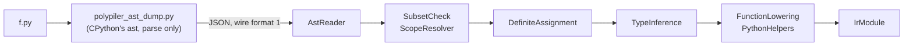

# Python frontend

**Status:** the first subset is implemented ([#452](https://github.com/Hawkynt/Polypiler/issues/452),
[#449](https://github.com/Hawkynt/Polypiler/issues/449) and the plain-function part of
[#450](https://github.com/Hawkynt/Polypiler/issues/450)), stage 2 of the [pipeline](PIPELINE.md); the
epic is [#442](https://github.com/Hawkynt/Polypiler/issues/442). Related: [exceptions](../reference/exceptions.md) ·
[frontends, backends and targets](TARGETS.md).

`polypiler translate f.py --from python --to csharp|javascript` imports a Python 3 module into the
typed IR. The frontend lives in `Polypiler.Core.Frontends.Python`.

## Parsing

The source is parsed by the standard `ast` module of the installed CPython through
`AstDump/polypiler_ast_dump.py`, which the assembly carries. The interpreter is the one
`PythonImportOptions.Interpreter` or `POLYPILER_PYTHON` names, else `python3`, else `python`; it runs
with `-I -B` and reads the source from standard input. The helper only parses: the source is never
compiled, imported or executed. It prints one JSON object - `format` (1), `python` (the version), and
either `module`, the tree, or `error`, CPython's syntax error. A node carries its class under `_`, its
range as `line`, `col`, `endLine` and `endCol` (columns counted in characters from 1) and every field
under its own name; a constant carries `kind` and `value` as text: an `int` in decimal digits of any
size, a `float` as `float.hex()`, which reads back exactly.

`PythonFrontend.Dump` returns that JSON and `PythonFrontend.ImportDump` imports from it, so that a
recorded tree imports without an interpreter. The unit tests do exactly that from
`tests/fixtures/prototype/python/ast/`; the tests of the Python layer hold every recorded tree to what
the helper prints with the pinned CPython.

A syntax error, an interpreter that cannot be started and a dump of another wire format are `PLY1800`
(exit code 4).

## Types

The IR is typed, so the frontend gives every value a static type. Python's `bool`, `int` and `float`
are `bool`, `i64` and `f64`:

- A **parameter** has the type of its hint (`int`, `float`, `bool`, also as a string). A parameter
  without a hint has the type of the arguments the module's own calls pass it; without such a call it
  is `PLY1801`.
- A **local** and a **result** have the type of the values that reach them - a hint on them is recorded,
  not trusted. The rules run to a fixed point, so recursion and calls in any order are typed; a result
  only recursion reaches takes its hint.
- Two number types **join** to the wider one: a `bool` is an `int`, an `int` converts to the nearest
  `float`. The narrower value is converted where it is stored, which the caveat
  `py-number-widened` announces. `None` and a number join to nothing: `PLY1803`.
- Every hint is recorded as a **source contract** - `f.a: int`, `f.return: int`, `f.x: int` for a local -
  in `PythonImportResult.Contracts`; `PythonImportOptions.RecordAnnotations = false` records none.

### `int` is exact or raises

Python's `int` is unbounded. The IR has no arbitrary-precision integer yet, so an `int` is an `i64`
whose every operation gives Python's exact result or raises `OverflowError` (`py-int-64`): `+ - *`
and unary `-` are the checked operations, `//` the floor division that traps on the one quotient that
does not fit, `<<` a helper that raises where a bit would be lost, `abs`, `**`, `int()` and `round()`
of a float raise beyond 64 bits. Nothing ever wraps around, so a masked hash such as
`((h * 33) ^ c) & 0xFFFFFFFF` is exact as long as its intermediate values fit. An integer literal
outside 64 bits is `PLY1804`.

This is where the repository and #452 differ: #452 imports every value as `dyn` and leaves the choice
of width to the specialization of #494, neither of which exists yet. With an arbitrary-precision
integer in the IR, the exact results beyond 64 bits come back; until then the translation is exact
or fails explicitly, never silently.

## Operations

| Python | IR |
| --- | --- |
| `+ - *` on `int` | `AddChecked`, `SubtractChecked`, `MultiplyChecked` |
| `+ - *` with a `float` | the operation on `f64`, the `int` or `bool` converted |
| `/` | always a `float`: of two `int` the correctly rounded quotient (`PyTrueDivideInt`, long division to 55 bits and a sticky bit), of floats `PyTrueDivideFloat`; `ZeroDivisionError` |
| `//`, `%` on `int` | `DivFloor`, `ModFloor` (`PyModuloInt` for a divisor that may be -1); `ZeroDivisionError` |
| `//`, `%` on `float` | `PyFloorDivideFloat`, `PyModuloFloat`: the exact `fmod` moved by the divisor where the signs differ, the quotient brought to the nearest integer; `ZeroDivisionError` |
| `**`, `pow(a, b)` | `PyPowerInt` for an `int` exponent that is a non-negative constant or of unknown sign (`py-int-power-sign`), `PyPowerFloat` for a negative constant one and for floats: `ZeroDivisionError` for `0.0` to a negative power, `OverflowError`, and `ArithmeticError` where CPython gives a complex (`py-complex-power`) |
| `<<`, `>>` | `PyShiftLeft`, `PyShiftRight` (a constant count below 64 is a plain arithmetic shift); `ValueError` for a negative count |
| `&`, `\|`, `^`, `~` | `And`, `Or`, `Xor`, `BitNot`: infinite two's complement is the 64-bit one; of two `bool`s a `bool` |
| `< <= > >= == !=` | the comparison; an `int` with a `float` compared exactly (`PyCompareIntFloat`, `PyCompareFloatInt`) |
| `a < b < c` | `b` evaluated once, `c` only when `a < b` holds |
| `and`, `or` | of `bool`s the short-circuit operators; otherwise a choice that gives an operand: `0 or 9` is 9 |
| `not`, a condition | the truth of the value: not zero; a NaN is true |
| `x if c else y` | a choice |
| `int()`, `round()`, `float()`, `bool()`, `abs()` | `PyIntOfFloat` (toward zero; `ValueError` for NaN, `OverflowError` for an infinity), `RoundEven` then `PyIntOfFloat`, a conversion, the truth, `PyAbsInt` or `Abs` |
| `divmod(a, b)` | only as `q, r = divmod(a, b)`: both computed before either name is assigned |

The helpers are private functions of the module that the lowering adds where it calls one; every
backend writes them as functions of their own. An operand used twice that is neither a constant nor a
variable is kept in a temporary; where that would move it before an operation that may raise, or out
of an operand evaluated under a condition, the expression is refused (`PLY1802`).

## Statements

`if`/`elif`/`else`, `while` and `for` over `range` with their `else` clauses, `break`, `continue`,
`pass`, `return`, expression statements, `a = b = e`, `a, b = e1, e2`, `x op= e`, `x: T = e`,
`match` with literals, `|`, captures, `_` and guards, and `assert`.

- **`range`**: the arguments are evaluated once, in order, before the loop; a zero step raises
  `ValueError` before the first pass. A counter walks the range and the loop variable is assigned from
  it at the start of every pass; where the body never assigns the variable and nothing reads it after
  the loop, the variable is the counter. A step other than ±1 decides whether another element follows
  on the distance to the end, exact in unsigned 64 bits, so no element of a range near the limits is
  lost or added.
- **Loop `else`** runs when the loop ends without `break`: after the loop where nothing breaks,
  otherwise under a flag every `break` sets.
- **`match`** evaluates its subject once and tries the cases in order. A literal is compared with `==`
  (so `case 1:` matches `1.0`); `True`, `False` and `None` are compared by identity and match only
  themselves; a capture binds the subject before its guard is tested.
- **`assert`** raises `AssertionError` with its string message; `PythonImportOptions.StripAssertions`
  leaves it out, as `python -O` does.
- **Definite assignment**: a local read where CPython could raise `UnboundLocalError` - assigned in
  one arm only, a loop variable after a loop that may not run - is `PLY1811`. The analysis knows
  `while True`, and that a `range` of constant arguments that is not empty runs its body.

## Functions and modules

Module-level `def`s with positional parameters, calls between them with positional arguments, and
recursion. A function whose name does not start with an underscore is public. A docstring,
`from __future__ import` and the block under `if __name__ == "__main__":` are left out; any other
module-level statement is refused. Defaults, keyword and starred arguments, decorators, nested
functions, `global`, `nonlocal` and redefinitions are `PLY1830`; function values, lambdas, generators and
coroutines `PLY1832`; a name that is no local, function of the module or supported built-in (`int`,
`float`, `bool`, `abs`, `round`, `divmod`, `pow`, `range`), and every `import`, `PLY1833`. A module
that rebinds a built-in's name calls its own function.

## Diagnostics

| Code | Meaning |
| --- | --- |
| `PLY1800` | CPython reports a syntax error, or the helper fails |
| `PLY1801` | a type that is not known, or a hint the import does not know |
| `PLY1802` | an expression outside the subset |
| `PLY1803` | values of types no type of the import holds both of |
| `PLY1804` | an integer literal beyond 64 bits |
| `PLY1810` | a statement outside the subset |
| `PLY1811` | a local that may be unbound |
| `PLY1812` | a match pattern outside literals, alternatives, captures, `_` and guards |
| `PLY1813` | a `for` over anything but `range` |
| `PLY1830` | a feature of functions outside the subset |
| `PLY1832` | a function value that escapes, a generator or a coroutine |
| `PLY1833` | a name neither part of the import nor a supported built-in |

## Tests

The fixtures `tests/fixtures/prototype/python/{scalars,control,functions}.py` are run by CPython
through `oracle.py` on every combination of the boundary values of their parameter types, random
operands (seed 1800) and lists of their own, and the outcomes are recorded under `recorded/`. The unit
tests hold the interpreter and the C# emitted from the IR to the recordings, the acceptance tests the
JavaScript emitted from the IR and run by node, and the tests of the Python layer hold the recordings
to CPython again. A recorded `int` beyond 64 bits is expected to raise `OverflowError` and a complex
result `ArithmeticError`, as the caveats say; every other outcome must be CPython's, type included.
