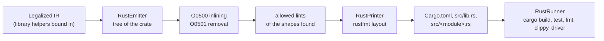

# The Rust backend

**Status:** implemented for scalar code ([#461](https://github.com/Hawkynt/Polypiler/issues/461),
[#458](https://github.com/Hawkynt/Polypiler/issues/458), [#459](https://github.com/Hawkynt/Polypiler/issues/459));
arrays and slices, structs and enums, closures and `Result` follow in phase 2. The runner that builds
and executes the output is [#468](https://github.com/Hawkynt/Polypiler/issues/468).
Related: [backends](BACKENDS.md) · [pipeline](PIPELINE.md) · [exceptions](../reference/exceptions.md) ·
[integer operations](../reference/integer-operations.md).

`polypiler translate <file> --from <csharp|javascript> --to rust --output <dir>` writes a Cargo package:

| File | What it holds |
| --- | --- |
| `Cargo.toml` | `[package]` with `name` (the module's name in `snake_case`), `version = "0.1.0"`, the `edition` and, from Rust 1.56, `rust-version`; no dependencies |
| `src/lib.rs` | the header (`//!`: profile, helper licences, floating-point record, caveats, notices), `#![forbid(unsafe_code)]`, the lints the code needs allowed, `pub mod <module>;` |
| `src/<module>.rs` | the constants, the spelling functions and helpers, the functions; a `#[cfg(test)] mod tests` when tests are asked for |

The backend builds a Rust syntax tree from the IR (`Polypiler.Core.Backends.Rust/Syntax/RustSyntax.cs`),
runs the target passes over it - helper inlining (O0500), removal of what nothing names (O0501) -
and prints it with `RustPrinter`, which writes what `rustfmt` writes in its default configuration.
`RustSyntaxReader` reads every generated file back into the tree for the parse-back sweep;
`RustSyntaxRewriter` walks and rewrites it; `RustLiveness` finds the values a function stores and
never reads.

## Profiles

`--profile` names the edition, `--rust-version` raises the minimum supported Rust version (MSRV)
above the release that stabilized it:

| Profile | Edition | MSRV by default |
| --- | --- | --- |
| `rust2018` | 2018 | 1.31 |
| `rust2021` | 2021 | 1.56 |
| `rust2024` (default) | 2024 | 1.85 |

The edition decides the keywords (`async`, `await`, `dyn`, `try` from 2018, `gen` from 2024), which a
name escapes as a raw identifier (`r#gen`). The MSRV decides the rows of `RustCapabilities`:

| Row | Since | Without it |
| --- | --- | --- |
| `checked_abs`, `wrapping_abs` | 1.13 | the helper of the library |
| `to_bits`, `from_bits` | 1.20 | refused (`PLY1550`) |
| `TryFrom` (checked narrowing) | 1.34 | the spelling function `ply_i2i_trap_<from>_<to>`, a range test through `i128` |
| `copysign` | 1.35 | the portable implementation |
| `reverse_bits` | 1.37 | the helper of the library |
| `is_subnormal` | 1.53 | the portable implementation |
| `rust-version` key of `Cargo.toml` | 1.56 | left out |
| labelled blocks (`label_break_value`) | 1.65 | a `continue` in a `do`-`while` and a `break` inside a switch section are refused (`PLY1550`) |
| `round_ties_even` | 1.77 | the helper `RoundEven` of the library |

## Lowering

| IR | Rust |
| --- | --- |
| `Add`, `Subtract`, `Multiply` of integers | `a.wrapping_add(b)`, `wrapping_sub`, `wrapping_mul` - never a bare `+`, whose meaning depends on `overflow-checks` |
| `AddChecked`, `SubtractChecked`, `MultiplyChecked`; `NegateChecked` | `a.checked_add(b).expect("IntegerOverflow")`; `a.checked_neg().expect("IntegerOverflow")` |
| `AddOverflows`, `SubOverflows`, `MulOverflows` | `a.checked_add(b).is_none()`, `checked_sub`, `checked_mul` at every width |
| `Divide`, `Remainder` of integers | `ply_div_<t>(a, b)`, `ply_rem_<t>(a, b)`: `panic!("DivideByZero")` on 0, then `checked_div`/`checked_rem` with `IntegerOverflow`; `a / 7` where the divisor is a constant other than 0 and -1 |
| `ShiftLeft`, `ShiftRight`, `ShiftRightLogical` | `a.wrapping_shl(n as u32)`, `wrapping_shr`, which mask the count as the IR does; a logical shift of a signed value `(a as u32).wrapping_shr(n as u32) as i32` |
| `Negate`, `BitNot`, `LogicalNot` | `a.wrapping_neg()` (`-a` for floating point), `!a`, `!c` - a negated comparison of integers turned around (`a >= b`) |
| arithmetic and comparisons of floating point | the operators; a compound assignment where clippy's `assign_op_pattern` asks |
| conversions between integers | `i64::from(a)` where every value fits (a literal in it, also in the arms of an `if`, carries its type: `u64::from(if c { 1u32 } else { 0u32 })`), `a as u8` wrapping, `u8::try_from(a).expect("IntegerOverflow")` trapping |
| conversions to and from floating point | `a as f64`, `f64::from(a)` for `f32` to `f64`, `a as i32` saturating (Rust's `as`), `ply_f2i_trap_<t>(a)` trapping |
| intrinsics with a method | `rotate_left`, `count_ones`, `leading_zeros`, `trailing_zeros`, `swap_bytes`, `reverse_bits`, `is_power_of_two`, `min`, `max`, `saturating_*`, `checked_abs`, `wrapping_abs`, `sqrt`, `floor`, `ceil`, `trunc`, `round`, `round_ties_even`, `abs`, `mul_add`, `copysign`, `is_nan`, `is_infinite`, `is_finite`, `is_sign_negative`, `is_normal`, `is_subnormal`, `to_bits`, `from_bits` |
| every other intrinsic | the helper of the IR library (`IntegerLibrary`, `MinimumDouble`, `SignOf`, `RoundHalfUp`, `ToInt32`, `Clamp`, …) or the portable floating-point implementation, copied into the module |
| `if`, `while`, `do`-`while`, `for` | `if`/`else if`, `while c` (`loop` for `while true`), `loop { …; if !c { break; } }`, a `while` whose step precedes every `continue`; a counted loop `for i in a..b` where its counter and bound allow |
| `switch` | `match` with or-patterns and ranges of three or more consecutive labels, `_` last; one section an `if`; a `break` inside a section leaves `'s<n>: { match … }` |
| `return` | the tail of the function, `return v;` elsewhere |
| a value assigned in every branch | `let x = if c { a } else { b };` (clippy's `needless_late_init`) |
| a throw of a library exception | `panic!("<IrTrap>")` |
| `try`/`catch` | refused, `PLY1560` |
| a read-only table | `static NAME: [u32; N] = […];`, read as `NAME[i as usize]`, borrowed as `&NAME` |
| an array parameter | `&[T]`, or `&mut [T]` where the function or a callee writes it (#460) |
| an array the function makes | `Vec<T>`: `vec![0; n]` (`usize::try_from(n).expect("IntegerOverflow")` for a signed length), `vec![a, b]`, `Vec::new()`; a temporary one only read is an array `[a, b]` |
| an array result | `Vec<T>`, or the borrow of its parameters, `fn f<'a>(a: &'a [T], b: &'a [T]) -> &'a [T]`, exclusive where a caller writes through it |
| `a[i]`, `a[i] = v`, `a.Length` | `a[i as usize]` with Rust's own bounds panic as the trap, `a[i as usize] = v` (an index with an effect bound first, since Rust evaluates the value before the place), `a.len() as i32` |
| a counted loop over an array that only reads its elements | `for &x in data` (`&v` for a vector, `.iter()` for an exclusive borrow) |
| `Array.Copy`, `Fill`, `Clear` | `ply_copy`, `ply_copy_within` (one array), each range checked by `ply_range` first; `a.fill(v)` |
| a swap of two elements through a variable | `a.swap(i, j)` where the indices can neither panic nor change anything |
| `LoadLittle`/`LoadBig`, `StoreLittle`/`StoreBig` | `u32::from_le_bytes(d[ply_range(i, 4, d.len())].try_into().expect("4 bytes"))`; `let at = ply_range(…); d[at].copy_from_slice(&v.to_le_bytes());` |
| one array passed twice to a call that writes one of them | a copy of the callee with the two parameters merged, `<callee>_aliased<i><j>`, where the callee assigns neither; otherwise `PLY1566` |
| a struct of numbers | `#[derive(Clone, Copy, Debug, Default, PartialEq, Eq)] pub struct Name { pub field: T }`; with a floating-point field `impl PartialEq` of the IR's equality (a NaN equals a NaN) instead of the derived one (#462) |
| `StructNew`, `StructDefault`, a field read or written | `Name { a, b: x }`, `Name::default()`, `p.x`, `p.x = v;` (`let mut` for the variable, a parameter rebound) |
| a string | its UTF-16 code units: `Vec<u16>` owned, `&[u16]` as a parameter; a literal `ply_utf16("text")`, a constant `static NAME: &str` |
| string operations | `len`, indexing, `==`, `starts_with`, `ends_with`, `repeat`, `cmp`, `[a, b].concat()`, `parts.join(sep)`, `push`/`extend_from_slice` for `s += …`; the helpers of `Helpers/Strings.cs` for searching, replacing, splitting, trimming and padding |

A trap is a panic whose message is the name of the IR trap - `IntegerOverflow`, `DivideByZero`,
`ArgumentOutOfRange`, … - in every build mode; the verification reads it back with `RustTraps`
([exceptions](../reference/exceptions.md#rust)).

## Refused

What the backend does not write yet is refused with `PLY1550`, naming the construct: views and
pointers, classes, interfaces and enums (`declared types (classes)` …), module state
(`module state (globals)`), closures, collections and sequences, the conversions between numbers and
text; an array safe Rust cannot own (written and shared by two variables, or a parameter and a new
array in one written variable), a struct with a field that is no value. One array passed to a call
twice where it is written and the callee swaps its parameters is `PLY1566`. Two exported functions
whose Rust names are the same are `PLY1574`; an exception handler `PLY1560`.

## Lints

`src/lib.rs` allows exactly the lints the module has a shape for, from a closed list:
`unused_assignments` (a value of the source stored and never read, found by `RustLiveness`),
`unused_comparisons`, `clippy::absurd_extreme_comparisons`, `clippy::approx_constant`,
`clippy::almost_swapped` (the source's `let a = b; b = a;`), `clippy::empty_loop`, `clippy::eq_op`, `clippy::erasing_op`, `clippy::identity_op`,
`clippy::manual_clamp` and `clippy::min_max` (a minimum and a maximum whose bounds may be out of
order, where `clamp` would panic), `clippy::manual_range_contains`, `clippy::neg_cmp_op_on_partial_ord`
and `clippy::nonminimal_bool` (a negated ordering of floating-point numbers), `clippy::too_many_arguments`.
No group is ever allowed. Every other lint is avoided by the shape the backend writes.

## Verification

- `RustScalarEmitTests`, `RustControlEmitTests`, `RustPackageEmitTests`, `RustSyntaxTests`,
  `RustProfileTests`: the emitted text per row, the printer's layout rules, the parse-back sweep over
  every prototype fixture and every Rust fixture in both overflow modes.
- `RustPrinterLayoutTests`, `RustEmitEdgeTests`, `RustTargetPassTests`, `RustReaderAndAnalysisTests`:
  the printer, the emitter, the target passes, the reader and the liveness analysis on the forms the
  fixtures do not reach, rule by rule.
- `MemoryEmitTests`, `TypeEmitTests`: arrays, ownership and aliasing, structs, their forms and refusals.
- `RustDifferentialTests` (layer `rust`): every prototype fixture - all 24 since #460 - is built by the
  pinned toolchain and called on every case of `PrototypeCases`, with overflow checks on and off; every
  outcome, the final contents of every array argument included, equals the C# compiler's and the
  interpreter's.
- `RustFamilyDifferentialTests` (layer `rust`): the fixtures of the families the backend writes - bits,
  records, strings, the floating-point view of bytes - against .NET in both overflow modes.
- `RustRoundTripTests` (layer `rust`): every Rust fixture, imported by the Rust frontend in each
  overflow mode, comes back as a crate that is built with overflow checks on and off; every outcome is
  what rustc recorded for the original in the mode of the import.
- `RustBackendScenarioTests` (layer `rust`): the scenarios of the issues with their hand-checked
  values, clippy with `-D warnings` and `cargo fmt --check` on the crates, the generated tests passing
  and a mutated one failing.

The runner (`Polypiler.Core.Verification/Runners`): `RustRunner` builds (`cargo build`), tests
(`cargo test`), format-checks (`cargo fmt --check`), lints (`cargo clippy -- -D warnings`) and calls
exports through a generated driver (`RustDriverGenerator`) on input images - scalars, and `seq<T>` and
`utf16` as vectors borrowed by the call, an `inout` one exclusively and written back after the result - with `RustBuildOptions`
(`OverflowChecks`, `DebugAssertions`, `OptLevel`) that have no defaults. Diagnostics: `PLY1591` the
compiler rejected the input, `PLY1592` the driver died, `PLY1595` a protocol error such as a signature
that does not fit the declaration.
