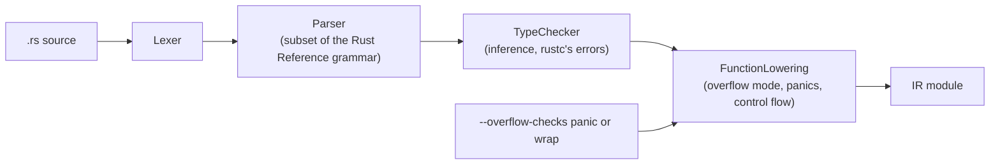

# The Rust frontend

**Status:** implemented for the scalar subset (#466, #463, the free functions of #464); modules,
closures, iterator methods, slices and `Option`/`Result` values are the next issues of epic #456.

`Polypiler.Core.Frontends.Rust` imports the scalar subset of Rust (2024 edition) into the IR:
free functions over the primitive numeric types and `bool`, their operators, casts and overflow
methods, and the control flow around them. `polypiler translate <file>.rs --from rust
--overflow-checks <panic|wrap>` runs it. Related: [IR](IR.md) · [pipeline](PIPELINE.md) ·
[exceptions](../reference/exceptions.md) · [integer operations](../reference/integer-operations.md).

## Parsing and typing in C#

The source is read by a recursive-descent parser of the frontend (`Syntax/Lexer.cs`,
`Syntax/Parser.cs`) over the grammar of The Rust Reference for the imported subset, and typed by
the frontend's own checker (`Typing/TypeChecker.cs`). Issue #456 planned a helper executable built
on rust-analyzer's crates instead. The frontend does not use it:

- `polypiler translate` stays one self-contained program. A helper would be a native Rust build per
  operating system, shipped and located at run time, with a `rust-src` component on the user's
  machine - for a subset whose grammar fits in two files.
- The subset needs only the inference rustc applies to it: an unsuffixed integer literal is an
  inference variable that every use narrows and that becomes `i32` when nothing does (`f64` for a
  float), an untyped `let` is a variable as well, a method receiver must be known when the method is
  checked (`E0689`), and a literal cast with `as` takes the cast's type (`300 as u8` is an
  overflowing literal). Methods are resolved by the receiver's resolved primitive type, never by
  name alone.
- `rustc` 1.99 (`tooling/toolchains.lock`) is the oracle: the acceptance tests compile every fixture
  with overflow checks on and off and hold the interpreter, the emitted C# and the emitted
  JavaScript to it, call by call.

What the frontend accepts is a subset of what rustc accepts. It reports the compiler's errors the
subset can produce with rustc's code (`PLY1500`, for example `E0308`, `E0004`, `E0268`) and the
deny-by-default lints `overflowing_literals`, `arithmetic_overflow` and `unconditional_panic` for
constant operands; rustc also finds overflows its constant propagation sees through locals
(`let x: u8 = 255; x + 1`), which the frontend does not.

## The overflow mode

Rust's `+` panics on overflow in a debug build and wraps in a release build; the source does not
say which, so the import requires `--overflow-checks` and refuses without it (`PLY1503`). The mode
decides `+ - *`, unary `-`, `abs`, `pow` and the shifts:

| Construct | `panic` | `wrap` |
| --- | --- | --- |
| `+ - *` on `i32`, `u32`, `i64`, `u64` | `AddChecked`, `SubtractChecked`, `MultiplyChecked` | `Add`, `Subtract`, `Multiply` |
| `+ - *` on 8- and 16-bit types | computed in `i32`/`u32`, converted back with the `Trap` contract | the same, `Wrap` contract |
| unary `-` | `NegateChecked` (narrow: `Trap` conversion) | `Negate` |
| `<<`, `>>` | an amount outside `0..BITS` - a negative one too - panics | the amount masked to `BITS - 1` |
| `abs` | `Abs` (traps on `MIN`) | `AbsWrap` |
| `pow` | panics when the power is no value of the type | the power modulo 2^width |

Division and remainder trap in both modes, on a zero divisor and on `MIN / -1` and `MIN % -1`. The
explicit methods ignore the mode: `wrapping_*` wraps, `saturating_*` clamps, `checked_*` is a value
and an overflow flag consumed on the spot (`unwrap`, `expect`, `unwrap_or`, `is_some`, `is_none`),
`overflowing_*` the same pair read by `.0`, `.1` or a tuple `let`. `pow` and its family are
exponentiation by squaring as `core` computes it, written in Rust and lowered by this frontend into
the helpers `rust_pow_wrapping_<type>` and `rust_pow_overflows_<type>` of the module.

`as` never panics: between integers it wraps (the source's sign extended), from a float to an
integer it truncates and saturates (NaN to 0), to a float it rounds to nearest even. `isize` and
`usize` are 64 bits wide.

## Panics

A panic is the throw of an exception class of the IR ([exceptions](../reference/exceptions.md)):
an arithmetic overflow `OverflowException`, a zero divisor `DivideByZeroException`, `unwrap` of a
`None`, `expect`, `step_by(0)` `InvalidOperationException` with Rust's message, `clamp` with
crossed bounds the IR's `Clamp` (`ArithmeticException`). The differential tests compare these
three classes - overflow, divide by zero, any other panic - with the message rustc printed.

## Control flow

The IR is structured, with no labels: Rust's expression forms become statements that leave their
value in a local, and the order of evaluation is kept - operands left to right, an operand that
needed statements reading every operand before it into a local first, the right side of an
assignment before its place.

- `if` and `match` that yield a value become conditional expressions where every branch is a plain
  value, otherwise an `if` chain assigning a local. A `match` is tested arm by arm in source order,
  a guard only after its pattern matched; the checker proves the arms exhaustive (`E0004`), so the
  last arm without a guard is the final `else` and no default arm is invented.
- `break 'label` and `continue 'label` to an outer loop set a flag of the target and leave the
  innermost loop; after every loop on the way the flag is tested and the jump goes on. A labelled
  block is a loop that runs once.
- `for` over `a..b`, `a..=b` and their `rev()` and `step_by(n)` forms evaluates the bounds and the
  step once, panics on a step of 0 before the first iteration, and never computes a value past the
  range: an inclusive range ends by testing for its last value (`0..=u8::MAX` runs 256 times), the
  distance to the end is measured in `u64`. `rev()` and `step_by()` apply in source order.

## Refusals

| Code | Refused |
| --- | --- |
| `PLY1500` | source rustc rejects: a syntax error, a type error with its code, a denied lint |
| `PLY1501` | `i128`, `u128`, `f16`, `f128`, `char`, `str` and every type but the primitives above |
| `PLY1502` | any other construct: closures, references, arrays, tuples as values, other methods (`floor`, `to_be`, ...), a `checked_*` result stored |
| `PLY1503` | an import without the overflow mode |
| `PLY1504` | a local whose type nothing decides |
| `PLY1510` | `if let`, `while let`, `let ... else` |
| `PLY1511` | `@` bindings, slice, struct, enum, reference and const patterns, a binding in an or-pattern, a `match` on a float |
| `PLY1512` | a `for` over anything but an integer range with `rev()` and `step_by()` |
| `PLY1513` | `async`, `.await`, `try`, `gen`, `yield` |
| `PLY1530` | generic, `unsafe` and `extern` functions, `where`, parameter patterns, nested items |
| `PLY1531` | macros |
| `PLY1533` | attributes but the lint levels, `inline`, `must_use`, `cold`, `track_caller` and documentation |

## Tests

`tests/fixtures/prototype/rust/` holds `scalars.rs` (every operator, method and cast for every type),
`control.rs` (the control forms and all twelve range forms over bound pairs and steps) and
`functions.rs` (calls, recursion, `pub`). `recorded/` holds what rustc did with each, per overflow
mode, for the calls of `RustCases`; `RustDifferentialTests` in `Polypiler.Tests` holds the
interpreter to the recordings, the one in `Polypiler.Tests.Acceptance` (layer `rust`) holds the
recordings to rustc and the emitted C# and JavaScript to the recordings. Run the acceptance test
`Recording_IsWhatRustcDoes` with `POLYPILER_RECORD=1` after a fixture or its calls changed.
