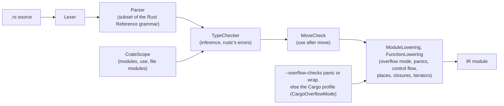

# The Rust frontend

**Status:** implemented for the scalar subset (#466, #463), functions, modules, closures and
`#[test]` (#464), arrays, slices, `Vec`, references and slice iterators (#465), structs, inherent
methods, field-less enums and `Option`/`Result` with `?` (#467), and of epic #456 text (`String`,
`&str`, `char`, `format!`), traits of the crate's types with static dispatch, trait objects,
generic functions, structs, impls, methods and traits, the operator traits and
`HashMap`/`BTreeMap`/`HashSet`/`BTreeSet`. Enums with data and the smart pointers but
`Box<dyn T>` and `Rc<dyn T>` are next.

`Polypiler.Core.Frontends.Rust` imports a subset of Rust (2024 edition) into the IR: functions
and inherent methods over the primitive numeric types, `bool`, tuples, fixed arrays, slices, `Vec`,
structs, field-less enums, `Option`, `Result`, text, maps and sets, with their operators, casts and
overflow methods, the control flow around them, closures and iterator chains over slices, ranges and
text, traits and generic functions, across the modules of one crate. `polypiler translate <file>.rs --from rust` runs it, in the overflow mode of
`--overflow-checks <panic|wrap>` or of the Cargo profile that applies; `--debug-assertions on|off`
decides `debug_assert!` (without it a source using one is `PLY1536`). Related: [IR](IR.md) · [pipeline](PIPELINE.md) ·
[exceptions](../reference/exceptions.md) · [integer operations](../reference/integer-operations.md).

## Parsing and typing in C#

The source is read by a recursive-descent parser of the frontend (`Syntax/Lexer.cs`,
`Syntax/Parser.cs`) over the grammar of The Rust Reference for the imported subset, and typed by
the frontend's own checker (`Typing/TypeChecker.cs`). Issue #456 planned a helper executable built
on rust-analyzer's crates instead. The frontend does not use it:

- `polypiler translate` stays one self-contained program. A helper would be a native Rust build per
  operating system, shipped and located at run time, with a `rust-src` component on the user's
  machine - for a subset whose grammar fits in two files.
- The subset needs only the inference rustc applies to it: an unsuffixed integer literal is an
  inference variable that every use narrows and that becomes `i32` when nothing does (`f64` for a
  float), an untyped `let` is a variable as well, a method receiver must be known when the method is
  checked (`E0689`), and a literal cast with `as` takes the cast's type (`300 as u8` is an
  overflowing literal). Methods are resolved by the receiver's resolved primitive type, never by
  name alone.
- `rustc` 1.99 (`tooling/toolchains.lock`) is the oracle: the acceptance tests compile every fixture
  with overflow checks on and off and hold the interpreter, the emitted C# and the emitted
  JavaScript to it, call by call.

What the frontend accepts is a subset of what rustc accepts. It reports the compiler's errors the
subset can produce with rustc's code (`PLY1500`, for example `E0308`, `E0004`, `E0268`, `E0382`,
`E0384`, `E0594`, `E0599`) and the
deny-by-default lints `overflowing_literals`, `arithmetic_overflow` and `unconditional_panic` for
constant operands; rustc also finds overflows its constant propagation sees through locals
(`let x: u8 = 255; x + 1`), which the frontend does not.

## The overflow mode

Rust's `+` panics on overflow in a debug build and wraps in a release build; the source does not
say which. `--overflow-checks panic|wrap` says it. Without the flag the import takes what Cargo
passes to rustc as `-C overflow-checks` (`Cargo/CargoOverflowMode.cs`, after The Cargo Book,
"Profiles"):

- the profile is `dev`, the one of a plain `cargo build`, or the one `--cargo-profile <name>` names;
- the manifest is the nearest `Cargo.toml` at or above the source's folder, or the workspace root
  whose profiles Cargo reads instead: the one its `package.workspace` names, else the nearest
  `Cargo.toml` above it with a `[workspace]` table;
- the profile's own `overflow-checks` wins; without one it inherits: `dev` is on, `release` off,
  `test` inherits `dev`, `bench` `release`, a custom profile the one its `inherits` names;
- without a `Cargo.toml` the built-in profiles keep these defaults, so a lone `.rs` file panics.

The manifest is read by a small TOML 1.0.0 reader (`Cargo/TomlReader.cs`), written from the
specification at toml.io; it reads every form a manifest may use (dotted and quoted keys, inline
tables, arrays of tables, the four kinds of string). Profile overrides for single packages
(`[profile.dev.package.<name>]`), `.cargo/config.toml` and `CARGO_PROFILE_*` variables are not
read. A profile the manifest does not define, a custom profile without `inherits` or without a
manifest, an `inherits` circle, an `overflow-checks` that is no boolean and a manifest that is no
TOML are `PLY1503`, a usage error. `CargoOverflowModeTests` holds the rules and the reader;
`CargoOverflowModeOracleTests` (layer `rust`) holds the result to `cargo run --profile` for each
manifest form. The chosen mode and where it came from are a note on standard
error and the caveat `rs-overflow-checks` of the translation's manifest:
`overflow checks on, an overflowing operator panics (Cargo profile 'dev' of ../Cargo.toml)`.

The mode decides `+ - *`, unary `-`, `abs`, `pow` and the shifts:

| Construct | `panic` | `wrap` |
| --- | --- | --- |
| `+ - *` on `i32`, `u32`, `i64`, `u64` | `AddChecked`, `SubtractChecked`, `MultiplyChecked` | `Add`, `Subtract`, `Multiply` |
| `+ - *` on 8- and 16-bit types | computed in `i32`/`u32`, converted back with the `Trap` contract | the same, `Wrap` contract |
| unary `-` | `NegateChecked` (narrow: `Trap` conversion) | `Negate` |
| `<<`, `>>` | an amount outside `0..BITS` - a negative one too - panics | the amount masked to `BITS - 1` |
| `abs` | `Abs` (traps on `MIN`) | `AbsWrap` |
| `pow` | panics when the power is no value of the type | the power modulo 2^width |

Division and remainder trap in both modes, on a zero divisor and on `MIN / -1` and `MIN % -1`. The
explicit methods ignore the mode: `wrapping_*` wraps, `saturating_*` clamps, `checked_*` is a value
and an overflow flag consumed on the spot (`unwrap`, `expect`, `unwrap_or`, `is_some`, `is_none`),
`overflowing_*` the same pair read by `.0`, `.1` or a tuple `let`. `pow` and its family are
exponentiation by squaring as `core` computes it, written in Rust and lowered by this frontend into
the helpers `rust_pow_wrapping_<type>` and `rust_pow_overflows_<type>` of the module.

`as` never panics: between integers it wraps (the source's sign extended), from a float to an
integer it truncates and saturates (NaN to 0), to a float it rounds to nearest even. `isize` and
`usize` are 64 bits wide.

## Values, places and borrowing

Rust's types map onto the IR's by what a value is, not by how it is stored:

| Rust | IR |
| --- | --- |
| `[T; N]` | an array; a read of an array place by value is a copy (`Duplicate`), so the arrays never alias |
| `&[T]`, `&mut [T]` | a read-only view and a view of the array, the `Vec` or the range of either it borrows |
| `Vec<T>` | a list; `vec![a, b]`, `vec![v; n]`, `Vec::new`, `with_capacity`, `push`, `pop`, `clear`, `to_vec` |
| tuples | a struct `Tuple_<types>` with the fields `item0`, `item1`, ...; a tuple destructured where it is made (`let (a, b) = (x, y)`, a `match` on one) is its parts and no struct |
| `struct` | an IR struct; a tuple struct's fields are `_0`, `_1`, ... |
| field-less `enum` | an IR enum with its discriminants; `as` casts read them |
| `Option<T>` | an optional; `Some`, `None`, `?`, `if let`, `match`, `unwrap`, `expect`, `unwrap_or`, `ok_or`, `copied` |
| `Result<T, E>` | a struct of `is_ok`, `ok` and `err`; `Ok`, `Err`, `?`, `is_ok`, `is_err`, `ok`, `unwrap`, `expect`, `unwrap_or` |
| `fn(T) -> U` | a function reference, called with `IrInvoke` |

A shared reference to a value is the value: nothing can change it while the reference lives. A
`&mut` that a local holds is an alias of the place it borrows - a local, a field, an element - and
every use reads or writes that place. A function with `&mut` parameters of values (not slices)
takes them by copy-in/copy-out: it returns a struct `<name>_out` of its result and the final value
of each such parameter, and the caller writes them back into the places it passed. A method with
`&mut self` is a function with such a first parameter. A `&mut` to a `Vec`, an array, a map or a
set is the container itself, which the IR shares, so a whole value assigned through it (`*v = vec![..]`)
replaces the container's contents where it is - element by element, entry by entry - and the place
it borrows, the caller's included, sees the new value.

The borrow checker is rustc's: a source the frontend imports compiles. Within the subset the
frontend checks what lowering relies on - a use after a move of a non-`Copy` value is `E0382`
(`Typing/MoveCheck.cs`), an assignment through `&` or to an immutable binding `E0594`/`E0384` - and
refuses the forms whose aliasing the IR cannot express: a `&mut` held in a tuple or a struct, a
reference result, a `&mut` binding into an `Option` or a `Result`.

`match`, `if let`, `while let`, `let` and `let ... else` destructure tuples, structs, tuple structs, enums,
`Option`, `Result`, references and ranges, with bindings, `_`, `..`, or-patterns and guards;
exhaustiveness is checked over all of them (`Typing/Exhaustiveness.cs`). A `match` over an integer
or an enum whose arms are constants becomes an IR `switch`.

## Items, modules and closures

A crate is the source file and the modules it declares: inline `mod m { ... }` and file modules
`mod m;` read from `m.rs` or `m/mod.rs` beside their declarer (`Typing/CrateScope.cs`). `use` with
groups, globs, `self`, `super`, `crate`, renames and `pub use` re-exports resolves names across
them, as do `std::cmp::{min, max}` and `std::mem::swap`. The exported surface is every item reachable
by a public path; its IR name is that shortest public path joined by `_`. Modules are emitted in
dependency order (`ImportResult.ModuleOrder`), test-only modules last; `ImportResult.Modules` gives the module of
each free function outside the root (`util::bits`), which the Rust backend writes back as files of their own.

Inherent `impl` blocks give structs and enums associated functions, constants and methods with
`self`, `&self` and `&mut self`. `#[derive(Clone, Copy, PartialEq, Eq, Debug, Default)]` is
accepted, `#[repr(C)]` on a struct and an integer `repr` on an enum.

A closure is inlined where it is called: its parameters become locals, its captures are the
variables they name, and a `return` in it leaves the inlined body. A `move` closure snapshots the
`Copy` values it captures. A closure that escapes - stored, returned, coerced to `fn`, used other
than called or passed to an iterator method - is `PLY1532`.

Iterator chains over `iter()`, `iter_mut()`, `into_iter()`, `chunks_exact`, ranges and `zip` are
loops: the positional adapters `rev`, `step_by`, `zip`, `enumerate`, `copied` and `cloned` move the
position, `map` and `filter` stream the item through, and the chain ends in a `for` or in `sum`,
`product`, `count`, `fold`, `any`, `all`, `for_each` or `collect`. A chain stored as a value is `PLY1535`.

`collect` makes the collection its turbofish names or the caller expects - a `let` with a type, an
argument, a return value - and fills it item by item as the loop runs: a `Vec` pushes them, a map
puts each pair (a later key replacing the value of an earlier one, as `FromIterator` for `HashMap`
and `BTreeMap` does), a set adds them; no other target, `String` included, and no `&mut` items.
A `_` in a `let`'s type or a turbofish is a type the code decides (`Vec<_>`), in a signature
`E0121`. A `Vec` of shared references holds the values they borrow, which nothing can change while
they live.

`#[test]` functions and the items under `#[cfg(test)]` are imported as tests: `ImportResult.Tests`
names them and they are no part of the exported surface; `assert!`, `assert_eq!`, `assert_ne!` and
their `debug_` forms panic as rustc does.

## Text

`String` and `&str` are the IR's string, which is immutable: a `String`'s value is its text, and
`push_str`, `push`, `clear` and `+=` write the place it lives in. A `char` is its code point as a
`u32`. Rust's text is UTF-8 and the IR's UTF-16, so every byte quantity is computed, never
approximated: `len()` is the UTF-8 length, `as_bytes()` and `bytes()` the UTF-8 bytes, `chars()` the
code points, `&s[a..b]` the code units between the char boundaries at those byte offsets - off a
boundary, past the end or with `a > b` it panics as Rust's slicing does - and `find()` a byte offset.
Strings order by code point (UTF-8's byte order), not by UTF-16 unit, which parts at the surrogates;
`trim` uses Rust's `White_Space` set, not ECMAScript's; `parse::<integer>` reads digits as `core`'s
`from_str_radix` does in base 10 and checks the range of the type.

The helpers computing these (`Lowering/TextHelpers.cs`) are Rust, written in the subset with the
IR's string operations as five functions only their source can name, and lowered with the module, so
every backend emits them through its ordinary path; their names take a prefix no function of the
crate starts with.

`format!` writes Display of integers, `bool`, `char` and text, Debug of integers and `bool`, the
radix traits of integers in two's complement, with fill, alignment, sign, `#`, `0` and a width counted
in chars, and positional, indexed, named and captured arguments. The IR holds strings in lists and
arrays but in no struct and no optional value, so a `String` field, `Option<&str>`, a result or a
tuple of text and a `&mut String` parameter are refused.

## Traits and generics

Traits are resolved at compile time, as rustc resolves static dispatch (`Typing/TypeChecker.Traits.cs`).
`impl Trait for T` gives `T` - a struct, an enum, a primitive, text or a tuple - the trait's methods,
found after `T`'s own methods and those the language gives a primitive. A provided method the impl
does not override is checked and lowered once for that type; supertraits, associated functions
(`T::new()`), associated types of impls (`Self::Output`) and the operator traits of `core::ops` and
`PartialEq` implemented for a struct or an enum, which make the operators call the impl's method,
are imported.

A generic function is monomorphised: every call infers its type arguments (or takes the
turbofish's), and once the caller's types are decided the call is bound to the instance for those
arguments, made once - the item parsed anew from its file, since the checker keeps what it learns in
tables keyed by the node, its types resolved with the arguments, its bounds checked (`E0277`), its
body checked like any function. Its IR name is the function's name followed by its type arguments
(`larger_u8`). Bounds may name the crate's traits and `Copy`, `Clone`, `PartialEq`, `Eq`,
`PartialOrd`, `Ord`, `Default`, `Display`, `Debug`, the operator traits with their `Output` and
the compound assignment traits; `where` clauses on type parameters join them. A generic function's
result may name an associated type of a type parameter, `T::Output` or `<T as Add>::Output`: a call
resolves it once its arguments are checked - the type of the impl's `type Output`, a number itself
(the operators of the primitives yield their own type), an integer literal's type still to be
decided - and the instance resolves it with its type argument. A parameter of that type is refused,
as a call checks its arguments before it knows the type arguments.

Generic structs are monomorphised the same way. A struct type carries its type arguments, which are
inference variables until its uses decide them (`Pair { a: 1, b: x }`, `Pair::<u8>::new`), and its
fields' types are the declaration's with the arguments in place; the IR has a struct for each list of
arguments the code uses (`Pair_u8`), and each one's fields must be what an IR struct holds and its
parameters' bounds must hold (`E0277`). A generic impl is one for all instances of a generic struct,
`impl<T> S<T>` with the struct's parameters in order: its methods, its trait impls' methods and
provided methods, and methods with type parameters of their own are templates, specialised where a
call or an operator names them - the impl's arguments those of the receiver's type, the method's
the turbofish's or inferred - and made once their types are decided; a bound of the impl that does
not hold is rustc's `E0599`. A trait impl may also be for one instance (`impl Area for Pair<u8>`),
and an associated type of a generic impl (`type Output = V<T>`) is that of each instance. A generic
trait (`trait Conv<T>`) is implemented once per list of arguments, which a bound may name
(`X: Conv<u32>`); a method of a generic trait that a type implements with several arguments is
refused, as only rustc's inference over the expected type would choose. A public generic function is
exported as the instances the crate makes of it, `largest_u8` for `largest::<u8>`
(`ImportResult.Instances` maps each to the path Rust calls it by); one the crate never instantiates,
or instantiates with a type that is not `pub`, has no exported surface to give.

## Trait objects

`&dyn Trait`, `Box<dyn Trait>` and `Rc<dyn Trait>` of a trait of the crate dispatch at run time
(`Typing/TypeChecker.TraitObjects.cs`, `Lowering/TraitObjectLowering.cs`). The trait is an IR
interface whose methods are those with `&self` or `&mut self`, its supertraits its base
interfaces. A value of a type that implements the trait becomes a trait object at a coercion site of
The Rust Reference - a `let` with a type, an argument, a return value and the tail of a body, the
arms of an `if` and a `match` that yield one, an element of `vec!` or of `push`, an assignment to a
variable holding one - as `&x`, `Box::new(x)` or `Rc::new(x)`; the object is a sealed class of one
field, `value`, a copy of `x`, that implements the interface by calling the impl of `x`'s type with
the field. A `&mut self` method writes the field back from the copy-out of the impl. A call through
the object is an interface call of the IR.

The copy is never told apart from the original: a `Box` owns its value and a move moves the
reference, an `Rc` gives no `&mut` access and its `clone` shares the reference, and a `&dyn` borrows
the value shared, so nothing changes it while the object lives. A `&mut dyn Trait` would write
through to the value it borrows, which the copy cannot, so it is refused; so is assigning a new box
through a `&mut Box<dyn Trait>`. A trait is dyn compatible as rustc says (`E0038`): no associated
function without `self`, no generic method, no `Self` in a signature; a method that takes `self` by
value is part of the trait but no method of the object (`E0161`). `&Box<dyn T>` is unsized like any
other reference, as rustc does it (`E0277`), and `&*b` reaches the object. A trait object is no
field of a struct, no element of an array or a slice (the IR's arrays hold no objects) and no
`Option` payload; a `Vec` holds it, and `vec!` fills such a list one element at a time.

## Maps and sets

`HashMap`, `BTreeMap`, `HashSet` and `BTreeSet`, named through `use std::collections::...` or their
full path, are the IR's maps and sets. A Rust collection is moved, never shared, so the IR's map,
a reference, holds it exactly, and a `&mut` to one is passed as the reference. `insert` hands back
the value it replaces, `get`, `contains_key` and `remove` look the key up by reference, `map[&k]`
panics on an absent key, and `entry(k).or_insert(v)` is a place the caller writes through. A
`HashMap` enumerates in an order Rust leaves unspecified and that differs between runs, so iterating
one is refused; so is a `BTreeMap`'s and a `BTreeSet`'s sorted iteration, as the IR's maps and sets
enumerate in insertion or slot order and have no sorted one. Keys are integers, `bool`, `char` and
text; values are what an IR optional holds. `collect` makes any of the four from pairs or items,
which needs no iteration of them.

## Panics

A panic is the throw of an exception class of the IR ([exceptions](../reference/exceptions.md)):
an arithmetic overflow `OverflowException`, a zero divisor `DivideByZeroException`, an index or a
range outside a slice, an array or a `Vec` `IndexOutOfRangeException`, `unwrap` of a `None` or an
`Err`, `expect`, `step_by(0)`, `assert!` and its relatives, `panic!`, `todo!`, `unimplemented!`,
`unreachable!` and unequal lengths of `copy_from_slice` `InvalidOperationException` with Rust's
message, `clamp` with crossed bounds the IR's `Clamp` (`ArithmeticException`). The differential
tests compare these classes with the message rustc printed.

## Control flow

The IR is structured, with no labels: Rust's expression forms become statements that leave their
value in a local, and the order of evaluation is kept - operands left to right, an operand that
needed statements reading every operand before it into a local first, the right side of an
assignment before its place.

- `if` and `match` that yield a value become conditional expressions where every branch is a plain
  value, otherwise an `if` chain assigning a local. A `match` is tested arm by arm in source order,
  a guard only after its pattern matched; the checker proves the arms exhaustive (`E0004`), so the
  last arm without a guard is the final `else` and no default arm is invented.
- `break 'label` and `continue 'label` to an outer loop set a flag of the target and leave the
  innermost loop; after every loop on the way the flag is tested and the jump goes on. A labelled
  block is a loop that runs once.
- `for` over `a..b`, `a..=b` and their `rev()` and `step_by(n)` forms evaluates the bounds and the
  step once, panics on a step of 0 before the first iteration, and never computes a value past the
  range: an inclusive range ends by testing for its last value (`0..=u8::MAX` runs 256 times), the
  distance to the end is measured in `u64`. `rev()` and `step_by()` apply in source order.

## Refusals

| Code | Refused |
| --- | --- |
| `PLY1500` | source rustc rejects: a syntax error, a type error with its code, a borrow error the subset sees (`E0382`, `E0384`, `E0594`), a denied lint |
| `PLY1501` | `i128`, `u128`, `f16`, `f128`, `!` as a parameter, and every type outside the subset |
| `PLY1502` | any other construct: a range as a value, `()` as a value, a type alias, a constructor or a library function as a value, a `&mut` to a value held other than as an argument, a tuple made as a value or named as a type that holds an `Option`, a `Vec`, a map, a set, a reference, text or a trait object, which no IR struct holds, other methods (`floor`, `to_be`, ...) |
| `PLY1503` | an overflow mode the Cargo profile cannot give: an undefined profile, no `inherits`, a circle, a manifest that is no TOML |
| `PLY1504` | a local or an expression whose type nothing decides (rustc's `E0282`) |
| `PLY1510` | let chains (`if let ... && ...`) |
| `PLY1511` | `@` bindings, `ref` bindings, const block patterns, a binding in an or-pattern, a variable in a range pattern, a `&mut` binding into an `Option` or a `Result`, a `match` on a float |
| `PLY1512` | a `for` or a chain over `..` or `a..` |
| `PLY1513` | `async`, `.await`, `try`, `gen`, `yield` |
| `PLY1520` | nested arrays, a slice or a `Vec` of anything but numbers, `bool`, tuples and structs of them, a struct field (of an instance of a generic struct too) of an `Option`, a `Vec`, a map, a set, text or such a tuple, a slice pattern, an array length no constant gives |
| `PLY1521` | `&mut str`, `&mut String` parameters |
| `PLY1522` | `unsafe` blocks, `unsafe trait`, `unsafe impl`, raw pointers and borrows, `static mut`, `union`, `ManuallyDrop` |
| `PLY1523` | `Box` and `Rc` of anything but a trait object, `Arc`, `Cell`, `RefCell`, `Mutex` |
| `PLY1524` | slice methods outside the subset (`sort`, `binary_search`, `get` with a range, ...) |
| `PLY1525` | `VecDeque`, `BinaryHeap`, `LinkedList`; iterating a map or a set; map keys and values the IR cannot hold |
| `PLY1530` | `unsafe`, `extern` and variadic functions, `where`, `impl Trait`, a typed `self`, a function without a body, nested items |
| `PLY1531` | macros but `assert!`, `assert_eq!`, `assert_ne!`, their `debug_` forms, `panic!`, `todo!`, `unimplemented!`, `unreachable!`, `vec!` and `format!`; format arguments of the panicking macros, float formatting, Debug of text, precision and width arguments |
| `PLY1532` | a closure that escapes, a move of a captured non-`Copy` value, a `move` closure assigning its capture |
| `PLY1533` | attributes but the lint levels, `inline`, `must_use`, `cold`, `track_caller`, `derive`, `repr`, `test`, `cfg(test)` and documentation |
| `PLY1534` | a path to another crate or outside the supported standard-library subset |
| `PLY1535` | iterator methods outside the subset, an adapter in an order the lowering does not stream, a chain stored as a value, `collect` into anything but `Vec`, the four maps and sets, or of `&mut` items |
| `PLY1536` | `debug_assert!` without `--debug-assertions` |
| `PLY1540` | `&mut dyn Trait`, a trait object of a library trait, of a trait with associated types or whose traits share a method name, with a `&mut` parameter, in a struct field; a new box assigned through `&mut Box<dyn Trait>`; impls of library traits outside the operator traits, `PartialEq`, `Default` and `Clone`, bounds on other library traits |
| `PLY1541` | generic enums, const generics, an inherent impl of one instance of a generic struct, a generic impl of anything but a generic struct of the crate for its parameters in order, a supertrait of a generic trait, a method of a generic trait a type implements with several arguments, a public generic function the crate does not instantiate or instantiates with a type that is not `pub` |
| `PLY1542` | lifetime parameters, reference fields, reference results |
| `PLY1543` | enums with data |
| `PLY1544` | derives and `repr` forms outside the list above |
| `PLY1545` | `Option` and `Result` methods outside the subset, and of payloads the IR's optional cannot hold |
| `PLY1546` | `Drop` implementations |

## Tests

`tests/fixtures/prototype/rust/` holds `scalars.rs` (every operator, method and cast for every type),
`control.rs` (the control forms and all twelve range forms over bound pairs and steps),
`objects.rs` (trait objects), `generics.rs` (generic structs, impls, methods and traits),
`collect.rs` (`collect` into vectors, maps and sets), `outputs.rs` (associated types of type parameters),
`functions.rs` (calls, recursion, `pub`), `memory.rs` (arrays, slices, `Vec`, references,
copy-in/copy-out), `types.rs` (structs, methods, enums, `Option`, `Result`, `?`), `closures.rs`
(closures and iterator chains), `edges.rs` (the rarer forms), `strings.rs` (text), `traits.rs`
(traits and generic functions), `collections.rs` (maps and sets) and the package `modgraph/` (file
modules, `use`, re-exports, `#[test]`). `recorded/` holds what rustc did with each, per overflow
mode, for the calls of `RustCases`; `RustDifferentialTests` in `Polypiler.Tests` holds the
interpreter to the recordings, `RustFrontendDifferentialTests` in `Polypiler.Tests.Acceptance`
(layer `rust`) holds the recordings to rustc and the emitted C# and JavaScript to the recordings, and
`RustRoundTripTests` there holds the Rust the Rust backend writes back from the IR to them, its crate
built with overflow checks on and off. Ten of the fifteen fixtures make the round trip; the five
the backend cannot write yet - `memory`, `types`, `edges`, `objects` and `reassign`, for arrays as
struct fields, one array held by two variables, a view copied onto another and lists of classes - are
listed in `RustFixture.BackendPending`, and a unit test holds that the backend refuses each of them
with `PLY1550`, naming the construct. The unit tests under `Polypiler.Tests/Frontends/Rust/` hold every
refusal and every rustc error the frontend reports to its code. Run the acceptance test
`Recording_IsWhatRustcDoes` with `POLYPILER_RECORD=1` after a fixture or its calls changed.
