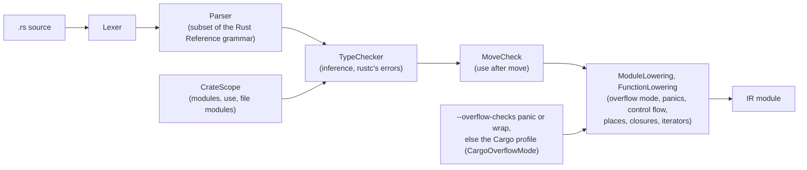

# The Rust frontend

**Status:** implemented for the scalar subset (#466, #463), functions, modules, closures and
`#[test]` (#464), arrays, slices, `Vec`, references and slice iterators (#465), structs, inherent
methods, field-less enums and `Option`/`Result` with `?` (#467). Traits, generics, enums with data,
text and the smart pointers are the next issues of epic #456.

`Polypiler.Core.Frontends.Rust` imports a subset of Rust (2024 edition) into the IR: functions
and inherent methods over the primitive numeric types, `bool`, tuples, fixed arrays, slices, `Vec`,
structs, field-less enums, `Option` and `Result`, with their operators, casts and overflow methods,
the control flow around them, closures and iterator chains over slices and ranges, across the
modules of one crate. `polypiler translate <file>.rs --from rust` runs it, in the overflow mode of
`--overflow-checks <panic|wrap>` or of the Cargo profile that applies; `--debug-assertions on|off`
decides `debug_assert!` (without it a source using one is `PLY1536`). Related: [IR](IR.md) · [pipeline](PIPELINE.md) ·
[exceptions](../reference/exceptions.md) · [integer operations](../reference/integer-operations.md).

## Parsing and typing in C#

The source is read by a recursive-descent parser of the frontend (`Syntax/Lexer.cs`,
`Syntax/Parser.cs`) over the grammar of The Rust Reference for the imported subset, and typed by
the frontend's own checker (`Typing/TypeChecker.cs`). Issue #456 planned a helper executable built
on rust-analyzer's crates instead. The frontend does not use it:

- `polypiler translate` stays one self-contained program. A helper would be a native Rust build per
  operating system, shipped and located at run time, with a `rust-src` component on the user's
  machine - for a subset whose grammar fits in two files.
- The subset needs only the inference rustc applies to it: an unsuffixed integer literal is an
  inference variable that every use narrows and that becomes `i32` when nothing does (`f64` for a
  float), an untyped `let` is a variable as well, a method receiver must be known when the method is
  checked (`E0689`), and a literal cast with `as` takes the cast's type (`300 as u8` is an
  overflowing literal). Methods are resolved by the receiver's resolved primitive type, never by
  name alone.
- `rustc` 1.99 (`tooling/toolchains.lock`) is the oracle: the acceptance tests compile every fixture
  with overflow checks on and off and hold the interpreter, the emitted C# and the emitted
  JavaScript to it, call by call.

What the frontend accepts is a subset of what rustc accepts. It reports the compiler's errors the
subset can produce with rustc's code (`PLY1500`, for example `E0308`, `E0004`, `E0268`, `E0382`,
`E0384`, `E0594`, `E0599`) and the
deny-by-default lints `overflowing_literals`, `arithmetic_overflow` and `unconditional_panic` for
constant operands; rustc also finds overflows its constant propagation sees through locals
(`let x: u8 = 255; x + 1`), which the frontend does not.

## The overflow mode

Rust's `+` panics on overflow in a debug build and wraps in a release build; the source does not
say which. `--overflow-checks panic|wrap` says it. Without the flag the import takes what Cargo
passes to rustc as `-C overflow-checks` (`Cargo/CargoOverflowMode.cs`, after The Cargo Book,
"Profiles"):

- the profile is `dev`, the one of a plain `cargo build`, or the one `--cargo-profile <name>` names;
- the manifest is the nearest `Cargo.toml` at or above the source's folder, or the workspace root
  whose profiles Cargo reads instead: the one its `package.workspace` names, else the nearest
  `Cargo.toml` above it with a `[workspace]` table;
- the profile's own `overflow-checks` wins; without one it inherits: `dev` is on, `release` off,
  `test` inherits `dev`, `bench` `release`, a custom profile the one its `inherits` names;
- without a `Cargo.toml` the built-in profiles keep these defaults, so a lone `.rs` file panics.

The manifest is read by a small TOML 1.0.0 reader (`Cargo/TomlReader.cs`), written from the
specification at toml.io; it reads every form a manifest may use (dotted and quoted keys, inline
tables, arrays of tables, the four kinds of string). Profile overrides for single packages
(`[profile.dev.package.<name>]`), `.cargo/config.toml` and `CARGO_PROFILE_*` variables are not
read. A profile the manifest does not define, a custom profile without `inherits` or without a
manifest, an `inherits` circle, an `overflow-checks` that is no boolean and a manifest that is no
TOML are `PLY1503`, a usage error. `CargoOverflowModeTests` holds the rules and the reader;
`CargoOverflowModeOracleTests` (layer `rust`) holds the result to `cargo run --profile` for each
manifest form. The chosen mode and where it came from are a note on standard
error and the caveat `rs-overflow-checks` of the translation's manifest:
`overflow checks on, an overflowing operator panics (Cargo profile 'dev' of ../Cargo.toml)`.

The mode decides `+ - *`, unary `-`, `abs`, `pow` and the shifts:

| Construct | `panic` | `wrap` |
| --- | --- | --- |
| `+ - *` on `i32`, `u32`, `i64`, `u64` | `AddChecked`, `SubtractChecked`, `MultiplyChecked` | `Add`, `Subtract`, `Multiply` |
| `+ - *` on 8- and 16-bit types | computed in `i32`/`u32`, converted back with the `Trap` contract | the same, `Wrap` contract |
| unary `-` | `NegateChecked` (narrow: `Trap` conversion) | `Negate` |
| `<<`, `>>` | an amount outside `0..BITS` - a negative one too - panics | the amount masked to `BITS - 1` |
| `abs` | `Abs` (traps on `MIN`) | `AbsWrap` |
| `pow` | panics when the power is no value of the type | the power modulo 2^width |

Division and remainder trap in both modes, on a zero divisor and on `MIN / -1` and `MIN % -1`. The
explicit methods ignore the mode: `wrapping_*` wraps, `saturating_*` clamps, `checked_*` is a value
and an overflow flag consumed on the spot (`unwrap`, `expect`, `unwrap_or`, `is_some`, `is_none`),
`overflowing_*` the same pair read by `.0`, `.1` or a tuple `let`. `pow` and its family are
exponentiation by squaring as `core` computes it, written in Rust and lowered by this frontend into
the helpers `rust_pow_wrapping_<type>` and `rust_pow_overflows_<type>` of the module.

`as` never panics: between integers it wraps (the source's sign extended), from a float to an
integer it truncates and saturates (NaN to 0), to a float it rounds to nearest even. `isize` and
`usize` are 64 bits wide.

## Values, places and borrowing

Rust's types map onto the IR's by what a value is, not by how it is stored:

| Rust | IR |
| --- | --- |
| `[T; N]` | an array; a read of an array place by value is a copy (`Duplicate`), so the arrays never alias |
| `&[T]`, `&mut [T]` | a read-only view and a view of the array, the `Vec` or the range of either it borrows |
| `Vec<T>` | a list; `vec![a, b]`, `vec![v; n]`, `Vec::new`, `with_capacity`, `push`, `pop`, `clear`, `to_vec` |
| tuples | a struct `Tuple_<types>` with the fields `item0`, `item1`, ... |
| `struct` | an IR struct; a tuple struct's fields are `_0`, `_1`, ... |
| field-less `enum` | an IR enum with its discriminants; `as` casts read them |
| `Option<T>` | an optional; `Some`, `None`, `?`, `if let`, `match`, `unwrap`, `expect`, `unwrap_or`, `ok_or`, `copied` |
| `Result<T, E>` | a struct of `is_ok`, `ok` and `err`; `Ok`, `Err`, `?`, `is_ok`, `is_err`, `ok`, `unwrap`, `expect`, `unwrap_or` |
| `fn(T) -> U` | a function reference, called with `IrInvoke` |

A shared reference to a value is the value: nothing can change it while the reference lives. A
`&mut` that a local holds is an alias of the place it borrows - a local, a field, an element - and
every use reads or writes that place. A function with `&mut` parameters of values (not slices)
takes them by copy-in/copy-out: it returns a struct `<name>_out` of its result and the final value
of each such parameter, and the caller writes them back into the places it passed. A method with
`&mut self` is a function with such a first parameter.

The borrow checker is rustc's: a source the frontend imports compiles. Within the subset the
frontend checks what lowering relies on - a use after a move of a non-`Copy` value is `E0382`
(`Typing/MoveCheck.cs`), an assignment through `&` or to an immutable binding `E0594`/`E0384` - and
refuses the forms whose aliasing the IR cannot express: a `&mut` held in a tuple or a struct, a
reference result, a `&mut` binding into an `Option` or a `Result`.

`match`, `if let`, `while let`, `let` and `let ... else` destructure tuples, structs, tuple structs, enums,
`Option`, `Result`, references and ranges, with bindings, `_`, `..`, or-patterns and guards;
exhaustiveness is checked over all of them (`Typing/Exhaustiveness.cs`). A `match` over an integer
or an enum whose arms are constants becomes an IR `switch`.

## Items, modules and closures

A crate is the source file and the modules it declares: inline `mod m { ... }` and file modules
`mod m;` read from `m.rs` or `m/mod.rs` beside their declarer (`Typing/CrateScope.cs`). `use` with
groups, globs, `self`, `super`, `crate`, renames and `pub use` re-exports resolves names across
them, as do `std::cmp::{min, max}` and `std::mem::swap`. The exported surface is every item reachable
by a public path; its IR name is that shortest public path joined by `_`. Modules are emitted in
dependency order (`ImportResult.ModuleOrder`), test-only modules last.

Inherent `impl` blocks give structs and enums associated functions, constants and methods with
`self`, `&self` and `&mut self`. `#[derive(Clone, Copy, PartialEq, Eq, Debug, Default)]` is
accepted, `#[repr(C)]` on a struct and an integer `repr` on an enum.

A closure is inlined where it is called: its parameters become locals, its captures are the
variables they name, and a `return` in it leaves the inlined body. A `move` closure snapshots the
`Copy` values it captures. A closure that escapes - stored, returned, coerced to `fn`, used other
than called or passed to an iterator method - is `PLY1532`.

Iterator chains over `iter()`, `iter_mut()`, `into_iter()`, `chunks_exact`, ranges and `zip` are
loops: the positional adapters `rev`, `step_by`, `zip`, `enumerate`, `copied` and `cloned` move the
position, `map` and `filter` stream the item through, and the chain ends in a `for` or in `sum`,
`product`, `count`, `fold`, `any`, `all` or `for_each`. A chain stored as a value is `PLY1535`.

`#[test]` functions and the items under `#[cfg(test)]` are imported as tests: `ImportResult.Tests`
names them and they are no part of the exported surface; `assert!`, `assert_eq!`, `assert_ne!` and
their `debug_` forms panic as rustc does.

## Panics

A panic is the throw of an exception class of the IR ([exceptions](../reference/exceptions.md)):
an arithmetic overflow `OverflowException`, a zero divisor `DivideByZeroException`, an index or a
range outside a slice, an array or a `Vec` `IndexOutOfRangeException`, `unwrap` of a `None` or an
`Err`, `expect`, `step_by(0)`, `assert!` and its relatives, `panic!`, `todo!`, `unimplemented!`,
`unreachable!` and unequal lengths of `copy_from_slice` `InvalidOperationException` with Rust's
message, `clamp` with crossed bounds the IR's `Clamp` (`ArithmeticException`). The differential
tests compare these classes with the message rustc printed.

## Control flow

The IR is structured, with no labels: Rust's expression forms become statements that leave their
value in a local, and the order of evaluation is kept - operands left to right, an operand that
needed statements reading every operand before it into a local first, the right side of an
assignment before its place.

- `if` and `match` that yield a value become conditional expressions where every branch is a plain
  value, otherwise an `if` chain assigning a local. A `match` is tested arm by arm in source order,
  a guard only after its pattern matched; the checker proves the arms exhaustive (`E0004`), so the
  last arm without a guard is the final `else` and no default arm is invented.
- `break 'label` and `continue 'label` to an outer loop set a flag of the target and leave the
  innermost loop; after every loop on the way the flag is tested and the jump goes on. A labelled
  block is a loop that runs once.
- `for` over `a..b`, `a..=b` and their `rev()` and `step_by(n)` forms evaluates the bounds and the
  step once, panics on a step of 0 before the first iteration, and never computes a value past the
  range: an inclusive range ends by testing for its last value (`0..=u8::MAX` runs 256 times), the
  distance to the end is measured in `u64`. `rev()` and `step_by()` apply in source order.

## Refusals

| Code | Refused |
| --- | --- |
| `PLY1500` | source rustc rejects: a syntax error, a type error with its code, a borrow error the subset sees (`E0382`, `E0384`, `E0594`), a denied lint |
| `PLY1501` | `i128`, `u128`, `f16`, `f128`, `!` as a parameter, and every type outside the subset |
| `PLY1502` | any other construct: a range as a value, `()` as a value, a type alias, a constructor or a library function as a value, a `&mut` to a value held other than as an argument, other methods (`floor`, `to_be`, ...) |
| `PLY1503` | an overflow mode the Cargo profile cannot give: an undefined profile, no `inherits`, a circle, a manifest that is no TOML |
| `PLY1504` | a local or an expression whose type nothing decides (rustc's `E0282`) |
| `PLY1510` | let chains (`if let ... && ...`) |
| `PLY1511` | `@` bindings, `ref` bindings, const block patterns, a binding in an or-pattern, a variable in a range pattern, a `&mut` binding into an `Option` or a `Result`, a `match` on a float |
| `PLY1512` | a `for` or a chain over `..` or `a..` |
| `PLY1513` | `async`, `.await`, `try`, `gen`, `yield` |
| `PLY1520` | nested arrays, a slice or a `Vec` of anything but numbers, `bool`, tuples and structs of them, a slice pattern, an array length no constant gives |
| `PLY1521` | `char`, `&str`, `String` |
| `PLY1522` | `unsafe` blocks, `unsafe trait`, `unsafe impl`, raw pointers and borrows, `static mut`, `union`, `ManuallyDrop` |
| `PLY1523` | `Box`, `Rc`, `Arc`, `Cell`, `RefCell`, `Mutex` |
| `PLY1524` | slice methods outside the subset (`sort`, `binary_search`, `get` with a range, ...) |
| `PLY1525` | `HashMap`, `HashSet`, `BTreeMap`, `BTreeSet`, `VecDeque`, `BinaryHeap` |
| `PLY1530` | generic, `unsafe`, `extern` and variadic functions, `where`, `impl Trait`, a typed `self`, a function without a body, nested items |
| `PLY1531` | macros but `assert!`, `assert_eq!`, `assert_ne!`, their `debug_` forms, `panic!`, `todo!`, `unimplemented!`, `unreachable!` and `vec!`; format arguments |
| `PLY1532` | a closure that escapes, a move of a captured non-`Copy` value, a `move` closure assigning its capture |
| `PLY1533` | attributes but the lint levels, `inline`, `must_use`, `cold`, `track_caller`, `derive`, `repr`, `test`, `cfg(test)` and documentation |
| `PLY1534` | a path to another crate or outside the supported standard-library subset |
| `PLY1535` | iterator methods outside the subset, an adapter in an order the lowering does not stream, a chain stored as a value |
| `PLY1536` | `debug_assert!` without `--debug-assertions` |
| `PLY1540` | traits, trait impls, trait objects |
| `PLY1541` | generic structs, enums and impls |
| `PLY1542` | lifetime parameters, reference fields, reference results |
| `PLY1543` | enums with data |
| `PLY1544` | derives and `repr` forms outside the list above |
| `PLY1545` | `Option` and `Result` methods outside the subset, and of payloads the IR's optional cannot hold |
| `PLY1546` | `Drop` implementations |

## Tests

`tests/fixtures/prototype/rust/` holds `scalars.rs` (every operator, method and cast for every type),
`control.rs` (the control forms and all twelve range forms over bound pairs and steps),
`functions.rs` (calls, recursion, `pub`), `memory.rs` (arrays, slices, `Vec`, references,
copy-in/copy-out), `types.rs` (structs, methods, enums, `Option`, `Result`, `?`), `closures.rs`
(closures and iterator chains), `edges.rs` (the rarer forms) and the package `modgraph/` (file
modules, `use`, re-exports, `#[test]`). `recorded/` holds what rustc did with each, per overflow
mode, for the calls of `RustCases`; `RustDifferentialTests` in `Polypiler.Tests` holds the
interpreter to the recordings, `RustFrontendDifferentialTests` in `Polypiler.Tests.Acceptance`
(layer `rust`) holds the recordings to rustc and the emitted C# and JavaScript to the recordings, and
`RustRoundTripTests` there holds the Rust the Rust backend writes back from the IR to them, its crate
built with overflow checks on and off; the fixtures the backend cannot write yet are listed in
`RustFixture.BackendPending`. The unit tests under `Polypiler.Tests/Frontends/Rust/` hold every
refusal and every rustc error the frontend reports to its code. Run the acceptance test
`Recording_IsWhatRustcDoes` with `POLYPILER_RECORD=1` after a fixture or its calls changed.
