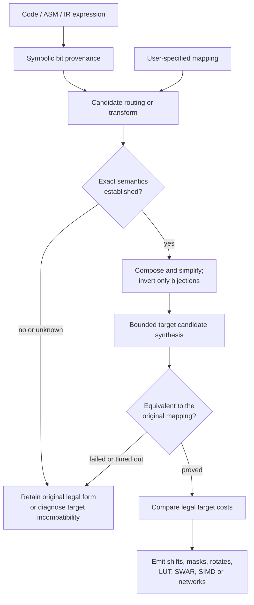

# Semantic recovery, de-optimization and permutation synthesis

**Status:** design; the [BitPerm project](https://github.com/Hawkynt/Hawkynt.github.io/tree/main/BitPerm) is an existing prototype, not yet a Polypiler subsystem. See [PRD §§19–20](../prd/05-semantics-and-recovery.md#s19).

The compiler first recovers **what** an operation means and only later chooses **how** to implement it. This allows optimized legacy code to become a simple canonical operation, then to be re-optimized for a different CPU or language.

## Recoverable patterns

| Low-level pattern | Candidate recovered operation | Non-negotiable conditions |
|---|---|---|
| Shift/add multiplication | Fixed-width multiply | Width, overflow and shift rules match |
| Branchless min/max | Signed/unsigned Min/Max | No overflow or evaluation mismatch |
| XOR swap | Swap | No aliasing or observable intermediate writes |
| Shift/or rotation | Rotate/FunnelShift | Signedness and shift-count rules |
| Kernighan loop | PopCount | Correct integer termination behavior |
| Repeated masked operations | Pack/Unpack/BitPermute | Full bit mapping, constants and side effects |
| Manually unrolled loop | Iteration domain + map/reduction | Exact induction, bounds, order and dependencies |
| Software-pipelined loop | Logical iterations | Inter-iteration dependence and exception order |
| Generated state machine | Iterator/Coroutine/Async | Suspension, lifetime, scheduling and errors |
| Cleanup in try/finally | ResourceScope | Acquisition, cleanup, all exits and error precedence |

The recovered operation is a candidate. If a rewrite is not proven legal, retain the original representation or produce an explicit diagnostic when it cannot be emitted.

## BitPerm: two directions

A **permutation** is bijective. **Routing** may duplicate or drop bits or insert constants. A general **Boolean transform** may combine bits through XOR/AND/etc. Do not label a non-bijective transform invertible.

Source-bit basis testing finds candidate routing, but does **not prove** a general arithmetic function is linear or a permutation. For multiplication tricks, integer carries can make a candidate mapping incorrect on multiple simultaneously set bits. Use exact bitvector semantics and an equivalence prover or exhaustive tests when small enough.

## From BitPerm prototype to reusable engine

BitPerm already has a routing map, building blocks, a greedy solver, a bounded Dijkstra search, per-CPU costs and browser tests. Migration should:

1. Pin and inventory the actual implementation and test behavior.
2. Separate routing approximations from exact arithmetic operation semantics.
3. Produce typed Polypiler IR rather than final C-like text from building blocks.
4. Add deterministic bounded search, explicit cost models and proof results.
5. Recognize networks and source patterns in reverse; add butterfly/Beneš candidates.
6. Link the existing visualization to the common engine only after behavior is verified.

The current bounded search should be described as "best found in the modeled search space under the budget", not unconditionally globally optimal.

## De-unroll before re-unrolling

A set of four independent indexed stores can become an iteration-domain operation only if their address expressions and effects permit it. The target may then choose a loop for 6502, register packing on x86-64 or SIMD for a wide processor.

Memory-mapped I/O, volatile ordering, non-commutative floating-point reductions, unknown aliases and exception edges can block that reconstruction. Source-specific instruction scheduling has no semantic importance only if externally observable behavior is unchanged.

## Cross-operation optimization

Recognizing permutations enables simplifications across a whole pipeline:

- Compose consecutive permutations.
- Cancel inverses where the operations have matching domains.
- Propagate layouts through compatible Boolean operations.
- Fuse pack/unpack and marshaling transformations.
- Select an execution representation that avoids repeated conversions.

A high-level intrinsic is not always faster: it may be decomposed back into precisely the same shifts on an older target.

## Verification and diagnostics

- For pure bounded bitvectors, use SMT bitvector equivalence; for small widths, exhaustively evaluate.
- For loops, prove induction/dependence properties or decline the rewrite.
- For floating-point patterns, account for rounding, FMA, NaNs and signed zero.
- Log each recognized candidate, its facts, its proof outcome and the chosen lowering.
- Timeouts and uncertain proofs mean **no rewrite**, not "probably equivalent".

Related: [IR](IR.md) · [walkthroughs](WALKTHROUGHS.md) · [verification](../quality/VERIFICATION.md).
