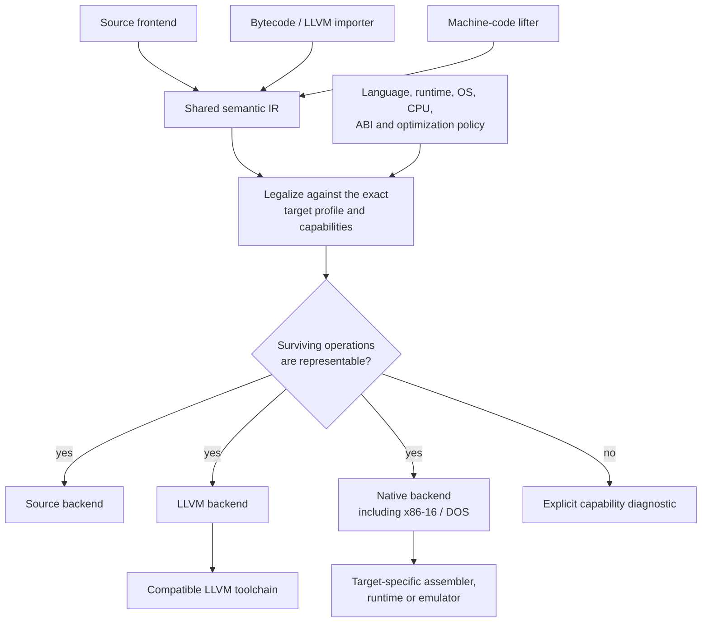

# Frontends, backends and target profiles

**Status:** planned integrations; consult [PRD §3](../prd/01-product-and-targets.md#s3) for phased support obligations. Both source and target support are independent capabilities.

## Three importer families

**Source frontends** parse source syntax with native language semantics. First targets are C# (Roslyn), JavaScript (existing Cipher pipeline) and PowerBASIC (existing PB-Compiler binder). Follow-on languages include C, C++, Rust, Kotlin, Perl, Python, TypeScript, Java, Go, Delphi, FreeBASIC, PHP and Ruby.

**Intermediate/bytecode frontends** lift LLVM `.ll`/`.bc`, MSIL, JVM bytecode, WebAssembly, tokenized BASIC and format-specific BASIC p-code. The importer must retain ABI, runtime linkage, versions, metadata and exceptional behavior. LLVM is an additional interchange representation, not a replacement for Polypiler's semantic IR; GCC GENERIC/GIMPLE is separate from LLVM and needs its own adapter.

**Machine-code frontends** lift x86/x64, ARM/AArch64, MOS 6502 and later other processors through decoded instruction semantics, register/flag SSA, stack and call-convention recovery, memory provenance, and explicit unresolved platform effects. Function entry, CPU model, code/data mapping and environment must be supplied or discovered reliably.

## Export families

- **Source emitters:** valid native syntax, types, imports, modules and [minimal required helpers](LANGUAGE-LOWERING.md#runtime-closure).
- **IR emitters:** LLVM-compatible IR/bitcode where legal; other bytecode emitters only after runtime/verification coverage.
- **Native emitters:** x86-16/DOS via existing PB-Compiler architecture; MOS 6502 and other CPUs through target-specific machine IR, register/zero-page allocation and executable formats.
- **Packaging:** builds or modules with provenance, test fixtures, dependency manifests and licenses. The helpers and portable implementations a backend copies into an output are MIT ([LICENSE-OUTPUT.md](../../LICENSE-OUTPUT.md)), each source file of them states its licence in an `SPDX-License-Identifier` header, and a backend reports every helper it emitted with its origin and licence, which the header of the generated file and its manifest record.

A backend cannot silently map an untranslatable instruction or library call to a placeholder. It must lower, bridge, retain a compatible dependency, or diagnose it.

LLVM and native/DOS emission are separate routes; support for either does not establish the other.

## Target profile is a tuple

| Dimension | Examples |
|---|---|
| Language/dialect | C# stable; PowerBASIC pb35; Perl 5; C64 BASIC V2 |
| Runtime | .NET 9; .NET Framework 2.0-compatible helpers; native C; Perl runtime |
| OS/environment | Windows, Linux, DOS, C64, freestanding |
| Processor | x86-64, ARM64, x86-16, MOS 6502 |
| ABI | Win32 cdecl/stdcall; System V; segmented DOS conventions |
| Capabilities | FPU/SIMD/BMI2, heap, threads, exceptions, external DLL loader |
| Optimization policy | exact/strict, compatible-fast, size, latency, constant-time |

The first two dimensions exist today in the C# backend. A profile (`--profile net2.0` … `net10.0`) fixes the framework and the C# version of its time, and one capability table (`CSharpCapabilities`) says for every API and every language feature the emitter writes which profile has it first and what replaces it elsewhere: an older call with the same bits, or a private helper emitted only where it is called. A defect of a runtime that changes what correct code computes is a row too, naming the first profile whose runtime has it; the emitter writes the affected expressions in a form the runtime computes correctly there ([known runtime defects](../reference/known-runtime-defects.md)). Adding an operation is one row of that table. The generated file of each profile is compiled against that framework's reference assemblies in the tests, never only against the runtime the tests run on.

Do not infer target portability solely from the language name. PowerBASIC for Windows DLL imports and PowerBASIC DOS OMF linking are different targets; a Win64 library is not callable directly from a 32-bit DOS executable.

## Bidirectional support is tested direction by direction

A C# backend and a C# frontend are distinct deliverables. Support is reported for the exact **input representation + constructs + output target profile + runtime requirements**.

| Demonstration | Initial route | Main risk |
|---|---|---|
| Cipher JavaScript → C# | JS source frontend → canonical IR → C# | JS coercions, typed arrays |
| PowerBASIC → C# | PB source frontend → IR → C# | dialect rounding, arrays, error behavior |
| Kotlin CPU deinterlacer → Perl | Kotlin frontend → iteration/memory IR → Perl | indexing, integer behavior, inherited license |
| C# → x86-16/DOS | Roslyn → object/runtime lowering → x86-16 | unavailable .NET runtime features, segments |
| 6502 → C# | machine lifter → explicit effects → C# | flags, self-modification, MMIO |
| C external DLL binding → PowerBASIC Windows | C declarations → ForeignCall/ABI → PB declarations | packing, pointer layout, symbol decoration |
| LLVM → source | LLVM importer → semantic recovery → source backend | lost high-level information, intrinsics |

A Rust adapter around NCNN is **not** proof that neural inference has been translated into independent Rust. Models, weights, operator semantics and third-party licensing must be treated separately.

## Capability diagnostics

A capability decision should say what is missing and where, for example:

    POLY-CAP-UNSUPPORTED:
      source: PowerBASIC DOS (pb35)
      destination: Rust / Linux
      operation: far-pointer runtime call to unresolved DOS service
      reason: target lacks an equivalent runtime binding
      suggestions: provide a compatible adapter or use a DOS target

This is an illustrative format; the versioned diagnostic schema is defined by the PRD.

Related: [PRD and architecture index](../PRD.md#architecture-guides) · [pipeline](PIPELINE.md) · [interop](INTEROP.md) · [verification](../quality/VERIFICATION.md).
