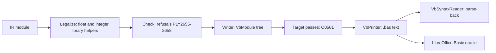

# The classic Visual Basic backend

**Status:** implemented for integers, floating point, control flow, procedures, arrays, records,
strings, module state, exceptions and the dynamic type ([#1556](https://github.com/Hawkynt/Polypiler/issues/1556), [#1088](https://github.com/Hawkynt/Polypiler/issues/1088),
[#1085](https://github.com/Hawkynt/Polypiler/issues/1085), [#1086](https://github.com/Hawkynt/Polypiler/issues/1086),
[#1087](https://github.com/Hawkynt/Polypiler/issues/1087), [#1089](https://github.com/Hawkynt/Polypiler/issues/1089),
classic dialect), checked by LibreOffice Basic in VBA mode, the oracle of
[ADR 2600](../adr/2600-classic-visual-basic-oracle.md). Related: [classic Visual Basic frontend](VISUALBASIC-FRONTEND.md) ·
[backends](BACKENDS.md) · [exceptions](../reference/exceptions.md#visual-basic).

`polypiler translate <file> --to visualbasic --output <directory> [--profile visualbasic/vb6|vba6|vba7|vba7-64]`
writes one standard module, `<module>.bas`, with its `Attribute VB_Name` line, and the manifest beside it.

## Pipeline

## Project

| Folder | What it holds |
| --- | --- |
| `Syntax/` | `VbSyntax.cs`, the tree of a standard module; `VbSyntaxRewriter` (walk, the shape two trees are compared by); `VbSyntaxReader`, which reads the printed subset back - keywords in any case, ` _` continuations, comments, the precedence of [MS-VBAL] 5.6.9 |
| `Printing/` | `VbPrinter`: four spaces, LF, parentheses exactly where precedence needs them, a right operand that starts with a minus sign always in parentheses, literals in the form Visual Basic reads (`&H80000000`, `65535&`, `1E+20`, `3#`, `0.5!`) |
| `Profiles/` | `VisualBasicProfile` (`visualbasic/vb6`, `vba6`, `vba7` - the default, which compiles on 32- and 64-bit Office - and `vba7-64`) and `VisualBasicCapabilities`: `LongLong` only on `vba7-64`, `LongPtr`/`PtrSafe` from VBA 7 |
| `Helpers/` | `VisualBasicHelpers`, the operations Visual Basic has no expression for, and `ArrayHelpers`, the length, creation, copy and fill of an array per element type (listed in [backends](BACKENDS.md#helpers-that-stay-with-a-backend)) |
| `Writing/` | the writer: module, names, types, constants, globals; statements; expressions and conversions; exceptions |
| `Passes/` | `VisualBasicTargetPasses`: O0501, which removes a helper nothing names |

## Representation

| IR | Visual Basic |
| --- | --- |
| `bool` | `Boolean` |
| `u8` | `Byte` |
| `i8`, `i16` | `Integer`, an `i8` held in its range |
| `u16`, `i32` | `Long` |
| `u32` | the bits of a `Long`; compared with the sign bit flipped |
| `i64`, `u64` | `LongLong` (`vba7-64`), otherwise refused with `PLY2656` |
| `f32`, `f64` | `Single`, `Double` |
| string | `String`; a character outside printable ASCII as `ChrW(n)` |
| array | a dynamic array from 0; an empty one has no bounds, so its length is `PlyLen_<T>` |
| struct | a `Public Type`; a parameter by reference, copied field by field where the body changes it |
| global, table | a module variable that `PlyInit` sets on the first call of a public procedure |
| `variant` ([variants](../reference/variants.md)) | `Variant`: `Empty`, `Null`, or the payload through its conversion function (`CInt(x)`, `CLng(x)`, `CDbl(x)`, …), which gives it its subtype also where a literal would have another; the tag `VarType(v)`; a payload the frontend tested `CInt(v)`, …, one it did not a test that raises error 13 first; a date `CDate(x)` and `CDbl(v)`; a currency `CCur(CDec(x) / 10000)` and `CLngLng(CDec(v) * 10000)`, only where the profile has `LongLong`; arrays of it `Variant()` |
| `FormatVisualBasic` | `PlyFmtR8(x, sep)`/`PlyFmtR4`: `CStr` with the run-time decimal separator replaced by the IR's and a three-digit exponent with a leading zero shortened, as LibreOffice writes `1E+020` |
| `ParseDotNet` of `f64`/`f32` | `PlyParseR8`: blanks and group separators removed, error 13 for a character no number has, then `Val`, which reads a point in every locale |

## The arithmetic

Visual Basic raises run-time error 6 for every integer result outside its type, so the IR's wrapping
`+`, `-`, `*` and negation of 32 bits are `PlyAdd32`, `PlySub32`, `PlyMul32` and `PlyNeg32`, exact in
`Double` and reduced modulo 2^32 (16-bit halves for the product); of two operands of at most 16 bits the
backend writes Visual Basic's own operator, which cannot overflow. A checked operation is Visual Basic's
operator through its conversion function, `CLng(a + b)`: LibreOffice Basic computes such intermediates
wider and checks only what is stored or converted, so the conversion makes both trap at the same place.
Signed division is `PlyDiv32`, which raises error 6 for `&H80000000 \ -1` itself; LibreOffice ends with
a processor fault there. Unsigned division and remainder, the shifts, and every narrowing conversion
that wraps or checks are helpers; a float is truncated with `Fix` before `CLng`, `CInt` or `CByte`,
which round half to even. Floating-point arithmetic is Visual Basic's own; a `Single` result is
rounded with `CSng`. Visual Basic raises error 6 or 11 where IEEE 754 gives an infinity or a NaN, so a
module whose floating-point results leave the finite range traps where the IR does not (see the known
differences of [exceptions](../reference/exceptions.md#visual-basic)).

## Control flow

`And` and `Or` evaluate both operands, so `&&` and `||` are an `If` that assigns a temporary unless the
right operand can neither trap nor change anything; a conditional is `IIf` through the type's conversion
function under the same condition, an `If` otherwise. Every loop is a `Do` loop: a test that needs
statements of its own is written inside it with `Exit Do`; `continue` is a `GoTo` to a label before the
loop's end; a `break` out of a switch a `GoTo` to a label after `End Select`. A try is
`On Error GoTo Catch`, whose label takes `Err.Number` and resumes (which clears `Err`) at a dispatch
that runs the first catch clause whose class the number stands for (11 divide by zero, 6 overflow,
9 index out of range, 13 invalid cast, 91 null reference, 5 argument) or raises the number again;
every jump out of a try puts the enclosing handler in force again. A throw of a library exception is
`Err.Raise` with its number.

## Verification

- `VisualBasicParseBackTests`: every prototype fixture in every profile reads back to the tree it was
  printed from and prints the same text again.
- `VisualBasicOracleTests` (layer `visualbasic`): the prototype fixtures translated from C# print, on
  LibreOffice, what the IR interpreter computes for the same calls; the classic fixtures print their
  documented values after the round trip through the IR; Adler-32 and CRC-32 give their published values.
