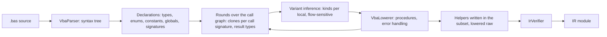

# The classic Visual Basic frontend

**Status:** implemented for the classic dialect of VB6 and VBA standard modules
([#1090](https://github.com/Hawkynt/Polypiler/issues/1090), with the classic parts of
[#1094](https://github.com/Hawkynt/Polypiler/issues/1094), [#1091](https://github.com/Hawkynt/Polypiler/issues/1091),
[#1092](https://github.com/Hawkynt/Polypiler/issues/1092), [#1093](https://github.com/Hawkynt/Polypiler/issues/1093) and
[#1095](https://github.com/Hawkynt/Polypiler/issues/1095)), `Variant` ([#1556](https://github.com/Hawkynt/Polypiler/issues/1556)),
its inference across the module ([#1564](https://github.com/Hawkynt/Polypiler/issues/1564)), the locale
([#1565](https://github.com/Hawkynt/Polypiler/issues/1565)), `Currency` and `Date` ([#1566](https://github.com/Hawkynt/Polypiler/issues/1566))
and bitwise `Variant`s and `Variant` arrays ([#1567](https://github.com/Hawkynt/Polypiler/issues/1567)), its oracle LibreOffice Basic in VBA mode
([ADR 2600](../adr/2600-classic-visual-basic-oracle.md)). Related: [classic Visual Basic backend](VISUALBASIC-BACKEND.md) ·
[import differences](../reference/import-differences.md) · [variants](../reference/variants.md).

`polypiler translate <file>.bas --from visualbasic --to <target> --output <directory> [--vb-locale <locale>]`
imports one standard module; its name is the `Attribute VB_Name`, or the file name. `--vb-locale`
(`VisualBasicImportOptions.Locale`) states the regional settings the module runs under - `en-US`
(the default, the separators of the invariant culture), `en-GB`, `de-DE` or `fr-FR` - whose decimal
separator `CStr` writes and `CDbl` reads and whose digit group separator `CDbl` skips.

## Pipeline

## Parsing

`Polypiler.Core.Frontends.VisualBasic/Parsing/VbaParser.cs` is a lexer and recursive-descent parser
written from [MS-VBAL] sections 3 and 5: the grammars found (ANTLR `grammars-v4/vba`, Rubberduck) are
GPL-3.0, so none is used (ADR 2600). It reads keywords in any case, ` _` continuations, `:` between
statements, `'` and `Rem` comments, line labels and line numbers, type characters of names and literals
(`%`, `&`, `^`, `!`, `#`, `$`, `@`), `&H` and `&O` literals, single-line and block `If`, and the
operator precedence of 5.6.9. A syntax error is `PLY2645` with its line.

## Lowering

| Visual Basic | IR |
| --- | --- |
| `Boolean`, `Byte`, `Integer`, `Long`, `LongLong`, `Single`, `Double`, `String` | `bool`, `u8`, `i16`, `i32`, `i64`, `f32`, `f64`, string |
| `Currency`, `@` literals, `CCur` | `i64` of ten thousandths: exact `+ -`, the product of the ten thousandths divided by 10000 with a tie to even (`PlyCurMul`), `CCur` of a `Double` `x * 10000` rounded half to even (as `VarCyFromR8`), error 6 outside the 64 bits; with a `Single` or a `Double` `*` is a `Double`, `/` always |
| `Date`, `#1/2/2000#`, `#2000-01-02 13:30#`, `CDate` | `f64` days since 1899-12-30, the time as the fraction (a day before the epoch minus its time); `Date ± number` a `Date`, `Date - Date` and `*`, `/` a `Double`, error 6 outside 100-01-01 … 9999-12-31 |
| `DateSerial`, `TimeSerial`, `Year`, `Month`, `Day`, `Weekday`, `Hour`, `Minute`, `Second` | helpers over Howard Hinnant's `days_from_civil`/`civil_from_days` (years 0-29 are 2000-2029, 30-99 1930-1999; months and days normalised; error 5 outside the dates); the time rounded to the second |
| `Type … End Type` | struct (no `String` or array fields, which the IR's records do not hold) |
| `Enum` | `Long` constants |
| `Const`, module variable | constant, global |
| array with its bounds | IR array from 0; the lower bound - declared, of the first `ReDim`, or `Option Base` - is subtracted from every index |
| `Function`/`Sub`, `ByVal`, `Optional … = d` | function; a parameter by reference that is not assigned is a value |
| `+ - *` on `Byte`/`Integer` | 32-bit arithmetic converted back with a trap |
| `+ - *` on `Long`/`LongLong` | checked arithmetic |
| `/`, `^`, floating-point `+ - *` | the IR's, checked by `PlyCheckD`/`PlyDivD`/`PlyPow`: error 6 for an infinite result, 11 for a zero divisor, 6 for 0/0 |
| `\`, `Mod` | operands rounded half to even to integers, then truncating division and remainder |
| `And`, `Or`, `Xor`, `Eqv`, `Imp`, `Not` | logical on two `Boolean`s, evaluating both operands; bitwise otherwise |
| `&`, `CStr`, a number assigned to a `String` | concatenation; an integer in decimal, a `Single`/`Double` by `FormatVisualBasic` (15 or 7 significant digits, `1E+20`, `1E-05`, the locale's decimal separator), a `Currency` with up to four decimals |
| `CDbl`/`CSng`/`CLng`/… of a `String`, a `String` with a number, a `String` condition, `IsNumeric` | `PlyNumText`: blanks, a sign, digits with the locale's group separator, its decimal separator, an exponent after `E` or `D`, `&H`/`&O`, to the canonical text `ParseDotNet` reads exactly; error 13 for no number, 6 beyond the range; `"True"`/`"False"` as a `Boolean` |
| `Val` | `PlyVal`: blanks anywhere, a point in every locale, the longest number at the start, `&H`/`&O` as `Integer`/`Long` bits, 0 without one |
| `CInt`, `CLng`, `CByte`, implicit conversion | half to even, trapping outside the type |
| `For … Step` | the end and the step evaluated once; the counter's step traps after the last pass, as Visual Basic's does |
| `Select Case` | the value once, then an `If` chain over the clauses |
| `On Error GoTo h` with `h:` at the end | a try whose catch clauses set `Err.Number` and fall into the handler |
| `On Error Resume Next`, a handler that ends with `Resume Next` | a try around every following statement; an error in an `If` condition goes on inside its first branch |
| `Err.Number`, `Err.Clear`, `Err.Raise n`, `Error n` | the global `ErrNumber`; the throw of the class of 5, 6, 9, 11, 13, 91 or 94 (`InvalidOperationException`, "Invalid use of Null") |
| `Dim v`, `Dim v As Variant` of one kind, assigned before every read | a local of that type (below) |
| any other `Variant`, untyped or `As Variant` parameters, results and module variables | the dynamic type `variant` ([variants](../reference/variants.md)) |
| `Empty`, `Null`, `CVar` | `IrVariantOf` |
| `IsEmpty`, `IsNull`, `VarType`, `TypeName`, `IsNumeric` | the tag of a dynamic value; a constant for a typed one |
| `Dim a(…)`, `Dim a()` of `Variant`, `Array(…)`, `IsArray` | an array of the dynamic type (`variant[]`), elements `Empty` when made; `Array(…)` from `Option Base`; a `Variant` local only ever assigned an array becomes that array |
| untyped or `Variant` parameters and results called with one kind each | clones per call signature (below) |

The built-in functions are lowered to helpers written in the subset itself and lowered with it (`PlyLeft`,
`PlyMid`, `PlyInStr`, …); a module carries those it calls.

## Variant

Every local declared without a type or `As Variant` is a candidate. The procedure is lowered with every
candidate dynamic, collecting the kinds - `Empty`, `Null`, `Boolean`, `Byte`, `Integer`, `Long`,
`LongLong`, `Single`, `Double`, `String` - each may hold, until they no longer grow. The kinds flow with
the statements: an assignment replaces what the local held, the branches of an `If` or a `Select Case`
join, a loop joins its head with the end of its body and every `Exit` until the head no longer grows,
an assignment under `On Error Resume Next` only adds (it may be skipped), and a handler starts with
whatever the code it guards may have assigned. A candidate whose assignments all have one scalar kind
and which is never read where it may still be `Empty` is lowered as a local of that type; the
lowering with the types given checks it, and a local assigned another type there, or read where it may
be `Empty`, is lowered again as a dynamic one. `TypeName`, `VarType`, `IsEmpty` and `IsNull` of such a
local are constants.

A local given a fixed type is still a `Variant` to its arithmetic: `+`, `-`, `*` and the negation of
one-kind integer, `Boolean` and `Double` operands are computed exactly as a `Double` - exact for the
integers, and for a result beyond `Long` the same rounding Visual Basic's promotion to `Double` gives
- and the value with the type it started in gives its tag when it is boxed (`PlyVarFromWide`). Every
other operation with a dynamic operand calls a helper written in the subset over the three operations
of the type (`PlyVarArith`, `PlyVarDiv`, `PlyVarIntDiv`, `PlyVarNeg`, `PlyVarPow`, `PlyVarConcat`,
`PlyVarCmp`, `PlyVarLogic`, `PlyVarIsTrue`, `PlyVarCStr`, `PlyVarDbl`, …):

| Operation | Visual Basic's rule, as the helpers compute it |
| --- | --- |
| `+ - *` | in the wider type ([MS-VBAL] 5.6.9.3); a result that overflows promotes `Byte` → `Integer` → `Long` → `Double`, `Single` → `Double`, instead of error 6; `Boolean` counts as `Integer` |
| `+` of two `String`s | concatenation |
| `Empty` | `Empty + x` is `x` unchanged, `Empty + Empty` `Integer 0`; elsewhere `Integer 0` or `""` |
| `Null` | propagates through every operator and comparison; `Null & Null` is `Null`, otherwise `&` reads it as `""` |
| `/`, `^` | a `Double` (a `Single` for `Single` with the narrow integers); 0/0 error 6, a zero divisor 11 |
| `\`, `Mod` | operands rounded half to even to integers; the result in the narrower type, promoted like `+` |
| `=`, `<`, … | numbers by value, strings by code unit, a number below a string, `Empty` as 0 or `""` |
| `And`, `Or`, `Xor`, `Not` | on `Boolean` and `Null`, three-valued: `Null And False` is `False`, `Null Or True` is `True` |
| `And`, `Or`, `Xor`, `Eqv`, `Imp`, `Not` of other kinds | bitwise in the effective type of [MS-VBAL] 5.6.9.8 (`PlyVarBits`): `Byte` of two `Byte`s, `Boolean` of two `Boolean`s, `Integer` of `Byte`/`Boolean`/`Integer`/`Empty`, `Long` of anything else rounded half to even; with `Null`: `0 And Null` is 0, `x Or Null` is x for x ≠ 0, `x Imp Null` is `Not x` but for -1, `Null Imp y` is y for y ≠ 0, everything else `Null` |
| `Currency` and `Date` in a `Variant` | tags 6 and 7: `Currency` never promotes (error 6), a `Date` that leaves the dates a `Double`; a `Variant` that may hold a `Currency` uses the `…C` helpers (`PlyVarArithC`, `PlyVarDivC`, …), so a module without `Currency` carries no 64-bit integer |
| a condition | `Null` and `Empty` are false |
| assignment to a typed variable, `CInt`, `CStr`, … | `Empty` is 0, `""` or `False`; `Null` raises error 94 |
| `For` over a counter | constant bounds whose last step still fits keep the counter in its type; otherwise the counter is dynamic and every step is `Variant` addition |

Module variables of `Variant` may hold anything: they stay dynamic, and so does what a dynamic value
from outside may hold - every kind but `Currency`, which a module only meets through its own `CCur`,
`@` literals and `Currency` variables (a `Currency` the host passes in a dynamic `Variant` raises error 13).
Refused where the kinds say it can happen: a `LongLong` in a dynamic `Variant`, `^`, `\`, `Mod`, the
bitwise operators and a condition of one that may hold a `Currency`, a built-in function other than the
conversions and the ones above applied to a dynamic `Variant`, `Debug.Print` of one that may be `Null`,
a `Variant` that may hold an array and another kind, and `Variant` fields. The text of a `Date` that a
dynamic `Variant` holds raises error 13 when it runs; the text of a typed `Date` is refused.

## Variant parameters and results across the module

Untyped and `As Variant` parameters and results are inferred from the calls of the whole module
(`VbaLowerer.Specialisation.cs`). A call whose every `Variant` argument has one scalar kind calls a
clone of the procedure whose parameters have those types - `Add(CLng(3), CLng(4))` calls
`Add_Long_Long(a As Long, b As Long)` - at most four clones per procedure; a call of several kinds, or
of a fifth signature, calls the procedure as it is declared. The result is a local of the procedure's
inference: of one kind on every exit and never `Empty`, it gives the clone that return type. The module
is lowered round after round, each with the clones and result types the round before found, until a
round finds the same (recursion included; after twelve rounds every procedure is lowered as declared).
A `Public` procedure keeps its declared signature, which the host calls, and gets clones for the
module's own calls; a `Private` one called through one clone alone is that clone under its own name,
and one never called keeps its declared signature. A clone whose lowering is refused - the text of a
`Date` that its typed parameter would hold - leaves its calls to the procedure as declared. A clone's
typed parameters keep the arithmetic of a `Variant`: `Inc(CInt(32767))` of `Inc = x + 1` is
`Long 32768`, not error 6.

## What is refused

`PLY2646` names the `Variant` constructs above, the text of a `Date`, a `For` loop over a `Currency` or
`Date` counter, `Decimal`, `Object`, `LongPtr`, fixed-length strings, class modules and `Property`,
`Declare`, `Static`, `GoSub`/`Return`, `GoTo`, `With`, `For Each`, `Set`, `ParamArray`, a parameter
passed by reference and assigned, `Err.Raise` of another number, arrays of `String` or `Boolean`,
multidimensional arrays and the functions it does not import (`Format`, `Str`, `UCase`, `Now`, `Date`,
`Time`, `DateAdd`, `DateDiff`, `IsDate`, `CDec`, …). `PLY2648` is a name that names nothing or a type mismatch.
`Err` is not cleared when a procedure ends - documented by VBA, not done by LibreOffice (ADR 2600).

## Visual Basic .NET

**Status:** implemented for the first verified subset ([#1083](https://github.com/Hawkynt/Polypiler/issues/1083),
the VB.NET parts of [#1094](https://github.com/Hawkynt/Polypiler/issues/1094), [#1091](https://github.com/Hawkynt/Polypiler/issues/1091),
[#1092](https://github.com/Hawkynt/Polypiler/issues/1092), [#1093](https://github.com/Hawkynt/Polypiler/issues/1093) and
[#1095](https://github.com/Hawkynt/Polypiler/issues/1095)), checked against the Visual Basic compiler and
runtime of the pinned `dotnet-sdk`.

`polypiler translate <file>.vb --from visualbasic --to <target> --output <directory> [--vb-langversion 9..16.9] [--vb-removeintchecks]`
imports one `Module` of a `.vb` file. Roslyn (`Microsoft.CodeAnalysis.VisualBasic`, MIT) parses and
binds it in process - no compiler is started - with the options of a Visual Basic project: the
language version (16.9 unless named), `Option Strict On`, `Option Explicit On`, `Option Infer On`,
`Option Compare Binary` and integer checks on, which `--vb-removeintchecks` removes, as `/removeintchecks`
does; the file's own `Option` statements override them, as in the compiler. A compiler error is
`PLY2610`; a construct outside the subset `PLY2611`. The frontend lowers the bound operations
(`IOperation`), which state every conversion Visual Basic inserts and whether an operation checks for
overflow (`Polypiler.Core.Frontends.VisualBasic/Net/VbNetLowerer*.cs`):

| Visual Basic .NET | IR |
| --- | --- |
| `SByte`, `Byte`, `Short`, `UShort`, `Integer`, `UInteger`, `Long`, `ULong`, `Single`, `Double`, `Boolean`, `Char`, `String` | `i8` to `u64`, `f32`, `f64`, `bool`, `u16` (a code unit), string |
| `Structure` of fields, `New S With {.F = v}`, `Enum`, `Const`, module variables with their initializers in source order | struct, struct built in field order, the underlying integer, constant, global |
| a local | declared at the procedure's start with its default value: a `Dim` without an initializer inside a loop keeps its value from the pass before, as Visual Basic gives a local the lifetime of the procedure |
| `+ - *` of `Integer`, `Long` and their unsigned types | checked (`OverflowException`), or wrapping without integer checks |
| `+ - *` of `Byte`, `SByte`, `Short`, `UShort` | 32-bit arithmetic converted back, checked or wrapping |
| `\`, `Mod` | truncating division, remainder with the dividend's sign; `Mod` of floating point is `fmod` |
| `/`, `^` | floating-point division, `Pow`, with the operands Visual Basic converted |
| `CInt`, `CLng`, … of a floating-point number, also an implicit narrowing under `Option Strict Off` | rounded half to even, then converted: checked or, without integer checks, saturated |
| a narrowing conversion of integers | checked, or wrapping without integer checks |
| `CInt(True)`, `CByte(True)` | -1 of the target type: -1, 255 |
| `And`, `Or`, `Xor` of `Boolean`s | both operands evaluated; `AndAlso`, `OrElse` short-circuit |
| `<<`, `>>` | the count masked to the width of the left operand, also of a narrow one |
| `=`, `<` of strings | by code unit (`Option Compare Text` is refused) |
| `If`, `Select Case` | `If`; a `Select Case` of integer constants a switch, any other the clauses tested in order (`=`, `a To b`, `Is op v`) |
| `For c = a To b Step s` | start, limit and step evaluated once; the step added after each pass, checked, so a counter past its type's largest value throws |
| `For Each` over an array or a string, `Do While`/`Until`, `Loop While`/`Until`, `While`, `Exit`, `Continue` | loops; an `Exit` or `Continue` of a loop around the innermost one makes the procedure a state machine (below) |
| `GoTo`, labels, `On Error`, `Resume`, `Err` | the procedure as a state machine (below) |
| `Try`, `Catch ex As T When c`, `Finally`, `Throw`, `Throw` alone | try with filters, throw, rethrow, for the exception classes of the library |
| `ReDim [Preserve] a(n)` | a new array of n + 1 elements, the old ones copied |
| `Math`, `Len`, `AscW`, `ChrW`, `Fix`, `Int`, `Substring`, `IndexOf` (of a `Char` or ordinal), `Contains`, `Replace`, `String.Join`, `ToString`, `Console.WriteLine` | the IR's operations; the text of a number in the invariant culture (caveat `vbnet-invariant-culture`) |

A `String` variable that holds `Nothing` in Visual Basic holds the empty string in the IR, which every
operation of the subset treats alike (caveat `vbnet-nothing-string`); `s Is Nothing` of a string is
refused. Refused with `PLY2611`: `Decimal`, `Date`, `Object` and late binding, classes, a `Structure`
with members of its own, arrays of several dimensions and of arrays, `Exit Try`, a `GoTo` or a label
inside a `Try`, `Static` locals, a `ByRef` parameter the procedure assigns, `ParamArray`, properties,
the members of `Err` but `Number`, `Clear` and `Raise(n)`, and the functions of the runtime it does
not import (`Left`, `Mid`, `InStr`, `Format`, …).

### Jumps and unstructured error handling

A procedure with `GoTo`, a label, `On Error` or `Resume` - or one whose structured lowering meets an
`Exit` or `Continue` of a statement around the innermost one - is lowered as a state machine
(`Net/VbNetLowerer.Jumps.cs`): its statements flattened into sections between the labels, `If`, loops
and `Select Case` into tests and jumps, a loop over a switch of the state, each jump an assignment of
it. A `Try` stays structured inside it; a jump out of one is refused.

Under `On Error` every statement is a section of its own and the loop's body a try. An error with no
handler on, or inside the handler, goes to the caller; otherwise `Err.Number` is set from the class of
the exception as the runtime maps it and execution goes on with the next statement (`On Error Resume
Next`) or at the handler's label (`On Error GoTo label`). The next statement of an `If` or `Do While`
whose condition failed is the first one inside it, of a `Select Case` whose value failed the one after
`End Select`. `Resume` runs the statement that failed again, `Resume Next` the one after it, `Resume
label` the label; each leaves the handler and clears `Err`, and outside a handler raises error 20.
`On Error GoTo 0` turns the handler off, `On Error GoTo -1` leaves it; every `On Error` clears `Err`.
`Err.Number` is a module variable, `Err.Clear` clears it, `Err.Raise(n)` throws the exception class of
n (5, 6, 9, 11, 13, 91) or a plain `Exception` with n kept beside it, which the next trap reads. A
`Catch` sets `Err.Number` where the file reads it - by `TypeOf` of the exception for a class with classes
of other numbers below it, such as `Exception` - and clears it where it ends, as the compiler's code
does. The numbers and the rules are the table of the dialect `vbnet`,
[`spec/languages/visualbasic/vbnet-errors.yaml`](../../spec/languages/visualbasic/vbnet-errors.yaml),
which `ErrProbe.vb` records on the runtime; the fixture `Jumps.vb` and the tests compare each case with
the compiler.
