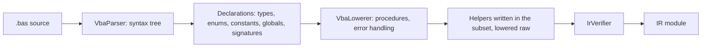

# The classic Visual Basic frontend

**Status:** implemented for the classic dialect of VB6 and VBA standard modules
([#1090](https://github.com/Hawkynt/Polypiler/issues/1090), with the classic parts of
[#1094](https://github.com/Hawkynt/Polypiler/issues/1094), [#1091](https://github.com/Hawkynt/Polypiler/issues/1091),
[#1092](https://github.com/Hawkynt/Polypiler/issues/1092), [#1093](https://github.com/Hawkynt/Polypiler/issues/1093) and
[#1095](https://github.com/Hawkynt/Polypiler/issues/1095)), its oracle LibreOffice Basic in VBA mode
([ADR 2600](../adr/2600-classic-visual-basic-oracle.md)). Related: [classic Visual Basic backend](VISUALBASIC-BACKEND.md) ·
[import differences](../reference/import-differences.md).

`polypiler translate <file>.bas --from visualbasic --to <target> --output <directory>` imports one
standard module; its name is the `Attribute VB_Name`, or the file name.

## Pipeline

## Parsing

`Polypiler.Core.Frontends.VisualBasic/Parsing/VbaParser.cs` is a lexer and recursive-descent parser
written from [MS-VBAL] sections 3 and 5: the grammars found (ANTLR `grammars-v4/vba`, Rubberduck) are
GPL-3.0, so none is used (ADR 2600). It reads keywords in any case, ` _` continuations, `:` between
statements, `'` and `Rem` comments, line labels and line numbers, type characters of names and literals
(`%`, `&`, `^`, `!`, `#`, `$`, `@`), `&H` and `&O` literals, single-line and block `If`, and the
operator precedence of 5.6.9. A syntax error is `PLY2645` with its line.

## Lowering

| Visual Basic | IR |
| --- | --- |
| `Boolean`, `Byte`, `Integer`, `Long`, `LongLong`, `Single`, `Double`, `String` | `bool`, `u8`, `i16`, `i32`, `i64`, `f32`, `f64`, string |
| `Type … End Type` | struct (no `String` or array fields, which the IR's records do not hold) |
| `Enum` | `Long` constants |
| `Const`, module variable | constant, global |
| array with its bounds | IR array from 0; the lower bound - declared, of the first `ReDim`, or `Option Base` - is subtracted from every index |
| `Function`/`Sub`, `ByVal`, `Optional … = d` | function; a parameter by reference that is not assigned is a value |
| `+ - *` on `Byte`/`Integer` | 32-bit arithmetic converted back with a trap |
| `+ - *` on `Long`/`LongLong` | checked arithmetic |
| `/`, `^`, floating-point `+ - *` | the IR's, checked by `PlyCheckD`/`PlyDivD`/`PlyPow`: error 6 for an infinite result, 11 for a zero divisor, 6 for 0/0 |
| `\`, `Mod` | operands rounded half to even to integers, then truncating division and remainder |
| `And`, `Or`, `Xor`, `Eqv`, `Imp`, `Not` | logical on two `Boolean`s, evaluating both operands; bitwise otherwise |
| `&` | concatenation; an integer as `CStr` writes it |
| `CInt`, `CLng`, `CByte`, implicit conversion | half to even, trapping outside the type |
| `For … Step` | the end and the step evaluated once; the counter's step traps after the last pass, as Visual Basic's does |
| `Select Case` | the value once, then an `If` chain over the clauses |
| `On Error GoTo h` with `h:` at the end | a try whose catch clauses set `Err.Number` and fall into the handler |
| `On Error Resume Next`, a handler that ends with `Resume Next` | a try around every following statement; an error in an `If` condition goes on inside its first branch |
| `Err.Number`, `Err.Clear`, `Err.Raise n`, `Error n` | the global `ErrNumber`; the throw of the class of 5, 6, 9, 11, 13 or 91 |

The built-in functions are lowered to helpers written in the subset itself and lowered with it (`PlyLeft`,
`PlyMid`, `PlyInStr`, …); a module carries those it calls.

## What is refused

`PLY2646` names `Variant`, `Currency`, `Date`, `Decimal`, `Object`, `LongPtr`, fixed-length strings,
class modules and `Property`, `Declare`, `Static`, `GoSub`/`Return`, `GoTo`, `With`, `For Each`, `Set`,
`ParamArray`, a parameter passed by reference and assigned, `Err.Raise` of another number, arrays of
`String` or `Boolean`, multidimensional arrays and the functions that depend on the locale (`CStr` of a
floating-point number, `Val`, `Format`, `UCase`). `PLY2648` is a name that names nothing or a type mismatch.
`Err` is not cleared when a procedure ends - documented by VBA, not done by LibreOffice (ADR 2600).
