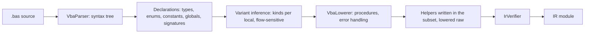

# The classic Visual Basic frontend

**Status:** implemented for the classic dialect of VB6 and VBA standard modules
([#1090](https://github.com/Hawkynt/Polypiler/issues/1090), with the classic parts of
[#1094](https://github.com/Hawkynt/Polypiler/issues/1094), [#1091](https://github.com/Hawkynt/Polypiler/issues/1091),
[#1092](https://github.com/Hawkynt/Polypiler/issues/1092), [#1093](https://github.com/Hawkynt/Polypiler/issues/1093) and
[#1095](https://github.com/Hawkynt/Polypiler/issues/1095)) and `Variant` ([#1556](https://github.com/Hawkynt/Polypiler/issues/1556)), its oracle LibreOffice Basic in VBA mode
([ADR 2600](../adr/2600-classic-visual-basic-oracle.md)). Related: [classic Visual Basic backend](VISUALBASIC-BACKEND.md) ·
[import differences](../reference/import-differences.md) · [variants](../reference/variants.md).

`polypiler translate <file>.bas --from visualbasic --to <target> --output <directory>` imports one
standard module; its name is the `Attribute VB_Name`, or the file name.

## Pipeline

## Parsing

`Polypiler.Core.Frontends.VisualBasic/Parsing/VbaParser.cs` is a lexer and recursive-descent parser
written from [MS-VBAL] sections 3 and 5: the grammars found (ANTLR `grammars-v4/vba`, Rubberduck) are
GPL-3.0, so none is used (ADR 2600). It reads keywords in any case, ` _` continuations, `:` between
statements, `'` and `Rem` comments, line labels and line numbers, type characters of names and literals
(`%`, `&`, `^`, `!`, `#`, `$`, `@`), `&H` and `&O` literals, single-line and block `If`, and the
operator precedence of 5.6.9. A syntax error is `PLY2645` with its line.

## Lowering

| Visual Basic | IR |
| --- | --- |
| `Boolean`, `Byte`, `Integer`, `Long`, `LongLong`, `Single`, `Double`, `String` | `bool`, `u8`, `i16`, `i32`, `i64`, `f32`, `f64`, string |
| `Type … End Type` | struct (no `String` or array fields, which the IR's records do not hold) |
| `Enum` | `Long` constants |
| `Const`, module variable | constant, global |
| array with its bounds | IR array from 0; the lower bound - declared, of the first `ReDim`, or `Option Base` - is subtracted from every index |
| `Function`/`Sub`, `ByVal`, `Optional … = d` | function; a parameter by reference that is not assigned is a value |
| `+ - *` on `Byte`/`Integer` | 32-bit arithmetic converted back with a trap |
| `+ - *` on `Long`/`LongLong` | checked arithmetic |
| `/`, `^`, floating-point `+ - *` | the IR's, checked by `PlyCheckD`/`PlyDivD`/`PlyPow`: error 6 for an infinite result, 11 for a zero divisor, 6 for 0/0 |
| `\`, `Mod` | operands rounded half to even to integers, then truncating division and remainder |
| `And`, `Or`, `Xor`, `Eqv`, `Imp`, `Not` | logical on two `Boolean`s, evaluating both operands; bitwise otherwise |
| `&` | concatenation; an integer as `CStr` writes it |
| `CInt`, `CLng`, `CByte`, implicit conversion | half to even, trapping outside the type |
| `For … Step` | the end and the step evaluated once; the counter's step traps after the last pass, as Visual Basic's does |
| `Select Case` | the value once, then an `If` chain over the clauses |
| `On Error GoTo h` with `h:` at the end | a try whose catch clauses set `Err.Number` and fall into the handler |
| `On Error Resume Next`, a handler that ends with `Resume Next` | a try around every following statement; an error in an `If` condition goes on inside its first branch |
| `Err.Number`, `Err.Clear`, `Err.Raise n`, `Error n` | the global `ErrNumber`; the throw of the class of 5, 6, 9, 11, 13, 91 or 94 (`InvalidOperationException`, "Invalid use of Null") |
| `Dim v`, `Dim v As Variant` of one kind, assigned before every read | a local of that type (below) |
| any other `Variant`, untyped or `As Variant` parameters, results and module variables | the dynamic type `variant` ([variants](../reference/variants.md)) |
| `Empty`, `Null`, `CVar` | `IrVariantOf` |
| `IsEmpty`, `IsNull`, `VarType`, `TypeName`, `IsNumeric` | the tag of a dynamic value; a constant for a typed one |

The built-in functions are lowered to helpers written in the subset itself and lowered with it (`PlyLeft`,
`PlyMid`, `PlyInStr`, …); a module carries those it calls.

## Variant

Every local declared without a type or `As Variant` is a candidate. The procedure is lowered with every
candidate dynamic, collecting the kinds - `Empty`, `Null`, `Boolean`, `Byte`, `Integer`, `Long`,
`LongLong`, `Single`, `Double`, `String` - each may hold, until they no longer grow. The kinds flow with
the statements: an assignment replaces what the local held, the branches of an `If` or a `Select Case`
join, a loop joins its head with the end of its body and every `Exit` until the head no longer grows,
an assignment under `On Error Resume Next` only adds (it may be skipped), and a handler starts with
whatever the code it guards may have assigned. A candidate whose assignments all have one scalar kind
and which is never read where it may still be `Empty` is lowered as a local of that type; the
lowering with the types given checks it, and a local assigned another type there, or read where it may
be `Empty`, is lowered again as a dynamic one. `TypeName`, `VarType`, `IsEmpty` and `IsNull` of such a
local are constants.

A local given a fixed type is still a `Variant` to its arithmetic: `+`, `-`, `*` and the negation of
one-kind integer, `Boolean` and `Double` operands are computed exactly as a `Double` - exact for the
integers, and for a result beyond `Long` the same rounding Visual Basic's promotion to `Double` gives
- and the value with the type it started in gives its tag when it is boxed (`PlyVarFromWide`). Every
other operation with a dynamic operand calls a helper written in the subset over the three operations
of the type (`PlyVarArith`, `PlyVarDiv`, `PlyVarIntDiv`, `PlyVarNeg`, `PlyVarPow`, `PlyVarConcat`,
`PlyVarCmp`, `PlyVarLogic`, `PlyVarIsTrue`, `PlyVarCStr`, `PlyVarDbl`, …):

| Operation | Visual Basic's rule, as the helpers compute it |
| --- | --- |
| `+ - *` | in the wider type ([MS-VBAL] 5.6.9.3); a result that overflows promotes `Byte` → `Integer` → `Long` → `Double`, `Single` → `Double`, instead of error 6; `Boolean` counts as `Integer` |
| `+` of two `String`s | concatenation |
| `Empty` | `Empty + x` is `x` unchanged, `Empty + Empty` `Integer 0`; elsewhere `Integer 0` or `""` |
| `Null` | propagates through every operator and comparison; `Null & Null` is `Null`, otherwise `&` reads it as `""` |
| `/`, `^` | a `Double` (a `Single` for `Single` with the narrow integers); 0/0 error 6, a zero divisor 11 |
| `\`, `Mod` | operands rounded half to even to integers; the result in the narrower type, promoted like `+` |
| `=`, `<`, … | numbers by value, strings by code unit, a number below a string, `Empty` as 0 or `""` |
| `And`, `Or`, `Xor`, `Not` | on `Boolean` and `Null`, three-valued: `Null And False` is `False`, `Null Or True` is `True` |
| a condition | `Null` and `Empty` are false |
| assignment to a typed variable, `CInt`, `CStr`, … | `Empty` is 0, `""` or `False`; `Null` raises error 94 |
| `For` over a counter | constant bounds whose last step still fits keep the counter in its type; otherwise the counter is dynamic and every step is `Variant` addition |

Parameters, results and module variables of `Variant` may hold anything: they stay dynamic. Two
operations depend on the locale, which the frontend does not model, and are refused where the kinds
say they can happen: the text of a `Single` or `Double` (`CStr`, `&`, assignment to a `String`), and a
`String` that meets a number (arithmetic, a comparison with a typed value, a typed conversion, a
condition, `IsNumeric`). So are the bitwise operators on integer `Variant`s, `Eqv` and `Imp`, a
`LongLong` in a dynamic `Variant`, a built-in function other than the conversions and the ones above
applied to a dynamic `Variant`, `Debug.Print` of one that may be `Null`, and `Variant` arrays and fields.

## What is refused

`PLY2646` names the `Variant` constructs above, `Currency`, `Date`, `Decimal`, `Object`, `LongPtr`, fixed-length strings,
class modules and `Property`, `Declare`, `Static`, `GoSub`/`Return`, `GoTo`, `With`, `For Each`, `Set`,
`ParamArray`, a parameter passed by reference and assigned, `Err.Raise` of another number, arrays of
`String` or `Boolean`, multidimensional arrays and the functions that depend on the locale (`CStr` of a
floating-point number, `Val`, `Format`, `UCase`). `PLY2648` is a name that names nothing or a type mismatch.
`Err` is not cleared when a procedure ends - documented by VBA, not done by LibreOffice (ADR 2600).
