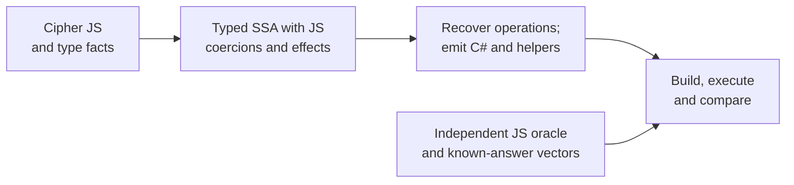
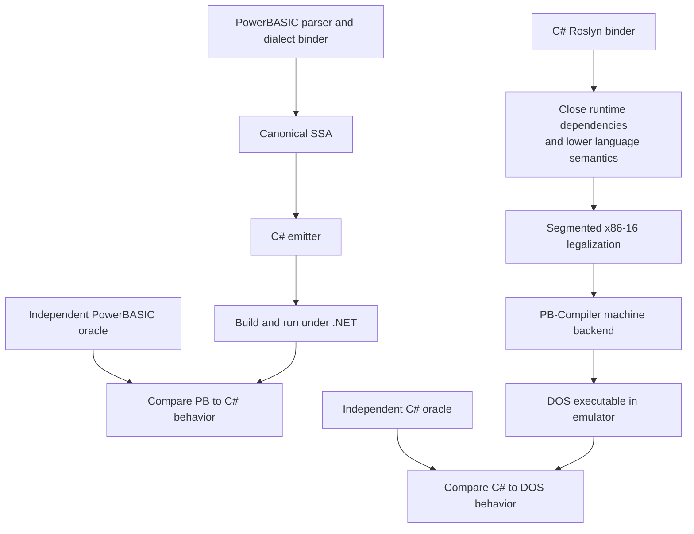
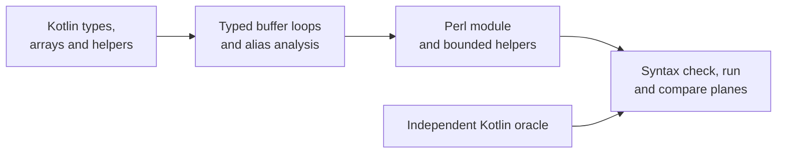
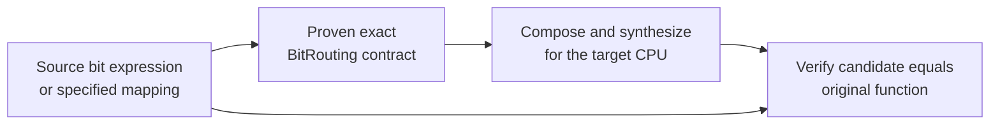
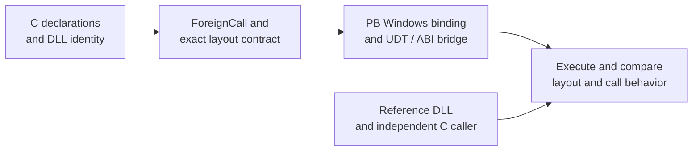
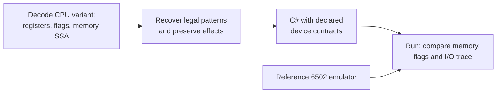

# Worked translation walks (acceptance scenarios)

**Status:** expected flows and fixtures, not currently runnable commands or test results. Refer to [PRD §6](../prd/03-behavior-and-testing.md#s6), [§11](../prd/04-roadmap-and-delivery.md#s11), [§14](../prd/04-roadmap-and-delivery.md#s14), [§22](../prd/06-recovery-acceptance-and-gates.md#s22), [§27](../prd/07-language-and-platform-integration.md#s27) and [§31](../prd/09-interop-acceptance-and-execution.md#s31).

Each walk describes a vertical slice: **real input → precise IR contract → target artifact → independent oracle**. Synthetic toy programs may bootstrap the compiler but must not replace the final upstream showcase.

## 1. Cipher JavaScript → C#

**Input:** a pinned executable Cipher algorithm and committed known-answer vectors.

Assertions: preserve 32-bit JS bitwise coercions, byte truncation and input/output shape; reject unsupported dynamic behavior rather than silently interpreting an arbitrary object as a byte array.

## 2. PowerBASIC → C# and C# → DOS

**Input:** a pinned PB numeric/bit routine and a C# equivalent or separately selected supported function.

Assertions: PB signedness, dialect-specific float/MBF behavior, address spaces, error handling and near/far pointers; generated C# runs under .NET, while DOS output runs in an emulator. These are two independent direction-specific gates.

## 3. Kotlin deinterlacer → Perl module

**Input:** [MediaDroyd Deinterlacer.kt](https://github.com/Hawkynt/MediaDroyd/blob/main/core/player/src/main/kotlin/com/hawkynt/mediadroyd/player/Deinterlacer.kt) and its existing reference tests, including license notices.

Start with a testable selected method; do not claim the entire file is supported until all reachable behaviors, methods and dependencies are verified. Preserve notices for derivatives.

## 4. BitPerm mapping → Rust / C# / 6502 and back

**Input:** a BitPerm routing specification or a pinned shift/mask/multiplication program.

Assertions: identity, reverse, duplicate, constants, inverse-only-for-bijections, carry-sensitive multiply counterexamples, cost budget and target instruction availability. Verify *actual integer multiplication*, not an OR-of-shifts approximation.

## 5. C DLL bindings → PowerBASIC for Windows

**Input:** C header, DLL identity evidence and a compiled reference DLL.

Assertions: symbol name, convention, parameter/return widths, struct size/offset/stride, callback and buffer effects. C `dllimport` alone does not supply a DLL filename. Do not mix Windows DLL imports with the DOS OMF target.

## 6. MOS 6502 routine → C#

**Input:** machine code, CPU variant, entry address, memory map and reference emulator.

An arbitrary external access is preserved or emulated with a declared device contract. Unknown hardware behavior requires an explicit error, not fabricated semantics.

## Common expected outputs

Each demonstration should include a versioned input fixture, command invocation, generated artifact, build log, source/target execution traces, proof/optimization decisions, dependency/license manifest, and a machine-readable **support tier**.

See [quality gates](../quality/VERIFICATION.md). Every CLI example in the repository README and PRD remains a *planned interface* until implemented.
