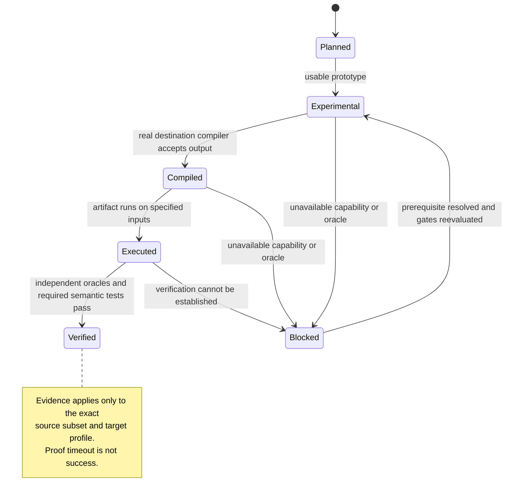

# Verification, diagnostics and release gates

**Status:** required quality strategy; no CI jobs or compiler behavior are claimed to exist yet. See [PRD §§6–7](../prd/03-behavior-and-testing.md), [§§22–24](../prd/06-recovery-acceptance-and-gates.md) and [§§31–33](../prd/09-interop-acceptance-and-execution.md).

A plausible generated source file is not evidence of successful transpilation. Polypiler should verify both the **semantic transformation** and the **actual artifact under its destination toolchain**.

## Evidence ladder

| State | Meaning | What must be recorded |
|---|---|---|
| planned | No usable implementation | Feature and milestone specification |
| experimental | Prototype exists | Known limitations and experimental tests |
| compiled | Generated output builds under the target compiler | Toolchain/version, logs and artifact hashes |
| executed | Destination artifact runs on test inputs | Inputs, outputs, exit status, effects |
| verified | Independent required oracles and semantic tests pass | Differential evidence, negative cases, proof assumptions |
| unsupported / blocked | Unsupported or not verifiable in chosen environment | Exact diagnostic and missing capability |

Do not elevate a language pair to "verified" because the parser completed, the file compiled, or a handful of sample inputs passed.

## Test pyramid

1. **IR/model tests:** type checks, verifier failures, SSA/control-flow validity, memory effects, exceptional edges.
2. **Analysis tests:** ranges, known/demanded bits, congruences, dominance, alias/lifetime, loop dependences.
3. **Transformation tests:** before/after equivalence, positive and negative pattern recognition, structural invalidation.
4. **Lowering tests:** target types, packing, ABI classification, runtime helpers, native instruction semantics.
5. **Compiler/toolchain tests:** compile every supported sample with the real target compiler.
6. **Differential execution:** source oracle versus destination artifact, including return values, mutation, errors and external effects.
7. **Metamorphic/property/fuzz tests:** bit-width boundaries, shapes, random inputs and minimized failures.
8. **Performance tests:** reproducible comparisons; correctness is not optional in speed modes.

Use NUnit and the repository's prescribed non-fluent assertions for the .NET test suites; target fixtures may use native toolchain test frameworks.

## Example BDD scenarios

**JavaScript fixed-width result**

    Given a pinned Cipher JavaScript algorithm and official vectors
    When it is translated to C# for .NET 9
    Then the generated C# builds under the specified toolchain
    And the outputs match the independent JavaScript execution
    And the manifest identifies all generated helpers and licenses

**Unknown external call**

    Given a method invoking an unrecognized foreign symbol
    When the target environment cannot invoke or emulate that symbol
    Then translation fails with a precise unresolved-dependency diagnostic
    And the operation is not dropped or replaced by an arbitrary value

**Unsafe rewrite**

    Given a multiply-based bit routing candidate with input-dependent carries
    When a solver cannot prove equivalence
    Then the rewrite is not applied
    And the original legal representation is preserved or target legalization fails

**Foreign packed record**

    Given a five-byte packed C record
    When the target's native UDT inserts three bytes of padding
    Then the foreign call does not receive that padded UDT as if compatible
    And the backend uses a verified packed representation or explicit ABI bridge

**Inline ASM and device effects**

    Given recognized arithmetic instructions interleaved with a volatile device write
    When equivalent arithmetic is recovered
    Then arithmetic may be optimized where independent
    And the device write's value and observable ordering are retained

## What the verifier compares

Return values are insufficient when behavior can also be observed through memory, pointer identity, IO ports, DLL calls, errors, cleanup, exceptions, scheduling, output file formats and CPU flags. Define the observation contract per test; for hardware-dependent software, specify whether cycle timing is part of it.

- Integer arithmetic: exact widths, signedness and overflow.
- Floating arithmetic: precision, rounding steps, NaNs, infinities, signed zero and exceptional modes.
- Memory: permitted accesses, bounds, layout, aliasing, lifetime and copies.
- Runtime: call traces, exceptions, handler state, deterministic cleanup.
- Foreign ABI: layout oracles and actual compiled-library calls.
- Bit manipulation: exhaustive inputs for small widths and SMT bitvector proofs for feasible larger widths.
- Binary lifting: emulator-oracle comparisons and explicit CPU variant profiles.

A proof timeout, an unsatisfied target capability or a missing reference toolchain means **no verified claim**.

## CI and PR requirements

- Documentation-only changes: link/structure review and consistency with the PRD; no fictitious build or test claims.
- Code changes: `dotnet build` and `dotnet test`, required coverage for service/logic code, toolchain-specific jobs and negative tests.
- Performance changes: reproducible benchmark methodology and correctness baseline.
- Every PR: summary, why, test evidence, limitations and at least one human reviewer before merge.
- No direct push to `main`; keep linear history and use branch protection where available.
- Publish generated packages only when authorized and their licenses/dependencies are verified.

## Operational rule

The compiler should emit a machine-readable report for every rejected or accepted transformation: source location, rule, preconditions, facts, proof outcome, target requirement and fallback. Unsupported is a **successful diagnostic outcome**, not a license to generate wrong code.

Related: [PRD and architecture index](../PRD.md#architecture-guides) · [pipeline](../architecture/PIPELINE.md) · [IR](../architecture/IR.md) · [walkthroughs](../architecture/WALKTHROUGHS.md).
